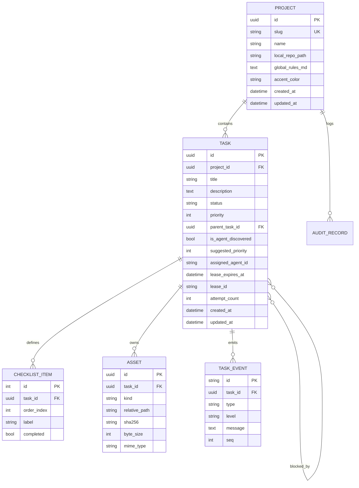

# Doc 01 — System Architecture & Data Contracts

> **Series position:** 01 of 10 · **Owner:** Subagent 1 (Lead Architect)
> **Authority:** This document is the **single immutable source of truth** for every schema, identifier, path, port, and enum in ATLAS-MCP.
> **Parent:** [`master_implementation_plan.md`](./master_implementation_plan.md) — this document may only *refine* it, never contradict it.
> **Change control:** Any alteration to a frozen contract requires a `CONTRACT-CHANGE` note appended to §22 and a version bump of `contract_version`.

---

## 1. Scope & Purpose

Doc 01 defines the shared language of the platform so that ten isolated subagents can build ten isolated slices of the system without merge conflicts or interface drift. It answers, for every component:

| Question | Answered in |
| :--- | :--- |
| How do processes talk to each other, on which ports, in which direction? | §2, §3 |
| Where does every file live on disk? | §4, §5 |
| What is the exact shape of every field in the database? | §6 |
| What is the exact JSON on the wire? | §7, §8 |
| What are the MCP tool contracts? | §9 |
| What are the state transitions and their guards? | §10 |
| What breaks concurrency and how is it prevented? | §11 |
| How is the system configured and secured? | §13, §14 |
| What do frontend subagents mock while backend is being built? | §16 |

### 1.1 Non-goals (explicitly out of scope for v1)

1. Multi-tenant authentication, organizations, or RBAC beyond a single-architect local operator.
2. Remote agents connecting over the public internet (agents are assumed co-located with the host filesystem).
3. Automatic merging to `main` — the review gate is human-final by design (Master §6.3).
4. Cloud object storage for artifacts — the local filesystem is ground truth (Master §3).
5. Streaming raw image bytes through MCP — forbidden by the Token Conservation Engine (Master §4.1).

### 1.2 Contract version

```
CONTRACT_VERSION = "1.0.0"
```

All DTO examples in the series must declare `"contract_version": "1.0.0"` where a version is present.

---

## 2. System Context & Topology

```
┌──────────────────────────────────────────────────────────────────────────────┐
│                            HUMAN ARCHITECT (Browser)                         │
└───────────────────────────────┬──────────────────────────────────────────────┘
                                │ HTTPS/SSE  →  http://127.0.0.1:3471
                                ▼
┌──────────────────────────────────────────────────────────────────────────────┐
│               FRONTEND — Next.js 15 App Router (Node runtime)                │
│  Browser ⇄ same-origin /api/v1/*  ⇄ (Next rewrite, injects Bearer token)     │
└───────────────────────────────┬──────────────────────────────────────────────┘
                                │ HTTP + SSE  →  http://127.0.0.1:8471
                                ▼
┌──────────────────────────────────────────────────────────────────────────────┐
│           ORCHESTRATION ENGINE — Django 5 (ASGI via uvicorn/daphne)          │
│   /api/v1/*        → human + web contracts      (Doc 04, Doc 09)             │
│   /internal/v1/*   → agent RPC contract         (Doc 04 internal routers)    │
│   SQLite WAL  +  storage/ file router           (Doc 02, Doc 03)             │
└───────────────────────────────┬──────────────────────────────────────────────┘
                                │ HTTP (localhost, JSON)  ←  NOT stdio
                                ▼
┌──────────────────────────────────────────────────────────────────────────────┐
│                    ATLAS MCP SERVER — FastMCP (Python, stdio transport)      │
│   Exposes tools to the agent CLI over stdio; every tool body is a thin       │
│   adapter that calls Django /internal/v1/* and projects a trimmed payload.   │
└───────────────────────────────┬──────────────────────────────────────────────┘
                                │ MCP stdio (one process per agent session)
                                ▼
┌──────────────────────────────────────────────────────────────────────────────┐
│         AGENT CLI INSTANCES (Claude Code / Copilot CLI) per project          │
└──────────────────────────────────────────────────────────────────────────────┘
```

### 2.1 Transport decisions (frozen)

| Link | Transport | Rationale |
| :--- | :--- | :--- |
| Browser ⇄ Next.js | HTTPS + `EventSource` for SSE | Only public surface. |
| Next.js ⇄ Django | HTTP JSON + SSE, loopback only | Next server-side rewrite injects the bearer token; browser never sees it. |
| MCP server ⇄ Django | HTTP JSON, loopback only | MCP tools are stateless adapters; all state lives in Django. |
| Agent CLI ⇄ MCP server | MCP over **stdio** | One MCP process per agent session; no shared mutable state. |
| Django ⇄ SQLite | `sqlite3` WAL | Master §5.1. |
| Django ⇄ filesystem | Atomic `os.replace` + `os.fsync` | Master §5.3. |

### 2.2 Process inventory

| Process | Command | Port | Owner doc |
| :--- | :--- | :--- | :--- |
| Backend API | `python backend/manage.py runserver 127.0.0.1:8471` (or `uvicorn atlas.asgi:application --port 8471`) | 8471 | 02, 03, 04, 09 |
| Frontend | `npm --prefix frontend run dev` | 3471 | 05, 06, 07, 09 |
| MCP server | `python -m mcp_server` (stdio) | — | 08 |
| Mock agent runner | `python scripts/run_mock_agent.py --project alpha` | — | 10 |

---

## 3. Technology Baseline

| Layer | Choice | Version floor | Notes |
| :--- | :--- | :--- | :--- |
| Python | CPython | 3.11+ | `tomllib`, `zoneinfo`, `match` available. |
| Web framework | Django | 5.0 | ASGI-capable, `StreamingHttpResponse` for SSE. |
| API layer | Django REST Framework | 3.15 | Serializers + routers; no GraphQL. |
| DB | SQLite | 3.40+ | WAL, `synchronous=NORMAL`, `busy_timeout=5000`. |
| MCP | `mcp` Python SDK (FastMCP) | 1.x | stdio transport. |
| HTTP client (MCP) | `httpx` | 0.27+ | Sync client, 10s default timeout. |
| Frontend | Next.js App Router | 15.x | React 19, server components for shell, client for live panes. |
| Styling | Tailwind CSS | v4 | CSS-first `@theme` tokens (Doc 05). |
| State | Zustand + TanStack Query | 5.x / 5.x | Query for server state, Zustand for ephemeral HUD state (Doc 06). |
| Charts | Custom SVG scatter (no heavy chart lib) | — | Priority matrix must stay < 20 kB JS (Doc 06). |
| Testing (py) | pytest + pytest-django + `httpx` TestClient | — | Doc 10. |
| Testing (js) | Vitest + Playwright | — | Doc 10. |
| Formatting | `ruff format` / `eslint` + `prettier` | — | Enforced by Doc 10 CI script. |

**Dependency rule:** each doc lists its own additions; no doc may introduce a second state manager, a second HTTP client, or a second CSS system.

---

## 4. Monorepo Folder Topology & Path Ownership

The repository is a polyglot monorepo. Directories are the primary conflict-prevention boundary (Master §11).

```
ATLAS-MCP/
├── plan-series/                      # Doc 01–10 + README (this series)
├── backend/
│   ├── manage.py
│   ├── pyproject.toml
│   ├── atlas/                        # Django project package
│   │   ├── __init__.py
│   │   ├── settings/
│   │   │   ├── base.py               # shared settings, DB WAL, apps
│   │   │   ├── dev.py                # DEBUG, permissive CORS on loopback
│   │   │   └── prod.py               # token enforced, no DEBUG
│   │   ├── urls.py                   # mounts api.v1 + api.internal
│   │   ├── asgi.py
│   │   └── wsgi.py
│   ├── core/                         # domain layer (Doc 02, Doc 03)
│   │   ├── apps.py                   # ready() → recovery watchdog hook
│   │   ├── models/
│   │   │   ├── project.py
│   │   │   ├── task.py
│   │   │   ├── checklist.py
│   │   │   ├── asset.py
│   │   │   ├── event.py
│   │   │   └── enums.py              # TextChoices mirrors of §6.2
│   │   ├── migrations/
│   │   ├── storage.py                # UUID folder router + atomic writes
│   │   ├── leases.py                 # claim / heartbeat / release
│   │   ├── recovery.py               # boot janitor + WAL integrity
│   │   ├── events.py                 # in-process pub/sub → SSE fan-out
│   │   ├── audit.py                  # project_audit.log JSONL appender
│   │   └── services/
│   │       ├── tasks.py              # transition guards (pure functions)
│   │       ├── discoveries.py
│   │       ├── reviews.py
│   │       └── telemetry.py
│   ├── api/                          # HTTP surface (Doc 04, Doc 09)
│   │   ├── common/
│   │   │   ├── auth.py
│   │   │   ├── errors.py
│   │   │   ├── pagination.py
│   │   │   └── renderers.py
│   │   ├── v1/
│   │   │   ├── urls.py
│   │   │   ├── views/{projects,tasks,discoveries,reviews,assets,telemetry,matrix}.py
│   │   │   └── serializers/{project,task,checklist,asset,discovery,review,telemetry}.py
│   │   ├── internal/
│   │   │   ├── urls.py
│   │   │   ├── views/{claim,heartbeat,submit,propose,log,dod,subtask,detail}.py
│   │   │   └── serializers.py
│   │   └── sse.py                    # streaming generators (Doc 09)
│   └── data/                         # gitignored: atlas.db, atlas.db-wal
├── frontend/
│   ├── package.json
│   ├── next.config.ts                # /api/v1/* rewrite → 127.0.0.1:8471
│   ├── tailwind.config.ts
│   ├── app/
│   │   ├── layout.tsx
│   │   ├── page.tsx                  # command center root
│   │   ├── projects/[slug]/page.tsx
│   │   ├── projects/[slug]/tasks/[taskId]/page.tsx
│   │   └── discoveries/page.tsx
│   ├── components/
│   │   ├── ui/                       # primitives (Doc 05)
│   │   ├── hud/                      # shell chrome (Doc 05/06)
│   │   ├── board/                    # split workspaces (Doc 06)
│   │   ├── matrix/                   # priority scatter (Doc 06)
│   │   ├── tasks/                    # task cards, DoD gauges (Doc 06)
│   │   ├── discoveries/              # triage inbox (Doc 06)
│   │   ├── terminal/                 # live log stream (Doc 09)
│   │   └── canvas/                   # annotation engine (Doc 07)
│   ├── hooks/                        # keyboard, sse, query hooks (Doc 06/09)
│   ├── lib/
│   │   ├── api/                      # typed fetch client
│   │   ├── types/                    # generated from §7 by hand (frozen)
│   │   ├── mocks/                    # §16 fixture pack
│   │   └── format/                   # duration, percent, path helpers
│   └── styles/
│       ├── tokens.css                # @theme design tokens (Doc 05)
│       └── globals.css
├── mcp_server/                       # Doc 08
│   ├── __main__.py
│   ├── server.py
│   ├── config.py
│   ├── client.py                     # httpx adapter to /internal/v1
│   ├── projections.py                # token trimming (§9.6)
│   ├── paths.py                      # absolute path normalizer
│   ├── errors.py
│   ├── tools/{claim,propose,submit,progress,heartbeat,dod,subtask,detail}.py
│   └── schemas/{claim,propose,submit,progress}.py
├── storage/                          # gitignored runtime artifacts (Master §3)
│   └── projects/{project_uuid}/…
├── tests/
│   ├── unit/                         # core services, guards
│   ├── integration/                  # api + db
│   └── e2e/                          # multi-agent + crash sim (Doc 10)
└── scripts/
    ├── bootstrap_dev.py
    ├── run_mock_agent.py
    ├── simulate_power_cut.py
    └── verify_series.py
```

### 4.1 Path ownership matrix (hard rule)

| Path prefix | Owner doc | Other docs may… |
| :--- | :--- | :--- |
| `backend/atlas/` | 01 (skeleton), 02 (apps/migrations wiring) | read only |
| `backend/core/` | 02, 03 | read only |
| `backend/api/` | 04 (internal + v1), 09 (`api/sse.py`) | 09 touches **only** `sse.py` |
| `frontend/styles/`, `tailwind.config.ts`, `components/ui/` | 05 | import only |
| `frontend/app/`, `components/{board,matrix,tasks,discoveries,hud}/`, `hooks/`, `lib/{api,types,format}` | 06 | import only |
| `frontend/components/canvas/`, `frontend/lib/canvas/` | 07 | import only |
| `frontend/components/terminal/`, `frontend/lib/sse/` | 09 | import only |
| `mcp_server/` | 08 | read only |
| `tests/e2e/`, `scripts/` | 10 | read only |

**Rule:** a doc may *create* files only under its own prefixes. Cross-prefix needs are satisfied by importing the frozen contract from `frontend/lib/types` or by calling a documented HTTP endpoint.

---

## 5. Identifier, Naming & Path Conventions

| Item | Rule | Example |
| :--- | :--- | :--- |
| Project UUID | UUIDv4, generated once at creation, immutable, used as folder name | `b3f1c0a4-7d21-4a6e-9f5c-2a1e8d6f0c11` |
| Project slug | `^[a-z][a-z0-9-]{1,31}$`, unique, immutable after creation | `alpha`, `client-web` |
| Task UUID | UUIDv4 string, primary key | `5f2d…` |
| Checklist item id | Positive integer, unique **within** a task, assigned `1..n` in creation order | `1`, `2`, `3` |
| Asset id | UUIDv4 | — |
| Event id | ULID string (`evt_` prefix) — sortable, used as SSE `id` | `evt_01JA2Y…` |
| Lease id | ULID string (`lea_` prefix) | `lea_01JA2Y…` |
| Timestamps | ISO-8601 with offset, millisecond precision, **UTC `Z`** on the wire | `2026-10-27T08:10:11.297Z` |
| Durations | Integer seconds, field suffixed `_seconds` | `lease_ttl_seconds: 900` |
| JSON casing | `snake_case` everywhere (DB, REST, MCP, SSE) | `local_repo_path` |
| File paths in JSON | Absolute, **native** separators via `str(Path(p).resolve())`; never assume POSIX | `E:\…\storage\projects\…\input\raw_screenshot_01.png` |
| Storage-relative paths in DB | POSIX-style, relative to `storage/` root | `projects/{uuid}/tasks/{uuid}/output/git_patch.patch` |
| Feature flags | `ATLAS_FEATURE_*` env, booleans `0|1` | `ATLAS_FEATURE_SOUND=1` |

**Dual-path rule:** the database always stores the portable relative path (`Asset.relative_path`); absolute paths are *derived at response time* by joining `ATLAS_STORAGE_ROOT`. This keeps the DB valid if the repo moves.

---

## 6. Canonical Data Model

### 6.1 Entity relationship



### 6.2 Enumerations (frozen)

```python
# backend/core/models/enums.py — mirrors of wire values; wire == DB value (no translation layer)
class TaskStatus(models.TextChoices):
    PENDING_APPROVAL = "PENDING_APPROVAL"   # agent-discovered, hidden from claim queue
    PENDING          = "PENDING"            # claimable
    IN_PROGRESS      = "IN_PROGRESS"        # leased
    IN_REVIEW        = "IN_REVIEW"          # patch submitted, awaiting human
    COMPLETED        = "COMPLETED"          # human signed off
    REJECTED         = "REJECTED"           # dismissed discovery / abandoned task

class LogLevel(models.TextChoices):
    DEBUG = "DEBUG"; INFO = "INFO"; WARN = "WARN"; ERROR = "ERROR"

class AssetKind(models.TextChoices):
    INPUT_SCREENSHOT  = "INPUT_SCREENSHOT"
    ANNOTATED_CANVAS  = "ANNOTATED_CANVAS"
    USER_CONTEXT      = "USER_CONTEXT"
    OUTPUT_PATCH      = "OUTPUT_PATCH"
    VERIFICATION_IMAGE= "VERIFICATION_IMAGE"
    TEST_LOG          = "TEST_LOG"

class AssetSource(models.TextChoices):
    HUMAN = "HUMAN"; AGENT = "AGENT"; SYSTEM = "SYSTEM"

class EventType(models.TextChoices):
    TASK_CREATED         = "task.created"
    TASK_UPDATED         = "task.updated"
    TASK_STATUS_CHANGED  = "task.status_changed"
    TASK_PRIORITY_CHANGED= "task.priority_changed"
    TASK_DOD_UPDATED     = "task.dod_updated"
    TASK_LOG             = "task.log"
    TASK_LEASE_EXPIRED   = "task.lease_expired"
    TASK_SUBMITTED       = "task.submitted"
    REVIEW_APPROVED      = "review.approved"
    REVIEW_REJECTED      = "review.rejected"
    DISCOVERY_CREATED    = "discovery.created"
    DISCOVERY_APPROVED   = "discovery.approved"
    DISCOVERY_REJECTED   = "discovery.rejected"
    AGENT_CONNECTED      = "agent.connected"
    AGENT_HEARTBEAT      = "agent.heartbeat"
    SYSTEM_BOOT          = "system.boot"
    SYSTEM_RECOVERY      = "system.recovery"
    TELEMETRY_TICK       = "telemetry.tick"
```

**Frozen decision:** `REJECTED` is terminal and reserved for (a) dismissed discoveries and (b) tasks the architect explicitly abandons. A failed *review* returns the task to `PENDING` (rework), it is **not** `REJECTED`.

### 6.3 `Project` (table `core_project`)

| Field | Type | Constraints | Doc-04 exposure |
| :--- | :--- | :--- | :--- |
| `id` | UUID | PK | `id` |
| `slug` | varchar(32) | unique, immutable, regex §5 | `slug` |
| `name` | varchar(120) | required | `name` |
| `local_repo_path` | varchar(1024) | required, absolute, **not** validated for existence at write time (archived machines) | `local_repo_path` |
| `global_rules_md` | text | default `""`, injected into `claim_next_task.project_rules` (trimmed, §9.6) | `global_rules_md` |
| `accent_color` | varchar(7) | hex, default `#00F2FE` | `accent_color` |
| `archived_at` | datetime | null | `archived_at` |
| `created_at` / `updated_at` | datetime | auto | same |

### 6.4 `Task` (table `core_task`)

| Field | Type | Constraints | Notes |
| :--- | :--- | :--- | :--- |
| `id` | UUID | PK | |
| `project_id` | FK Project | `on_delete=CASCADE`, indexed with `status` + `priority` | composite index `(project_id, status, priority DESC, created_at ASC)` |
| `title` | varchar(200) | required | |
| `description` | text | required | Markdown allowed |
| `status` | varchar(20) | enum §6.2, default `PENDING` | indexed |
| `priority` | smallint | `0..100`, default `50` | CHECK constraint; indexed |
| `parent_task_id` | FK Task null | `on_delete=SET_NULL` | subtask linkage |
| `blocked_by` | M2M Task (self) | symmetrical **false**, DAG enforced in service layer | `related_name="blocks"` |
| `is_agent_discovered` | bool | default `False` | |
| `discovered_during_task_id` | FK Task null | `SET_NULL` | provenance |
| `discovery_reason` | text | default `""` | why the agent proposed it |
| `suggested_priority` | smallint null | `0..100` | preserved after approval for audit |
| `discovered_by_agent` | varchar(120) | default `""` | `agent_identifier` |
| `assigned_agent_id` | varchar(120) | null | set on claim, retained after submit |
| `lease_id` | varchar(32) | null (`lea_` ULID) | null iff not `IN_PROGRESS` |
| `lease_expires_at` | datetime | null | the agent's **completion estimate**, not a cutoff — §11 |
| `lease_overdue_at` | datetime | null | set when the estimate passes; cleared by the next heartbeat |
| `last_heartbeat_at` | datetime | null | |
| `claimed_at` | datetime | null | |
| `submitted_at` | datetime | null | |
| `completed_at` | datetime | null | |
| `review_summary` | text | default `""` | agent summary on submit |
| `review_notes` | text | default `""` | human rework notes on reject |
| `attempt_count` | smallint | default `0` | incremented on each claim |
| `created_at` / `updated_at` | datetime | auto | |

**Invariant:** `status == IN_PROGRESS` ⟺ `lease_id IS NOT NULL AND lease_expires_at IS NOT NULL`.

### 6.5 `ChecklistItem` (table `core_checklistitem`)

| Field | Type | Constraints |
| :--- | :--- | :--- |
| `id` | int | PK (auto) — wire id is the per-task `order_index`, see note |
| `task_id` | FK Task | `on_delete=CASCADE`, `related_name="checklist"` |
| `order_index` | smallint | unique per task, `>= 1` |
| `label` | varchar(200) | required |
| `completed` | bool | default `False` |
| `completed_at` | datetime | null |
| `completed_by_agent` | varchar(120) | null |

> **Wire identity:** MCP and REST expose `ChecklistItem.order_index` as the field `id` (master §9.1 requires `"id": integer`). Serializers must map `order_index → id`. Re-ordering within a task is forbidden in v1 to keep ids stable.

### 6.6 `Asset` (table `core_asset`)

| Field | Type | Constraints |
| :--- | :--- | :--- |
| `id` | UUID | PK |
| `task_id` | FK Task | `on_delete=CASCADE`, `related_name="assets"` |
| `kind` | varchar(24) | enum §6.2 |
| `relative_path` | varchar(1024) | unique; POSIX-style, relative to `storage/` |
| `filename` | varchar(255) | `input/…`, `output/…` basename |
| `mime_type` | varchar(120) | |
| `byte_size` | bigint | |
| `sha256` | char(64) | dedupe + integrity |
| `source` | varchar(8) | enum §6.2 |
| `created_at` | datetime | auto |

### 6.7 `TaskEvent` (table `core_taskevent`)

| Field | Type | Constraints |
| :--- | :--- | :--- |
| `id` | varchar(32) | PK (`evt_` ULID) |
| `task_id` | FK Task null | `SET_NULL`; null for project/system events |
| `project_id` | FK Project | indexed |
| `seq` | bigint | monotonic **per project**, assigned in `transaction.atomic()` |
| `type` | varchar(32) | enum §6.2 |
| `level` | varchar(8) | enum §6.2, default `INFO` |
| `message` | text | |
| `payload` | JSON | small, ≤ 2 kB; never image data |
| `created_at` | datetime | auto, indexed |

**Retention:** `TaskEvent` rows older than 30 days are pruned by the boot janitor; `execution.log` on disk is the durable record.

### 6.8 Audit log record (`project_audit.log`, JSONL, append-only)

```json
{"ts":"2026-10-27T08:10:11.297Z","project_slug":"alpha","event":"LEASE_RECLAIMED","task_id":"5f2d…","actor":"system","detail":{"previous_lease":"lea_01JA2Y…","expired_at":"2026-10-27T08:05:00.000Z"}}
```

Allowed `event` values: `PROJECT_CREATED`, `TASK_CREATED`, `TASK_STATUS`, `TASK_PRIORITY`, `DOD_TOGGLE`, `LEASE_GRANTED`, `LEASE_RENEWED`, `LEASE_RECLAIMED`, `SUBMITTED`, `REVIEW_APPROVED`, `REVIEW_REJECTED`, `DISCOVERY_PROPOSED`, `DISCOVERY_APPROVED`, `DISCOVERY_REJECTED`, `SUBTASK_SPAWNED`, `SYSTEM_BOOT`, `SYSTEM_CRASH_DETECTED`, `FILE_WRITE_FAILED`.

### 6.9 Derived / computed fields (never stored)

| Field | Formula |
| :--- | :--- |
| `dod_progress_percent` | `round(completed_items / total_items * 100)`, `0` when no items |
| `age_hours` | `(now - created_at) / 3600`, 2 dp |
| `is_blocked` | `blocked_by` contains a task that is not `COMPLETED` **and** whose `dod_progress_percent < 100` |
| `dependency_weight` | `count(blocked_by) + 0.5 * count(children not COMPLETED)` |
| `lease_seconds_remaining` | `max(0, lease_expires_at - now)` |
| `is_overdue` | `status == IN_PROGRESS and lease_overdue_at IS NOT NULL` |
| `lease_seconds_overdue` | `max(0, now - lease_expires_at)`, else `0` |
| `project_health_percent` | `round(completed / (completed + pending + in_progress + in_review) * 100)`; `0` if denominator `0` |

---

## 7. JSON Wire Contracts (REST + SSE)

### 7.1 Global conventions

* Content type `application/json; charset=utf-8`.
* Object keys `snake_case`; absent optional values are `null`, never omitted (stable shapes for the frontend).
* Lists are wrapped: `{"items": [...], "next_cursor": null}`.
* Cursor pagination: opaque base64 of `(created_at, id)`; page size default 50, max 200.
* Every response may include `"contract_version": "1.0.0"`.
* Errors use the envelope in §7.8.

### 7.2 `ProjectDTO`

```json
{
  "contract_version": "1.0.0",
  "id": "b3f1c0a4-7d21-4a6e-9f5c-2a1e8d6f0c11",
  "slug": "alpha",
  "name": "Alpha Backend",
  "local_repo_path": "E:\\dev\\alpha",
  "accent_color": "#00F2FE",
  "global_rules_md": "Use pnpm. Tests: pytest -q.",
  "archived_at": null,
  "created_at": "2026-10-20T04:00:00.000Z",
  "updated_at": "2026-10-26T11:20:00.000Z",
  "counters": {
    "pending": 8, "in_progress": 1, "in_review": 2,
    "completed": 34, "pending_approval": 1,
    "health_percent": 76
  },
  "active_agent_id": "Agent-Claude",
  "last_event_at": "2026-10-27T08:09:55.120Z"
}
```

### 7.3 `TaskSummaryDTO` (list/board/matrix rows — token-budgeted)

```json
{
  "id": "5f2d6c1e-1f0b-4c5b-9a2e-77d0d2f3c901",
  "project_slug": "alpha",
  "title": "Fix JWT expiry race condition",
  "status": "IN_PROGRESS",
  "priority": 95,
  "dod_progress_percent": 66,
  "is_agent_discovered": false,
  "is_blocked": false,
  "parent_task_id": null,
  "age_hours": 27.4,
  "dependency_weight": 1.5,
  "assigned_agent_id": "Agent-Claude",
  "lease_seconds_remaining": 612,
  "is_overdue": false,
  "lease_seconds_overdue": 0,
  "created_at": "2026-10-26T04:40:00.000Z",
  "updated_at": "2026-10-27T08:05:00.000Z"
}
```

### 7.4 `TaskDetailDTO` (single task view — superset of summary)

Adds:

```json
{
  "description": "…markdown…",
  "definition_of_done": [
    { "id": 1, "label": "Repro test written", "completed": true,  "completed_at": "2026-10-27T07:00:00.000Z" },
    { "id": 2, "label": "Mutex guard added",  "completed": true,  "completed_at": "2026-10-27T07:40:00.000Z" },
    { "id": 3, "label": "Migrations added",   "completed": false, "completed_at": null }
  ],
  "blocked_by": ["9a1c…"],
  "blocks": ["77ba…"],
  "child_task_ids": ["1c9d…"],
  "discovered_during_task_id": null,
  "discovery_reason": "",
  "suggested_priority": null,
  "review_summary": "",
  "review_notes": "",
  "attempt_count": 1,
  "assets": [
    {
      "id": "0c7b…",
      "kind": "ANNOTATED_CANVAS",
      "filename": "annotated_canvas.png",
      "mime_type": "image/png",
      "byte_size": 184320,
      "source": "HUMAN",
      "absolute_path": "E:\\My_GitHub_Repos\\ATLAS-MCP\\storage\\projects\\…\\input\\annotated_canvas.png",
      "url": "/api/v1/assets/0c7b…/content",
      "created_at": "2026-10-26T05:02:00.000Z"
    }
  ],
  "recent_events": [ "/* ≤ 50 TaskEventDTO, oldest→newest */" ]
}
```

### 7.5 `TaskEventDTO` (identical shape to SSE envelope, §7.9)

### 7.6 `DiscoveryDTO`

```json
{
  "task_id": "8c14…",
  "project_slug": "alpha",
  "title": "Migrate auth middleware to Node 22 API",
  "description": "…",
  "status": "PENDING_APPROVAL",
  "suggested_priority": 85,
  "priority": 85,
  "discovered_during_task_id": "5f2d6c1e-…",
  "discovered_by_agent": "Agent-Claude",
  "discovery_reason": "Deprecation warning observed during Task #104 test run",
  "assets": [
    {
      "id": "3d91…",
      "kind": "VERIFICATION_IMAGE",
      "filename": "verification_depr_warning.png",
      "mime_type": "image/png",
      "byte_size": 41270,
      "source": "AGENT",
      "absolute_path": "E:\\…\\storage\\projects\\…\\output\\verification_depr_warning.png",
      "url": "/api/v1/assets/3d91…/content",
      "created_at": "2026-10-27T07:55:00.000Z"
    }
  ],
  "screenshot_absolute_paths": ["E:\\…\\output\\verification_depr_warning.png"],
  "created_at": "2026-10-27T07:55:00.000Z"
}
```

**Why `assets[]` is carried:** `absolute_path` is unusable in a browser (a host path cannot be rendered), so the triage inbox needs the same `url` field that `TaskDetailDTO.assets[]` exposes. `screenshot_absolute_paths` is retained for agents and is the *derived* convenience view of `assets[].absolute_path`; both must describe the same set. A discovery with zero screenshots returns `"assets": []` and `"screenshot_absolute_paths": []` (never `null`).

### 7.7 `PriorityMatrixPointDTO` & `TelemetrySummaryDTO`

```json
{
  "points": [
    {
      "task_id": "5f2d…", "title": "Fix JWT expiry race condition",
      "project_slug": "alpha", "status": "IN_PROGRESS",
      "priority": 95, "age_hours": 27.4, "dependency_weight": 1.5,
      "is_blocked": false, "is_agent_discovered": false, "dod_progress_percent": 66
    }
  ],
  "axes": { "x": "age_hours", "x_alternate": "dependency_weight", "y": "priority", "y_max": 100 }
}
```

```json
{
  "projects": [
    { "slug": "alpha", "health_percent": 76, "active_agent_id": "Agent-Claude", "in_progress": 1 },
    { "slug": "beta",  "health_percent": 41, "active_agent_id": "Agent-Copilot", "in_progress": 1 }
  ],
  "tasks_by_status": { "PENDING_APPROVAL": 1, "PENDING": 8, "IN_PROGRESS": 2, "IN_REVIEW": 2, "COMPLETED": 34, "REJECTED": 0 },
  "discoveries_pending": 1,
  "oldest_pending_age_hours": 51.2,
  "leases_expiring_within_5m": 0,
  "leases_overdue": 0,
  "throughput_last_24h": 6,
  "generated_at": "2026-10-27T08:10:11.297Z"
}
```

### 7.8 Error envelope (all REST + SSE `error` events)

```json
{
  "error": {
    "code": "STALE_LEASE",
    "message": "Task 5f2d… is leased by Agent-Claude until 2026-10-27T08:25:00Z.",
    "retryable": false,
    "detail": { "task_id": "5f2d…", "assigned_agent_id": "Agent-Claude", "current_lease_id": "lea_01JA2Y…" },
    "request_id": "req_01JA2Y…"
  }
}
```

HTTP status map: `VALIDATION_ERROR→400`, `AUTH_*→401/403`, `*_NOT_FOUND→404`, `*_CONFLICT|TASK_ALREADY_LEASED|STALE_LEASE|INVALID_TRANSITION|DEPENDENCY_CYCLE|DEPENDENCY_UNSATISFIABLE→409`, `PAYLOAD_TOO_LARGE→413`, `PAYLOAD_TOO_SCOPE→400`, `RATE_LIMITED→429`, `INTERNAL_ERROR→500`, `STORAGE_WRITE_FAILED→507`.

### 7.9 SSE envelope (single shape for all channels)

```
id: evt_01JA2Y7Q0K3M9V2T
event: task.log
data: {"id":"evt_01JA2Y7Q0K3M9V2T","seq":142,"type":"task.log","level":"INFO","project_slug":"alpha","task_id":"5f2d…","message":"running: pytest tests/auth/ -k race","payload":{"source":"mcp"},"ts":"2026-10-27T08:10:11.297Z"}
```

Rules: `event:` mirrors `data.type`; `id:` is the ULID (enables `Last-Event-ID` replay); every 15 s a comment frame `: ping` is sent; server sets `Cache-Control: no-cache`, `X-Accel-Buffering: no`, `Connection: keep-alive`.

---

## 8. State Machine & Transition Guards

```
PENDING_APPROVAL ──approve──▶ PENDING ──claim──▶ IN_PROGRESS ──submit──▶ IN_REVIEW ──sign_off──▶ COMPLETED
       │                        ▲   ▲                                        │
       └──reject──▶ REJECTED    │   └────────────reject (rework)────────────┘
                                │
                       lease_expired / force_release
```

| # | From | Action | To | Guard (all must hold) | Side effects |
| :--- | :--- | :--- | :--- | :--- | :--- |
| T1 | — | `create_task` (human) | `PENDING` | valid project, title/description non-empty, priority `0..100`, `blocked_by` acyclic | folder scaffold, `task.created`, audit |
| T2 | — | `propose_task` (agent) | `PENDING_APPROVAL` | project exists, `discovered_during_task_id` exists, title non-empty | asset rows for screenshots, `discovery.created` |
| T3 | `PENDING_APPROVAL` | `approve_discovery` | `PENDING` | status is `PENDING_APPROVAL` | `priority = suggested_priority` (or edited value), `discovery.approved` |
| T4 | `PENDING_APPROVAL` | `reject_discovery` | `REJECTED` | status is `PENDING_APPROVAL` | `discovery.rejected` |
| T5 | `PENDING` | `claim_next_task` | `IN_PROGRESS` | `is_blocked == false`, `priority >= min_priority`, `project.archived_at IS NULL` | `lease_id`, `lease_expires_at = now+900s` (a **completion estimate**), `lease_overdue_at = NULL`, `attempt_count += 1`, `lease.granted` |
| T6 | `IN_PROGRESS` | `task_heartbeat` | `IN_PROGRESS` | lease matches `lease_id` (an expired estimate is **accepted**) | `lease_expires_at = now+900s`, `lease_overdue_at = NULL`, `last_heartbeat_at = now` |
| T7 | `IN_PROGRESS` | `submit_for_review` | `IN_REVIEW` | lease matches `lease_id` (an expired estimate is accepted — ownership, not punctuality, gates submission) | patch + log assets written, lease cleared, `task.submitted` |
| T8 | `IN_REVIEW` | `approve_review` | `COMPLETED` | status is `IN_REVIEW` | `completed_at`, `review.approved`, project counters refresh |
| T9 | `IN_REVIEW` | `reject_review` | `PENDING` | status is `IN_REVIEW`, `review_notes` non-empty | `lease` cleared, `attempt_count` unchanged, `review.rejected` |
| T10 | `IN_PROGRESS` | `mark_overdue` (system) | `IN_PROGRESS` (**no status change**) | `lease_expires_at < now - grace` and `lease_overdue_at IS NULL` | `lease_overdue_at = now`, `[OVERDUE]` WARN line, `task.lease_expired` event, audit `TASK_OVERDUE`. The task keeps its agent and its lease. |
| T11 | `IN_PROGRESS` | `force_release` (human) | `PENDING` | operator action | audit `LEASE_RECLAIMED` actor `human` |
| T12 | `PENDING`/`REJECTED` | `archive_task` | `REJECTED` | operator action | audit only |
| T13 | `REJECTED` | `requeue_task` (human) | `PENDING` | status is `REJECTED` **and** no `blocked_by` blocker is a dead end (rejected with `dod_progress_percent < 100`) | `review_notes = ""`, `attempt_count` unchanged, audit `TASK_STATUS` actor `human` |
| T14 | `PENDING` | `claim_for_agent` (human picks one task) | `IN_PROGRESS` | task is `PENDING`, not blocked, and holds **no** live lease | grants a lease to the named agent, audit `LEASE_GRANTED` actor `human`. If a live lease exists → `409 TASK_ALREADY_LEASED` |

**Illegal transitions** must return `409 INVALID_TRANSITION` with `{"from":…,"action":…}` in `detail`.

**Review approve body:** `POST /api/v1/reviews/{id}/approve/` accepts an **optional** body `{"note"?: string}`. The route must succeed with **no body at all** (`Content-Type` absent) — the UI sends no body, and a body-less POST must not 400. Same rule for `POST /api/v1/tasks/{id}/force-release/`.

**Requeue direction:** `requeue` is the inverse of archive (T12) and is the **only** way a `REJECTED` task re-enters the queue. It never applies to `PENDING` (already queued) or `IN_REVIEW` (use `reject_review`, T9) — those return `409 INVALID_TRANSITION` rather than acting as an audited no-op.

**DoD guard:** `submit_for_review` does **not** require 100 % DoD completion, but the response includes `dod_progress_percent` and the UI flags incomplete items in amber. Human sign-off is the only hard gate (Master §6.3).

**Dependency guard:** a task is claimable only when every `blocked_by` blocker has reached **100 % Definition-of-Done progress** — its status is irrelevant. `COMPLETED` short-circuits the predicate (so a verified blocker with no checklist still releases dependents), and a blocker with no checklist items reads as 0 % and therefore never satisfies an edge. At **claim-filter** time a task with an unsatisfied blocker is **silently skipped** — `claim_next_task` returns the next eligible task, or `{"task_id": null, "reason": "NO_ELIGIBLE_TASK"}`. It never raises, because a queue scan is not a user action and must stay cheap (Master §4.2).

The single implementation is `backend/core/dependencies.py`; the claim filter, the `?blocked=` board filter, `search_tasks` and the priority matrix all read it, so they cannot drift apart.

`DEPENDENCY_UNSATISFIABLE` is raised only on **explicit intent** operations where a human is acting on one known task: `create_task` / `reopen` with a **dead** blocker in `blocked_by`, and `requeue` (T13) when a blocker is rejected *and* never reached 100 % DoD. The operator gets a 409 with the offending blocker in `detail`; the sweeper and claim path never emit it.

---

## 9. MCP Tool Contracts (Frozen)

### 9.1 Tool inventory

| # | Tool | Kind | Master ref | Handler file |
| :--- | :--- | :--- | :--- | :--- |
| 1 | `claim_next_task` | core | §9.1 | `mcp_server/tools/claim.py` |
| 2 | `propose_task` | core | §9.2 | `mcp_server/tools/propose.py` |
| 3 | `submit_for_review` | core | §9.3 | `mcp_server/tools/submit.py` |
| 4 | `log_task_progress` | core | §9.4 | `mcp_server/tools/progress.py` |
| 5 | `task_heartbeat` | supporting | §5.2, §6.1 | `mcp_server/tools/heartbeat.py` |
| 6 | `update_dod_item` | supporting | §6.2 | `mcp_server/tools/dod.py` |
| 7 | `spawn_subtask` | supporting | §6.4 | `mcp_server/tools/subtask.py` |
| 8 | `get_task_details` | supporting | §4.2 | `mcp_server/tools/detail.py` |


The four **core** signatures are copied verbatim from Master §9 and may not change. The four supporting tools are *additive*; they must not alter core semantics.

### 9.2 `claim_next_task` (core, frozen)

Parameters `{project_slug: string, agent_identifier: string, min_priority: integer 0..100 = 0}` → returns `ClaimedTaskProjection`:

```json
{
  "task_id": "5f2d…",
  "title": "Fix JWT expiry race condition",
  "description": "…",
  "priority": 95,
  "status": "IN_PROGRESS",
  "local_repo_path": "E:\\dev\\alpha",
  "project_rules": "Use pnpm. Tests: pytest -q.",
  "lease_id": "lea_01JA2Y…",
  "lease_ttl_seconds": 900,
  "heartbeat_interval_seconds": 120,
  "definition_of_done": [
    { "id": 1, "label": "Repro test written", "completed": false },
    { "id": 2, "label": "Mutex guard added",  "completed": false }
  ],
  "attached_images": ["E:\\…\\storage\\projects\\…\\input\\annotated_canvas.png"]
}
```

No-task condition returns `{"task_id": null, "reason": "NO_ELIGIBLE_TASK"}` (2 fields only — never an exception, so agents can back off cheaply).

### 9.3 `propose_task` (core, frozen)

Parameters `{project_slug, title, description, suggested_priority, discovered_during_task_id, screenshot_paths?: string[]}` → returns `{"task_id": "8c14…", "status": "PENDING_APPROVAL", "ok": true}`.

`screenshot_paths` are **host absolute paths**; the server validates containment (must resolve inside `storage/`) and copies them into the discovery task's `output/` using the atomic writer.

### 9.4 `submit_for_review` (core, frozen)

Parameters `{task_id, summary_of_work, git_patch, verification_log?}` → returns `{"ok": true, "status": "IN_REVIEW", "dod_progress_percent": 100}`.

`git_patch` must be a unified diff; `> 5 MB` → `413 PAYLOAD_TOO_LARGE`. Patch + log are written to `output/git_patch.patch` and `output/test_execution.log`.

### 9.5 `log_task_progress` (core, frozen)

Parameters `{task_id, message, level?: DEBUG|INFO|WARN|ERROR = INFO}` → returns exactly `{"ok": true}` (2 fields, Master §4.3). Never echoes history. `message` truncated to 4 000 chars, ANSI control codes stripped.

### 9.6 Token projection rules (binding on Doc 08)

| Rule | Limit |
| :--- | :--- |
| No `created_at`/`updated_at`/`audit`/FK UUIDs in task projections | — |
| `description` truncated to 8 000 chars with `…[truncated]` suffix | 8 kB |
| `project_rules` truncated to 1 200 chars | 1.2 kB |
| Max `attached_images` returned | 10 (most recent), paths only |
| Max checklist items | 40 |
| No event history, no asset bytes, never base64 | hard |
| Hard ceiling per tool response | 16 kB |

### 9.7 MCP error surface

Tools return JSON (`isError` only for transport faults). Error body mirrors §7.8 with `code` ∈ {`INVALID_ARGUMENT`, `PROJECT_NOT_FOUND`, `TASK_NOT_FOUND`, `TASK_CONFLICT`, `LEASE_INVALID`, `BACKEND_UNAVAILABLE`, `STORAGE_WRITE_FAILED`}. `BACKEND_UNAVAILABLE` must include `"retryable": true` and the adapter retries exactly twice with 250 ms / 750 ms backoff.

---

## 10. Internal Agent RPC Contract (MCP → Django, `/internal/v1`)

All routes: `POST`, `Authorization: Bearer $ATLAS_API_TOKEN`, JSON in/out, `X-ATLAS-Agent` header required.

| Route | Body | Returns |
| :--- | :--- | :--- |
| `/internal/v1/claim` | `{project_slug, agent_identifier, min_priority}` | §9.2 projection |
| `/internal/v1/heartbeat` | `{task_id, lease_id}` | `{ok, lease_expires_at, seconds_remaining}` (§9.7) |
| `/internal/v1/progress` | `{task_id, message, level}` | `{ok:true}` |
| `/internal/v1/dod` | `{task_id, item_id, completed}` | `{ok, dod_progress_percent}` |
| `/internal/v1/submit` | `{task_id, summary_of_work, git_patch, verification_log?}` | `{ok, status, dod_progress_percent}` |
| `/internal/v1/propose` | `{project_slug, title, description, suggested_priority, discovered_during_task_id, screenshot_paths}` | `{ok, task_id, status}` |
| `/internal/v1/subtask` | `{parent_task_id, title, description, priority}` | `{ok, task_id}` |
| `/internal/v1/task` | `{task_id}` | §9.2 projection (re-read) |

`/internal/v1/*` is **stateless** — no session, no cookies. Idempotency: `submit` is idempotent per `(task_id, sha256(git_patch))`; `propose` is idempotent per `(project_slug, title, discovered_during_task_id)` within 10 minutes.

---

## 11. Concurrency, Leases & Atomicity Invariants

### 11.1 Why `select_for_update` is insufficient

Master §6.1 names row locking, but **SQLite has no `SELECT … FOR UPDATE`**. Django silently ignores `select_for_update()` on SQLite. The frozen implementation is therefore a **single-statement conditional claim** inside an immediate transaction:

```python
# backend/core/leases.py — shape only; Doc 03 owns the full implementation
with transaction.atomic():
    cursor = connection.cursor()
    cursor.execute("BEGIN IMMEDIATE")          # acquire the write lock up front
    candidate = _next_eligible_id(project_slug, min_priority)   # SELECT …
    if candidate is None:
        return None
    updated = Task.objects.filter(
        id=candidate.id, status=TaskStatus.PENDING
    ).update(
        status=TaskStatus.IN_PROGRESS, lease_id=new_lease_id,
        lease_expires_at=now + timedelta(seconds=LEASE_TTL_SECONDS),
        assigned_agent_id=agent_identifier, claimed_at=now,
        attempt_count=F("attempt_count") + 1,
    )
    if updated != 1:                            # lost the race → retry
        raise LeaseRace()
```

**Invariants (asserted in tests, Doc 10):**

| ID | Invariant |
| :--- | :--- |
| I1 | The number of successful claims for a task equals the number of distinct `lease_id` values ever issued. |
| I2 | Two concurrent claims never return the same `task_id` (verified with 20 parallel threads, Doc 10 §5.2). |
| I3 | `IN_PROGRESS` ⇒ exactly one non-null `lease_id`. |
| I4 | A heartbeat with a stale `lease_id` mutates nothing and returns `409 STALE_LEASE`. |
| I5 | After boot recovery, no task is `IN_PROGRESS` with `lease_expires_at < now - 60s` **and** `lease_overdue_at IS NULL` (i.e. every missed estimate is visible). |
| I6 | Storage writes are either absent or complete (no zero-byte PNG/patch) — verified by killing the writer mid-write. |

### 11.2 Lease parameters (frozen)

```
LEASE_TTL_SECONDS          = 900      # the agent's completion estimate (Master §5.2)
HEARTBEAT_INTERVAL_SECONDS = 120      # agents must ping every 2 minutes
RECLAIM_GRACE_SECONDS      = 60       # delay before a blown estimate shows as OVERDUE
SSE_KEEPALIVE_SECONDS      = 15
```

**`LEASE_TTL_SECONDS` is an estimate, not an eviction timer.** Passing it never
changes a task's status, never clears its lease and never reassigns it: the
sweeper only stamps `lease_overdue_at` and emits a `WARN`. Only a human
(T11 force-release, T12 archive) or a review rejection (T9) returns work to the
queue, so an agent that underestimated its own job keeps the job. This is why
`RECLAIM_GRACE_SECONDS` now means "how long after the estimate the OVERDUE badge
appears" rather than "how long until the crash janitor steals the task".

### 11.3 Event sequencing

`TaskEvent.seq` is allocated as `MAX(seq)+1` per project under the same `BEGIN IMMEDIATE` lock. The SSE endpoint uses `seq` (not timestamps) for `Last-Event-ID` replay resolution, guaranteeing no gaps and no reordering for a single client.

---

## 12. Public REST Contract Index

| Group | Routes | Doc |
| :--- | :--- | :--- |
| Projects | `GET/POST /api/v1/projects/`, `GET/PATCH /api/v1/projects/{slug}/` | 04 |
| Tasks | `GET/POST /api/v1/projects/{slug}/tasks/`, `GET/PATCH /api/v1/tasks/{id}/` | 04 |
| Priority | `PATCH /api/v1/tasks/{id}/priority/` → `{priority:int}` | 04, 06 |
| DoD | `PATCH /api/v1/tasks/{id}/dod/{item_id}/` → `{completed:bool}` | 04 |
| Queue ops | `POST /api/v1/tasks/{id}/force-release/`, `/archive/`, `/requeue/`, `/claim-for-agent/` | 04 |
| Discoveries | `GET /api/v1/discoveries/`, `POST /api/v1/discoveries/{id}/approve/`, `/reject/` | 04 |
| Reviews | `GET /api/v1/reviews/`, `POST /api/v1/reviews/{id}/approve/`, `/reject/` | 04 |
| Assets | `POST /api/v1/assets/` (multipart), `GET /api/v1/assets/{id}/content`, `/download` | 04, 07 |
| Telemetry | `GET /api/v1/telemetry/summary`, `GET /api/v1/priority-matrix?x=age_hours` | 04, 06 |
| SSE | `GET /api/v1/stream/events?project_slug=`, `GET /api/v1/stream/tasks/{id}/log` | 09 |
| Health | `GET /healthz` (no auth) → `{status:"ok", db:"wal", overdue_tasks:n}` | 03 |

**Transport note:** the browser calls these same-origin; `next.config.ts` rewrites `/api/v1/:path*` → `http://127.0.0.1:8471/api/v1/:path*` and injects `Authorization` server-side. SSE must bypass compression (`compress: false` for the stream route).

---

## 13. Configuration Matrix

| Env var | Default | Consumer | Meaning |
| :--- | :--- | :--- | :--- |
| `ATLAS_ENV` | `dev` | backend | `dev|prod` |
| `ATLAS_DB_PATH` | `<repo>/backend/data/atlas.db` | backend | SQLite file |
| `ATLAS_STORAGE_ROOT` | `<repo>/storage` | backend, mcp | Artifact root |
| `ATLAS_BACKEND_URL` | `http://127.0.0.1:8471` | frontend server, mcp | Django base URL |
| `ATLAS_API_TOKEN` | dev-only random | backend, frontend server, mcp | Bearer secret (never shipped to browser) |
| `ATLAS_WEB_ORIGIN` | `http://localhost:3471` | backend | CORS + SSE `Access-Control-Allow-Origin` |
| `ATLAS_AGENT_ID` | `Agent-Unknown` | mcp | Default `agent_identifier` |
| `ATLAS_PROJECT_SLUG` | unset | mcp | Default `project_slug` |
| `ATLAS_LEASE_TTL_SECONDS` | `900` | backend | frozen default |
| `ATLAS_HEARTBEAT_INTERVAL_SECONDS` | `120` | mcp | informs agent prompt |
| `ATLAS_RECLAIM_GRACE_SECONDS` | `60` | backend | boot janitor tolerance |
| `ATLAS_MAX_UPLOAD_MB` | `25` | backend | asset upload cap |
| `ATLAS_FEATURE_SOUND` | `1` | frontend | terminal alert audio |
| `ATLAS_LOG_LEVEL` | `INFO` | all | stdlib logging |

`scripts/bootstrap_dev.py` generates `.env` with a random token and prints the MCP client snippet for `claude_desktop_config.json` / `.vscode/mcp.json`.

---

## 14. Security Model

1. **Loopback binding:** Django and Next bind `127.0.0.1` only. Any non-loopback bind requires `ATLAS_ENV=prod` and a non-default token (startup check refuses otherwise).
2. **Token separation:** the browser never receives `ATLAS_API_TOKEN`; it is injected by the Next.js server rewrite.
3. **Path containment:** every agent-supplied path is resolved with `Path.resolve()` and must be a descendant of `ATLAS_STORAGE_ROOT`; otherwise `400 PATH_OUT_OF_SCOPE`.
4. **Patch handling:** `git_patch` is stored as data, never executed; the review UI renders it as literal text.
5. **Upload validation:** MIME sniffing against an allow-list (`image/png`, `image/jpeg`, `image/webp`, `text/plain`, `text/markdown`), size cap, `sha256` dedupe.
6. **Log hygiene:** agent log lines strip ANSI escapes and control chars, and are capped at 4 000 chars before storage and streaming.
7. **Command injection:** no route ever interpolates user input into a shell string; test runners live in Doc 10 scripts with argv arrays only.

---

## 15. Error & Failure Taxonomy

| Code | HTTP | Origin | Meaning / recovery |
| :--- | :--- | :--- | :--- |
| `VALIDATION_ERROR` | 400 | api | Field-level detail map |
| `PATH_OUT_OF_SCOPE` | 400 | core/storage | Supplied path escaped storage root |
| `AUTH_MISSING` / `AUTH_INVALID` | 401 | api/common | Token missing/bad |
| `PROJECT_NOT_FOUND` / `TASK_NOT_FOUND` / `ASSET_NOT_FOUND` | 404 | api | |
| `INVALID_TRANSITION` | 409 | services | Guard table §8 rejected |
| `TASK_ALREADY_LEASED` | 409 | leases | **Only** raised by `POST /api/v1/tasks/{id}/claim-for-agent/` (§12) when a human deliberately assigns a specific task whose live lease belongs to someone else. The agent path never emits it — `claim_next_task` simply skips leased tasks. |
| `STALE_LEASE` | 409 | leases | `lease_id` mismatch or expired |
| `DEPENDENCY_CYCLE` | 409 | services | `blocked_by` would create a cycle |
| `DEPENDENCY_UNSATISFIABLE` | 409 | services | Blocker `REJECTED` |
| `PAYLOAD_TOO_LARGE` | 413 | api | Patch/upload caps |
| `UNSUPPORTED_MEDIA_TYPE` | 415 | assets | MIME allow-list |
| `INTERNAL_ERROR` | 500 | all | Logged with `request_id` |
| `STORAGE_WRITE_FAILED` | 507 | storage | `os.replace`/`fsync` failure |
| `BACKEND_UNAVAILABLE` | 502 | mcp | Retryable ×2 |

**Optional derived fields:** a response may carry *additional* convenience fields that are pure functions of frozen fields, provided the frozen field is still present and unmodified. Canonical instance: `/internal/v1/heartbeat` returns `seconds_remaining` alongside `lease_expires_at` (it is `max(0, lease_expires_at − now)`). Such fields are additive, must be documented by the producing doc, and must never be the *only* carrier of information.

**Degraded-mode rules:** if the filesystem write fails, the DB transaction rolls back and the API returns `507`; the SSE bus still emits the failure event so the HUD shows a red banner. If SSE drops, the client reconnects with `Last-Event-ID` and falls back to a REST refetch (`staleTime` 0).

---

## 16. Frontend Mock Fixture Pack (contract for parallel development)

Docs 06, 07, 09 must build against these files before the backend exists:

```
frontend/lib/mocks/
├── projects.json          # 2 ProjectDTO  (alpha complete, beta mid-flight)
├── tasks_alpha.json       # 12 TaskSummaryDTO across all statuses, ages 0.5–51h
├── tasks_beta.json        # 9  TaskSummaryDTO
├── task_detail.json       # 1  TaskDetailDTO incl. 3 DoD items + 2 assets
├── discoveries.json       # 1  DiscoveryDTO (PENDING_APPROVAL, priority 85)
├── reviews.json           # 1  IN_REVIEW task with patch asset
├── matrix.json            # PriorityMatrixResponse with 21 points
├── telemetry.json         # TelemetrySummaryDTO
├── events.jsonl           # 60 SSE envelopes, seq 1..60, mixed types/levels
└── errors.json            # one sample of every §7.8 error code
```

Fixture rules: values must be realistic (no `"lorem ipsum"`), timestamps must be internally consistent (event `ts` ≥ task `updated_at`), and the file set must exercise every enum member at least once.

---

## 17. Master Capability Traceability

| # | Master capability | Primary doc | Verifiable in |
| :--- | :--- | :--- | :--- |
| 1 | Atomic claim protocol | 03, 04, 08 | Doc 10 `CAP-01`, `INV-I1..I3` (§5.1–5.3) |
| 2 | DoD checklists | 02, 04, 08 | Doc 10 `CAP-02` (§6.1) |
| 3 | Verification gates | 04, 06, 08 | Doc 10 `CAP-03` (§6.1) |
| 4 | Subtask spawning | 04, 08 | Doc 10 `CAP-04` (§6.1) |
| 5 | Dependency blocking (DAG) | 02, 04 | Doc 10 `CAP-05`, `INV-D*` (§5.7, §6.1) |
| 6 | In-app canvas annotation | 07 | Doc 10 `CAP-06` (Playwright `canvas.spec.ts`, §11.5) |
| 7 | Cyber HUD theme | 05 | Doc 10 `CAP-07` (`visual/board`, §11.6); Doc 05 §9 motion/a11y rules |
| 8 | Split multi-agent dashboard | 06 | Doc 10 `CAP-08` (`board.spec.ts`, §11) |
| 9 | Live SSE terminal stream | 09 | Doc 10 `CAP-09` + `SSE-*` (§12) |
| 10 | Keyboard-first navigation | 06 | Doc 10 `CAP-10` (`keyboard.spec.ts`, §11) |
| 11 | Visual priority matrix | 06 | Doc 10 `CAP-11` (`matrix.spec.ts`, §11) |
| 12 | Project root detection | 02, 08 | Doc 10 `CAP-12` (§6.1) |
| — | Leases & crash recovery | 03 | Doc 10 `X-LEASE` (§6.1), `FI-*` (§7) |
| — | Token conservation | 08 | Doc 10 `X-TOKEN` (§6.1), `MCP-07` (§9.4) |
| — | Discovery pipeline | 04, 08 | Doc 10 `X-DISCOVERY` (§6.1), `triage.spec.ts` |

---

## 18. Cross-Document Contracts (who consumes what)

| Doc | Must consume | Must publish |
| :--- | :--- | :--- |
| 02 | §4, §5, §6, §7.3–7.4 | model field list, storage API signatures |
| 03 | §6.4, §8, §11, §15 | `recovery.mark_overdue` wiring, `leases.*` signatures |
| 04 | §7, §8, §10, §15 | endpoint schemas, serializer field maps |
| 05 | §2.1 palette (Master), §7.7 | token names, component prop tables |
| 06 | §7, §12, §16 | component tree, hook signatures, keyboard map |
| 07 | §6.6, §7.4, §14 | canvas tool enum, export pipeline, upload payload |
| 08 | §9, §10, §13 | tool schemas, projection table, error mapping |
| 09 | §7.9, §11.3, §12 | SSE channel table, client hook signature |
| 10 | §8, §11, §15, §17 | test matrix mapped to invariant IDs |

---

## 19. Definition of Done — this document

- [x] Topology, ports, and transport for every link are frozen.
- [x] Every entity, field, type, constraint, and index is enumerated.
- [x] Every wire DTO has a concrete JSON example.
- [x] All four core MCP tools match Master §9 exactly; supporting tools are additive.
- [x] State machine table with guards and side effects is complete.
- [x] Concurrency algorithm is valid for SQLite (no `FOR UPDATE`).
- [x] Environment matrix, security model, and error taxonomy are complete.
- [x] Frontend mock fixture pack is specified so Docs 05–09 can run in parallel.
- [x] All 12 master capabilities map to an owning document and a verification point.

---

## 20. Contract Change Log

| Version | Date | Change | Reason |
| :--- | :--- | :--- | :--- |
| 1.0.0 | 2026-10-27 | Initial freeze | Series bootstrap |
| 1.0.1 | 2026-10-27 | Added transition **T13** (`REJECTED → PENDING` via `requeue`, now guarded on completed blockers) and **T14** (`claim_for_agent`, the sole emitter of `TASK_ALREADY_LEASED`); declared review-approve and force-release accept an **empty body**; added `assets[]` to `DiscoveryDTO`; clarified that one SSE connection serves exactly one `project_slug`; recorded the additive-field rule with `/internal/v1/heartbeat`'s `seconds_remaining`; **fixed a self-contradiction** where §8 said claim-filter *raises* `DEPENDENCY_UNSATISFIABLE` while also saying it skips silently | Drift audit by Doc 06 (missing `requeue` guard, no browser-loadable discovery asset) and Doc 10 (`DEF-04-01` `TASK_ALREADY_LEASED` had no emitter; `DEF-01-03` `DEPENDENCY_UNSATISFIABLE` had contradictory semantics) |

**Procedure:** append a row, bump `CONTRACT_VERSION`, then update every consumer doc in the same PR. A doc that disagrees with this file is a defect in that doc, not in Doc 01.
