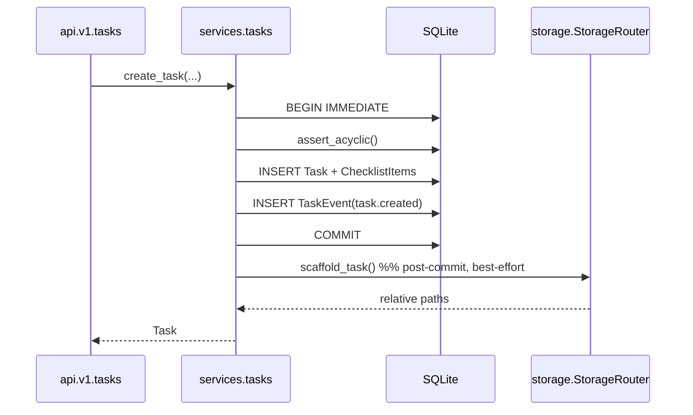

# Doc 02 — Database Models & Storage File Router

> **Series position:** 02 of 10 · **Owner:** Subagent 2 (Backend Engine)
> **Consumes:** Doc 01 §4 (tree), §5 (naming), §6 (data model), §7.3–7.4 (DTOs), §11 (atomicity), §15 (errors)
> **Publishes to:** Doc 03 (lease/recovery hooks), Doc 04 (ORM + serializers), Doc 08 (path derivation), Doc 10 (fixtures)
> **Hard rule:** field names, types, nullability, enums and paths are **copied** from Doc 01. Any mismatch is a defect in this doc.

---

## 1. Scope & Boundary

Doc 02 owns the **persistence layer**: Django models, migrations, the UUID folder router, and the atomic file writer. It does not own HTTP (Doc 04), recovery policy (Doc 03), or MCP tooling (Doc 08).

| Owned path | Never touched by us |
| :--- | :--- |
| `backend/core/models/*.py` | `backend/api/**` (Doc 04) |
| `backend/core/migrations/*.py` | `backend/core/leases.py` internals (Doc 03 owns behaviour; we own signatures) |
| `backend/core/storage.py` | `frontend/**` |
| `backend/core/audit.py` | `mcp_server/**` |
| `backend/atlas/settings/base.py` (DB block only) | `backend/atlas/urls.py` (Doc 04) |

**Dependency direction (enforced by import lint):**

```
api/  ──▶  core/services/  ──▶  core/models/  ──▶  core/enums
                     │
                     ├──▶  core/storage.py   (filesystem)
                     ├──▶  core/audit.py     (append-only log)
                     └──▶  core/events.py    (in-process bus → Doc 09 SSE)
models/ must never import services/ or api/.
```

---

## 2. App Layout

```
backend/core/
├── __init__.py
├── apps.py                  # CoreConfig.ready() → Doc 03 recovery hook
├── enums.py                 # TextChoices: TaskStatus, LogLevel, AssetKind, AssetSource, EventType
├── models/
│   ├── __init__.py          # re-exports for migration stability
│   ├── project.py
│   ├── task.py
│   ├── checklist.py
│   ├── asset.py
│   ├── event.py
│   └── managers.py          # TaskQuerySet: claimable(), overdue(), for_project()
├── migrations/
├── storage.py               # StorageRouter: paths + atomic writes
├── paths.py                 # containment validation (shared with Doc 08)
├── audit.py                 # JSONL appender
├── events.py                # publish(TaskEvent) → bus
└── services/
    ├── tasks.py             # transition guards (Doc 01 §8)
    ├── discoveries.py
    ├── reviews.py
    └── telemetry.py
```

**Import rule:** `models/` imports only `django.*`, `core.enums`, `core.paths`. Migrations must never import model classes by module path beyond `django.db.models`.

---

## 3. Django Settings — Database Block

```python
# backend/atlas/settings/base.py  (excerpt — DB only; Doc 03 owns recovery, Doc 04 owns CORS)
DATABASES = {
    "default": {
        "ENGINE": "django.db.backends.sqlite3",
        "NAME": env("ATLAS_DB_PATH", default=BASE_DIR / "data" / "atlas.db"),
        "OPTIONS": {
            "timeout": 5.0,                 # 5000 ms busy timeout (master §5.1)
            "init_command": (
                "PRAGMA journal_mode=WAL;"
                "PRAGMA synchronous=NORMAL;"
                "PRAGMA foreign_keys=ON;"
                "PRAGMA temp_store=MEMORY;"
                "PRAGMA mmap_size=134217728;"
            ),
            "transaction_mode": "IMMEDIATE",  # avoids SQLITE_BUSY upgrade deadlocks
        },
        "ATOMIC_REQUESTS": False,             # explicit transactions only; see §7.3
        "CONN_MAX_AGE": 0,
    }
}
```

| PRAGMA | Value | Why |
| :--- | :--- | :--- |
| `journal_mode` | `WAL` | Crash-safe rollback, readers never block the writer (master §5.1). |
| `synchronous` | `NORMAL` | Durability at the WAL checkpoint; ~10× faster than `FULL` and safe for WAL. |
| `foreign_keys` | `ON` | Django does not enable it by default on SQLite. |
| `busy_timeout` | `5000 ms` | Tolerates the SSE connection pool's brief write bursts. |
| `transaction_mode` | `IMMEDIATE` | Acquire the write lock at `BEGIN`; prevents lock-upgrade `SQLITE_BUSY` under concurrent claims (Doc 01 §11.1). |

**Verification (asserted in Doc 10):** `PRAGMA journal_mode;` returns `wal` after the first connection.

---

## 4. Enum Module

```python
# backend/core/enums.py
from django.db import models

class TaskStatus(models.TextChoices):
    PENDING_APPROVAL = "PENDING_APPROVAL", "Pending approval"
    PENDING          = "PENDING",          "Pending"
    IN_PROGRESS      = "IN_PROGRESS",      "In progress"
    IN_REVIEW        = "IN_REVIEW",        "In review"
    COMPLETED        = "COMPLETED",        "Completed"
    REJECTED         = "REJECTED",         "Rejected"

class LogLevel(models.TextChoices):
    DEBUG = "DEBUG", "Debug"
    INFO  = "INFO",  "Info"
    WARN  = "WARN",  "Warn"
    ERROR = "ERROR", "Error"

class AssetKind(models.TextChoices):
    INPUT_SCREENSHOT   = "INPUT_SCREENSHOT",   "Input screenshot"
    ANNOTATED_CANVAS   = "ANNOTATED_CANVAS",   "Annotated canvas"
    USER_CONTEXT       = "USER_CONTEXT",       "User context"
    OUTPUT_PATCH       = "OUTPUT_PATCH",       "Output patch"
    VERIFICATION_IMAGE = "VERIFICATION_IMAGE", "Verification image"
    TEST_LOG           = "TEST_LOG",           "Test log"

class AssetSource(models.TextChoices):
    HUMAN  = "HUMAN",  "Human"
    AGENT  = "AGENT",  "Agent"
    SYSTEM = "SYSTEM", "System"

class EventType(models.TextChoices):
    TASK_CREATED          = "task.created"
    TASK_UPDATED          = "task.updated"
    TASK_STATUS_CHANGED   = "task.status_changed"
    TASK_PRIORITY_CHANGED = "task.priority_changed"
    TASK_DOD_UPDATED      = "task.dod_updated"
    TASK_LOG              = "task.log"
    TASK_LEASE_EXPIRED    = "task.lease_expired"
    TASK_SUBMITTED        = "task.submitted"
    REVIEW_APPROVED       = "review.approved"
    REVIEW_REJECTED       = "review.rejected"
    DISCOVERY_CREATED     = "discovery.created"
    DISCOVERY_APPROVED    = "discovery.approved"
    DISCOVERY_REJECTED    = "discovery.rejected"
    AGENT_CONNECTED       = "agent.connected"
    AGENT_HEARTBEAT       = "agent.heartbeat"
    SYSTEM_BOOT           = "system.boot"
    SYSTEM_RECOVERY       = "system.recovery"
    TELEMETRY_TICK        = "telemetry.tick"
```

Enums are defined **once** here and referenced by every layer. Wire values equal DB values — no translation maps anywhere in the codebase.

---

## 5. Model Specifications

All models: `Meta.ordering`, `Meta.indexes`, explicit `db_table` prefixing is **not** used (Django default `core_<model>` matches Doc 01 §6.3–6.7 table names).

### 5.1 `Project`

```python
# backend/core/models/project.py
class Project(models.Model):
    id = models.UUIDField(primary_key=True, default=uuid.uuid4, editable=False)
    slug = models.CharField(max_length=32, unique=True, validators=[validate_slug])
    name = models.CharField(max_length=120)
    local_repo_path = models.CharField(max_length=1024)          # absolute, NOT existence-checked
    global_rules_md = models.TextField(blank=True, default="")
    accent_color = models.CharField(max_length=7, default="#00F2FE")
    archived_at = models.DateTimeField(null=True, blank=True)
    created_at = models.DateTimeField(auto_now_add=True)
    updated_at = models.DateTimeField(auto_now=True)

    class Meta:
        db_table = "core_project"
        indexes = [models.Index(fields=["archived_at", "slug"], name="ix_project_active")]
```

`local_repo_path` is deliberately **not** validated for existence: a project may point at a repository on a machine that is currently offline. Doc 08 surfaces the string verbatim; the agent is responsible for `cd`-ing into it (master §12 / capability 12).

### 5.2 `Task`

```python
# backend/core/models/task.py
class Task(models.Model):
    id = models.UUIDField(primary_key=True, default=uuid.uuid4, editable=False)
    project = models.ForeignKey(Project, on_delete=models.CASCADE, related_name="tasks")

    title = models.CharField(max_length=200)
    description = models.TextField()
    status = models.CharField(max_length=20, choices=TaskStatus.choices,
                              default=TaskStatus.PENDING, db_index=True)
    priority = models.SmallIntegerField(default=50,
                                        validators=[MinValueValidator(0), MaxValueValidator(100)])

    parent_task = models.ForeignKey("self", null=True, blank=True,
                                    on_delete=models.SET_NULL, related_name="children")
    blocked_by = models.ManyToManyField("self", symmetrical=False, blank=True,
                                        related_name="blocks")

    is_agent_discovered = models.BooleanField(default=False)
    discovered_during_task = models.ForeignKey("self", null=True, blank=True,
                                               on_delete=models.SET_NULL,
                                               related_name="discovered_tasks")
    discovery_reason = models.TextField(blank=True, default="")
    suggested_priority = models.SmallIntegerField(null=True, blank=True)
    discovered_by_agent = models.CharField(max_length=120, blank=True, default="")

    assigned_agent_id = models.CharField(max_length=120, null=True, blank=True)
    lease_id = models.CharField(max_length=32, null=True, blank=True)
    lease_expires_at = models.DateTimeField(null=True, blank=True)
    last_heartbeat_at = models.DateTimeField(null=True, blank=True)
    claimed_at = models.DateTimeField(null=True, blank=True)
    submitted_at = models.DateTimeField(null=True, blank=True)
    completed_at = models.DateTimeField(null=True, blank=True)

    review_summary = models.TextField(blank=True, default="")
    review_notes = models.TextField(blank=True, default="")
    attempt_count = models.SmallIntegerField(default=0)

    created_at = models.DateTimeField(auto_now_add=True, db_index=True)
    updated_at = models.DateTimeField(auto_now=True)

    class Meta:
        db_table = "core_task"
        ordering = ["-priority", "created_at"]
        indexes = [
            models.Index(fields=["project", "status", "-priority", "created_at"],
                         name="ix_task_claim_queue"),          # claim hot path
            models.Index(fields=["project", "status", "updated_at"],
                         name="ix_task_board"),
            models.Index(fields=["lease_expires_at"], name="ix_task_lease"),
            models.Index(fields=["parent_task"], name="ix_task_parent"),
            models.Index(fields=["discovered_during_task"], name="ix_task_discovery"),
        ]
        constraints = [
            models.CheckConstraint(check=Q(priority__gte=0) & Q(priority__lte=100),
                                   name="ck_task_priority_range"),
            # I3: IN_PROGRESS <=> lease present
            models.CheckConstraint(
                check=(Q(status="IN_PROGRESS") & Q(lease_id__isnull=False)
                       & Q(lease_expires_at__isnull=False))
                      | (~Q(status="IN_PROGRESS") & Q(lease_id__isnull=True)),
                name="ck_task_lease_invariant"),
        ]
```

**Index rationale**

| Index | Serves |
| :--- | :--- |
| `ix_task_claim_queue` | `claim_next_task` eligibility scan: `WHERE project_id=? AND status='PENDING' ORDER BY priority DESC, created_at ASC` — becomes a covering scan. |
| `ix_task_board` | Project board sort by recency. |
| `ix_task_lease` | Boot janitor `WHERE status='IN_PROGRESS' AND lease_expires_at < now`. |
| `ix_task_parent` / `ix_task_discovery` | Subtask and provenance traversals. |

**`blocked_by` DAG:** symmetry disabled; cycles are rejected in `core/services/tasks.py::assert_acyclic()` (see §7.2). M2M through table is Django's default `core_task_blocked_by(task_from_id, task_to_id)`; **semantics: `task.blocked_by` contains prerequisites.**

**Self-reference note:** `discovered_during_task` uses `related_name="discovered_tasks"` so `task.discovered_tasks.count()` reports how many discoveries a task produced — required by the discovery pipeline (master §7).

### 5.3 `ChecklistItem`

```python
class ChecklistItem(models.Model):
    task = models.ForeignKey(Task, on_delete=models.CASCADE, related_name="checklist")
    order_index = models.SmallIntegerField()          # 1-based, stable; wire id
    label = models.CharField(max_length=200)
    completed = models.BooleanField(default=False)
    completed_at = models.DateTimeField(null=True, blank=True)
    completed_by_agent = models.CharField(max_length=120, null=True, blank=True)

    class Meta:
        db_table = "core_checklistitem"
        ordering = ["order_index"]
        constraints = [models.UniqueConstraint(fields=["task", "order_index"],
                                               name="uq_checklist_task_order")]
```

**Wire mapping:** `id` on the wire = `order_index`. Doc 04 serializers perform `order_index → id`. Re-ordering is forbidden in v1 (would break agent idempotency); the service layer exposes only `toggle` and `append`.

### 5.4 `Asset`

```python
class Asset(models.Model):
    id = models.UUIDField(primary_key=True, default=uuid.uuid4, editable=False)
    task = models.ForeignKey(Task, on_delete=models.CASCADE, related_name="assets")
    kind = models.CharField(max_length=24, choices=AssetKind.choices)
    relative_path = models.CharField(max_length=1024, unique=True)   # POSIX, rel. to storage/
    filename = models.CharField(max_length=255)
    mime_type = models.CharField(max_length=120)
    byte_size = models.BigIntegerField()
    sha256 = models.CharField(max_length=64, db_index=True)
    source = models.CharField(max_length=8, choices=AssetSource.choices)
    created_at = models.DateTimeField(auto_now_add=True)

    class Meta:
        db_table = "core_asset"
        indexes = [models.Index(fields=["task", "kind"], name="ix_asset_task_kind")]
```

`relative_path` uniqueness doubles as a file-level dedupe guard. `sha256` is indexed so re-uploading an identical annotated PNG can reuse the existing file (referenced by a new `Asset` row only if the task differs).

### 5.5 `TaskEvent`

```python
class TaskEvent(models.Model):
    id = models.CharField(primary_key=True, max_length=32)      # evt_<ULID>
    project = models.ForeignKey(Project, on_delete=models.CASCADE, related_name="events")
    task = models.ForeignKey(Task, null=True, blank=True,
                             on_delete=models.SET_NULL, related_name="events")
    seq = models.BigIntegerField()                              # monotonic per project
    type = models.CharField(max_length=32, choices=EventType.choices)
    level = models.CharField(max_length=8, choices=LogLevel.choices, default=LogLevel.INFO)
    message = models.TextField()
    payload = models.JSONField(default=dict, blank=True)
    created_at = models.DateTimeField(auto_now_add=True)

    class Meta:
        db_table = "core_taskevent"
        ordering = ["seq"]
        constraints = [models.UniqueConstraint(fields=["project", "seq"],
                                               name="uq_event_project_seq")]
        indexes = [
            models.Index(fields=["project", "seq"], name="ix_event_replay"),
            models.Index(fields=["task", "seq"], name="ix_event_task"),
            models.Index(fields=["created_at"], name="ix_event_retention"),
        ]
```

`id` is deliberately a `CharField` (ULID) rather than a UUID PK so SSE `Last-Event-ID` replay resolves by lexicographic range and `seq` monotonicity. `uq_event_project_seq` makes gap-free ordering a database guarantee, which Doc 09's replay logic depends on.

### 5.6 Managers & querysets

```python
# backend/core/models/managers.py
class TaskQuerySet(models.QuerySet):
    def for_project(self, project_id) -> "TaskQuerySet":
        return self.filter(project_id=project_id)

    def claimable(self, *, min_priority: int = 0) -> "TaskQuerySet":
        from core.dependencies import unsatisfied_blocker_qs
        return (self.filter(status=TaskStatus.PENDING, priority__gte=min_priority)
                    .filter(archived_at__isnull=True)
                    .exclude(project__archived_at__isnull=False)
                    .exclude(blocked_by__in=unsatisfied_blocker_qs())
                    .order_by("-priority", "created_at"))

    def overdue(self) -> "TaskQuerySet":
        return self.filter(status=TaskStatus.IN_PROGRESS, lease_overdue_at__isnull=False)
```

`claimable()` encodes the DAG rule from Doc 01 §8. The blocker set is
**not** "status != COMPLETED" — it is
`core.dependencies.unsatisfied_blocker_qs()`, i.e. "blocker is not `COMPLETED`
**and** its DoD is below 100 %". `.exclude(blocked_by__in=…)` implements "every
prerequisite satisfied" without an N+1 loop, and it means a blocker parked in
`IN_REVIEW` at 100 % already releases its dependents — which is what breaks the
old deadlock where agents only ever reach `IN_REVIEW`.

`overdue()` is the read side of the overdue flag. It is a *filter*, never a
mutation: nothing in the manager ever returns a task to `PENDING`.

---

## 6. Migrations Plan

| # | Migration | Contents |
| :--- | :--- | :--- |
| 0001 | `initial_project` | `Project` |
| 0002 | `task_core` | `Task` (+ 3 indexes, 2 constraints), `blocked_by` M2M |
| 0003 | `task_lease_columns` | lease / heartbeat / attempt columns + `ix_task_lease` |
| 0004 | `checklist` | `ChecklistItem` + unique constraint |
| 0005 | `asset` | `Asset` + indexes |
| 0006 | `taskevent` | `TaskEvent` + constraints/indexes |
| 0007 | `discovery_columns` | discovery provenance columns + `ix_task_discovery` |

Migration discipline:

1. Every migration declares `atomic = True` (default) and is generated by `makemigrations` — never hand-written unless it is a data migration.
2. Data migrations (backfills) live in `migrations/` with `RunPython` and **must** be reversible or declare `reverse_code=migrations.RunPython.noop` with a comment.
3. `python manage.py makemigrations --check --dry-run` runs in CI; drift fails the build.
4. SQLite limitation: column drops/alters are table-rebuilds. Acceptable at this scale; if a table exceeds ~500 k rows, Doc 03's maintenance window handles a manual `VACUUM`.

---

## 7. Service Layer Contracts (signatures only — behaviour is Doc 03/04)

### 7.1 `core/services/tasks.py`

```python
def create_task(*, project_slug: str, title: str, description: str, priority: int,
                blocked_by_ids: list[str] | None = None,
                checklist: list[str] | None = None,
                parent_task_id: str | None = None) -> Task: ...

def assert_acyclic(task_id: str, blocked_by_ids: list[str]) -> None:
    """Raises DependencyCycle if adding these edges creates a cycle."""

def transition(task: Task, action: str, *, actor: str, **payload) -> Task:
    """Single entry point for every state change. Validates Doc 01 §8 guard table."""

def toggle_checklist_item(task_id: str, item_id: int, completed: bool,
                          agent_id: str | None = None) -> tuple[Task, int]:
    """Returns (task, dod_progress_percent)."""

def dod_progress_percent(task: Task) -> int: ...
```

### 7.2 Cycle detection

```python
def assert_acyclic(task_id: str, blocked_by_ids: list[str]) -> None:
    # iterative DFS over the existing graph; depth cap 500 guards against pathological chains
    stack, seen = list(blocked_by_ids), set()
    while stack:
        node = stack.pop()
        if node == task_id:
            raise DependencyCycle(task_id=task_id, via=node)
        if node in seen:
            continue
        seen.add(node)
        stack.extend(
            Task.blocked_by.through.objects
                .filter(to_task_id=node)
                .values_list("from_task_id", flat=True)
        )
```

Depth cap and `seen` set keep this O(V+E) and safe for adversarial input. Run **inside** the creating transaction so a rejected edge never partially persists.

### 7.3 Transaction policy

| Operation | Transaction | Isolation need |
| :--- | :--- | :--- |
| `create_task` + folder scaffold | `atomic()` around DB only; files written after commit | File orphan on rollback is harmless (janitor sweeps `storage/` for folders with no DB row). |
| `claim_next_task` | `BEGIN IMMEDIATE` + conditional `UPDATE … WHERE status='PENDING'` | See Doc 01 §11.1 / Doc 03. |
| `submit_for_review` | `atomic()`; file writes staged to `*.tmp` before commit, renamed after | Prevents a committed row pointing at a missing patch. |
| `toggle_checklist_item` | `atomic()` + `select_for_update(nowait=False)` | Single row; SQLite write lock suffices. |
| Bulk reprioritise (UI) | One `bulk_update` in `atomic()` | Doc 04 caps batch at 200 ids. |

---

## 8. Storage File Router (`backend/core/storage.py`)

### 8.1 Layout (mirrors master §3, extended for Doc 01 §6.6 asset kinds)

```
storage/
└── projects/{project_uuid}/
    ├── project_meta.json            # snapshot: slug, name, local_repo_path, global_rules_md, accent_color
    ├── project_audit.log            # JSONL append-only (audit.py)
    └── tasks/{task_uuid}/
        ├── meta.json                # offline mirror of the Task row (see §8.5)
        ├── input/
        │   ├── raw_screenshot_01.png
        │   ├── annotated_canvas.png
        │   └── user_context.md
        ├── output/
        │   ├── git_patch.patch
        │   ├── test_execution.log
        │   ├── verification.png
        │   └── depr_warning.png     # discovery screenshots land here
        └── execution.log            # streamed agent log (append, rotated at 8 MB)
```

### 8.2 Path API

```python
# backend/core/storage.py
@dataclass(frozen=True)
class StorageRouter:
    root: Path                                     # = ATLAS_STORAGE_ROOT resolved

    # --- derivation ---
    def project_dir(self, project_id: UUID) -> Path: ...
    def task_dir(self, project_id: UUID, task_id: UUID) -> Path: ...
    def input_dir(self, project_id: UUID, task_id: UUID) -> Path: ...
    def output_dir(self, project_id: UUID, task_id: UUID) -> Path: ...
    def execution_log(self, project_id: UUID, task_id: UUID) -> Path: ...
    def audit_log(self, project_id: UUID) -> Path: ...

    # --- portable <-> absolute ---
    def to_relative(self, absolute: Path) -> str:   # POSIX, relative to root
    def to_absolute(self, relative: str) -> Path:   # joins root, re-validates containment

    # --- writes (all atomic) ---
    def write_bytes(self, dest: Path, data: bytes, *, fsync: bool = True) -> str
    def write_text(self, dest: Path, text: str) -> str
    def append_text(self, dest: Path, text: str) -> None      # O_APPEND, line-buffered
    def ingest_external(self, source: Path, dest: Path) -> str # copy-in for MCP screenshot_paths

    # --- scaffolding ---
    def scaffold_task(self, project_id: UUID, task_id: UUID, *, description: str,
                      checklist: list[str], meta: dict) -> None
    def prune_orphans(self, known_task_ids: set[UUID]) -> int
```

### 8.3 Atomic write algorithm (master §5.3)

```python
def write_bytes(self, dest: Path, data: bytes, *, fsync: bool = True) -> str:
    dest.parent.mkdir(parents=True, exist_ok=True)
    tmp = dest.with_name(f".{dest.name}.{os.getpid()}.{uuid.uuid4().hex[:8]}.tmp")
    try:
        # 1. write to a unique temp file in the SAME directory (same filesystem → atomic rename)
        with open(tmp, "wb") as fh:
            fh.write(data)
            fh.flush()
            if fsync:
                os.fsync(fh.fileno())        # force frames to physical media
        # 2. atomic replace
        os.replace(tmp, dest)                # POSIX + Windows: atomic within a volume
        if fsync:
            self._fsync_dir(dest.parent)     # durable directory entry (POSIX only)
    except BaseException:
        tmp.unlink(missing_ok=True)
        raise StorageWriteFailed(path=str(dest))
    return self.to_relative(dest)
```

| Property | Guarantee |
| :--- | :--- |
| No partial file | Readers see either the old file or the complete new file. |
| Crash safety | Uncommitted temp files are swept on boot (`prune_orphans` removes `.*.tmp` older than 1 h). |
| Cross-platform | `os.replace` is atomic on NTFS and POSIX; the temp file is created in the destination directory so no cross-volume rename occurs. |
| Windows note | `_fsync_dir` is a no-op on Windows (directory handles cannot be flushed); `os.fsync` on the file handle is sufficient there. |

**Why `tempfile.NamedTemporaryFile` is not used:** it may create in the system temp directory (different volume → non-atomic rename) and it opens with delete-on-close semantics on Windows.

### 8.4 `execution.log` append contract

* Opened with `open(path, "a", encoding="utf-8", newline="\n")` — `O_APPEND` guarantees atomic line appends for lines `< 4 kB` on POSIX; Doc 08 caps lines at 4 000 chars (§9.6 of Doc 01) which satisfies this.
* Format: one plain-text line, `HH:MM:SS LEVEL message` (HUD parity with the terminal pane).
* Rotation: at 8 MB, rename to `execution.log.1` and start fresh; only one generation is kept (`execution.log.1` is deleted on the next rotation).
* **Never** rewritten in place → no read-position invalidation for Doc 09's tailer.

### 8.5 `meta.json` offline mirror

```json
{
  "schema": 1,
  "project": { "id": "…", "slug": "alpha", "name": "Alpha Backend", "local_repo_path": "E:\\dev\\alpha" },
  "task": {
    "id": "5f2d…", "title": "Fix JWT expiry race condition", "status": "IN_PROGRESS",
    "priority": 95, "attempt_count": 1,
    "definition_of_done": [{ "id": 1, "label": "Repro test written", "completed": true }]
  },
  "written_at": "2026-10-27T08:10:11.297Z",
  "written_by": "core.storage"
}
```

Purpose: if the SQLite file is lost, a human can reconstruct priority/DoD by hand from `meta.json`. It is **written after** each successful task mutation (post-commit signal) and is never read by the application.

### 8.6 Containment validation (`core/paths.py`)

```python
def ensure_within_root(candidate: Path, root: Path) -> Path:
    resolved = candidate.expanduser().resolve(strict=False)
    root_resolved = root.resolve()
    try:
        resolved.relative_to(root_resolved)          # Python 3.9+ path comparison
    except ValueError as exc:
        raise PathOutOfScope(path=str(candidate)) from exc
    return resolved
```

Shared by Doc 04 (upload destinations) and Doc 08 (`propose_task.screenshot_paths`). Guards against `..` traversal, UNC escapes, and symlink redirection.

---

## 9. Scaffolding Sequence (task creation)



**Ordering rule:** DB first, files second. A crash between the two leaves a task with no folder; `scaffold_task` is idempotent (`exist_ok=True`) and the janitor repairs missing folders on boot (Doc 03 §6.3). The inverse ordering is forbidden because an orphaned folder cannot be attributed to a task.

`scaffold_task` creates: `input/`, `output/`, `execution.log` (empty, touched), `meta.json`, and writes `user_context.md` only if description exceeds 2 000 chars (keeps the MCP projection small while preserving full context on disk).

---

## 10. Asset Ingest Contract (Doc 04 + Doc 07 + Doc 08)

| Step | Actor | Validation |
| :--- | :--- | :--- |
| 1 | Client posts multipart | `<= ATLAS_MAX_UPLOAD_MB` (25), else `413 PAYLOAD_TOO_LARGE` |
| 2 | Backend sniffs MIME | allow-list: `image/png`, `image/jpeg`, `image/webp`, `text/plain`, `text/markdown`; else `415` |
| 3 | Backend hashes | `sha256` while streaming to the temp file (no full-buffer in memory above 1 MB) |
| 4 | Dedupe probe | existing `Asset` with same `sha256` **and** same `task_id` + `kind` → return existing row (idempotent) |
| 5 | Destination | `input/` for human-supplied kinds, `output/` for agent/system kinds |
| 6 | Filename policy | `{kind.lower()}_{sha256[:8]}{ext}` → collision-free and stable across retries |
| 7 | Write | `StorageRouter.write_bytes` (atomic) |
| 8 | Row | `Asset.objects.create(...)` in the same request transaction |

**Filename decision:** deterministic content-addressed names beat user-supplied names (no sanitisation bugs, natural dedupe, predictable export tests).

---

## 11. Audit Logger (`backend/core/audit.py`)

```python
def record(project: Project, event: str, *, actor: str, task_id: str | None = None,
           detail: dict | None = None) -> None:
    line = json.dumps({
        "ts": utcnow_iso(), "project_slug": project.slug, "event": event,
        "task_id": task_id, "actor": actor, "detail": detail or {},
    }, separators=(",", ":"), ensure_ascii=False)
    router.append_text(router.audit_log(project.id), line + "\n")
```

Allowed `event` values are the §6.8 list in Doc 01. Audit failures are **logged and swallowed** — they must never fail a user request, because the DB row is the authoritative record.

---

## 12. Data Integrity Rules (enforced in DB **and** service layer)

| # | Rule | DB enforcement | Service enforcement |
| :--- | :--- | :--- | :--- |
| D1 | `priority ∈ [0,100]` | `ck_task_priority_range` | serializer validators |
| D2 | `IN_PROGRESS ⇔ lease` | `ck_task_lease_invariant` | `transition()` |
| D3 | Checklist `order_index` unique per task | `uq_checklist_task_order` | append-only API |
| D4 | Event `seq` unique per project | `uq_event_project_seq` | `BEGIN IMMEDIATE` allocator |
| D5 | Asset `relative_path` unique | unique constraint | content-addressed naming |
| D6 | DAG acyclic | not expressible | `assert_acyclic()` |
| D7 | Slug immutable after create | not expressible | serializer `read_only` |
| D8 | No orphan assets | FK `CASCADE` | deletion pipeline removes files |

**Deletion policy:** deleting a project/task removes DB rows via `CASCADE` and moves the folder to `storage/projects/.trash/{uuid}` (not `rmtree`) so a mis-click is recoverable. `prune_orphans` deletes `.trash` entries older than 7 days.

---

## 13. Query Budgets (avoid N+1)

| Endpoint consumer | Required `select_related` / `prefetch_related` |
| :--- | :--- |
| Project list with counters | `annotate(Count("tasks", filter=Q(...)))` — 1 query, no prefetch |
| Board list (`TaskSummaryDTO`) | `select_related("project")` + `annotate(dod_total, dod_done)` |
| Task detail | `select_related("project","parent_task")` + `prefetch_related("checklist","assets","blocked_by")` + `Prefetch("events", queryset=last_50)` |
| Priority matrix | values-only query, no model instantiation |
| Discovery inbox | `filter(is_agent_discovered=True, status=PENDING_APPROVAL)` + `prefetch_related("assets")` |

Rule: a request handler may execute **at most 6** queries for list views and **at most 10** for detail views. Doc 10 asserts these counts with `django_assert_num_queries`.

---

## 14. Test Plan (this doc's scope)

| Test | Asserts |
| :--- | :--- |
| `test_wal_enabled` | `PRAGMA journal_mode` == `wal` |
| `test_priority_check_constraint` | raw `UPDATE … priority=101` raises `IntegrityError` |
| `test_lease_check_constraint` | setting `IN_PROGRESS` without `lease_id` raises |
| `test_checklist_unique_order` | duplicate `order_index` on same task raises |
| `test_event_seq_unique` | duplicate `(project, seq)` raises |
| `test_acyclic_rejects_cycle` | A→B→A raises `DependencyCycle` |
| `test_claimable_skips_blocked` | blocked task absent from queryset |
| `test_atomic_write_no_partial` | simulated exception mid-write leaves destination byte-identical to before |
| `test_containment_rejects_escape` | `../../etc/passwd` raises `PathOutOfScope` |
| `test_asset_dedupe_by_sha` | second identical upload returns the same row |
| `test_scaffold_idempotent` | calling twice creates no duplicate files |
| `test_query_count_board` | board endpoint ≤ 6 queries |

Full harness, fixtures and CI wiring live in Doc 10.

---

## 15. Definition of Done — Doc 02

- [ ] All 5 models migrated; `makemigrations --check` clean.
- [ ] Every index and CHECK constraint from §5 exists in the generated SQL.
- [ ] `StorageRouter` exposes all methods in §8.2 with atomic semantics per §8.3.
- [ ] Containment validation rejects traversal, absolute escapes, and UNC paths.
- [ ] Asset ingest is idempotent by `sha256` and uses content-addressed filenames.
- [ ] Task scaffolding is idempotent and DB-before-files ordered.
- [ ] Audit log is JSONL, append-only, and never blocks a request.
- [ ] §14 test list passes; query budgets hold.

---

## 16. Cross-Document Contracts

| Direction | Item |
| :--- | :--- |
| **Publishes → Doc 03** | `Task.objects.overdue()`, `StorageRouter.prune_orphans()`, `audit.record()` |
| **Publishes → Doc 04** | Model field names for serializers, `TaskQuerySet.claimable`, `services.tasks.transition` |
| **Publishes → Doc 08** | `to_relative()` / `to_absolute()` for path derivation, `ensure_within_root()` |
| **Publishes → Doc 10** | Fixture factory signatures, constraint names for negative tests |
| **Consumes from Doc 01** | §4 tree, §5 naming, §6 fields/enums, §11 atomicity, §15 error codes |

---

## 17. Implementation Checklist for Subagent 2

1. `core/enums.py` — verbatim from §4.
2. `core/paths.py` — `ensure_within_root` + unit tests.
3. `core/storage.py` — router, atomic writes, scaffold, prune; unit tests first (TDD).
4. `core/models/project.py` → migration 0001.
5. `core/models/task.py` + managers → migrations 0002/0003/0007.
6. `core/models/checklist.py` → 0004.
7. `core/models/asset.py` → 0005.
8. `core/models/event.py` → 0006.
9. `core/audit.py` — append-only JSONL, failure-swallowing.
10. `core/services/tasks.py` — `create_task`, `assert_acyclic`, `dod_progress_percent`.
11. Query-budget assertions and `--check` CI wiring.
