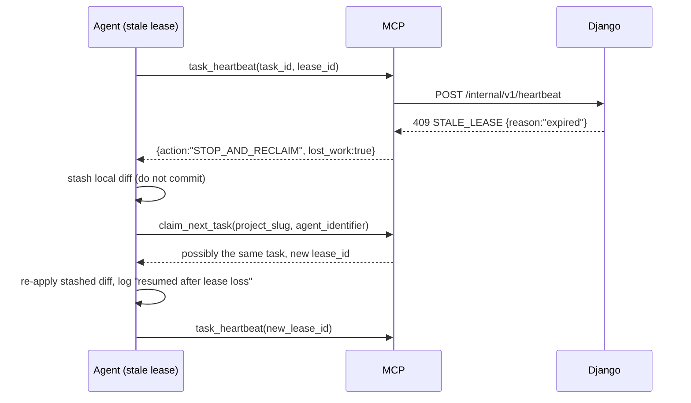
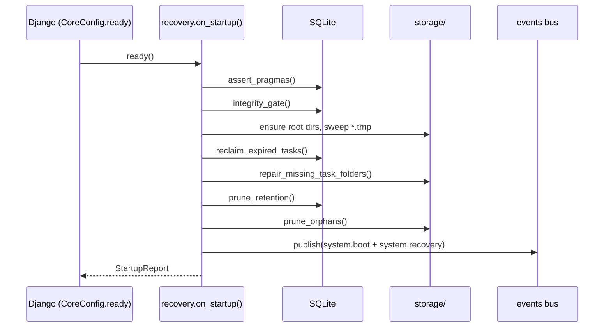

# Doc 03 — Fault Tolerance, Leases & Crash Recovery

> **Series position:** 03 of 10 · **Owner:** Subagent 3 (Reliability Specialist)
> **Consumes:** Doc 01 §6.4 (Task lease fields), §8 (state machine), §11 (invariants & frozen timings), §15 (error codes); Doc 02 §5.2, §8.3 (atomic writes)
> **Publishes to:** Doc 04 (`claim`, `heartbeat`, force-release endpoints), Doc 08 (lease semantics the agent must respect), Doc 09 (`system.recovery` events), Doc 10 (crash-simulation tests)
> **Owned paths:** `backend/core/leases.py`, `backend/core/recovery.py`, `backend/core/apps.py` (`ready()` hook), `backend/core/maintenance.py`

---

## 1. Threat Model & Design Goals

The platform must survive the failures below without losing a task, corrupting the database, or wedging the queue.

| # | Failure | Blast radius without mitigation | Mitigation (this doc) |
| :--- | :--- | :--- | :--- |
| F1 | Host power cut mid-transaction | Corrupt DB / partial commit | WAL + `synchronous=NORMAL` (§3) |
| F2 | Host power cut mid-file-write | Zero-byte PNG/patch | Atomic temp+`os.replace`+`fsync` (Doc 02 §8.3), `.tmp` sweep (§7.3) |
| F3 | Agent CLI killed while `IN_PROGRESS` | Task stuck forever | 15 min lease + boot janitor + runtime sweeper (§5, §6) |
| F4 | Two agents claim simultaneously | Duplicate work, lost writes | Conditional single-statement claim (§4.2) |
| F5 | Clock skew between host and container | Spurious lease expiry | 60 s reclaim grace (§5.2) |
| F6 | Long test run > 15 min with no heartbeat | Lease lost mid-work | Heartbeat contract + re-claim protocol (§4.5) |
| F7 | Disk full | Writes fail after DB commit | Write-before-commit ordering (§7.2) + `507` |
| F8 | Django restart with live SSE clients | Missed events | `seq` replay + `Last-Event-ID` (Doc 09 §6) |
| F9 | Corrupt SQLite file | Total outage | `PRAGMA integrity_check` at boot + `.bak` restore path (§3.3) |
| F10 | Orphaned folders from crashes | Disk growth | `prune_orphans` (§7.3) |

**Design principle:** every durability guarantee is enforced **below** the service layer so no individual endpoint can accidentally bypass it.

---

## 2. Component Map

```
backend/core/
├── apps.py            # CoreConfig.ready() → recovery.on_startup()   [guarded, idempotent]
├── leases.py          # grant / renew / release / reclaim  (the only writer of lease fields)
├── recovery.py        # WAL bootstrap, integrity check, boot janitor, runtime sweeper
├── maintenance.py     # retention pruning, .tmp sweep, orphan folders, VACUUM policy
└── services/tasks.py  # transition() calls leases.* — never mutates lease columns directly
```

**Hard rule:** `Task.lease_id`, `lease_expires_at`, `last_heartbeat_at`, `assigned_agent_id` are written **only** by `core/leases.py`. A code-review checklist item enforces this (`grep -L` style CI check in Doc 10).

---

## 3. Durability Layer

### 3.1 Connection bootstrap

The PRAGMAs from Doc 02 §3 are applied per connection. Additionally, `recovery.on_startup()` asserts them and fails loudly if the deployment silently ignored the option:

```python
def assert_pragmas():
    with connection.cursor() as cur:
        cur.execute("PRAGMA journal_mode;");  mode = cur.fetchone()[0].lower()
        cur.execute("PRAGMA synchronous;");   sync = cur.fetchone()[0]
        cur.execute("PRAGMA foreign_keys;");  fk   = cur.fetchone()[0]
    if mode != "wal":
        raise ImproperlyConfigured(f"journal_mode is {mode!r}, expected 'wal'")
    if sync != 1:                      # 1 == NORMAL
        logger.warning("synchronous=%s (expected NORMAL)", sync)
    if not fk:
        raise ImproperlyConfigured("foreign_keys is OFF")
```

Running this at boot converts a silent performance/durability misconfiguration into an immediate, diagnosable failure.

### 3.2 WAL guarantees we rely on

| Guarantee | Consequence for ATLAS |
| :--- | :--- |
| Readers never block the writer | SSE replays can query while a claim commits. |
| Writers serialise | `BEGIN IMMEDIATE` gives us a global write mutex for lease allocation. |
| Crash mid-checkpoint replays from WAL | A power cut loses at most the frames not yet checkpointed, and never corrupts the file. |
| `-wal` and `-shm` files must live beside the DB | `ATLAS_DB_PATH` must be on a local filesystem (network shares break `-shm` locking) — startup check. |

### 3.3 Integrity check & restore path

On startup, **before** serving traffic:

```python
def integrity_gate(db_path: Path) -> None:
    with connection.cursor() as cur:
        cur.execute("PRAGMA quick_check;")     # ~O(size), 10-50x faster than integrity_check
        rows = [r[0] for r in cur.fetchall()]
    if rows != ["ok"]:
        logger.critical("SQLite quick_check failed: %s", rows[:5])
        raise DatabaseCorrupt(detail={"db_path": str(db_path), "findings": rows[:5]})
```

`quick_check` (not `integrity_check`) is used because it detects the same structural corruption class relevant here at a fraction of the cost — a 200 MB database checks in well under a second.

**Restore procedure (documented, not automated):** stop the service, move `atlas.db*` aside, copy the most recent `atlas.db.bak` (created by §7.4), restart. The `task/meta.json` mirrors (Doc 02 §8.5) allow manual reconstruction of any tasks created after the backup.

---

## 4. Lease Engine (`backend/core/leases.py`)

### 4.1 Frozen parameters

| Constant | Value | Source |
| :--- | :--- | :--- |
| `LEASE_TTL_SECONDS` | `900` (15 min) | Master §5.2 |
| `HEARTBEAT_INTERVAL_SECONDS` | `120` (2 min) | Master §5.2 |
| `RECLAIM_GRACE_SECONDS` | `60` | Doc 01 §11.2 (clock-skew tolerance) |
| `MAX_LEASE_RENEWALS_BEFORE_WARN` | `30` (≈ 1 h continuous work) | This doc |
| `CLAIM_RETRY_ATTEMPTS` | `3` | §4.2 |
| `SWEEPER_INTERVAL_SECONDS` | `60` | §6.1 |

### 4.2 Claim algorithm (SQLite-correct)

`select_for_update()` is a **no-op on SQLite**. The claim is therefore a single conditional `UPDATE` guarded by the current status, executed inside `BEGIN IMMEDIATE`:

```python
def claim_next_task(*, project_slug: str, agent_identifier: str,
                    min_priority: int = 0) -> Task | None:
    for attempt in range(CLAIM_RETRY_ATTEMPTS):
        try:
            with transaction.atomic():
                with connection.cursor() as cur:
                    cur.execute("BEGIN IMMEDIATE")        # write lock at BEGIN
                candidate_id = (
                    Task.objects.eligible_for_claim(min_priority)
                        .for_project(project_slug)
                        .values_list("id", flat=True)
                        .first()
                )
                if candidate_id is None:
                    return None
                now = timezone.now()
                lease_id = new_lease_id()                 # lea_<ULID>
                updated = Task.objects.filter(
                    id=candidate_id, status=TaskStatus.PENDING, lease_id__isnull=True,
                ).update(
                    status=TaskStatus.IN_PROGRESS,
                    lease_id=lease_id,
                    lease_expires_at=now + timedelta(seconds=LEASE_TTL_SECONDS),
                    last_heartbeat_at=now,
                    claimed_at=now,
                    assigned_agent_id=agent_identifier,
                    attempt_count=F("attempt_count") + 1,
                    updated_at=now,
                )
                if updated != 1:                          # lost the race
                    raise LeaseRace()
                task = Task.objects.select_related("project").get(id=candidate_id)
                _emit_lease_granted(task, lease_id, agent_identifier)
                return task
        except (LeaseRace, OperationalError) as exc:
            if attempt == CLAIM_RETRY_ATTEMPTS - 1:
                raise BackendUnavailable(detail={"reason": "claim_contention"}) from exc
            time.sleep(0.02 * (attempt + 1))
    return None
```

**Correctness argument:** the `UPDATE … WHERE status='PENDING' AND lease_id IS NULL` row count is the linearisation point. Exactly one concurrent transaction can observe `updated == 1` for a given `candidate_id`; every other attempt sees `updated == 0` and retries against the next candidate. This satisfies Doc 01 invariants **I1–I3** without relying on row locks.

`LeaseRace` is an internal control-flow exception and must never reach the API layer.

### 4.3 Heartbeat (`renew`)

```python
def heartbeat(*, task_id: str, lease_id: str) -> datetime:
    now = timezone.now()
    updated = Task.objects.filter(
        id=task_id, status=TaskStatus.IN_PROGRESS, lease_id=lease_id,
        lease_expires_at__gt=now - timedelta(seconds=RECLAIM_GRACE_SECONDS),
    ).update(lease_expires_at=now + timedelta(seconds=LEASE_TTL_SECONDS),
             last_heartbeat_at=now, updated_at=now)
    if updated != 1:
        task = Task.objects.filter(id=task_id).only("status", "lease_id", "lease_expires_at").first()
        raise StaleLease(detail={
            "task_id": str(task_id),
            "current_status": getattr(task, "status", None),
            "current_lease_id": getattr(task, "lease_id", None),
            "reason": "expired" if task and task.lease_expires_at and task.lease_expires_at <= now
                      else "mismatch",
        })
    return now + timedelta(seconds=LEASE_TTL_SECONDS)
```

The grace window is applied to **renewal** (not to claim) so a heartbeat that arrives 30 s late due to clock skew still succeeds instead of forcing a needless re-claim. The `stale` error payload is machine-actionable: Doc 08 turns it into an instruction the agent can follow ("release work, re-claim").

Heartbeat is **idempotent** — repeating it just extends the expiry.

### 4.4 Release paths

| Path | Trigger | Implementation |
| :--- | :--- | :--- |
| `release_on_submit(task)` | `submit_for_review` (T7) | Clears `lease_id`, `lease_expires_at`; keeps `assigned_agent_id` for provenance; sets `submitted_at`. |
| `release_on_reject(task)` | `reject_review` (T9) | Clears lease columns; status → `PENDING`; preserves `review_notes`. |
| `force_release(task, actor)` | Human "force release" in HUD (T11) | Same as submit-clear, plus audit `LEASE_RECLAIMED` with `actor="human"`. Refuses if the task is not `IN_PROGRESS` (`409 INVALID_TRANSITION`). |

All three run inside `transaction.atomic()` and emit `task.status_changed`.

### 4.5 Re-claim protocol after lease loss

When an agent receives `STALE_LEASE`, it must **not** submit the work it did under the lost lease (another agent may have already re-claimed). The defined sequence:



The agent must log `resumed after lease loss` via `log_task_progress` so the HUD shows the discontinuity (this is the moment a human should glance at the task).

### 4.6 Expiry predicate (single source of truth)

```python
EXPIRED_Q = Q(status=TaskStatus.IN_PROGRESS,
              lease_expires_at__lt=timezone.now() - timedelta(seconds=RECLAIM_GRACE_SECONDS))
```

Every sweeper, endpoint and test imports this predicate. Divergent ad-hoc comparisons are forbidden — they are the most common source of "task stuck forever" bugs in lease systems.

---

## 5. Boot Recovery (`backend/core/recovery.py`)

### 5.1 Startup sequence



`ready()` must be:

* **Idempotent** — the dev autoreloader calls `ready()` twice; a module-level guard (`_started` flag) is required.
* **Non-fatal for non-critical steps** — retention pruning and orphan cleanup log a warning and continue; pragma/integrity failures abort startup.
* **Skipped during tests** — `if "pytest" in sys.modules and not os.environ.get("ATLAS_FORCE_RECOVERY"): return`, except the dedicated recovery test module which sets the env var.
* **Never run inside a migration** — `ready()` executes after migrations for the real server, but during `manage.py migrate` it may run before tables exist. Guard with a table-existence probe:

```python
def _schema_ready() -> bool:
    from django.db import connection
    return "core_task" in connection.introspection.table_names()
```

### 5.2 `reclaim_expired_tasks()`

```python
def reclaim_expired_tasks(*, actor: str = "system") -> int:
    now = timezone.now()
    ids = list(Task.objects.filter(EXPIRED_Q).values_list("id", flat=True))
    reclaimed = 0
    for task_id in ids:
        with transaction.atomic():
            task = Task.objects.select_for_update().get(id=task_id)   # no-op on SQLite but harmless
            if task.status != TaskStatus.IN_PROGRESS:
                continue                                              # someone else fixed it
            previous_lease = task.lease_id
            task.status = TaskStatus.PENDING
            task.lease_id = None
            task.lease_expires_at = None
            task.assigned_agent_id = None
            task.save(update_fields=["status", "lease_id", "lease_expires_at",
                                     "assigned_agent_id", "updated_at"])
            _append_crash_log(task, previous_lease)
            events.publish(TaskEvent(...type=TASK_LEASE_EXPIRED, level=WARN,
                 message=f"[SYSTEM CRASH DETECTED] reclaiming expired lease {previous_lease}"))
            audit.record(task.project, "LEASE_RECLAIMED", actor=actor, task_id=str(task.id),
                         detail={"previous_lease": previous_lease,
                                 "expired_at": iso(task.lease_expires_at)})
            reclaimed += 1
    return reclaimed
```

**Per-task transaction** (not one giant transaction) so a single poisoned row cannot block recovery of the rest, and so the SSE bus sees incremental progress.

**Crash log line** written to `execution.log`:

```
08:10:11 WARN  [SYSTEM CRASH DETECTED] lease lea_01JA2Y… expired at 2026-10-27T08:05:00Z (attempt 2/…); task returned to PENDING
```

This is the string Doc 09 renders in the terminal pane and Doc 06's activity stream surfaces in crimson.

### 5.3 `repair_missing_task_folders()`

For every non-archived task that lacks its `storage/projects/{pid}/tasks/{tid}/` directory, call `StorageRouter.scaffold_task()` (idempotent). Bounded to 500 tasks per boot to keep startup fast; the remainder is handled by the runtime sweeper.

### 5.4 `StartupReport`

```python
@dataclass(frozen=True)
class StartupReport:
    pragmas_ok: bool
    integrity: str                 # "ok" | findings summary
    reclaimed_tasks: int
    repaired_folders: int
    pruned_events: int
    swept_temp_files: int
    orphans_removed: int
    duration_ms: int
```

Exposed at `GET /healthz` (unauthenticated, Doc 01 §12) as:

```json
{ "status": "ok", "db": "wal", "recovered_tasks": 2, "startup_ms": 184,
  "last_boot": "2026-10-27T08:10:11.297Z", "recovered_at": "2026-10-27T08:10:11.481Z" }
```

---

## 6. Runtime Supervision (no reboot required)

### 6.1 Background sweeper

A single daemon thread (not Celery — a scheduler dependency is unjustified for one 60 s tick) started from `ready()`:

```python
def _sweeper_loop(stop: threading.Event) -> None:
    while not stop.wait(SWEEPER_INTERVAL_SECONDS):
        try:
            n = reclaim_expired_tasks(actor="sweeper")
            if n:
                logger.warning("sweeper reclaimed %d expired leases", n)
            repair_missing_task_folders(limit=50)
        except Exception:                       # never let the thread die
            logger.exception("sweeper iteration failed")
```

| Property | Value | Rationale |
| :--- | :--- | :--- |
| Cadence | 60 s | 15× faster than the shortest realistic lease lifetime; negligible cost (one indexed query). |
| Guard | `ATLAS_DISABLE_SWEEPER=1` | Tests and management commands opt out. |
| Crash containment | broad `except` inside the loop | A failed tick must never stop future ticks. |
| Single instance | thread started only when `runserver`/`uvicorn` is the primary process | Prevents N workers × N sweepers (reclaim is idempotent, but avoid waste). |

**Decision:** the sweeper is *not* a separate process. A separate process would need its own supervision (systemd/PM2), contradicting the "single `manage.py runserver` developer experience" constraint. Idempotent reclaim makes multi-worker duplication harmless anyway.

### 6.2 Disk pressure guard

Before writing a patch (`submit_for_review`) or an upload:

```python
def assert_disk_headroom(required_bytes: int) -> None:
    free = shutil.disk_usage(settings.ATLAS_STORAGE_ROOT).free
    if free < max(required_bytes * 3, 256 * 1024 * 1024):
        raise StorageFull(detail={"free_bytes": free, "required_bytes": required_bytes})
```

Triple-headroom plus a 256 MB floor prevents a nearly-full disk from producing a *successful* DB commit with a truncated file.

---

## 7. Atomicity Across DB + Filesystem

### 7.1 The two-resource problem

A transaction cannot span SQLite and the filesystem. The ordering rule resolves it:

| Operation | Order | Failure outcome | Repair |
| :--- | :--- | :--- | :--- |
| Task create | DB commit → scaffold files | Task without folder | `repair_missing_task_folders` |
| Asset upload | write file (temp→replace) → insert row | File without row (orphan) | `prune_orphans` |
| Submit review | write patch/log (temp→replace) → commit status+rows | Files without rows | `prune_orphans` |
| Delete task/project | DB commit → move folder to `.trash` | Folder in `.trash` | 7-day retention then delete |

**Rule:** filesystem files are always written **before** the row that references them (except task scaffolding, where the row is the anchor). This guarantees "a row with a path always has a real file" — the invariant that matters for readers.

### 7.2 `submit_for_review` write protocol

```python
def submit(task_id, lease_id, summary, git_patch, verification_log):
    with transaction.atomic():
        task = _lock_and_validate(task_id, lease_id)          # T7 guard
        patch_rel = router.write_bytes(
            router.output_dir(task.project_id, task.id) / "git_patch.patch",
            git_patch.encode("utf-8"))                        # atomic, fsynced
        log_rel = router.write_text(
            router.output_dir(task.project_id, task.id) / "test_execution.log",
            verification_log or "")
        Asset.objects.bulk_create([...])                      # OUTPUT_PATCH, TEST_LOG
        task.status = TaskStatus.IN_REVIEW
        task.submitted_at = timezone.now()
        leases.release_on_submit(task)
        task.save(...)
    events.publish(TASK_SUBMITTED)
```

If the file write raises, the transaction rolls back and no `Asset` row survives. If the commit fails after the write, the files are orphans and get swept. There is **no state** in which a committed row points at a missing patch file.

### 7.3 Housekeeping (`maintenance.py`)

| Job | Cadence | Rule |
| :--- | :--- | :--- |
| Sweep `*.tmp` | boot + hourly | Delete temp files matching `.*.{pid}.{hex}.tmp` older than **1 hour** |
| Prune `TaskEvent` | boot + daily | Delete rows older than **30 days** (Doc 01 §6.7); keep the newest event per task regardless |
| Prune `.trash` | boot + daily | Delete entries older than **7 days** |
| Rotate `execution.log` | on append | Rename at **8 MB**, keep one generation (Doc 02 §8.4) |
| Size check | boot + daily | Warn at > 5 GB total storage |
| `VACUUM` | manual | Never automatic (blocks writes); documented in the runbook |
| `atlas.db.bak` | boot | Copy the DB **only if** `quick_check` is ok and the previous backup is older than 24 h |

### 7.4 Backup policy

Before the janitor mutates a recovered database, take one cheap snapshot:

```python
cur.execute("VACUUM INTO ?", [str(db_path.with_suffix(".db.bak"))])   # SQLite 3.27+, non-blocking-ish
```

One `VACUUM INTO` at boot, gated to ≥ 24 h since the last backup, gives a consistent single-file snapshot without an external backup tool. The file is excluded from git (`.gitignore`) but survives in `backend/data/`.

---

## 8. Consistency Invariants & Their Enforcement

| ID (Doc 01 §11.1) | Invariant | Enforced by | Verified by |
| :--- | :--- | :--- | :--- |
| I1 | Claims == distinct leases issued | `claim_next_task` single `UPDATE` | `test_claim_lease_bijection` |
| I2 | No double-claim under concurrency | conditional `UPDATE` + `BEGIN IMMEDIATE` | `test_parallel_claims` (20 threads) |
| I3 | `IN_PROGRESS ⇔ lease` | DB CHECK `ck_task_lease_invariant` | `test_lease_check_constraint` |
| I4 | Stale heartbeat mutates nothing | `heartbeat` filter + `409` | `test_stale_heartbeat_noop` |
| I5 | No expired leases after boot | `reclaim_expired_tasks()` | `test_boot_reclaims` |
| I6 | No partial files | temp+replace+fsync | `test_kill_mid_write` |
| — | Row ⇒ file exists | write-before-commit (§7.1) | `test_submit_rollback_leaves_no_row` |
| — | `seq` gap-free | unique `(project, seq)` + `BEGIN IMMEDIATE` | `test_event_seq_monotonic` |

---

## 9. Recovery Scenarios (operator runbook)

| Scenario | Symptom | Action | Expected duration |
| :--- | :--- | :--- | :--- |
| **Power cut mid-task** | Task shows `IN_PROGRESS` with an agent that is offline | Restart Django. Janitor reclaims after grace; `[SYSTEM CRASH DETECTED]` appears in the pane. | < 5 s after boot |
| **Agent CLI killed, host alive** | Lease countdown in the HUD reaches 0 | Sweeper reclaims within 120 s; no operator action. | ≤ 120 s |
| **Agent wedged but alive (heartbeating)** | Task stuck `IN_PROGRESS` for hours | Human "force release" in the HUD (`T11`). | instant |
| **Corrupt DB** | Startup aborts with `DatabaseCorrupt` | Stop, move `atlas.db*` aside, restore `.bak`, restart, reconstruct from `meta.json` if needed. | minutes |
| **Disk full** | `507 STORAGE_WRITE_FAILED` banner | Free space; retry submit; no DB cleanup needed (rollback was clean). | minutes |
| **Clock jumped forward** | Mass lease expiry | Grace window absorbs ≤ 60 s; larger jumps reclaim work and agents re-claim (safe by §4.5). | automatic |
| **Restart with live HUD tabs** | Terminal stalls then resumes | `EventSource` reconnects with `Last-Event-ID`; replay fills the gap (Doc 09 §6). | ≤ 3 s |

---

## 10. Test Plan (Doc 03 scope)

### 10.1 Unit

| Test | Assertion |
| :--- | :--- |
| `test_pragmas_applied` | `journal_mode=wal`, `foreign_keys=1`, `synchronous=1` |
| `test_integrity_gate_ok` | Fresh DB passes `quick_check` |
| `test_lease_ttl_constant` | `LEASE_TTL_SECONDS == 900`, `HEARTBEAT_INTERVAL_SECONDS == 120`, `RECLAIM_GRACE_SECONDS == 60` |
| `test_expired_predicate` | Rows inside/outside the grace window classify correctly |
| `test_lease_fields_only_written_by_leases_module` | Static grep: no `Task.objects.update(...lease_...)` outside `leases.py` |

### 10.2 Concurrency (the critical suite)

```python
def test_parallel_claims(db, project_factory, task_factory):
    task_factory.create_batch(10, project=project_factory(), status="PENDING")
    results = []
    def worker(i):
        close_old_connections()
        results.append(leases.claim_next_task(
            project_slug="alpha", agent_identifier=f"Agent-{i}"))
    with ThreadPoolExecutor(max_workers=20) as ex:
        list(ex.map(worker, range(20)))
    claimed = [t.id for t in results if t]
    assert len(claimed) == len(set(claimed)) == 10
    assert all(t.lease_id and t.status == "IN_PROGRESS" for t in results if t)
```

Plus: `test_heartbeat_race_with_reclaim` (heartbeat and reclaim interleaved must never resurrect a `PENDING` task into `IN_PROGRESS` without a new lease id).

### 10.3 Crash simulation

`scripts/simulate_power_cut.py` (Doc 10 owns the script; Doc 03 defines the contract):

1. Claim a task, write a 5 MB patch to a temp file, then `os.kill(os.getpid(), SIGKILL)` mid-`os.replace`.
2. Assert after restart: no zero-byte `git_patch.patch`, no `Asset` row without a file, task reclaimed.

### 10.4 Recovery integration

| Test | Assertion |
| :--- | :--- |
| `test_boot_reclaims_expired` | `IN_PROGRESS` + old lease → `PENDING`, crash line appended, event emitted |
| `test_boot_is_idempotent` | Two consecutive `on_startup()` calls → same state, no duplicate events |
| `test_ready_skips_without_schema` | `ready()` before migrations does not raise |
| `test_repair_missing_folder` | Deleted folder is re-created on boot |
| `test_prune_retention_30d` | 31-day events deleted, 29-day kept |
| `test_healthz_reports_report` | `/healthz` payload matches `StartupReport` |

---

## 11. Definition of Done — Doc 03

- [ ] `LEASE_TTL_SECONDS=900`, `HEARTBEAT_INTERVAL_SECONDS=120`, `RECLAIM_GRACE_SECONDS=60` are the only definitions.
- [ ] Claim uses `BEGIN IMMEDIATE` + conditional `UPDATE`; no reliance on `select_for_update`.
- [ ] Exactly one writer module (`leases.py`) mutates lease columns (CI grep check).
- [ ] Boot sequence: pragmas → integrity → reclaim → folder repair → retention → publish.
- [ ] `ready()` is idempotent, test-safe, and migration-safe.
- [ ] Runtime sweeper runs every 60 s, never dies, can be disabled by env.
- [ ] Submit writes files before commit; rollback leaves no dangling rows.
- [ ] `/healthz` exposes `StartupReport`.
- [ ] All §10 tests pass, including the 20-thread claim race.

---

## 12. Cross-Document Contracts

| Direction | Contract |
| :--- | :--- |
| **Publishes → Doc 04** | `leases.claim_next_task()`, `leases.heartbeat()`, `leases.force_release()`, `recovery.StartupReport`, `StaleLease`/`BackendUnavailable` exceptions |
| **Publishes → Doc 08** | Lease error payload shape (`reason: expired|mismatch`), `STOP_AND_RECLAIM` guidance, timings the agent prompt must state |
| **Publishes → Doc 09** | `SYSTEM_RECOVERY` / `TASK_LEASE_EXPIRED` events, `[SYSTEM CRASH DETECTED]` log format |
| **Publishes → Doc 10** | Invariant IDs I1–I6, `simulate_power_cut.py` contract, `ATLAS_FORCE_RECOVERY` env flag |
| **Consumes from Doc 01** | §8 transitions T5/T6/T7/T10/T11, §11 invariants and timings, §15 error codes |
| **Consumes from Doc 02** | `Task.objects.eligible_for_claim`, `leased_expired`, `StorageRouter` atomic writes |

---

## 13. Implementation Checklist for Subagent 3

1. `core/leases.py` — constants, `EXPIRED_Q`, `claim_next_task`, `heartbeat`, `release_*`, `force_release`; write the concurrency test **first**.
2. `core/recovery.py` — `assert_pragmas`, `integrity_gate`, `reclaim_expired_tasks`, `repair_missing_task_folders`, `on_startup` with guard flags.
3. `core/apps.py` — `CoreConfig.ready()` wiring, `_schema_ready()` probe, sweeper thread start.
4. `core/maintenance.py` — tmp sweep, retention prune, `.trash` prune, `VACUUM INTO` backup.
5. Wire `/healthz` (payload only; Doc 04 mounts the route).
6. Add the CI grep guard for lease-column writes.
7. Run the 20-thread race test 50× in a loop to shake out flakiness.
8. Document the runbook (§9) into `docs/runbook_recovery.md`.
