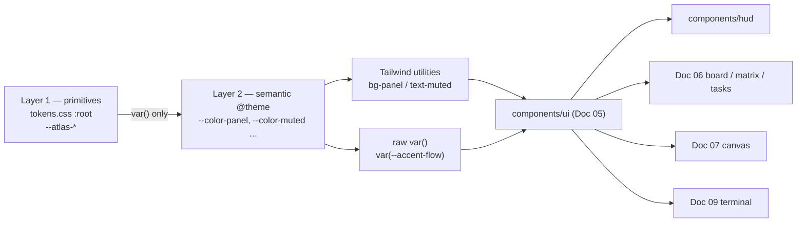

# Doc 05 — Tactical Cyber-HUD Design System

> **Series position:** 05 of 10 · **Owner:** Subagent 5 (Design Engineer)
> **Parent:** [`master_implementation_plan.md`](./master_implementation_plan.md) §2 (Visual Design System & Command HUD Aesthetic), §6 items 7 & 10, §11 (documents table).
> **Frozen input:** [`01_system_architecture.md`](./01_system_architecture.md) — the single immutable source of truth. This document refines it and never contradicts it.
> **Consumers:** Doc 06 (dashboard), Doc 07 (canvas annotation), Doc 09 (terminal/SSE), Doc 10 (visual QA).

---

## 1. Purpose & Boundary

Doc 05 is the only place in the series where a colour, font size, spacing value, duration, border treatment, or primitive prop signature is invented. Every other document **imports** what lives here.

### 1.1 Owned paths (hard boundary, mirrors Doc 01 §4.1)

| Path | Contents | Others may… |
| :--- | :--- | :--- |
| `frontend/styles/tokens.css` | Primitive `:root` vars + Tailwind v4 `@theme` semantic registration | import only |
| `frontend/styles/globals.css` | Reset, base type, `.hud-frame`, focus ring, scrollbars, keyframes | import only |
| `frontend/tailwind.config.ts` | Deliberately thin v4 shim: `content` globs + `darkMode: "class"` fixed to dark | read only |
| `frontend/components/ui/` | 15 primitives (§8) + local `cn` helper | import only |
| `frontend/components/hud/` | Shell chrome: `HudShell`, `HudTopBar`, `SystemStatusStrip`, `HudFocusProvider` | import only |

Doc 01 §4.1 assigns `frontend/components/hud/` to Doc 06. **Decision:** Doc 05 additionally owns the four shell files listed above and Doc 06 owns everything *inside* the slots they expose (§8.16). Rationale: the focus-arbitration context must live beside `HudPanel` or every consumer re-implements it; the slot API keeps Doc 06's page files untouched and merge-safe.

### 1.2 Non-goals

Doc 05 does **not** own: routes, `app/` layouts, split-pane data wiring, Zustand/TanStack Query, or the keyboard map (`J`/`K`/`C`/`A`/`Space`/`/`/`Esc`) — all Doc 06. It does not own canvas tools, brush cursors, or the export pipeline (Doc 07), nor the SSE client, terminal virtualization, or auto-scroll (Doc 09). Doc 05's only obligation to those documents is to publish the slots, primitives, and tokens listed in §14.1.

### 1.3 Import-only rule

```tsx
// CORRECT — Doc 06 / 07 / 09
import { HudPanel, PanelHeader, SegmentedGauge, StatusBadge } from "@/components/ui";
import { HudShell, HudFocusProvider } from "@/components/hud";

// FORBIDDEN anywhere outside Doc 05
<div className="bg-[#0B1528] shadow-[0_0_24px_rgba(0,242,254,.3)] text-[11px]">
```

1. **No hex literals** outside `styles/tokens.css` — review gate: `rg '#[0-9a-fA-F]{6}' frontend/components` returns zero hits outside `ui/`.
2. **No raw `shadow-*` / `blur-*` / `rounded-[Npx]`** by consumers — use the classes named in §6.3.
3. **New token needed?** Raise a `TOKEN-REQUEST` in the consuming doc; it is added here in the same PR.
4. **New primitive needed?** Compose existing primitives in your own folder; never fork one into `components/board/`.

Doc 05 also ships zero runtime behaviour: no `fetch`, no SSE subscription, no routing. Every primitive is presentational, typed against the frozen DTOs in Doc 01 §7, with `open` / `hovered` / `focused` as its only internal state.

---

## 2. Design Principles

Eight rules. When two conflict, the lower-numbered rule wins.

| # | Principle | Rule (one line) | Do | Don't |
| ---: | :--- | :--- | :--- | :--- |
| **P1** | Density is the feature | Every panel maximises verified information per pixel; whitespace separates, it never decorates. | 28px rows, 18px body line-height, 12px padding, `priority · age · DoD% · status` on one line | 48px rows with 24px padding; metrics hidden behind a "details" expander |
| **P2** | Legible under glare | Read on a bright monitor in a lit room: body ≥ 12px, contrast ≥ 4.5:1, always. | `--text-muted: #8B9AB0` (6.77:1); 1px `--border-grid` for structure | `#64748B` (4.07:1, fails §10.1); borders at 5% white |
| **P3** | Colour is state, never decoration | A saturated hue appears only when it encodes a Doc 01 §6.2 status, §7.7 priority/telemetry value, or log level. | Cyan = active/flowing; amber = human gate | Cyan as a brand flourish; amber to make a button pop |
| **P4** | Monospace for machine truth | Anything a machine produced — IDs, paths, timestamps, durations, percentages, logs, hashes — renders `font-machine tabular-nums`. | `<MachineText>{id.slice(0,8)}</MachineText>`; right-aligned tabular metrics | An Inter-rendered UUID wrapping mid-token; proportional digits shimmying on each SSE frame |
| **P5** | Zero decorative motion | An animation is permitted only if it encodes *liveness*, *severity*, or *arrival*. If you cannot name the datum, delete it. | 1 Hz lease countdown; 120ms append fade; 2s critical pulse | Cards floating in on mount; 400ms spring on reorder; ambient shimmer |
| **P6** | One focus, one accent | At most one panel per viewport is visually focused; at most two accent hues per panel. | Focused panel gets cyan brackets + inner glow; amber badge on slate rows | Every panel glowing equally; amber + cyan + emerald + crimson in one card |
| **P7** | Numbers align, text truncates | Numeric columns are right-aligned and tabular; truncated text always carries `title` with the full value. | `E:\dev\al…` + `title="E:\dev\alpha"`; `60%` in a fixed `w-9 text-right` slot | A row growing to three lines; `60%` floating after variable text |
| **P8** | Every affordance is pointer-optional | Every interactive element is a real `<button>`/`<a>`/`<input>` in DOM order with a visible `:focus-visible` ring. | `<IconButton label="Approve discovery">`; `Kbd` hints (`⏎`, `A`, `Esc`) | `<span onClick={approve}>✓</span>`; hotkeys that exist only in docs |

---

## 3. Design Token Architecture

### 3.1 Two layers, one direction



**Decision:** primitives are declared in `:root`, **not** in `@theme`. Tailwind therefore generates no `bg-obsidian-900` utility, which makes the raw palette physically unable to leak into feature code — the import-only rule of §1.3 enforced by the build system.

**Naming law:** `--atlas-<hue>-<step>` for primitives (never referenced outside `tokens.css`); `--<role>-<variant>` for semantic tokens; `--color-<role>` only inside `@theme`.

### 3.2 Layer 1 — primitives (frozen hues first)

Master §2.1 values verbatim; supporting shades are additive and exist only for tints, hovers, and AA-safe secondary text.

| Primitive | Hex | Origin | Purpose |
| :--- | :--- | :--- | :--- |
| `--atlas-obsidian-950` | `#030712` | **frozen** | Canvas / background space |
| `--atlas-obsidian-900` | `#060D1F` | **frozen** | Primary panel surface |
| `--atlas-obsidian-800` | `#0B1528` | **frozen** | Raised surface (cards, popovers, headers) |
| `--atlas-obsidian-750` | `#0F1D33` | supporting | Inset well (gauge track, terminal, code) |
| `--atlas-slate-800` | `#1E293B` | **frozen** | Grid borders, dividers |
| `--atlas-slate-700` | `#334155` | supporting | Border-strong (hover, nested panel) |
| `--atlas-cyan-400` | `#00F2FE` | **frozen** | Primary luminous accent — flow / active / identity |
| `--atlas-cyan-500` | `#00C9FF` | **frozen** | Flow secondary, pressed |
| `--atlas-cyan-100` | `#A5F3FC` | supporting | Machine-data text |
| `--atlas-cyan-900` | `#04202B` | supporting | Cyan tint background |
| `--atlas-amber-500` | `#F59E0B` | **frozen** | Review / human-gate accent |
| `--atlas-amber-600` | `#FF9100` | **frozen** | Review hot — badge text, gate icon |
| `--atlas-amber-900` | `#231603` | supporting | Amber tint background |
| `--atlas-emerald-500` | `#10B981` | **frozen** | Success / operational |
| `--atlas-emerald-400` | `#34D399` | supporting | Success text on emerald tint |
| `--atlas-emerald-900` | `#04231A` | supporting | Emerald tint background |
| `--atlas-crimson-500` | `#EF4444` | **frozen** | Critical / blocker |
| `--atlas-crimson-400` | `#FF5252` | **frozen** | Critical hot — text & pulse |
| `--atlas-crimson-900` | `#1F0A0F` | supporting | Crimson tint background |
| `--atlas-ice-100` | `#E2E8F0` | supporting | Primary text (15.70:1 on panel) |
| `--atlas-ice-300` | `#CBD5E1` | supporting | Secondary heading text |
| `--atlas-ice-500` | `#94A3B8` | supporting | Secondary / INFO text (7.55:1) |
| `--atlas-ice-600` | `#8B9AB0` | supporting | Muted text (6.77:1 — **approved**) |
| `--atlas-ice-650` | `#7A8AA3` | supporting | Low-priority text (5.52:1) |
| `--atlas-ice-700` | `#6B7C94` | supporting | DEBUG log text (4.55:1 — floor) |
| `--atlas-ice-750` | `#5A6B84` | supporting | Disabled only, never prose (3.57:1) |

No frozen value is altered and no new hue family is introduced.

### 3.3 Layer 2 — semantic tokens (the only names consumers touch)

| Semantic token | Primitive | Hex | Used for |
| :--- | :--- | :--- | :--- |
| `--surface-canvas` | `obsidian-950` | `#030712` | `<body>`, workspace backdrop |
| `--surface-panel` | `obsidian-900` | `#060D1F` | `HudPanel` body |
| `--surface-raised` | `obsidian-800` | `#0B1528` | Card, popover, toast, table header |
| `--surface-inset` | `obsidian-750` | `#0F1D33` | Gauge track, terminal viewport |
| `--surface-scrim` | — | `rgb(3 7 18 / .72)` | Modal scrim |
| `--border-grid` | `slate-800` | `#1E293B` | Panel border, row divider |
| `--border-strong` | `slate-700` | `#334155` | Hover border, nested panel |
| `--border-focus` | `cyan-400` | `#00F2FE` | Focus ring, focused bracket |
| `--accent-flow` | `cyan-400` | `#00F2FE` | `IN_PROGRESS`, live stream, links |
| `--accent-flow-dim` | `cyan-500` | `#00C9FF` | Pressed flow, MED priority fill |
| `--accent-flow-tint` | `cyan-900` | `#04202B` | Flow badge bg, active tab |
| `--accent-review` | `amber-500` | `#F59E0B` | `IN_REVIEW`, `PENDING_APPROVAL`, `WARN` |
| `--accent-review-hot` | `amber-600` | `#FF9100` | Review badge text |
| `--accent-review-tint` | `amber-900` | `#231603` | Review badge bg |
| `--accent-success` | `emerald-500` | `#10B981` | `COMPLETED`, passing tests |
| `--accent-success-soft` | `emerald-400` | `#34D399` | Success badge text |
| `--accent-success-tint` | `emerald-900` | `#04231A` | Success badge bg |
| `--accent-critical` | `crimson-500` | `#EF4444` | `ERROR`, priority ≥ 90, lease timeout |
| `--accent-critical-hot` | `crimson-400` | `#FF5252` | Critical badge text, pulse stroke |
| `--accent-critical-tint` | `crimson-900` | `#1F0A0F` | Critical badge bg |
| `--text-primary` | `ice-100` | `#E2E8F0` | Titles, values, prose |
| `--text-secondary` | `ice-500` | `#94A3B8` | Labels, INFO |
| `--text-muted` | `ice-600` | `#8B9AB0` | Metadata, timestamps, ticks |
| `--text-disabled` | `ice-750` | `#5A6B84` | Disabled controls only |
| `--text-machine` | `cyan-100` | `#A5F3FC` | IDs, paths, durations, log text |
| `--text-inverse` | `obsidian-950` | `#030712` | Text on a filled accent chip |
| `--status-pending-approval` | `review` | `#F59E0B` | §7.1 · `PENDING_APPROVAL` |
| `--status-pending` | `ice-500` | `#94A3B8` | §7.1 · `PENDING` |
| `--status-in-progress` | `flow` | `#00F2FE` | §7.1 · `IN_PROGRESS` |
| `--status-in-review` | `review` | `#F59E0B` | §7.1 · `IN_REVIEW` |
| `--status-completed` | `success` | `#10B981` | §7.1 · `COMPLETED` |
| `--status-rejected` | `critical` | `#EF4444` | §7.1 · `REJECTED` |
| `--priority-low` / `medium` / `high` / `critical` | `ice-650` / `flow-dim` / `review` / `critical-hot` | `#7A8AA3` / `#00C9FF` / `#F59E0B` / `#FF5252` | §7.3 · bands 0–39 / 40–69 / 70–89 / 90–100 |
| `--log-debug` / `info` / `warn` / `error` | `ice-700` / `ice-500` / `review` / `critical-hot` | `#6B7C94` / `#94A3B8` / `#F59E0B` / `#FF5252` | §7.2 · `DEBUG` / `INFO` / `WARN` / `ERROR` |

### 3.4 `frontend/styles/tokens.css` (< 60 lines, copy-pasteable)

```css
@import "tailwindcss";

/* Layer 1 — primitives. Never referenced outside this file. */
:root {
  --atlas-obsidian-950:#030712; --atlas-obsidian-900:#060D1F;
  --atlas-obsidian-800:#0B1528; --atlas-obsidian-750:#0F1D33;
  --atlas-slate-800:#1E293B;    --atlas-slate-700:#334155;
  --atlas-cyan-400:#00F2FE;     --atlas-cyan-500:#00C9FF;
  --atlas-cyan-100:#A5F3FC;     --atlas-cyan-900:#04202B;
  --atlas-amber-500:#F59E0B;    --atlas-amber-600:#FF9100;   --atlas-amber-900:#231603;
  --atlas-emerald-500:#10B981;  --atlas-emerald-400:#34D399; --atlas-emerald-900:#04231A;
  --atlas-crimson-500:#EF4444;  --atlas-crimson-400:#FF5252; --atlas-crimson-900:#1F0A0F;
  --atlas-ice-100:#E2E8F0; --atlas-ice-300:#CBD5E1; --atlas-ice-500:#94A3B8;
  --atlas-ice-600:#8B9AB0; --atlas-ice-650:#7A8AA3; --atlas-ice-700:#6B7C94; --atlas-ice-750:#5A6B84;
}

/* Layer 2 — semantic. These generate the ONLY colour utilities in the app. */
@theme {
  --color-canvas:var(--atlas-obsidian-950); --color-panel:var(--atlas-obsidian-900);
  --color-raised:var(--atlas-obsidian-800); --color-inset:var(--atlas-obsidian-750);
  --color-grid:var(--atlas-slate-800);      --color-grid-strong:var(--atlas-slate-700);
  --color-flow:var(--atlas-cyan-400);       --color-flow-dim:var(--atlas-cyan-500);
  --color-flow-tint:var(--atlas-cyan-900);
  --color-review:var(--atlas-amber-500);    --color-review-hot:var(--atlas-amber-600);
  --color-review-tint:var(--atlas-amber-900);
  --color-success:var(--atlas-emerald-500); --color-success-soft:var(--atlas-emerald-400);
  --color-success-tint:var(--atlas-emerald-900);
  --color-critical:var(--atlas-crimson-500);--color-critical-hot:var(--atlas-crimson-400);
  --color-critical-tint:var(--atlas-crimson-900);
  --color-primary:var(--atlas-ice-100);     --color-secondary:var(--atlas-ice-500);
  --color-muted:var(--atlas-ice-600);       --color-disabled:var(--atlas-ice-750);
  --color-machine:var(--atlas-cyan-100);    --color-inverse:var(--atlas-obsidian-950);
  --color-priority-low:var(--atlas-ice-650);--color-log-debug:var(--atlas-ice-700);
  --color-log-info:var(--atlas-ice-500);    --color-log-warn:var(--atlas-amber-500);
  --color-log-error:var(--atlas-crimson-400);

  --font-ui:var(--font-inter), Inter, "Geist Sans", system-ui, sans-serif;
  --font-machine:var(--font-jetbrains), "JetBrains Mono", "Geist Mono", ui-monospace, monospace;

  --text-hud-micro:10px;  --text-hud-micro--line-height:12px;  --text-hud-micro--letter-spacing:.08em; --text-hud-micro--font-weight:600;
  --text-hud-label:11px;  --text-hud-label--line-height:14px;  --text-hud-label--letter-spacing:.06em; --text-hud-label--font-weight:600;
  --text-hud-body:12px;   --text-hud-body--line-height:18px;
  --text-hud-bodylg:13px; --text-hud-bodylg--line-height:20px;
  --text-hud-title:15px;  --text-hud-title--line-height:20px;  --text-hud-title--font-weight:600;
  --text-hud-heading:18px;--text-hud-heading--line-height:24px;--text-hud-heading--font-weight:600;
  --text-hud-display:28px;--text-hud-display--line-height:32px;--text-hud-display--font-weight:600;
  --text-machine-sm:11px; --text-machine-sm--line-height:16px;
  --text-machine-md:12px; --text-machine-md--line-height:18px;
  --text-machine-lg:13px; --text-machine-lg--line-height:20px;

  --spacing-panel:12px; --spacing-row:28px; --spacing-gutter:12px;
  --radius-hud:4px;     --radius-chip:2px;
  --breakpoint-hud-dual:1280px; --breakpoint-hud-quad:1920px;
  --animate-hud-pulse:hud-pulse 2000ms cubic-bezier(.2,0,0,1) infinite;
  --animate-hud-append:hud-append 120ms cubic-bezier(.2,0,0,1) 1;
  --shadow-hud-panel:inset 0 1px 0 0 rgb(255 255 255/.03), 0 8px 24px -12px rgb(0 0 0/.6);
}
```

### 3.5 Utility mapping

| Registered token | Generated utilities | Consumer usage |
| :--- | :--- | :--- |
| `--color-panel` | `bg-panel`, `border-panel`, `text-panel` | `className="bg-panel"` |
| `--color-muted` | `text-muted` | metadata, timestamps |
| `--font-machine` | `font-machine` | inside `MachineText` only |
| `--text-hud-label` | `text-hud-label` | panel headers, badges |
| `--spacing-panel` | `p-panel`, `px-panel`, `gap-panel` | panel padding |
| `--radius-hud` / `--radius-chip` | `rounded-hud` / `rounded-chip` | 4px panels, 2px chips |
| `--breakpoint-hud-dual` | `hud-dual:grid-cols-2` | dual split (§5.3) |
| `--animate-hud-pulse` | `animate-hud-pulse` | critical priority only |

**Deliberate omissions:** no `--color-white`, no `--color-black`, no opacity-modified accent token. Tints use alpha modifiers on existing tokens (`bg-flow/12`, `bg-critical/8`) and never a new hex.

---

## 4. Typography Scale

### 4.1 Families (Master §2.2)

| Role | Primary | Fallback chain | Loaded by |
| :--- | :--- | :--- | :--- |
| UI / prose | **Inter** | Geist Sans → system-ui | Doc 06 via `next/font/google` |
| Data / machine | **JetBrains Mono** | Geist Mono → ui-monospace | Doc 06 via `next/font/google` |

Both variable, `display: "swap"`, `preload: true`, `subsets: ["latin"]`. Two families maximum — a third is an anti-pattern (§12).

### 4.2 Scale

| Token | Family | Size | LH | Weight | Tracking | Use case |
| :--- | :--- | ---: | ---: | ---: | ---: | :--- |
| `text-hud-micro` | UI | 10px | 12px | 600 | +0.08em | Eyebrows, gauge ticks, `Kbd` caps |
| `text-hud-label` | UI | 11px | 14px | 600 | +0.06em | `PanelHeader`, `StatusBadge`, tabs, `<th>` |
| `text-hud-body` | UI | 12px | 18px | 400 | 0 | Dense cells, list-row titles, tooltips |
| `text-hud-bodylg` | UI | 13px | 20px | 400/500 | 0 | Panel body copy, markdown, empty states |
| `text-hud-title` | UI | 15px | 20px | 600 | −0.01em | Detail title, modal title |
| `text-hud-heading` | UI | 18px | 24px | 600 | −0.02em | Section headings |
| `text-hud-display` | UI | 28px | 32px | 600 | −0.02em | Hero metrics only (`health_percent`) |
| `text-machine-sm` | Mono | 11px | 16px | 400 | 0 | Log lines, diff lines |
| `text-machine-md` | Mono | 12px | 18px | 400 | 0 | IDs, paths, durations, metric values |
| `text-machine-lg` | Mono | 13px | 20px | 500 | 0 | Inline code, patch headers |

**Floors:** nothing renders below 10px; no prose below 12px; no log line below 11px.

### 4.3 Machine-text law

These always render through `MachineText` (§8.6): task/project/asset UUIDs (`TaskSummaryDTO.id`, `ProjectDTO.id`, `Asset.id`, shown as an 8-char prefix), `ProjectDTO.slug`, absolute paths (`ProjectDTO.local_repo_path`, `Asset.absolute_path`), storage-relative paths (`Asset.relative_path`), timestamps (`created_at` / `updated_at` / `ts`, e.g. `2026-10-27T08:10:11.297Z`), durations (`lease_seconds_remaining` → `00:09:12`), metrics (`priority`, `dod_progress_percent`, `age_hours`, `health_percent` → `95`, `66%`, `27.4h`), log bodies (`TaskEventDTO.message`), and hashes (`Asset.sha256`).

**`tabular-nums` rule:** any numeric element whose value changes without a layout change (countdowns, percentages, counters) sets `tabular-nums` — implemented as `className="font-machine tabular-nums"`, never globally, because Inter's tabular figures widen prose.

### 4.4 Font wiring contract (Doc 05 ⇄ Doc 06)

```tsx
// frontend/app/layout.tsx — Doc 06 owns this file; reproduced as a contract
const inter = Inter({ subsets: ["latin"], variable: "--font-inter", display: "swap" });
const mono = JetBrains_Mono({ subsets: ["latin"], variable: "--font-jetbrains", display: "swap" });
// <html lang="en" className={`${inter.variable} ${mono.variable}`}>
```

Omitting either variable silently falls back to `system-ui` / `ui-monospace` — legible but off-spec, and §13 item 5 fails.

### 4.5 Type rules

1. Never `font-bold` (700) or above; 600 is the ceiling — hierarchy comes from size, case, and colour.
2. Uppercase is reserved for `text-hud-micro` / `text-hud-label`; never uppercase a task title.
3. Prose line length ≤ 88ch; log lines never wrap (`whitespace-pre` + horizontal scroll).
4. Tracking above `+0.08em` is forbidden — it breaks mono alignment of adjacent `MachineText`.

---

## 5. Spacing, Grid & Layout Rhythm

### 5.1 4px base scale

All spacing is a multiple of 4px. Tailwind's default scale satisfies this; Doc 05 adds four semantic aliases and forbids arbitrary values.

| Alias token | Value | Tailwind | Use |
| :--- | ---: | :--- | :--- |
| `--spacing-panel` | 12px | `p-panel`, `px-panel`, `gap-panel` | Panel inner padding |
| `--spacing-row` | 28px | `h-row` | Task/table row height |
| `--spacing-gutter` | 12px | `gap-gutter` | Split-pane gutter |
| `--spacing-frame` | 1px | `border-frame` | HUD frame stroke |

| Step | px | Permitted usage |
| :--- | ---: | :--- |
| `1` / `1.5` | 4 / 6 | Icon-to-label gap; badge and chip padding |
| `2` | 8 | Panel body rhythm, stack gap, nested-card padding |
| `3` | 12 | **Panel padding**, gutter, section gap |
| `4` | 16 | Between sub-sections inside a panel |
| `6` / `8` | 24 / 32 | Between panels in a column / page outer padding |
| `12` | 48 | Never inside a panel — page-level empty states only |

**Forbidden:** `p-[13px]`, `mt-[7px]`, `gap-[5px]`. The four aliases exist so the common cases need no arithmetic.

### 5.2 Panel anatomy & the HUD frame

Every top-level panel is a **frame**: 1px border, four 6px corner brackets, optional scanline overlay. One wireframe covers both the anatomy and the treatments.

```
╔══════════════════════════════════════════════════════════════════════╗  ← 1px --border-grid
║ ▌ TELEMETRY · QUEUE RADAR                               ⌁ LIVE  94%  ║  ← PanelHeader 32px
╟──────────────────────────────────────────────────────────────────────╢  ← 1px divider
║  PRIORITY MATRIX             y = priority ↑                          ║
║   100 ┤                      ·                                       ║
║       │                  ◆ 95  Fix JWT expiry race                   ║
║    75 ┤           ● 82                                       ▁▂▃▅▇   ║
║       │       ● 61                                            spark   ║
║    50 ┤  ● 48                                                        ║
║       └──────┴──────────┴──────────┴──────────┴──→ x = age_hours     ║
║        0h     12h        24h        36h       48h                    ║
╟──────────────────────────────────────────────────────────────────────╢
║  DoD  ▐███▌▐███▌▐███▌▐███▌▐███▌▐░░░▌▐░░░▌▐░░░▌              62%      ║  ← 28px row
║       1     2     3     4     5     6     7     8                    ║
║  LEASE 00:09:12   AGENT Agent-Claude   ATTEMPTS 1                    ║
╚══════════════════════════════════════════════════════════════════════╝  ← 12px padding
  ▲ corner brackets: 6px arms, 1px thick, --text-secondary (--border-focus when focused)
```

| Zone / element | Spec | Rule |
| :--- | :--- | :--- |
| `PanelHeader` | 32px fixed, `px-3` | Never wraps; truncate the title first |
| Panel body | auto, `p-3` (12px), `gap-2` stack | Maximum one nesting level |
| Panel footer | 28px, `px-3` | Pagination or `Kbd` legend only |
| Frame stroke | `1px solid var(--border-grid)`, `border-radius: 4px` | Never `rounded-lg`+ (§12) |
| Corner brackets | 6px arms, 1px thick | `--text-secondary` → `--border-focus` when focused |
| Scanline overlay | 2px repeating-linear-gradient at `rgba(0,242,254,.02)`, `pointer-events-none` | **Off by default**, telemetry panel only |
| Body background | `bg-panel`; nested wells `bg-inset` | Never a second glass layer (§6.2) |

```css
/* frontend/styles/globals.css — frame primitive, used by HudPanel only */
.hud-frame { position:relative; border:1px solid var(--border-grid); border-radius:var(--radius-hud); }
.hud-frame > .hud-corner::before, .hud-frame > .hud-corner::after {
  content:""; position:absolute; width:6px; height:6px; pointer-events:none;
  border:0 solid var(--text-secondary);
}
.hud-frame > .hud-corner::before { top:-1px; left:-1px; border-top-width:1px; border-left-width:1px; }
.hud-frame > .hud-corner::after  { bottom:-1px; right:-1px; border-bottom-width:1px; border-right-width:1px; }
.hud-frame[data-focused="true"], .hud-frame[data-focused="true"] > .hud-corner::before,
.hud-frame[data-focused="true"] > .hud-corner::after { border-color:var(--border-focus); }
```

### 5.3 Breakpoints & split-pane capacity

| Breakpoint | Min width | Splits | Layout |
| :--- | ---: | ---: | :--- |
| default | 0 | 1 | Single column; `Tabs` switch projects; top bar collapses |
| `md` | 768px | 1 | Wider rows; matrix behind a tab |
| `lg` | 1024px | 1 + rail | 240px left rail + one workspace |
| `hud-dual` | **1280px** | **2** | Two panes side by side; matrix in a collapsible right rail |
| `hud-quad` | **1920px** | **4** | 2×2 grid, matrix docked right at 360px |

**Decision:** quad view is a 2×2 grid, not four columns. Rationale: at 1920px four columns give 480px panes — too narrow for an 11px mono log stream; 2×2 gives ~960×500 panes that satisfy P1 and P2.

| Container | Rule |
| :--- | :--- |
| `HudShell` | `grid-rows-[40px_1fr]` — 40px top bar, remainder fills |
| Split container | `flex gap-gutter`; every pane `min-w-0` (mandatory, prevents `MachineText` flex overflow) |
| Log viewport | `min-h-0 flex-1 overflow-hidden` wrapping an inner `overflow-y-auto` |
| Pane minimum | 400px wide, 280px tall; below that the pane collapses to a summary row |

---

## 6. Elevation, Glass & Border Effects

### 6.1 Elevation ladder

Only three elevations exist; anything else is a bug.

| Level | Surface | Border | Shadow | Used by |
| :--- | :--- | :--- | :--- | :--- |
| **E0** canvas | `bg-canvas` | none | none | Workspace backdrop, gutter |
| **E1** panel | `bg-panel` + `backdrop-blur-md` | `1px --border-grid` | `--shadow-hud-panel` | `HudPanel`, split panes |
| **E2** raised | `bg-raised` | `1px --border-strong` | `0 12px 32px -16px rgb(0 0 0/.75)` | Popover, `ToastStack`, command palette |

**Decision:** no E3. Modal scrim (`--surface-scrim`) plus E2 is the ceiling; a fourth level reads as a different application inside the HUD.

### 6.2 Glass recipe

```css
.hud-glass {                      /* applied by HudPanel; components never re-declare it */
  background-color: color-mix(in oklab, var(--surface-panel) 88%, transparent);
  backdrop-filter: blur(12px) saturate(115%);
  box-shadow: var(--shadow-hud-panel);
}
```

| Constraint | Value | Reason |
| :--- | :--- | :--- |
| Blur radius | exactly 12px (`backdrop-blur-md`) | Larger smears the 1px grid; smaller is invisible at these opacities |
| Alpha floor | 88% surface opacity | Below 82% the canvas grid shows through log text and breaks P2 |
| Max layered glass | **2** surfaces deep | A third blur produces unpredictable contrast |
| `will-change` | never set globally | Blur across many panes is the largest compositor cost |

**Performance rule:** `HudPanel` must stay layout-stable (fixed `PanelHeader` height) — an unmount/remount on every SSE tick re-rasterizes `backdrop-filter` and drops frames.

### 6.3 Border effects

| Effect | CSS | Where |
| :--- | :--- | :--- |
| Grid border | `1px solid var(--border-grid)` | Panel edges, row separators |
| Strong border | `1px solid var(--border-strong)` | Hovered card, nested panel |
| Top highlight | `inset 0 1px 0 0 rgb(255 255 255/.04)` | Any glass surface (simulated light edge) |
| Corner bracket | §5.2 | Every top-level `HudPanel` with `brackets` |
| Left status rail | `3px solid var(--status-*)` | Task row, workbench pane leading edge |
| Focus ring | `2px solid var(--border-focus)`, `2px` offset | `:focus-visible` only (§10.2) |

### 6.4 Single-focus rule

Exactly **one** panel per viewport may render `data-focused="true"`.

| Signal | Unfocused | Focused |
| :--- | :--- | :--- |
| Outer border | `--border-grid` | `--border-focus` |
| Corner brackets | `--text-secondary` | `--border-focus` |
| Inner glow | none | `inset 0 0 0 1px rgb(0 242 254/.10), inset 0 0 24px -8px rgb(0 242 254/.22)` |
| Header title colour | `--text-primary` | unchanged (no extra signal) |
| Scanline | allowed off | allowed on |

```tsx
// components/hud/HudFocusProvider.tsx — arbitration, not decoration
const FocusCtx = createContext<{ id: string | null; set: (id: string) => void }>({ id: null, set: () => {} });
export function HudFocusProvider({ children }: { children: React.ReactNode }) {
  const [id, set] = useState<string | null>(null);
  return <FocusCtx.Provider value={{ id, set }}>{children}</FocusCtx.Provider>;
}
export const useHudFocus = (panelId: string) => {
  const { id, set } = useContext(FocusCtx);
  return { focused: id === panelId, focus: () => set(panelId) };
};
```

Rules: focusing sets a new id and the previous panel implicitly blurs (no coordinated animation); focus is set on `pointerdown` and `focusin`; while the command palette is open it is the only focused surface and all panels render `data-focused="false"`.

---

## 7. Status & Priority Color Semantics

### 7.1 `TaskStatus` → visual mapping (enum frozen, Doc 01 §6.2)

| Status | Token | Hex | Badge text | Fill / border / text | Rail | Pulse | Glyph |
| :--- | :--- | :--- | :--- | :--- | :--- | :--- | :--- |
| `PENDING_APPROVAL` | `--status-pending-approval` | `#F59E0B` | `PENDING APPROVAL` | `bg-review-tint` / `border-review/40` / `text-review-hot` | amber | 2s, **2 cycles then stop** | `⚡` |
| `PENDING` | `--status-pending` | `#94A3B8` | `PENDING` | `bg-raised` / `border-grid` / `text-secondary` | slate | none | `◌` |
| `IN_PROGRESS` | `--status-in-progress` | `#00F2FE` | `IN PROGRESS` | `bg-flow-tint` / `border-flow/30` / `text-flow` | cyan | 1.4s LED dot | `▶` |
| `IN_REVIEW` | `--status-in-review` | `#F59E0B` | `IN REVIEW` | `bg-review-tint` / `border-review/40` / `text-review-hot` | amber | none | `◑` |
| `COMPLETED` | `--status-completed` | `#10B981` | `COMPLETED` | `bg-success-tint` / `border-success/30` / `text-success-soft` | emerald | none | `✔` |
| `REJECTED` | `--status-rejected` | `#EF4444` | `REJECTED` | `bg-critical-tint` / `border-critical/40` / `text-critical-hot` | crimson | none | `✕` |

**Badge text is mandatory** (§10.4). Labels are uppercase `text-hud-label` taken from this table verbatim — Doc 06 must not invent abbreviations.

**Decision:** only `IN_PROGRESS` gets an LED dot. Rationale: the dot encodes *machine liveness* (a live lease with heartbeats). `IN_REVIEW` has no lease per Doc 01 §6.4, so a pulse there would imply liveness that does not exist.

**Decision:** `PENDING_APPROVAL` pulses twice then rests. Rationale: the discovery inbox is normally empty; a permanent pulse in a quiet HUD becomes wallpaper and defeats P5. Two cycles announce arrival, steady amber sustains the state.

### 7.2 `LogLevel` → visual mapping (Doc 01 §6.2)

| Level | Token | Hex | Glyph | Chip bg | Row tint | Weight |
| :--- | :--- | :--- | :--- | :--- | :--- | ---: |
| `DEBUG` | `--log-debug` | `#6B7C94` | `··` | none | none | 400 |
| `INFO` | `--log-info` | `#94A3B8` | `›` | none | none | 400 |
| `WARN` | `--log-warn` | `#F59E0B` | `▲` | `bg-review-tint` | `bg-review/5` | 500 |
| `ERROR` | `--log-error` | `#FF5252` | `✖` | `bg-critical-tint` | `bg-critical/8` | 500 |

The level chip renders the literal enum string (`DEBUG`/`INFO`/`WARN`/`ERROR`) — no synonyms, no emoji substitution. `DEBUG` is hidden entirely when the verbose toggle is off, including from the live region.

### 7.3 Priority bands

| Band | Range | Token | Hex | Label | Extra |
| :--- | :--- | :--- | :--- | :--- | :--- |
| Low | **0–39** | `--priority-low` | `#7A8AA3` | `LOW` | — |
| Medium | **40–69** | `--priority-medium` | `#00C9FF` | `MED` | default `50` lands here (Doc 01 §6.4) |
| High | **70–89** | `--priority-high` | `#F59E0B` | `HIGH` | — |
| Critical | **90–100** | `--priority-critical` | `#FF5252` | `CRITICAL` | 2s pulse, mandatory |

**Master rule (binding):** `priority >= 90` **must** use critical crimson. `ProjectDTO.accent_color` applies to identity chrome only (project chip, pane eyebrow, matrix point hue) — never to a priority or status signal.

```ts
// components/ui/priority.ts — single source of band logic
export type PriorityBand = "low" | "medium" | "high" | "critical";
export const priorityBand = (p: number): PriorityBand =>
  p >= 90 ? "critical" : p >= 70 ? "high" : p >= 40 ? "medium" : "low";
export const PRIORITY_LABEL: Record<PriorityBand, string> =
  { low: "LOW", medium: "MED", high: "HIGH", critical: "CRITICAL" };
```

Boundaries are inclusive at the lower bound: `39→low`, `40→medium`, `69→medium`, `70→high`, `89→high`, `90→critical`, `100→critical`.

### 7.4 Derived-value rules (Doc 01 §6.9)

| Field | Rule |
| :--- | :--- |
| `dod_progress_percent` | `< 34` → `--text-secondary`; `34–66` → `--accent-flow`; `>= 67` → `--accent-success`; `100` → success + `✔` |
| `lease_seconds_remaining` | `> 300` → `--text-machine`; `61–300` → `--accent-review`; `<= 60` → `--accent-critical` + pulse |
| `health_percent` | `< 40` → critical; `40–74` → review; `>= 75` → success |
| `age_hours` (status `PENDING`) | `> 48` → `--text-muted` + `STALE` chip in review amber |
| `is_blocked` | `⛔` chip in review amber, amber left rail, title never dimmed |
| `is_agent_discovered` | `⚡` chip in review amber; do not recolour the row |
| `attempt_count > 1` | `↻N` chip in `--text-muted` |

**Chip ceiling:** at most one accent-coloured chip per row (P6). Precedence: blocked > stale > discovered > attempts.

### 7.5 Colour budget enforcement

At most **2** saturated hues in a single task row or a single panel (verified by grep per row component and by a Storybook VRT baseline — a third hue is a visual regression). The top bar is fixed at one hue (cyan) plus the status dot. A whole page reaches 5 hues only when every status is simultaneously present.

---

## 8. Component Primitive Catalogue

All primitives live in `frontend/components/ui/`, accept `className`, and re-export from one barrel `frontend/components/ui/index.ts` (plus `LogLevelChip`, `priorityBand`, `PRIORITY_LABEL`). Consumers import **only** from `@/components/ui` and `@/components/hud`. Everything is server-compatible except `Tabs` and `ToastStack` (**client**).

| # | Primitive | Purpose |
| ---: | :--- | :--- |
| 1 | `HudPanel` | Frame + glass + brackets + focus arbitration |
| 2 | `PanelHeader` | Fixed 32px header: title, meta, actions |
| 3 | `SegmentedGauge` | LED-block DoD progress (Master §2.2) |
| 4 | `StatusBadge` / `LogLevelChip` | Enum → colour + text chip |
| 5 | `PriorityBar` | 0–100 bar with band + critical pulse |
| 6 | `MachineText` | Mono + tabular + truncation + `title` |
| 7 | `IconButton` | 24/28px square action, required `label` |
| 8 | `Tabs` | Segmented switch for panes/sections |
| 9 | `EmptyState` | Zero-data placeholder with action |
| 10 | `SkeletonLine` | Loading placeholder, no shimmer |
| 11 | `ToastStack` | Transient notifications |
| 12 | `Kbd` | Keycap chip for hotkey hints |
| 13 | `Divider` | 1px rule, h/v, optional caption |
| 14 | `Sparkline` | Inline SVG trend, no chart library |
| 15 | `AlertBanner` | Degraded-mode banner (Doc 01 §15) |

### 8.1 `HudPanel` · 8.2 `PanelHeader`

| `HudPanel` prop | Type | Default | Notes |
| :--- | :--- | :--- | :--- |
| `panelId` | `string` | **required** | Focus arbitration key, unique per viewport |
| `title` / `meta` / `actions` | `ReactNode` | — | Delegated to `PanelHeader` |
| `brackets` / `scanline` / `dense` | `boolean` | `true` / `false` / `false` | `scanline` legal only on the telemetry panel |
| `state` | `"idle" \| "loading" \| "error" \| "empty"` | `"idle"` | Swaps body for `SkeletonLine` / `AlertBanner` / `EmptyState` |

`PanelHeader` props: `title` (required, renders `<h2>` uppercase `text-hud-label`), `meta` (`text-hud-micro`, `aria-live="off"` so counters never announce on SSE ticks), `actions` (`IconButton` cluster), `sticky` (default `true`).

**States:** idle, focused, loading, error, empty. **A11y:** `<section aria-label={string title ?? panelId}>`; the panel is a container, not tabbable — focus lives on its interactive children.

```tsx
export function HudPanel({ panelId, title, meta, actions, brackets = true, scanline, dense, state = "idle", className, children }: HudPanelProps) {
  const { focused, focus } = useHudFocus(panelId);
  return (
    <section aria-label={typeof title === "string" ? title : panelId} onPointerDown={focus} onFocusCapture={focus}
      data-focused={focused} data-scanline={scanline ? "" : undefined}
      className={cn("hud-frame hud-glass relative flex min-h-0 min-w-0 flex-col", dense ? "p-2" : "p-panel", className)}>
      {brackets && <span className="hud-corner" aria-hidden />}
      {(title || meta || actions) && <PanelHeader title={title} meta={meta} actions={actions} />}
      <div className="min-h-0 flex-1 overflow-auto">{state === "idle" ? children : <PanelPlaceholder state={state} />}</div>
    </section>
  );
}

export const PanelHeader = ({ title, meta, actions, sticky = true }: PanelHeaderProps) => (
  <header className={cn("flex h-8 shrink-0 items-center gap-2 border-b border-grid pb-1", sticky && "sticky top-0 z-10 bg-panel/95 backdrop-blur-md")}>
    <h2 className="min-w-0 flex-1 truncate text-hud-label uppercase tracking-[0.06em] text-primary">{title}</h2>
    {meta && <span className="shrink-0 text-hud-micro tabular-nums text-muted">{meta}</span>}
    {actions && <div className="flex shrink-0 items-center gap-1">{actions}</div>}
  </header>
);
```

### 8.3 `SegmentedGauge` (DoD LED blocks — Master §2.2)

| Prop | Type | Default | Notes |
| :--- | :--- | :--- | :--- |
| `value` | `number` | **required** | `0..100`; pass `dod_progress_percent` |
| `segments` / `items` | `number` / `{id,label,completed}[]` | `10` / — | `items` overrides `segments`: one block per checklist item |
| `size` / `showLabel` | `"sm"\|"md"` / `boolean` | `"md"` / `true` | sm = 4px, md = 8px tall |
| `tone` | `"auto" \| "flow" \| "success"` | `"auto"` | `auto` follows §7.4 |

**States:** empty, partial, complete; blocks are all-or-nothing (LED semantics). **A11y:** `role="progressbar"` + `aria-valuenow/min/max` + `aria-valuetext="{n} of {m} checklist items complete"`; blocks `aria-hidden`.

```tsx
export function SegmentedGauge({ value, segments = 10, items, size = "md", showLabel = true, tone = "auto" }: SegmentedGaugeProps) {
  const total = items?.length ?? segments;
  const done = items ? items.filter((i) => i.completed).length : Math.round((value / 100) * segments);
  const fill = tone === "success" || (tone === "auto" && value >= 67) ? "bg-success" : "bg-flow";
  return (
    <div className="flex items-center gap-2" role="progressbar" aria-valuenow={value} aria-valuemin={0} aria-valuemax={100}
      aria-valuetext={items ? `${done} of ${total} checklist items complete` : `${value} percent complete`}>
      <div className={cn("flex flex-1 gap-[2px]", size === "sm" ? "h-1" : "h-2")} aria-hidden>
        {Array.from({ length: total }).map((_, i) => (
          <span key={i} title={items?.[i] ? `#${items[i].id} ${items[i].label}` : undefined}
            className={cn("flex-1 rounded-chip", i < done ? fill : "bg-inset ring-1 ring-inset ring-grid")} />
        ))}
      </div>
      {showLabel && <MachineText className="w-9 text-right text-machine-sm text-secondary">{items?.length ? `${done}/${total}` : `${value}%`}</MachineText>}
    </div>
  );
}
```

### 8.4 `StatusBadge` / `LogLevelChip`

`StatusBadge`: `status` (required `TaskStatus`), `size` (`sm` 16px | `md` 20px), `pulse` (default `true`, honours §7.1), `showGlyph` (default `true`). `LogLevelChip`: `level` (required), `compact` (default `true` — glyph only with `aria-label` carrying the word).

**States:** static; `PENDING_APPROVAL` / `IN_PROGRESS` animate per §7.1 and stop under reduced motion. **A11y:** the badge always carries its **text label** (§10.4); glyph-only is legal only when a visible level string exists in the same row.

```tsx
const STATUS: Record<TaskStatus, { label: string; glyph: string; cls: string; pulse: boolean }> = {
  PENDING_APPROVAL: { label: "PENDING APPROVAL", glyph: "⚡", cls: "bg-review-tint border-review/40 text-review-hot", pulse: true },
  PENDING:          { label: "PENDING",          glyph: "◌", cls: "bg-raised border-grid text-secondary",             pulse: false },
  IN_PROGRESS:      { label: "IN PROGRESS",      glyph: "▶", cls: "bg-flow-tint border-flow/30 text-flow",             pulse: true },
  IN_REVIEW:        { label: "IN REVIEW",        glyph: "◑", cls: "bg-review-tint border-review/40 text-review-hot",   pulse: false },
  COMPLETED:        { label: "COMPLETED",        glyph: "✔", cls: "bg-success-tint border-success/30 text-success-soft", pulse: false },
  REJECTED:         { label: "REJECTED",         glyph: "✕", cls: "bg-critical-tint border-critical/40 text-critical-hot", pulse: false },
};
export function StatusBadge({ status, size = "sm", pulse = true, showGlyph = true }: StatusBadgeProps) {
  const s = STATUS[status];
  return (
    <span data-pulse={pulse && s.pulse ? "status" : undefined}
      className={cn("inline-flex shrink-0 items-center gap-1 rounded-chip border px-1.5 font-ui uppercase", size === "sm" ? "h-4 text-hud-micro" : "h-5", s.cls)}>
      {showGlyph && <span aria-hidden>{s.glyph}</span>}{s.label}
    </span>
  );
}
```

### 8.5 `PriorityBar` · 8.6 `MachineText`

`PriorityBar`: `value` (required `0..100`), `showValue` (default `true`), `showBand` (default `false`), `height` (`4`|`6`), `interactive` (default `false` → `role="slider"` with `←/→` ±5, `PgUp/PgDn` ±10, `Home/End` 0/100; otherwise `role="progressbar" aria-label="Priority"`).

`MachineText`: `as` (`span`|`code`|`div`|`time`), `truncate` (`start`|`middle`|`end`|`false`, default `end`; paths use `middle` to keep the basename), `copyable` (focusable sibling button, `aria-label="Copy"`), `title` (auto from string children), `dim` (uses `--text-muted`). **States:** default, hover, copied (2s). `truncate` implies `title`, so truncation is always discoverable.

```tsx
export function PriorityBar({ value, showValue = true, showBand, height = 4, interactive }: PriorityBarProps) {
  const band = priorityBand(value);
  return (
    <div className="flex items-center gap-2">
      <div role={interactive ? "slider" : "progressbar"} aria-label="Priority" aria-valuenow={value} aria-valuemin={0}
        aria-valuemax={100} tabIndex={interactive ? 0 : undefined} style={{ height }}
        className={cn("relative flex-1 overflow-hidden rounded-chip bg-inset ring-1 ring-inset ring-grid", interactive && "cursor-ew-resize")}>
        <span data-pulse={band === "critical" ? "priority" : undefined} style={{ width: `${value}%` }}
          className={cn("absolute inset-y-0 left-0 rounded-chip transition-[width] duration-150",
            { low: "bg-priority-low", medium: "bg-flow-dim", high: "bg-review", critical: "bg-critical-hot" }[band])} />
      </div>
      {showBand && <span className="text-hud-micro uppercase text-muted">{PRIORITY_LABEL[band]}</span>}
      {showValue && <MachineText className="w-6 text-right text-machine-sm text-primary">{value}</MachineText>}
    </div>
  );
}

export function MachineText({ as: Tag = "span", truncate = "end", dim, title, className, children }: MachineTextProps) {
  const text = typeof children === "string" ? children : undefined;
  return (
    <Tag title={title ?? text} dir={truncate === "start" ? "rtl" : undefined}
      className={cn("font-machine text-machine-md tabular-nums", dim ? "text-muted" : "text-machine",
        truncate && "block min-w-0 truncate", Tag === "code" && "rounded-chip bg-inset px-1 text-machine-sm", className)}>
      {children}
    </Tag>
  );
}
```

### 8.7 `IconButton` · 8.8 `Tabs`

`IconButton`: `label` (required → `aria-label` + tooltip), `icon` (required), `variant` (`ghost`|`outline`|`solid`), `size` (`sm` 24px | `md` 28px), `danger` / `disabled` / `active` (default `false`). A real `<button type="button">`; `disabled` uses the native attribute so it deliberately leaves the tab order.

`Tabs`: `items` (`{id,label,badge?}[]`, required), `value` + `onChange` (controlled), `size`, `kbdHints` (renders `⌘1…⌘4`). `role="tablist"` / `role="tab"` + `aria-selected`, roving `tabIndex`, `←/→` cycles, `Home/End` jump.

```tsx
export function IconButton({ label, icon, variant = "ghost", size = "sm", danger, disabled, active, onClick }: IconButtonProps) {
  return (
    <button type="button" aria-label={label} title={label} aria-pressed={active || undefined} disabled={disabled} onClick={onClick}
      className={cn("inline-grid place-items-center rounded-hud border transition-colors duration-100",
        "focus-visible:outline-none focus-visible:ring-2 focus-visible:ring-flow focus-visible:ring-offset-2 focus-visible:ring-offset-canvas",
        size === "sm" ? "size-6" : "size-7",
        variant === "ghost" && "border-transparent text-secondary hover:bg-raised hover:text-primary",
        variant === "outline" && "border-grid text-secondary hover:border-grid-strong hover:text-primary",
        variant === "solid" && "border-flow bg-flow text-inverse hover:bg-flow-dim",
        active && "bg-flow-tint text-flow", danger && "hover:border-critical hover:text-critical-hot",
        disabled && "cursor-not-allowed text-disabled hover:bg-transparent")}>
      {icon}
    </button>
  );
}

export function Tabs({ items, value, onChange, size = "sm", kbdHints }: TabsProps) {
  const move = (d: number) => { const i = items.findIndex((t) => t.id === value); onChange(items[(i + d + items.length) % items.length].id); };
  return (
    <div role="tablist" onKeyDown={(e) => (e.key === "ArrowRight" ? move(1) : e.key === "ArrowLeft" ? move(-1) : null)}
      className="flex items-center gap-[2px] rounded-hud border border-grid bg-inset p-[2px]">
      {items.map((t, i) => (
        <button key={t.id} role="tab" aria-selected={t.id === value} tabIndex={t.id === value ? 0 : -1} onClick={() => onChange(t.id)}
          className={cn("flex items-center gap-1.5 rounded-chip px-2 text-hud-label uppercase", size === "sm" ? "h-6" : "h-7",
            t.id === value ? "bg-flow-tint text-flow" : "text-secondary hover:text-primary")}>
          {t.label}{t.badge}{kbdHints && <Kbd className="ml-1">⌘{i + 1}</Kbd>}
        </button>
      ))}
    </div>
  );
}
```

### 8.9 `EmptyState` · 8.10 `SkeletonLine` · 8.12 `Kbd` · 8.13 `Divider`

| Primitive | Props | States / A11y |
| :--- | :--- | :--- |
| `EmptyState` | `title` (required), `hint`, `icon`, `action`, `inline` (`false`) | static; title is `role="status"` → announces once when a focused panel empties |
| `SkeletonLine` | `lines` (`3`), `widths` (`["100%","92%","64%"]`), `dense` (`false`) | static, **no shimmer**; wrapper `aria-busy` + `aria-live="polite"` + `sr-only` "Loading" |
| `Kbd` | `children` (required), `size` (`xs` 16px \| `sm` 20px), `dim` (`false`) | renders `<kbd>`; chord wrapper gets `aria-label="Press Control then K"` |
| `Divider` | `orientation` (`horizontal`), `label`, `inset` (`false`) | `role="separator"` + `aria-orientation`; caption is `text-hud-micro` |

```tsx
export const EmptyState = ({ title, hint, icon, action, inline }: EmptyStateProps) => (
  <div className={cn("flex flex-col items-center justify-center gap-2 text-center", inline ? "py-4" : "h-full min-h-32 p-6")}>
    {icon && <div className="text-disabled" aria-hidden>{icon}</div>}
    <p role="status" className="text-hud-label uppercase tracking-[0.06em] text-secondary">{title}</p>
    {hint && <p className="max-w-[44ch] text-hud-body text-muted">{hint}</p>}
    {action}
  </div>
);

export const SkeletonLine = ({ lines = 3, widths = ["100%", "92%", "64%"], dense }: SkeletonLineProps) => (
  <div aria-busy="true" className={cn("flex flex-col gap-2", dense ? "py-1" : "py-2")}>
    <span className="sr-only">Loading</span>
    {Array.from({ length: lines }).map((_, i) => (
      <span key={i} aria-hidden style={{ width: widths[i % widths.length] }} className={cn("block rounded-chip bg-raised/60", dense ? "h-3" : "h-4")} />
    ))}
  </div>
);

export const Kbd = ({ children, size = "xs", dim }: KbdProps) => (
  <kbd className={cn("inline-flex items-center justify-center rounded-chip border border-grid bg-inset px-1 font-machine tabular-nums",
    size === "xs" ? "h-4 text-hud-micro" : "h-5 text-machine-sm", dim ? "text-disabled" : "text-secondary")}>{children}</kbd>
);

export function Divider({ orientation = "horizontal", label, inset }: DividerProps) {
  if (orientation === "vertical") return <span role="separator" aria-orientation="vertical" className="mx-1 h-full w-px self-stretch bg-grid" />;
  return (
    <div role="separator" aria-orientation="horizontal" aria-label={label} className={cn("flex items-center gap-2", inset && "mx-3")}>
      <span className="h-px flex-1 bg-grid" />
      {label && <span className="text-hud-micro uppercase tracking-[0.08em] text-muted">{label}</span>}
      {label && <span className="h-px flex-1 bg-grid" />}
    </div>
  );
}
```

### 8.11 `ToastStack`

| Prop | Type | Default | Notes |
| :--- | :--- | :--- | :--- |
| `toasts` | `{ id, level: "info"\|"warn"\|"error", title, body?, kbd?, actionLabel?, onAction? }[]` | **required** | |
| `onDismiss` | `(id: string) => void` | **required** | |
| `max` / `position` | `number` / `"bottom-right"\|"top-right"` | `3` / `"bottom-right"` | Oldest beyond `max` is dropped; never covers the top bar |

**States:** entering (120ms), visible, exiting, `error` (persistent). Auto-dismiss: `info` 4s, `warn` 8s, `error` **never**. **A11y:** region labelled `Notifications`; `role="status"` for info/warn, `role="alert"` for error; never traps focus.

```tsx
export function ToastStack({ toasts, onDismiss, max = 3, position = "bottom-right" }: ToastStackProps) {
  return (
    <div role="region" aria-label="Notifications"
      className={cn("pointer-events-none fixed z-50 flex w-80 flex-col gap-2", position === "bottom-right" ? "bottom-4 right-4" : "right-4 top-12")}>
      {toasts.slice(-max).map((t) => (
        <div key={t.id} role={t.level === "error" ? "alert" : "status"} data-enter="toast"
          className={cn("pointer-events-auto rounded-hud border bg-raised p-3 shadow-[0_12px_32px_-16px_rgb(0_0_0/.75)]",
            { info: "border-grid-strong", warn: "border-review/40", error: "border-critical/40" }[t.level])}>
          <div className="flex items-start gap-2">
            <LogLevelChip level={t.level === "info" ? "INFO" : t.level === "warn" ? "WARN" : "ERROR"} />
            <p className="min-w-0 flex-1 text-hud-body text-primary">{t.title}</p>
            <IconButton label="Dismiss notification" icon="✕" onClick={() => onDismiss(t.id)} />
          </div>
          {t.body && <p className="mt-1 text-hud-body text-muted">{t.body}</p>}
          {t.kbd && <div className="mt-2"><Kbd>{t.kbd}</Kbd></div>}
        </div>
      ))}
    </div>
  );
}
```

### 8.14 `Sparkline` · 8.15 `AlertBanner`

`Sparkline`: `values` (required, ≤ 120 points — caller downsamples), `width`/`height` (`80`/`20`, no responsive reflow), `tone` (`flow`|`success`|`critical`), `area`/`baseline` (`false`), `label` (required). Renders an em-dash below 2 points; `<svg role="img" aria-label="{label}: min …, max …, last …">`.

`AlertBanner`: `severity` (required `warn`|`critical`; critical for `507` / `502`), `title` (required), `detail` (§7.8 `message`), `code` (§7.8 `error.code`, in `MachineText`), `action` (Retry `IconButton`), `dismissible` (`false`; `critical` is never dismissible). **A11y:** `role="alert" aria-live="assertive"` for critical, `role="status" aria-live="polite"` for warn; `action` takes focus on appear.

```tsx
export function Sparkline({ values, width = 80, height = 20, tone = "flow", area, label, baseline }: SparklineProps) {
  if (values.length < 2) return <MachineText dim>—</MachineText>;
  const min = Math.min(...values), max = Math.max(...values), span = max - min || 1;
  const pts = values.map((v, i) => `${(i / (values.length - 1)) * width},${height - ((v - min) / span) * (height - 2) - 1}`).join(" ");
  const stroke = { flow: "var(--accent-flow)", success: "var(--accent-success)", critical: "var(--accent-critical-hot)" }[tone];
  return (
    <svg role="img" width={width} height={height} className="shrink-0" aria-label={`${label}: min ${min}, max ${max}, last ${values.at(-1)}`}>
      {area && <polygon points={`0,${height} ${pts} ${width},${height}`} fill={stroke} opacity={0.08} />}
      {baseline && <line x1={0} y1={height - 1} x2={width} y2={height - 1} stroke="var(--border-grid)" strokeWidth={1} />}
      <polyline points={pts} fill="none" stroke={stroke} strokeWidth={1.25} strokeLinejoin="round" />
    </svg>
  );
}

export function AlertBanner({ severity, title, detail, code, action, dismissible }: AlertBannerProps) {
  const critical = severity === "critical";
  return (
    <div role={critical ? "alert" : "status"} aria-live={critical ? "assertive" : "polite"}
      className={cn("flex items-start gap-2 rounded-hud border px-3 py-2",
        critical ? "border-critical/50 bg-critical-tint" : "border-review/40 bg-review-tint")}>
      <span aria-hidden className={critical ? "text-critical-hot" : "text-review-hot"}>{critical ? "✖" : "▲"}</span>
      <div className="min-w-0 flex-1">
        <p className="text-hud-label uppercase tracking-[0.06em] text-primary">{title}</p>
        {detail && <p className="mt-0.5 text-hud-body text-secondary">{detail}</p>}
        {code && <MachineText className="mt-0.5 text-machine-sm text-muted">{code}</MachineText>}
      </div>
      {action}{dismissible && <IconButton label="Dismiss banner" icon="✕" />}
    </div>
  );
}
```

### 8.16 HUD shell slots (published to Doc 06)

| Export | Slot | Doc 06 provides |
| :--- | :--- | :--- |
| `HudShell` | `topBar`, `children` | shell chrome + `HudFocusProvider` |
| `HudTopBar` | `projectSwitcher`, `status`, `clock` | data, never markup |
| `SystemStatusStrip` | `telemetry: TelemetrySummaryDTO` | the DTO only |
| `HudPanel` | `children` | panels and their contents |

```tsx
export function HudShell({ topBar, children }: { topBar: ReactNode; children: ReactNode }) {
  return (
    <HudFocusProvider>
      <div className="grid h-dvh grid-rows-[40px_1fr] bg-canvas font-ui text-hud-body text-primary">
        <div className="border-b border-grid bg-panel/95 backdrop-blur-md">{topBar}</div>
        <main className="grid min-h-0 gap-gutter overflow-hidden p-4 hud-dual:grid-cols-2 hud-quad:grid-cols-2">{children}</main>
      </div>
    </HudFocusProvider>
  );
}
```

---

## 9. Motion & Interaction Rules

### 9.1 Motion tokens

| Token | Value | Tailwind | Use |
| :--- | :--- | :--- | :--- |
| `--duration-instant` | 0ms | `duration-0` | Status swap that must feel absolute |
| `--duration-hud` | 100ms | `duration-100` | Hover, focus, colour transitions |
| `--duration-append` | 120ms | `duration-[120ms]` | SSE log line fade-in |
| `--duration-enter` | 180ms | `duration-[180ms]` | Toast / popover entrance |
| `--duration-gauge` | 150ms | `duration-150` | `PriorityBar` width change |
| `--ease-hud` | `cubic-bezier(.2,0,0,1)` | `ease-[…]` | Default for all of the above |
| `--ease-exit` | `cubic-bezier(.4,0,1,1)` | — | Toast exit only |
| `--pulse-critical` | 2000ms | `animate-hud-pulse` | Priority ≥ 90, `ERROR`, lease ≤ 60s |
| `--pulse-live` | 1400ms | `animate-hud-live` | `IN_PROGRESS` LED dot |

```css
/* frontend/styles/globals.css */
@keyframes hud-pulse  { 0%,100%{opacity:1} 50%{opacity:.45} }   /* 2s critical (§9.2) */
@keyframes hud-live   { 0%,100%{opacity:1;transform:scale(1)} 50%{opacity:.5;transform:scale(.86)} }
@keyframes hud-append { from{opacity:0;transform:translateY(2px)} to{opacity:1;transform:none} }
[data-pulse="priority"], [data-pulse="status"] { animation: var(--animate-hud-pulse); }
[data-enter="log"]   { animation: var(--animate-hud-append); }
[data-enter="toast"] { animation: hud-append var(--duration-enter) var(--ease-hud); }
@media (prefers-reduced-motion: reduce) {
  *, *::before, *::after { animation-duration:.01ms !important; animation-iteration-count:1 !important; transition-duration:.01ms !important; }
}
```

### 9.2 Allowed animations (exhaustive)

| Animation | Duration | Trigger | Encodes |
| :--- | ---: | :--- | :--- |
| Critical pulse | 2000ms ∞ | `priority >= 90`, `ERROR`, lease ≤ 60s | severity |
| Live LED dot | 1400ms ∞ | `IN_PROGRESS` | machine liveness |
| Log append fade | 120ms ×1 | new SSE frame appended | arrival |
| Toast enter / exit | 180ms / 120ms | new notification | arrival |
| Colour / border transition | 100ms | hover, focus, active | affordance response |
| `PriorityBar` width | 150ms | value change | quantity change |
| Lease countdown tick | 1000ms interval | `lease_seconds_remaining` decrement | remaining time |

**Lease countdown rule:** the value updates once per second via `setInterval` in Doc 06 — *not* a CSS animation. The only animation is a 100ms colour transition when the band changes (§7.4).

### 9.3 Forbidden animations

Skeleton shimmer (implies unmeasured progress); list reorder / FLIP (destroys position memory, P7); panel mount slide-in or stagger (delays first read of live data, P5); parallax, tilt, or glow breathing (noise over a 12-hour session); number count-up or odometer (falsifies telemetry — displayed value ≠ received value); drifting gradient or moving scanline (only the *static* overlay is allowed); blinking faster than 3 Hz (WCAG 2.3.1 seizure risk); hover `scale` on rows (shifts 1px borders, breaks the grid).

### 9.4 Reduced-motion contract

Under `prefers-reduced-motion: reduce`: infinite pulses run exactly one cycle (severity survives as static colour — which is why colour is never the only signal, §10.4); log append paints instantly with no translate; toasts have no transform; `SegmentedGauge` snaps instead of easing; the lease countdown keeps ticking, because a 1 Hz text update is content, not motion.

---

## 10. Accessibility Contract

### 10.1 Contrast audit (measured)

Ratios computed from WCAG 2.1 relative luminance with sRGB coefficients.

| Foreground | Hex | on canvas `#030712` | on panel `#060D1F` | on raised `#0B1528` | Verdict |
| :--- | :--- | ---: | ---: | ---: | :--- |
| `--text-primary` | `#E2E8F0` | 16.33 | 15.70 | 14.79 | AAA |
| `--text-secondary` | `#94A3B8` | 7.85 | 7.55 | 7.11 | AAA |
| **`--text-muted`** | **`#8B9AB0`** | **7.04** | **6.77** | **6.38** | **AA+ (chosen)** |
| `--text-machine` | `#A5F3FC` | 16.13 | 15.51 | 14.60 | AAA |
| `--accent-flow` | `#00F2FE` | 14.51 | 13.95 | 13.13 | AAA |
| `--accent-review` | `#F59E0B` | 9.37 | 9.01 | 8.49 | AAA |
| `--accent-review-hot` | `#FF9100` | 8.92 | 8.57 | 8.07 | AAA |
| `--accent-success` | `#10B981` | 7.94 | 7.63 | 7.19 | AAA |
| `--accent-critical` | `#EF4444` | 5.35 | 5.14 | 4.84 | AA |
| `--accent-critical-hot` | `#FF5252` | 6.31 | 6.06 | 5.71 | AA+ |
| `--log-debug` | `#6B7C94` | — | 4.55 | — | AA floor |
| `--text-disabled` | `#5A6B84` | — | 3.57 | — | **non-text only** |
| `--border-grid` | `#1E293B` | 1.38 | 1.32 | 1.25 | non-text (decorative) |

**Muted-text finding (required check).** Tailwind `slate-500` `#64748B` yields **4.07:1 on `#060D1F`** — it fails AA for body text. Doc 05 therefore fixes `--text-muted` at **`#8B9AB0` → 6.77:1**, with `#7A8AA3` (5.52:1) for the least important metadata and `#6B7C94` (4.55:1) permitted **only** for `DEBUG` log lines. `#64748B` is banned by name in §12.

**Badge pairs (text on its own tint)** all clear 4.5:1 — cyan on `#04202B` = 12.14, amber-hot on `#231603` = 7.83, emerald-soft on `#04231A` = 8.67, crimson-hot on `#1F0A0F` = 5.94. **Filled chips** use `--text-inverse` only where it clears 4.5: canvas on `#00F2FE` = 14.51, on `#F59E0B` = 9.37, on `#10B981` = 7.94, on `#FF5252` = 6.31. White on solid `#EF4444` is **3.76:1 — forbidden**; use `#FF5252` with inverse text, or a tinted badge.

### 10.2 Focus ring

| Property | Value |
| :--- | :--- |
| Width / style | `2px` `solid var(--border-focus)` (`#00F2FE`, 14.51:1 on canvas) |
| Offset | `2px` |
| Radius | inherits the element (`rounded-hud` = 4px) |
| Trigger | `:focus-visible` **only** — never `:focus` |
| Implementation | `focus-visible:outline-none focus-visible:ring-2 focus-visible:ring-flow focus-visible:ring-offset-2 focus-visible:ring-offset-canvas` |

The ring is never removed without an equivalent replacement. A focused element inside a focused panel keeps both the panel brackets and its own ring — different layers, not duplicates. `tabIndex={-1}` is permitted only on route-announcement containers.

### 10.3 ARIA & live-region contract

| Region | Element | `aria-live` | Content rule |
| :--- | :--- | :--- | :--- |
| SSE log stream | `<ol aria-relevant="additions" aria-atomic="false">` | `polite` | Only `INFO`/`WARN`/`ERROR` announce; `DEBUG` is excluded from the live region |
| Severe stream fault | `AlertBanner severity="critical"` | `assertive` | `STORAGE_WRITE_FAILED`, `BACKEND_UNAVAILABLE`, SSE drop |
| Discovery arrival | `ToastStack` toast | `polite` (`alert` for error) | One announcement per discovery, never re-announced |
| Panel counters | `PanelHeader meta` | `off` | Counters tick constantly; announcing them is noise |
| Empty → populated | `EmptyState` title | `polite` (`role="status"`) | Fires once on transition |
| Loading | `SkeletonLine` wrapper | `polite` + `aria-busy` | Text `Loading` |
| Route change | `<h1 tabIndex={-1}>` | `polite` | Doc 06 owns the `h1` |

**Log-stream rule:** `aria-live` sits on the *visible* list container, and Doc 09 must never replace that node on reconnect — replacing it re-announces the whole buffer. Append-only mutation is mandatory.

### 10.4 Colour is never the only signal

| Signal | Colour | Mandatory companion |
| :--- | :--- | :--- |
| `TaskStatus` | §7.1 hue | Badge **text label** + glyph |
| `LogLevel` | §7.2 hue | Literal level string in the chip |
| Priority band | §7.3 hue | Numeric value always visible; `LOW/MED/HIGH/CRITICAL` when `showBand` |
| `is_blocked` | amber rail | `⛔` glyph + `BLOCKED` text |
| Lease near expiry | crimson | `00:00:47` countdown digits |
| Focused panel | cyan brackets | Focus position itself; brackets are redundant |
| `dod_progress_percent` | §7.4 hue | Segment count + `NN%` |
| Degraded mode | crimson banner | Error code + message text |

### 10.5 Other obligations

Pointer targets ≥ 24×24 CSS px (≥ 28px on coarse pointers). Layout stays usable at 200% zoom and 1280px effective width, with no page-level horizontal scroll (panes scroll internally). No fixed-height text containers — every text block tolerates a 1.5× line-height override. One `<h1>` per route (Doc 06 owns it), panels are `<h2>`, no skipped levels, `<html lang="en">`. No single-character shortcut fires while a text input has focus.

---

## 11. Sound & Haptics (optional layer)

Gated by `ATLAS_FEATURE_SOUND` (Doc 01 §13, default `1`). Doc 05 owns the *policy*; Doc 09 owns the player. Until the user's first interaction no audio may play (autoplay policy) — sounds queue and flush on that gesture.

| Event (`EventType`, Doc 01 §6.2) | Sound | Default | Rationale |
| :--- | :--- | :--- | :--- |
| `review.approved` | 120ms two-tone rise (E5→A5), −18 dBFS | **ON** | Positive confirmation of a human gate |
| `discovery.created` | 180ms soft ping (C6), −20 dBFS | **ON** | The only asynchronous "your attention is needed" |
| `task.lease_expired` | 200ms low buzz (A3), −16 dBFS | **ON** | A failure must reach a user who looked away |
| `task.submitted` | none | OFF | Frequent; the badge suffices |
| `task.log` (any level, incl. `ERROR`) | none | OFF | Log volume makes audio unusable |
| `task.status_changed` (general) | none | OFF | Covered by the specific cases above |
| `agent.heartbeat`, `telemetry.tick` | none | OFF | High-frequency telemetry must be silent |
| `system.recovery` | none | OFF | Surfaced by `AlertBanner` instead |

**Hard rules:** no sound for anything firing more than once per minute; at most one sound per 2s (coalesce); ceiling −16 dBFS; no sound while `document.visibilityState !== "visible"` unless the event is in the ON list; every sound has a mute toggle in the top bar persisted to `localStorage["atlas.sound"]`.

**Haptics:** `navigator.vibrate(10)` on `review.approved` and `discovery.created` **only** when `matchMedia("(pointer: coarse)")` matches. Never on hover, never on scroll, never longer than 15ms.

```ts
// frontend/lib/format/sound.ts — contract stub; Doc 09 owns the implementation
export type SoundEvent = "review.approved" | "discovery.created" | "task.lease_expired";
export const SOUND_MAP: Record<SoundEvent, { file: string; gain: number }> = {
  "review.approved":    { file: "/sfx/approve.wav",   gain: 0.13 },
  "discovery.created":  { file: "/sfx/discovery.wav", gain: 0.10 },
  "task.lease_expired": { file: "/sfx/lease.wav",     gain: 0.16 },
};
```

---

## 12. Anti-Patterns

| # | Forbidden | Why | Correct alternative |
| ---: | :--- | :--- | :--- |
| 1 | > 2 accent hues in one panel | Destroys "colour = state" (P3/P6) | Identity hue + highest-severity hue |
| 2 | Gradient text (`bg-clip-text`) | Illegible at 10–12px; unmeasurable contrast | Solid `--text-primary` |
| 3 | `border-radius` > 8px on any surface | Rounds away the tactical frame | `rounded-hud` (4px) / `rounded-chip` (2px) |
| 4 | Drop shadow above 20% opacity | Haloes 1px borders, reads consumer-grade | `--shadow-hud-panel` |
| 5 | Animation on list reorder or mount stagger | Breaks position memory during triage | Instant layout; fade only on append |
| 6 | Any hex literal outside `tokens.css` | Token drift, unreviewable contrast | Semantic utility (§3.5) |
| 7 | `#64748B` for muted text | 4.07:1 — fails AA (§10.1) | `--text-muted` `#8B9AB0` |
| 8 | White text on `#EF4444` fill | 3.76:1 — fails AA | `#FF5252` fill + `--text-inverse`, or a tinted badge |
| 9 | Skeleton shimmer | Decorative motion (P5) | Flat `SkeletonLine` |
| 10 | Emoji as a status signal | Platform-dependent rendering, unreadable at 10px | Geometric glyphs from §7.1 (`▶ ◑ ✔ ✕ ◌ ⚡`) |
| 11 | `font-weight` ≥ 700 | Density collapse at 12px (P1) | 600 maximum |
| 12 | Body prose below 12px | Glare legibility (P2) | `text-hud-body` |
| 13 | Three or more font families | Incoherence + payload | Inter + JetBrains Mono only |
| 14 | Three or more nested glass layers | Unpredictable contrast, compositor cost | Max 2 (§6.2) |
| 15 | Two panels with `data-focused="true"` | Ambiguous focus (§6.4) | `HudFocusProvider` arbitration |
| 16 | `scale` / `translate` on row hover | Subpixel border shimmer | Background + border colour change |
| 17 | Full-row saturated background | Destroys the row's own text contrast | ≤ 10% alpha tint |
| 18 | Progress bar without a numeric label | Colour-only signal (§10.4) | `SegmentedGauge showLabel` |
| 19 | Scroll container without `min-h-0` / `min-w-0` | Flexbox overflow clips `MachineText` | Both modifiers on every pane |
| 20 | Scroll hijacking or custom smooth scroll in the log | Fights Doc 09 auto-scroll | Native scroll + `scrollTop` pin |

---

## 13. Definition of Done

Each item is verifiable by a reviewer reading this doc, or by a rendered Storybook / dev-server page.

| # | § | Check | Verified by |
| ---: | :--- | :--- | :--- |
| 1 | 1 | Every file Doc 05 creates is inside one of the five owned paths; `rg '#[0-9a-fA-F]{6}' frontend/components` returns 0 hits outside `ui/` | grep |
| 2 | 2 | All 8 principles have a name, a one-line rule, and a do/don't row | doc read |
| 3 | 3 | 26 primitive tokens; every Master §2.1 hex appears verbatim; each semantic token resolves to exactly one primitive | doc read + script |
| 4 | 3.4 | `tokens.css` compiles with `@import "tailwindcss"` + `@theme`; `bg-panel`, `text-muted`, `font-machine`, `text-hud-label` all resolve | `npm run build` |
| 5 | 4 | 10 type tokens; nothing below 10px; `tabular-nums` rule stated; font variables match §4.4 | doc read + computed styles |
| 6 | 5 | 4px scale with 4 aliases; `hud-dual` 1280px and `hud-quad` 1920px; ASCII frame wireframe present | doc read |
| 7 | 6 | Exactly 3 elevations; blur fixed at 12px; single-focus rule has a code mechanism | doc read |
| 8 | 7 | All 6 `TaskStatus` and 4 `LogLevel` members mapped; `priority >= 90` crimson; boundaries tested at 39/40/69/70/89/90/100 | doc read + `priorityBand` unit test |
| 9 | 8 | 15 primitives, each with a props table, states, an a11y note, and a sketch ≤ 25 lines | doc read |
| 10 | 9 | Allowed list is exhaustive; reduced-motion block present and correct | doc read + OS toggle |
| 11 | 10 | Muted contrast computed (6.77:1) and the failing `#64748B` banned by name; ring specified 2px/2px | measured table |
| 12 | 11 | Every ON sound has a default rationale; telemetry is silent | doc read |
| 13 | 12 | ≥ 15 anti-patterns, each with a concrete alternative | doc read |
| 14 | — | `HudPanel` + `SegmentedGauge` + `StatusBadge` render correctly for every enum member | visual QA (Doc 10 §6) |
| 15 | — | Keyboard-only walkthrough: every interactive primitive reachable, ring visible, no focus trap | manual + axe |

---

## 14. Cross-Document Contracts

### 14.1 Published by Doc 05

| Consumer | Consumes | Exact names |
| :--- | :--- | :--- |
| Doc 06 | Tokens | `--surface-canvas`, `--surface-panel`, `--surface-raised`, `--surface-inset`, `--border-grid`, `--border-strong`, `--accent-flow`, `--accent-review`, `--accent-success`, `--accent-critical`, `--text-primary`, `--text-secondary`, `--text-muted`, `--text-machine` |
| Doc 06 | Utilities | `bg-canvas`, `bg-panel`, `bg-raised`, `bg-inset`, `border-grid`, `border-grid-strong`, `text-flow`, `text-review`, `text-success`, `text-critical`, `text-primary`, `text-secondary`, `text-muted`, `text-machine`, `font-ui`, `font-machine`, `text-hud-{micro,label,body,bodylg,title,heading,display}`, `text-machine-{sm,md,lg}`, `rounded-hud`, `rounded-chip`, `p-panel`, `h-row`, `gap-gutter`, `hud-dual:*`, `hud-quad:*` |
| Doc 06 | Components | `HudShell`, `HudTopBar`, `SystemStatusStrip`, `HudFocusProvider`, `useHudFocus`, `HudPanel`, `PanelHeader`, `Tabs`, `IconButton`, `Kbd`, `Sparkline`, `EmptyState`, `SkeletonLine`, `ToastStack`, `AlertBanner` |
| Doc 06 | Helpers | `priorityBand(priority)`, `PRIORITY_LABEL` |
| Doc 07 | Components | `HudPanel`, `PanelHeader`, `IconButton`, `Divider`, `MachineText`, `EmptyState` |
| Doc 07 | Tokens | `--accent-flow` (selection stroke), `--accent-review` (annotation stroke), `--accent-critical` (blur mask outline), `--surface-inset` (canvas backdrop) |
| Doc 09 | Components | `MachineText`, `LogLevelChip`, `HudPanel`, `EmptyState`, `AlertBanner`, `Sparkline` |
| Doc 09 | Tokens | `--log-debug`, `--log-info`, `--log-warn`, `--log-error`, `--surface-inset`, `--text-machine` |
| Doc 09 | Motion | `[data-enter="log"]` → 120ms `hud-append`; `aria-live` placement rule (§10.3) |
| Doc 10 | QA | §13 checklist, §10.1 contrast table, §12 anti-pattern list |

### 14.2 Consumed from Doc 01

| Doc 01 source | What Doc 05 takes |
| :--- | :--- |
| §2.1 (Master), §3 | Palette; Tailwind v4 CSS-first `@theme` decision |
| §4 / §4.1 | Owned path prefixes and the import-only rule |
| §5 | `snake_case` fields, ISO-8601 `Z` timestamps, `_seconds` durations, native path separators |
| §6.2 | `TaskStatus` (6), `LogLevel` (4), `EventType` (sound triggers) |
| §6.9 | `dod_progress_percent`, `lease_seconds_remaining`, `is_blocked`, `age_hours`, `health_percent` colour rules |
| §7.3 / §7.4 | `TaskSummaryDTO` / `TaskDetailDTO` feeding rows, gauges, detail panels |
| §7.6 | `DiscoveryDTO` fields for the triage card |
| §7.7 | `PriorityMatrixPointDTO.priority` (band), `TelemetrySummaryDTO` (status strip, sparkline) |
| §7.8 | Error envelope → `AlertBanner` props (`code`, `message`, `request_id`) |
| §7.9 | SSE `level` → `LogLevelChip`; `ts` → `MachineText` |
| §2.2 (process inventory) | Frontend runs on port **3000** (`npm --prefix frontend run dev`), backend on **8000**; Doc 05 ships only static styles/components and changes neither port nor any `/api/v1` path |
| §13 | `ATLAS_FEATURE_SOUND` gating (§11) |
| §15 | `STORAGE_WRITE_FAILED` / `BACKEND_UNAVAILABLE` → critical `AlertBanner` |

### 14.3 Contract diff surface

Doc 05 alters no DTO, enum member, port, path, or error code. When a consumer needs a visual signal that no frozen enum supplies, the answer is a derived rule in §7.4 — **not** a new enum value. Anything that truly requires a schema change escalates to Doc 01's `CONTRACT-CHANGE` procedure.

### 14.4 Alias reconciliation (consumer docs → canonical)

Doc 01 §18 makes Doc 05 the publisher of token names, so the names in §3.3 are canonical. An early draft of Docs 06/07/10 used shorthand aliases (`--atlas-bg-canvas`, `--atlas-fg-primary`, `--atlas-status-in-progress`, `--surface-0`, `--accent-cyan`, …). Those have been **replaced in the consumer documents** with the canonical names below — no compatibility tokens were added, because two names for one colour is exactly the token drift §12 item 6 forbids.

| Removed alias | Canonical token | Consumers fixed |
| :--- | :--- | :--- |
| `--atlas-status-in-progress` | `--status-in-progress` | 06 |
| `--atlas-bg-canvas`, `--surface-0`, `--bg-canvas` | `--surface-canvas` | 07, 10 |
| `--atlas-bg-elevated` | `--surface-raised` | 07 |
| `--atlas-fg-primary` | `--text-primary` | 07 |
| `--atlas-accent-cyan`, `--color-accent-cyan`, `--accent-cyan` | `--accent-flow` | 07, 10 |
| `--atlas-accent-amber`, `--color-accent-amber` | `--accent-review` | 07 |
| `--atlas-accent-emerald` | `--accent-success` | 07 |
| `--atlas-danger`, `--color-accent-crimson` | `--accent-critical` | 07 |

**Verification gate (Doc 10 `verify_series.py`):** no consumer document may reference a `--atlas-*` primitive, a `--color-*` `@theme` alias, or any name absent from §3.3. The audit greps Docs 06–10 and fails on a hit. Status as of series v1.0.1: **zero** occurrences.

Prefix rules that make this unambiguous: `--atlas-<hue>-<step>` is **primitive** (unreachable from feature code); `--color-<role>` exists **only inside `@theme`**; anything a consumer writes must be a bare `--<role>-<variant>` from §3.3 or a generated utility from §3.5.

---

## 15. Implementation Checklist for Subagent 5

Ordered; each step is independently shippable and verifiable before the next begins.

| # | Task | Files | Done when |
| ---: | :--- | :--- | :--- |
| 1 | Bootstrap Tailwind v4 + fonts | `frontend/package.json`, `frontend/tailwind.config.ts` (content globs only) | `npm run dev` starts; Doc 06's layout imports `globals.css` |
| 2 | Write primitive tokens | `frontend/styles/tokens.css` (`:root`) | Every §3.2 hex present; no consumer references a primitive |
| 3 | Write `@theme` semantic block + type/spacing/breakpoint tokens | `frontend/styles/tokens.css` | `bg-panel`, `text-hud-label`, `font-machine`, `hud-dual:` all resolve |
| 4 | Write base layer | `frontend/styles/globals.css` | `.hud-frame`, `.hud-corner`, `.hud-glass`, focus ring, scrollbar skin, keyframes, reduced-motion block |
| 5 | Build `cn` helper + barrel | `components/ui/cn.ts`, `components/ui/index.ts` | TypeScript resolves every export |
| 6 | Display primitives | `HudPanel`, `PanelHeader`, `Divider`, `MachineText`, `Kbd`, `EmptyState`, `SkeletonLine`, `Sparkline` | Storybook renders every prop permutation |
| 7 | Signal primitives | `StatusBadge`, `LogLevelChip`, `PriorityBar`, `SegmentedGauge`, `AlertBanner` | One story per enum member; `priority=89` vs `90` visibly differs |
| 8 | Interactive primitives | `IconButton`, `Tabs` | Keyboard-only walkthrough passes; `:focus-visible` ring visible on canvas and panel |
| 9 | `ToastStack` | `components/ui/ToastStack.tsx` | `error` toast never auto-dismisses; `role="alert"` present |
| 10 | HUD shell | `components/hud/{HudShell,HudTopBar,HudFocusProvider,SystemStatusStrip}.tsx` | Focus arbitration proven: clicking panel B blurs A |
| 11 | Wire mock data | Storybook fixtures from Doc 01 §16 | Panels render 2-project / 12-task data, not "lorem ipsum" |
| 12 | Visual regression baseline | Storybook VRT or Playwright screenshots | Baselines committed for panel, gauge, badge, legend |
| 13 | A11y audit | `axe` on every story + manual spot-check | Zero critical/serious violations; §10.1 ratios re-measured from computed styles |
| 14 | Anti-pattern sweep | `rg` over `frontend/components` | Zero hex literals; zero `shadow-` except `--shadow-hud-panel`; zero `rounded-lg`+; zero `font-bold` |
| 15 | Handoff note | PR description referencing §14.1 | Doc 06/07/09 owners confirm import names match |

**Done for Subagent 5:** steps 1–15 complete, §13 checklist green, and this document unchanged except for defect fixes raised in review.


