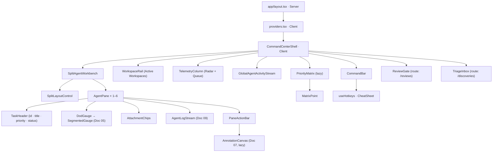

# Doc 06 — Next.js Dual Split-Board Command Dashboard

> **Series position:** 06 of 10 · **Owner:** Subagent 6 (Frontend Core)
> **Consumes:** [`01_system_architecture.md`](./01_system_architecture.md) §7 (DTOs), §8 (transitions), §12 (REST index), §14 (security), §16 (mock fixtures); [`master_implementation_plan.md`](./master_implementation_plan.md) §2 (HUD wireframe), §6 items 8/10/11/12, §11 (ownership).
> **Imports (never re-implements):** Doc 05 primitives, Doc 07 `AnnotationCanvas`, Doc 09 `AgentLogStream` / `useTaskLogStream`.
> **Change control:** Doc 01 is authoritative. If this document and Doc 01 disagree, this document is the defect. No schema, enum, route, or field name may be invented here.

## 1. Purpose & Boundary

This document specifies the **human command surface** of ATLAS-MCP: a Next.js 15 App Router application that lets one architect drive N concurrent agent CLI sessions across N projects from a single screen — dual/quad split workbench, triage inbox, review gate, visual priority matrix, and keyboard-first navigation.

### 1.1 What this document owns

| Path prefix | Contents | Notes |
| :--- | :--- | :--- |
| `frontend/app/` | Route segments, layouts, providers, error/loading boundaries | Server-first |
| `frontend/components/board/` | `CommandCenterShell`, `SplitAgentWorkbench`, `AgentPane`, `WorkspaceRail`, `SplitLayoutControl`, `PaneSlotPicker` | §5–§7 |
| `frontend/components/matrix/` | `PriorityMatrix`, `MatrixPoint`, `MatrixAxes`, `MatrixTooltip`, `use-lasso`, `scale.ts` | §11 |
| `frontend/components/tasks/` | `TaskListView`, `TaskBoardView`, `TaskRow`, `TaskCard`, `TaskFilters`, `TaskBulkBar`, `DodGauge`, `ReviewGate` | §8, §10 |
| `frontend/components/discoveries/` | `TriageInbox`, `DiscoveryCard`, `DiscoveryEditDialog`, `UndoShelf` | §9 |
| `frontend/hooks/` | `use-hotkeys`, `use-task-board`, `use-triage`, `use-review-gate`, `use-matrix`, `use-activity-stream`, `use-url-state` | §3, §12 |
| `frontend/lib/api/` | `client.ts`, `keys.ts`, `errors.ts`, `projects.ts`, `tasks.ts`, `discoveries.ts`, `reviews.ts`, `assets.ts`, `telemetry.ts` | §3 |
| `frontend/lib/types/` | Hand-maintained 1:1 mirrors of Doc 01 §7 DTOs + §6.2 enums | §4 |
| `frontend/lib/format/` | `percent.ts`, `duration.ts`, `path.ts` (middle-truncate), `clock.ts` | §6 |

**Hard rule (Doc 01 §4.1):** this document creates files **only** under the prefixes above. Anything else is imported.

### 1.2 Import-only dependencies (exact contract)

| Import path | Owner | Required surface |
| :--- | :--- | :--- |
| `@/components/ui/*` | Doc 05 | `HudPanel`, `PanelHeader`, `SegmentedGauge`, `StatusBadge`, `PriorityBar`, `MachineText`, `Kbd`, `IconButton`, `Tabs`, `EmptyState`, `AlertBanner`, `SkeletonLine` |
| `@/components/canvas/AnnotationCanvas` | Doc 07 | props `{ taskId: string; sourceAsset: AssetDTO; initialDocument?: CanvasDocument; mode?: "create"\|"review"; onExport?: (r: ExportResult) => void; onError?: (e: CanvasError) => void; onDirtyChange?: (d: boolean) => void; className?: string }` |
| `@/components/terminal/AgentLogStream` | Doc 09 | props `{ taskId: string; height?: number\|string; title?: string; onLineClick?: (l: TaskLogLine) => void; className?: string }` |
| `@/lib/sse/hooks/use-task-log-stream` | Doc 09 | hook `useTaskLogStream(taskId: string, opts?: TaskLogStreamOptions) => TaskLogStreamState` = `{ lines, connected, paused, newCount, clear(), export() }` |
| `@/lib/sse/{client,frame,ring-buffer}.ts` | Doc 09 | `event-source-registry.ts` exports `acquire(url)` / `release(url)`; Doc 06 must never call `new EventSource` inline |
| `@/styles/tokens.css`, Tailwind theme | Doc 05 | Token names only; no hard-coded hex in Doc 06 components. Hex literals in §11 SVG refer to **token values**, resolved through `var(--color-*)` |

**Decision:** Doc 06 renders **zero** raw hex colors. Every color in the matrix scatter resolves a CSS custom property (`var(--status-in-progress)`), so Doc 05 can retune the palette without touching Doc 06. Rationale: single source of truth for §2.1 palette; prevents drift during parallel authoring.

**Contract provenance:** the signatures above are the *ratified* ones — they were reconciled against Docs 07 and 09 after those documents published their surfaces. Doc 06 must not reintroduce the earlier draft shapes (`imageUrl`, `initialStrokes`, `readOnly`, `autoScroll`, `maxLines`). Where shape and behaviour could diverge, the sibling doc wins on **shape** and this doc wins on **behaviour** (read-only after submit, bounded DOM, sibling owns its own scroll container).

### 1.3 Explicit non-goals

1. No agent execution, patch application, or `git` invocation from the browser (Doc 01 §14.4 — patches are rendered as **literal text**).
2. No token handling. The browser never holds `ATLAS_API_TOKEN`; `/api/v1/:path*` is rewritten server-side by `next.config.ts` (Doc 01 §12, §14.2). Doc 06 code never reads, stores, or forwards an `Authorization` header.
3. No second HTTP client, no second state manager, no chart library (Doc 01 §3 dependency rule).
4. No optimistic **status** transitions. Only `priority` and DoD toggles are optimistic (§3.5); status is server-owned and guarded by Doc 01 §8.

## 2. Route Map & Rendering Strategy

### 2.1 App Router tree

```
frontend/app/
├── layout.tsx                        Server  — html/body, fonts, <Providers>
├── providers.tsx                     Client  — QueryClient, ToastHost, HotkeyRoot
├── page.tsx                          Server  — command center root
├── error.tsx  loading.tsx            Client / Server — failure + shell skeleton (§16.5)
├── projects/[slug]/page.tsx          Server  — board | list | matrix
├── projects/[slug]/tasks/[taskId]/page.tsx  Server — deep link, opens in focused pane
├── discoveries/page.tsx              Server  — triage inbox
└── reviews/page.tsx                  Server  — review gate queue      [added — see Decision]
```

**Decision:** Doc 01 §4 lists four route files as a *minimum snapshot*, not an exhaustive tree (it also omits every `loading.tsx`). Doc 06 adds `app/reviews/page.tsx` because the Review Gate (§10) needs a shareable, directly-linkable queue URL and `/discoveries` must not carry two unrelated queues. This introduces no new REST surface — `GET /api/v1/reviews/` already exists in Doc 01 §12.

### 2.2 Server vs client segmentation

Server: `layout.tsx` and every `page.tsx` — zero-JS shell, correct first paint, no token leakage. Client: `providers.tsx` (TanStack `QueryClientProvider`, Zustand hydration, toast portal), `CommandBar` and `WorkspaceRail` (1 s clock, SSE-driven counters, click handlers), `SplitAgentWorkbench`/`AgentPane` (`AgentLogStream`, `AnnotationCanvas`, hotkeys), `PriorityMatrix` (SVG hit-testing, lasso, zoom/pan), `TriageInbox`/`ReviewGate` (optimistic mutations, `Cmd+Enter`). `TaskListView` rows server-render the first page and become client-rendered once windowing engages.

**Why live panes must be client components:** an `EventSource` and a Zustand subscription are process-local browser concerns; a server component cannot subscribe to a stream, cannot handle `Backspace`, and would re-render the whole route on every log line. Live data therefore enters through **one** client boundary per pane.

### 2.3 Data flow (server → client handoff)

1. `page.tsx` (server) calls the typed client from §3 with `cache: 'no-store'` and passes the result as `initialData`.
2. TanStack Query hydrates using the `staleTime` table in §3.4, so the first client render paints instantly and refetches in the background.
3. SSE → cache patches are §13.

**Decision:** server prefetch is **best-effort**. If Django is down at SSR time, `page.tsx` catches `ApiError`, renders with `initialData: undefined`, and shows the `BACKEND_UNAVAILABLE` banner (§16.3) instead of throwing to `error.tsx`. A dead backend must never produce a blank command center — the architect needs to *see* the failure.

### 2.4 Suspense boundaries

`WorkspaceRail` ⇒ 3 × `SkeletonLine` cards (independent, slowest query); `PriorityMatrix` ⇒ `MatrixSkeleton` axes only (heavy client chunk, §15); `SplitAgentWorkbench` ⇒ pane frames without logs; `ActivityStream` ⇒ 8 × `SkeletonLine`. There is deliberately **no** Suspense inside a pane body: a pane must never unmount its terminal, because reconnection is expensive (§13.5).

`export const dynamic = 'force-dynamic'` on `page.tsx`, `projects/[slug]/page.tsx`, `discoveries/page.tsx`, `reviews/page.tsx` — operator data is never statically cacheable.

### 2.5 Component tree



## 3. Data Layer

### 3.1 `frontend/lib/api/client.ts`

A ~120-line file with **no domain knowledge**: URL building, JSON decoding, error-envelope decoding, abort, retry.

| Responsibility | Rule |
| :--- | :--- |
| Base URL | `''` (same-origin) — every call goes through `/api/v1/…` so the Next rewrite injects auth (Doc 01 §12) |
| Credentials | `credentials: 'same-origin'`; **never** set `Authorization` |
| Timeout / headers | `AbortSignal.timeout(15_000)`; `Accept: application/json`; `Content-Type: application/json` except multipart |
| Error decoding | Parse Doc 01 §7.8 into `ApiError`; non-JSON body ⇒ synthesize `INTERNAL_ERROR` (carries `request_id` into the toast, §3.6) |
| Retry | GET only, network/`BACKEND_UNAVAILABLE`, ≤ 2 attempts, 250 ms → 750 ms (mirrors Doc 01 §9.7) |

```ts
// frontend/lib/api/client.ts — signatures only
export class ApiError extends Error {
  constructor(readonly code: ApiErrorCode, readonly status: number, message: string,
              readonly retryable: boolean, readonly detail: Record<string, unknown>,
              readonly requestId: string | null) { super(message); }
}
export function apiGet<T>(path: string, init?: { signal?: AbortSignal }): Promise<T>;
export function apiPost<T>(path: string, body?: unknown): Promise<T>;
export function apiPatch<T>(path: string, body?: unknown): Promise<T>;
export function apiUpload<T>(path: string, form: FormData): Promise<T>;
```

`apiGet` unwraps `{ items, next_cursor }` only in the resource modules, never in the client — the client's generic is the literal body type.

### 3.2 One module per resource

| Module | Functions | REST binding (Doc 01 §12) |
| :--- | :--- | :--- |
| `projects.ts` | `list()`, `get(slug)`, `patch(slug, body)` | `GET /api/v1/projects/`, `GET/PATCH /api/v1/projects/{slug}/` |
| `tasks.ts` | `list(slug, query)`, `get(id)`, `create(slug, body)`, `patch(id, body)`, `setPriority(id, p)`, `toggleDod(id, itemId, completed)`, `forceRelease(id)`, `requeue(id)`, `archive(id)` | `GET/POST /api/v1/projects/{slug}/tasks/`, `GET/PATCH /api/v1/tasks/{id}/`, `PATCH …/priority/`, `PATCH …/dod/{item_id}/`, `POST …/force-release`, `…/requeue`, `…/archive` |
| `discoveries.ts` | `list()`, `approve(id, body)`, `reject(id, body)` | `GET /api/v1/discoveries/`, `POST /api/v1/discoveries/{id}/approve/`, `/reject/` |
| `reviews.ts` | `list()`, `approve(id)`, `reject(id, notes)` | `GET /api/v1/reviews/`, `POST /api/v1/reviews/{id}/approve/`, `/reject/` |
| `assets.ts` | `contentUrl(id)`, `downloadUrl(id)`, `upload(taskId, kind, file)` | `GET /api/v1/assets/{id}/content`, `…/download`, `POST /api/v1/assets/` |
| `telemetry.ts` | `summary()`, `matrix(x: 'age_hours' \| 'dependency_weight')` | `GET /api/v1/telemetry/summary`, `GET /api/v1/priority-matrix?x=` |

`assets.contentUrl` returns a **string only** — used as ``; assets are never fetched into JS memory (§15).

### 3.3 Query key factory

Every key is declared here and nowhere else. `qk` is `as const`-frozen so keys serialize deterministically.

```ts
// frontend/lib/api/keys.ts  (18 lines)
export const qk = {
  projects: { root: ['projects'] as const,
    list: () => ['projects', 'list'] as const,
    detail: (s: ProjectSlug) => ['projects', 'detail', s] as const },
  tasks: { root: ['tasks'] as const,
    board: (s: ProjectSlug, fk: string) => ['tasks', 'board', s, fk] as const,
    list: (s: ProjectSlug, fk: string) => ['tasks', 'list', s, fk] as const,
    detail: (id: TaskId) => ['tasks', 'detail', id] as const },
  discoveries: { root: ['discoveries'] as const,
    list: (fk: string) => ['discoveries', 'list', fk] as const },
  reviews: { root: ['reviews'] as const,
    list: (fk: string) => ['reviews', 'list', fk] as const,
    detail: (id: TaskId) => ['reviews', 'detail', id] as const },
  telemetry: { root: ['telemetry'] as const,
    summary: () => ['telemetry', 'summary'] as const,
    matrix: (x: MatrixXAxis) => ['telemetry', 'matrix', x] as const },
  assets: { root: ['assets'] as const,
    byTask: (id: TaskId) => ['assets', 'byTask', id] as const,
    meta: (id: AssetId) => ['assets', 'meta', id] as const },
} as const;
```

#### Key inventory (every key, no exceptions)

| Key | Shape | Invalidated by |
| :--- | :--- | :--- |
| `qk.projects.list()` / `.detail(slug)` | `['projects', 'list']`, `['projects','detail',slug]` | discovery approve/reject, review approve/reject, force-release, task create, `task.status_changed` SSE |
| `qk.tasks.board(slug,fk)` / `.list(slug,fk)` | `['tasks', kind, slug, fk]` | priority patch, DoD toggle, status change, claim/lease events |
| `qk.tasks.detail(id)` | `['tasks','detail',id]` | DoD toggle, priority patch, `task.log` (append), submit |
| `qk.discoveries.list(fk)` | `['discoveries','list',fk]` | approve, reject, `discovery.created` SSE |
| `qk.reviews.list(fk)` / `.detail(id)` | `['reviews', …]` | approve, reject, `task.submitted` SSE |
| `qk.telemetry.summary()` / `.matrix(x)` | `['telemetry', …]` | 15 s poll / 25 s poll, any status transition, priority patch, x-axis toggle |
| `qk.assets.byTask(id)` / `.meta(id)` | `['assets', …]` | asset upload, canvas export / never (immutable) |

`fk` is `filterKey(filter)`: `Object.entries(filter).filter(([,v]) => v != null).sort(([a],[b]) => a.localeCompare(b)).map(([k,v]) => `${k}=${String(v)}`).join('&')`. Object identity never leaks into a key.

### 3.4 Refetch policy per resource

| Resource | `staleTime` | `refetchInterval` | Focus refetch | Notes |
| :--- | :--- | :--- | :--- | :--- |
| projects list / detail | 10 s | 30 s | `true` | Health counters drift slowly |
| task board / list | 15 s | 30 s | `true` | `placeholderData: keepPreviousData` |
| task detail | 5 s | 20 s | `true` | Focused pane; SSE patches `recent_events` |
| discoveries / reviews | 10 s | 30 s | `true` | SSE `discovery.created` / `task.submitted` forces immediate invalidate |
| telemetry summary | 0 | 15 s | `false` | It *is* a heartbeat — the radar is a ticker, not a cache (§16.4) |
| priority matrix | 5 s | 25 s | `false` | Paused entirely while a lasso drag is active |
| asset content | 1 h | — | `false` | Immutable by `sha256` |

### 3.5 Optimistic mutation rules

Exactly **two** mutations are optimistic in the network sense: priority and DoD. Discovery triage uses *optimistic removal plus a delayed dispatch* (§9.5) — the row disappears immediately but no request exists to roll back. Everything else is pessimistic (spinner on the control, then invalidate).

| Mutation | Optimistic write | Rollback | Debounce |
| :--- | :--- | :--- | :--- |
| Priority slider (`PATCH /tasks/{id}/priority/`) | `setQueryData` on `tasks.detail(id)`, every `tasks.board/list(slug,*)` whose `fk` does not filter on priority, and `telemetry.matrix(x)` point patch | `onError` restores snapshot from `onMutate` context, then `invalidateQueries` | 250 ms trailing; commit on `keyup`/`blur`/`Enter` |
| DoD toggle (`PATCH /tasks/{id}/dod/{item_id}/`) | `definition_of_done[i].completed` flip + recompute `dod_progress_percent` locally | restore snapshot, invalidate `tasks.detail` | none — discrete click |
| Discovery approve/reject | remove row from `discoveries.list` (see §9.4–§9.5) | re-insert at original index | 5 s dispatch delay, cancellable (§9.5) |
| **Status / review actions** | **never optimistic** | — | Guard reasons from Doc 01 §8 must be shown verbatim |

**Rule:** an optimistic write may only touch rows whose `qk` prefix it can enumerate. Never `invalidateQueries()` with a bare root during a drag — it thrashes every pane.

### 3.6 Error → toast mapping (Doc 01 §7.8 / §15)

| `error.code` | HTTP | Toast level | Copy template | Query behaviour |
| :--- | :--- | :--- | :--- | :--- |
| `VALIDATION_ERROR` | 400 | warn | `Invalid field: {detail.field}` | no retry; focus the field |
| `PATH_OUT_OF_SCOPE` | 400 | error | `Path rejected: outside storage root` | no retry |
| `AUTH_MISSING` / `AUTH_INVALID` | 401 | error (sticky) | `Session token rejected — restart the dev proxy` | pause all queries |
| `PROJECT_NOT_FOUND` / `TASK_NOT_FOUND` / `ASSET_NOT_FOUND` | 404 | warn | `{entity} no longer exists` | invalidate parent list |
| `INVALID_TRANSITION` | 409 | warn | `Cannot {detail.action} from {detail.from} — refreshing` | invalidate detail + board |
| `TASK_ALREADY_LEASED` | 409 | warn | `Leased by {detail.assigned_agent_id}` + **Force release** action | no retry |
| `STALE_LEASE` | 409 | info | `Lease no longer yours — refreshing` | `staleTime = 0` refetch. Fires only on a `lease_id` mismatch (human release, review reject); a blown estimate is **not** an error |
| `DEPENDENCY_CYCLE` | 409 | error | `Dependency cycle rejected` | no retry |
| `DEPENDENCY_UNSATISFIABLE` | 409 | warn | `Blocker is REJECTED and unfinished; task is unclaimable` | invalidate board |
| `PAYLOAD_TOO_LARGE` | 413 | error | `Patch exceeds 5 MB` | no retry |
| `UNSUPPORTED_MEDIA_TYPE` | 415 | error | `Only PNG/JPEG/WebP/MD/TXT allowed` | no retry |
| `RATE_LIMITED` | 429 | info | `Throttled — retrying` | auto retry once after `retry-after` |
| `INTERNAL_ERROR` | 500 | error | `Internal error · {request_id}` | retry once |
| `STORAGE_WRITE_FAILED` | 507 | error (sticky) | `Disk write failed — state rolled back` | no retry; show degraded banner |
| `BACKEND_UNAVAILABLE` | 502 | error (sticky) | `Orchestration engine unreachable` | 2 retries then degraded mode (§16.3) |

Toast rendering lives in `providers.tsx` (`ToastHost`); `lib/api/errors.ts` exposes `toToast(err: ApiError): ToastSpec` — a pure function with unit tests, so mapping is verifiable without a browser.

### 3.7 `useTaskBoard` (16 lines, contract form)

```ts
// frontend/hooks/use-task-board.ts — key factory above is 18 lines; this hook is 16
export function filterKey(f: BoardFilter): string {
  return Object.entries(f).filter(([, v]) => v != null).sort(([a], [b]) => a.localeCompare(b))
    .map(([k, v]) => `${k}=${String(v)}`).join('&');
}

export function useTaskBoard(slug: ProjectSlug, filter: BoardFilter) {
  return useQuery({
    queryKey: qk.tasks.board(slug, filterKey(filter)),
    queryFn: ({ signal }) => tasksApi.list(slug, filter, signal),
    staleTime: 15_000, refetchInterval: 30_000, placeholderData: keepPreviousData,
    select: (p) => ({ items: p.items, nextCursor: p.next_cursor,
      dodComplete: p.items.filter((t) => t.dod_progress_percent === 100).length }),
  });
}
```

`select` is the **only** place a DTO becomes a view model. Components never re-derive aggregates during render.

## 4. Type Layer

`frontend/lib/types/` is a **hand-maintained, frozen transcription** of Doc 01 §7. There is no codegen (Doc 01 §3 dependency rule) and no runtime validation library — the mock fixture pack (§16) plus TypeScript is the contract test.

| File | Mirrors |
| :--- | :--- |
| `enums.ts` | Doc 01 §6.2 — `TaskStatus`, `LogLevel`, `AssetKind`, `AssetSource`, `EventType` as `const` objects + union types; values identical to wire, no translation |
| `dto/project.ts` | §7.2 `ProjectDTO` incl. `counters` |
| `dto/task.ts` | §7.3 `TaskSummaryDTO`, §7.4 `TaskDetailDTO`, `DefinitionOfDoneItem`, `AssetRefDTO`, `TaskProjection` |
| `dto/discovery.ts` | §7.6 `DiscoveryDTO` |
| `dto/review.ts` | §7.4 subset + `git_patch` / `verification_log` asset refs |
| `dto/matrix.ts` | §7.7 `PriorityMatrixPointDTO`, `PriorityMatrixResponse`, `MatrixXAxis = 'age_hours' \| 'dependency_weight'` |
| `dto/telemetry.ts` | §7.7 `TelemetrySummaryDTO` |
| `sse.ts` | §7.9 `TaskEventDTO` / `SseEnvelope`, `LogLine` re-exported **from Doc 09** (`@/lib/sse/types`) |
| `http.ts` | `ApiErrorCode` (§15 union), `ErrorEnvelope` (§7.8), `Paginated<T>` |
| `brands.ts` | `ProjectSlug`, `TaskId`, `AssetId`, `Ulid` — nominal string brands |
| `view.ts` | **Derived only**: `BoardFilter`, `TaskRowVM`, `PaneAssignment`, `MatrixPointVM`. Never contains a field absent from a DTO |

### 4.1 Rules

1. **1:1 field fidelity.** Every DTO field appears with the same `snake_case` name; no camelCase remapping in this directory. UI ergonomics are solved by selectors, not by renaming the wire.
2. **`null` is explicit.** Optional values are `| null`, never `?` — Doc 01 §7.1 guarantees "absent optional values are `null`, never omitted".
3. **No `any`.** Enforced by ESLint on `lib/types/**/*.ts`: `@typescript-eslint/no-explicit-any: "error"`, plus `consistent-type-imports` and `no-unused-vars` with `argsIgnorePattern: "^_"`.
4. **No `as` casts outside `client.ts`.** Decoders return `unknown`; `client.ts` performs one cast per call site. Narrowing uses guards in `lib/types/guards.ts` (`isTaskStatus`, `isEventType`).
5. **Drift detection.** `lib/types/__tests__/contract.test.ts` imports every `lib/mocks/*.json` fixture and asserts `satisfies` compatibility, so a Doc 01 field change fails at test time, not runtime.
6. **Exhaustiveness.** Every `switch` on `TaskStatus` / `EventType` / `ApiErrorCode` ends with `const _never: never = value` — a new enum member becomes a compile error rather than a silent fallthrough.

## 5. Layout Shell

### 5.1 Root composition (master §2 wireframe, faithful)

```
┌──────────────────────────────────────────────────────────────────────────────────────────────┐
│ [≡] ATLAS COMMAND CENTER │ MULTI-AGENT SOC            [SYS: OPTIMAL] [11:42:09] [◐] [⚙]      │ 64px
├──────────────────────────────┬──────────────────────────────────┬────────────────────────────┤
│ ACTIVE WORKSPACES            │ TELEMETRY & QUEUE RADAR          │ GLOBAL AGENT ACTIVITY      │
│  (rail, 264–320px)           │  (matrix + queue stats, 1fr)     │  STREAM  (320–380px)       │
│                              │                                  │                            │
├──────────────────────────────┴──────────────────────────────────┴────────────────────────────┤
│ SPLIT AGENT WORKBENCH                                                  [1×1][1×2][2×2][2×3]  │
│  pane grid — fills remaining height, min-h-0                                                 │
└──────────────────────────────────────────────────────────────────────────────────────────────┘
```

Grid declaration on `CommandCenterShell`:

```
h-dvh grid overflow-hidden
grid-rows-[64px_minmax(320px,auto)_minmax(0,1fr)]
```

Row 2 (three-column band) is a nested grid: `grid-cols-[264px_minmax(0,1fr)_320px]` at `xl`, collapsing per §5.3. Row 3 (`minmax(0,1fr)`) is the only row allowed to absorb leftover viewport; `min-h-0` on every descendant prevents the classic flex/grid blowout when a log line is 4 000 chars long.

### 5.2 Command bar

| Element | Source | Behaviour |
| :--- | :--- | :--- |
| `[≡]` menu | local | Toggles rail collapse; `Cmd+B` |
| `ATLAS COMMAND CENTER` | static | `MachineText`, letter-spaced, Doc 05 cyan accent; subtitle `MULTI-AGENT SOC` dimmed |
| `SYS: {status}` | `telemetry.summary()` + `/healthz` | `OPTIMAL` (green) / `DEGRADED` (amber) / `OFFLINE` (red) — §16.3 |
| Clock | local, 1 s tick | `HH:mm:ss` **local**; `title` shows the UTC ISO value |
| Theme `[◐]`, Settings `[⚙]` | Zustand | Doc 05 tokens only; settings drawer holds sound (`ATLAS_FEATURE_SOUND`), density, default pane count |

**Decision:** SYS status is computed from three booleans — `healthz.ok`, `telemetry.generated_at` freshness (< 60 s), and the focused project's `sse.connected`. Any false ⇒ `DEGRADED`; all three false ⇒ `OFFLINE`. One glanceable truth instead of three indicators in a 64 px bar.

### 5.3 Responsive collapse order

| Breakpoint | Layout | Collapse |
| :--- | :--- | :--- |
| `≥ 1536px` (`2xl`) | 3 columns + up to 6 panes | Rail 320 px, stream 380 px |
| `1280–1535px` (`xl`) | 3 columns | Rail 264 px, stream 320 px; matrix axes shorten labels |
| `1024–1279px` (`lg`) | 2 columns (rail + workbench); telemetry becomes a tab inside the workbench header, stream moves to a slide-over | Panes capped at 2×2 |
| `768–1023px` (`md`) | 1 column; rail becomes a horizontal scroller of project chips | Panes forced `1×1`; layout selector disabled with tooltip |
| `< 768px` | Explicit "command center requires ≥ 768 px" `EmptyState` + read-only task list | Split view unavailable |

Collapse order is: **activity stream → telemetry → rail → pane count**. The workbench is the last thing to degrade because it is the primary work surface.

### 5.4 Split view sizing: URL + Zustand

Layout is a **URL-owned** value so a split is shareable and survives reload:

```
/?p=alpha,beta&layout=1x2&t=5f2d…,8c14…
/projects/alpha?view=matrix&x=dependency_weight&status=PENDING,IN_REVIEW
```

| Param | Values | Owner |
| :--- | :--- | :--- |
| `layout` | `1x1` \| `1x2` \| `2x2` \| `2x3` | URL (authoritative) |
| `p` | comma-joined project slugs, one per slot, `-` = empty slot | URL |
| `t` | comma-joined task ids per slot (`-` = auto-select top of queue) | URL |
| `view` | `board` \| `list` \| `matrix` | URL |
| `x` | `age_hours` \| `dependency_weight` | URL |
| `q`, `status`, `group`, `sort` | filter state | URL |

Slot capacity is fixed by layout: `1x1`→1, `1x2`→2, `2x2`→4, `2x3`→6. `use-url-state.ts` clamps `p`/`t` arrays to capacity and pads with `-`; Zustand never invents a layout the URL does not describe.

**Decision:** Zustand holds a **mirror** of layout for zero-latency paint (avoids a `useSearchParams` suspense flash) and writes through `router.replace(..., { scroll: false })` on change. The URL wins on mount and on `popstate`. This is the one sanctioned duplication in §14 because it is *ephemeral UI state*, not server data.

```ts
// frontend/hooks/use-url-state.ts — write-through sketch
const patch = useCallback((next: Partial<ShellParams>) => {
  const sp = new URLSearchParams(searchParams.toString());
  for (const [k, v] of Object.entries(next)) {
    if (v == null || v === '') sp.delete(k); else sp.set(k, String(v));
  }
  router.replace(`?${sp.toString()}`, { scroll: false });
}, [router, searchParams]);
```

## 6. Workspace Rail (`Active Workspaces`)

One card per `ProjectDTO` (Doc 01 §7.2). Cards are the only place `local_repo_path` is shown (master capability 12 — project root detection is *visible* to the architect).

```
┌────────────────────────────────────────────┐
│ ● ALPHA            [ACTIVE]          94%   │   ← slug (MachineText) · StatusBadge · health
│ ▓▓▓▓▓▓▓▓▓▓▓▓▓▓▓▓▓▓▓░░░░░  94             │   ← SegmentedGauge (20 blocks)
│ Root: E:\dev\…\core-backend        (26 ch) │   ← middle-truncated absolute path
│ Agent: Agent-Claude · PENDING 8 · REV 2    │   ← active agent + counters
├────────────────────────────────────────────┤
│ ○ BETA              [IDLE]           41%   │
│ ▓▓▓▓▓▓▓▓░░░░░░░░░░░░░░░░  41             │
│ Root: E:\dev\client-web                    │
│ Agent: — · PENDING 4 · REV 0               │
└────────────────────────────────────────────┘
```

### 6.1 Card spec

| Region | Field | Rendering |
| :--- | :--- | :--- |
| Accent dot | `accent_color` | 8 px dot via `style={{ background: project.accent_color }}` — data-driven, not a hard-coded palette |
| Slug | `slug` | `MachineText`, uppercase, 13 px, tracking-wide |
| Status chip | derived: `in_progress > 0` ⇒ `ACTIVE`; `archived_at != null` ⇒ `ARCHIVED`; `active_agent_id == null` ⇒ `IDLE`; `health_percent >= 90 && in_review == 0` ⇒ `OPTIMAL` | `StatusBadge` |
| Health | `counters.health_percent` | `SegmentedGauge` (Doc 05) with value label right-aligned |
| Root path | `local_repo_path` | `format.path.middle(path, 26)` → `E:\dev\…\core-backend`; full value in `title` + copy-on-click (`Cmd+Click`) |
| Active agent | `active_agent_id ?? '—'` | `MachineText`, 11 px |
| Counters | `counters.pending`, `counters.in_review` | Inline `PENDING n · REV n` |
| Staleness | `last_event_at` | Card dims to 70 % when older than 10 min |

### 6.2 Interaction

Click focuses the **first empty** pane slot; if none, it reassigns the currently focused pane. `Shift+Click` (and `Cmd/Ctrl+Click`) opens `PaneSlotPicker`, listing slots `1…capacity` with occupancy — choosing one changes that slot's owner, and the previous occupant is *not* auto-reassigned. `Enter` (rail scope) behaves like click; `Space` routes to `/projects/{slug}`; right-click gives `Open board`, `Open matrix`, `Copy root path`, `Archive` (confirm).

`format.path.middle(raw, max)`:

```ts
// frontend/lib/format/path.ts
export function middlePath(raw: string, max = 34): string {
  if (raw.length <= max) return raw;
  const sep = raw.includes('\\') ? '\\' : '/';
  const parts = raw.split(sep).filter(Boolean);
  const head = parts[0]?.includes(':') ? `${parts[0]}${sep}` : `${sep}${parts[0]}`;
  const tail = parts[parts.length - 1] ?? '';
  const budget = max - head.length - tail.length - 2;
  if (budget <= 0) return `…${sep}${tail.slice(-(max - 1))}`;
  return `${head}…${sep}${tail}`;
}
```

**Decision:** middle truncation, never `text-ellipsis` end-truncation. Rationale: the *tail* is the discriminating segment (`…\core-backend` vs `…\client-web`); a leading path prefix is nearly identical across projects on one machine.

## 7. Split Agent Workbench

The core surface (master §2, capability 8). One to six independently-scrolling panes, each bound to `(project, task)`.

### 7.1 Wireframe — 1×2 layout

```
┌─ SLOT 1 ─ PROJECT: ALPHA · Agent-Claude ─────────────────┐ ┌─ SLOT 2 ─ PROJECT: BETA · Agent-Copilot ────────────────┐
│ TASK-104  Fix JWT expiry race condition  P95 IN_PROGRESS │ │ TASK-201  Rebuild settings drawer    P60 IN_REVIEW      │
│ ▓▓▓▓▓▓▓▓▓▓▓▓▓▓▓▓▓▓▓░░░░░░  66%  DoD 2/3  ⏱ lease 612s   │ │ ▓▓▓▓▓▓▓▓▓▓▓▓▓▓▓▓▓▓▓▓▓▓▓▓  100%  DoD 3/3  ⏱ —          │
│ [screenshot_annotated_v2.png ×] [context.md ×]           │ │ [canvas_mockup.png ×] [git_patch.patch ×]               │
│ ▓▓▓▓▓▓▓▓▓▓▓▓▓▓▓▓▓▓▓░░░░░░  66%  DoD 2/3  ⏱ 00:10:12      │ │ ▓▓▓▓▓▓▓▓▓▓▓▓▓▓▓▓▓▓▓▓▓▓▓▓  100%  DoD 3/3  ⏱ —          │
│ ┌ LIVE AGENT LOG ────────────────────────── ● STREAMING┐ │ │ ┌ LIVE AGENT LOG ────────────────────────── ○ CLOSED ┐ │
│ │ > running: pytest tests/auth/ -k "race"            █│ │ │ │ > subtask spawned: #201.1 (Tokens)               █│ │
│ │ > 3 passed, 1 failed                               ░│ │ │ │ > diff created: 4 files, +212 -78                ░│ │
│ └─────────────────────────────────────────────────────┘ │ │ └───────────────────────────────────────────────────┘ │
│ [Submit for review] [Open canvas] [Force release]        │ │ [Review gate ⌘↵]  [Open canvas]  [Force release]        │
└──────────────────────────────────────────────────────────┘ └─────────────────────────────────────────────────────────┘
```

### 7.2 Pane anatomy (top → bottom, every item mandatory)

| Row | Content | Source | Behaviour |
| :--- | :--- | :--- | :--- |
| 1 · Header | `TASK-{shortId}`, title, `PriorityBar` + numeric, `StatusBadge` | `TaskSummaryDTO` | Title truncates with `title` attr; `P` opens the priority slider (§12.1 #39) |
| 2 · DoD | `SegmentedGauge` + `n/m` + `LeaseChip` | `TaskDetailDTO.definition_of_done`, `lease_seconds_remaining`, `is_overdue`, `lease_seconds_overdue` | Gauge blocks are read-only here, interactive in the review gate. The chip shows the countdown, or `⏱ OVERDUE` when `is_overdue` — the tile stays `IN_PROGRESS` and the agent is never implied to have lost the task |
| 3 · Attachments | Chip per `assets[]`, icon by `kind` | `TaskDetailDTO.assets` | Click opens a `contentUrl` dialog; `Space` previews (§12) |
| 4 · Terminal | `AgentLogStream` | Doc 09 | Fills remaining height; internal scroll |
| 5 · Actions | Submit review · Open canvas · Force release | §7.5 | Disabled per guards |

**DoD gauge is interactive only in the review pane.** In a work pane it is read-only (the agent owns DoD via `update_dod_item`); in the review gate it is a checklist the human may tick before sign-off. Two writers to one checklist would race the agent's `PATCH …/dod/{item_id}/`.

### 7.3 Grid implementation notes (exact)

```tsx
// frontend/components/board/SplitAgentWorkbench.tsx — layout core
const LAYOUT_CLASS: Record<SplitLayout, string> = {
  '1x1': 'grid-cols-[minmax(0,1fr)] grid-rows-[minmax(0,1fr)]',
  '1x2': 'grid-cols-[repeat(2,minmax(0,1fr))] grid-rows-[minmax(0,1fr)]',
  '2x2': 'grid-cols-[repeat(2,minmax(0,1fr))] grid-rows-[repeat(2,minmax(0,1fr))]',
  '2x3': 'grid-cols-[repeat(3,minmax(0,1fr))] grid-rows-[repeat(2,minmax(0,1fr))]',
};

export function SplitAgentWorkbench({ layout, panes }: Props) {
  return (
    <section aria-label="Split agent workbench" className="h-full min-h-0 overflow-hidden">
      <div className={cn('grid h-full min-h-0 gap-px bg-line', LAYOUT_CLASS[layout])}>
        {Array.from({ length: capacity(layout) }, (_, i) => (
          <AgentPane key={i} slot={i} assignment={panes[i] ?? null} />
        ))}
      </div>
    </section>
  );
}
```

Non-negotiable details:

1. **`minmax(0,1fr)` everywhere.** Bare `1fr` resolves to `minmax(auto,1fr)`; a 4 000-char log line then expands its column and pushes siblings off-screen. This is the single most common split-pane defect and it is banned by this spec.
2. **`min-h-0` on every ancestor** between the viewport and the scroll container. `overflow-hidden` alone does not shrink a flex/grid child below content size.
3. **`gap-px bg-line`** produces Doc 05's luminous 1 px dividers without borders (borders add to layout; a 1 px gap background does not).
4. **Pane containment:** pane root is `flex min-h-0 min-w-0 flex-col overflow-hidden`. Rows 1–3 are `shrink-0`. Terminal row is `min-h-0 flex-1 overflow-hidden`. Action row is `shrink-0`.
5. **Nested scroll only inside the terminal.** `AgentLogStream` owns its own `overflow-y-auto overscroll-contain`; the pane never scrolls. `overscroll-contain` stops scroll chaining into the page when a log hits its end.
6. **Paint containment:** panes carry `[contain:layout_paint]`. With 6 panes × streaming logs this prevents whole-workbench repaints.
7. **Height floor:** at `2x3`, each pane gets ~⅓ of ~560 px ≈ 186 px. Below 180 px the pane collapses rows 3 and 5 into a single `⋯` overflow menu and the terminal gets the rest.

### 7.4 Empty and single-project states

No assignment ⇒ `EmptyState` "Assign a workspace" + `PaneSlotPicker`, with the pane still occupying its cell. Project assigned but no task ⇒ queue preview of the top 5 `TaskSummaryDTO` by priority, "waiting for claim". Archived project ⇒ greyed header, disabled actions, `archived_at` tooltip. `1x1` ⇒ the pane hides the attachment chip row and grows the terminal to ~62 % height.

### 7.5 Action bar guards

| Action | Enabled when | Calls | Failure handling |
| :--- | :--- | :--- | :--- |
| Submit for review | `status === 'IN_REVIEW'` (navigates to review route) or `IN_PROGRESS` (opens read-only review preview) | `POST /reviews/{id}/approve/` only from the review route; otherwise navigation | `INVALID_TRANSITION` → warn toast + invalidate |
| Open canvas | `assets[]` contains a `kind` in `{INPUT_SCREENSHOT, ANNOTATED_CANVAS, VERIFICATION_IMAGE}` | lazy `AnnotationCanvas` in a dialog (§7.6) | decode failure → `AlertBanner` in dialog |
| Force release | `status === 'IN_PROGRESS'` **and** confirm dialog accepted (T11) | `POST /tasks/{id}/force-release/` | `STALE_LEASE` → info toast, invalidate |
| Requeue | `status === 'REJECTED'` (T13) | `POST /tasks/{id}/requeue/` | invalidate board |

`Force release` is always behind a confirm: it returns a live agent's task to `PENDING` while the agent may still be editing files (Doc 01 §8 T11 — operator action, audited as `LEASE_RECLAIMED`/`human`). It is also the **only** way the HUD can take work away from an agent — an overdue estimate does not do it, so the confirm copy must say "the agent may still be working" rather than "the lease expired".

### 7.6 Canvas + terminal integration

```tsx
// frontend/components/board/AgentPane.tsx — integration sketch
const Canvas = dynamic(() => import('@/components/canvas/AnnotationCanvas'), { ssr: false });
const Terminal = dynamic(() => import('@/components/terminal/AgentLogStream'), { ssr: false });

// Docs 07/09 own their own props; Doc 06 maps HUD state onto them.
<Canvas
  taskId={task.id}
  sourceAsset={sourceImageAsset}          // assets[] entry with kind INPUT_SCREENSHOT
  initialDocument={existingDocument}      // re-open an ANNOTATED_CANVAS, else undefined
  mode={isEvidenceLocked ? 'review' : 'create'}
  onExport={(result) => qc.invalidateQueries({ queryKey: qk.tasks.detail(task.id) })}
  onDirtyChange={setCanvasDirty}
/>

<Terminal taskId={task.id} title={task.title} className="h-full" />
```

`mode="review"` in `IN_REVIEW`/`COMPLETED` prevents mutating evidence after submission (Doc 07 hides the tool palette and rejects edits). Line-count bounds are owned by Doc 09's ring buffer (2 000 lines) rather than a `maxLines` prop, and `AgentLogStream` owns its own scroll container — Doc 06 must not add one.

## 8. Task Board & List Views

Two presentations over one query (`qk.tasks.board | list`). Board = columns by group; List = virtualised rows. Both consume identical `TaskSummaryDTO[]`.

### 8.1 View model

`TaskRowVM` is produced by `select` (§3.7) or `useMemo` over the page: `shortId` (`id.slice(0,8)` uppercased, `TASK-` prefix added in the UI only), `isStale` (`updated_at` older than 24 h), `leaseUrgent` (`lease_seconds_remaining < 120 && !is_overdue`), `isOverdue` (`is_overdue`), `overdueLabel` (`formatOverdue(lease_seconds_overdue)`, e.g. `12m 30s over`), `dodState` (`0` → `EMPTY`, `1..99` → `PARTIAL`, `100` → `COMPLETE`), and `blockedReason` (`is_blocked ? 'blocked' : null` — the DTO carries no reason field, so the UI never invents one).

### 8.2 Sorting

| Column | DTO field | Default dir | Notes |
| :--- | :--- | :--- | :--- |
| Priority | `priority` | `desc` | Ties broken by `age_hours desc` |
| Age / Updated | `age_hours`, `updated_at` | `desc` | |
| DoD | `dod_progress_percent` | `asc` | "least done first" is the useful default |
| Status | explicit enum ordinal `PENDING_APPROVAL < PENDING < IN_PROGRESS < IN_REVIEW < COMPLETED < REJECTED` | `asc` | Ordinal map, not alphabetical |
| Dependency | `dependency_weight` | `desc` | |
| Title | `title` | `asc` | `localeCompare` with `numeric: true` |

Sorting is **client-side** on the loaded page and reflected in `sort` (`priority:desc`). Server-side sort is deliberately not used: Doc 01 §12 exposes no sort parameter, and a 200-row page sorts in < 1 ms.

### 8.3 Filtering

Filters live in the URL (§5.4). `BoardFilter`:

```ts
export type BoardFilter = {
  status: TaskStatus[] | null;       // ?status=PENDING,IN_REVIEW
  q: string | null;                  // free text over title + description snippet
  agent: string | null;              // assigned_agent_id
  blocked: boolean | null;           // is_blocked
  discovered: boolean | null;        // is_agent_discovered
  priorityMin: number | null;        // 0..100
  view: 'board' | 'list' | 'matrix';
  group: 'status' | 'priority';
  sort: string;                      // 'priority:desc'
};
```

`q` is applied through **`useDeferredValue`** (§15.3); all other filters apply synchronously because they are discrete clicks.

### 8.4 Grouping toggle

`group=status` (default) renders the 6 status columns in fixed enum order, showing `PENDING_APPROVAL` first only when its count > 0. `group=priority` renders `P0-24`, `P25-49`, `P50-74`, `P75-89`, `P90-100` in descending bands, each labelled with its count. `group` is URL-owned so a hand-off link opens the same board shape.

### 8.5 Keyboard traversal

`J` / `K` move focus, `Enter` opens the focused task in the focused pane, `Shift+Enter` sends it to the next empty pane, `Space` peeks (description + assets, no navigation), `X` toggles bulk selection, `Home`/`End` jump to first/last row, and `→`/`←` traverse columns in board view only — see §12.1 #15–#21 for the canonical table.

Focus is a **roving tabindex**: exactly one row carries `tabIndex={0}`; `J`/`K` mutate an `activeIndex` in a `board` Zustand slice and call `element.focus()` on the new row. Rows are `role="row"` inside `role="grid"`, so screen readers get position announcements for free (§16.1).

### 8.6 Virtualisation threshold

| Condition | Strategy |
| :--- | :--- |
| `rows <= 150` | Plain render. Measured: 150 × `TaskRow` ≈ 12 ms mount, acceptable |
| `rows > 150` | Windowed via `@tanstack/react-virtual`, `estimateSize: 44`, `overscan: 12` |
| `rows > 1000` | Additionally require `next_cursor` paging; the list shows "Load next 50" and disables `J`/`K` wrap across unloaded pages (`End` becomes "load all") |

The threshold is a constant `VIRTUALIZE_ABOVE = 150`, asserted in a unit test so it cannot drift between board and list.

**Decision:** virtualisation is **not** applied to the 6-column board. Columns are independently scrollable and each is almost always under the threshold; windowing per column would break column-level `→`/`←` focus semantics for negligible gain.

### 8.7 Bulk actions

| Action | Allowed | Rationale |
| :--- | :--- | :--- |
| Reprioritise (set absolute `0..100`) | ✅ | Idempotent, one `PATCH …/priority/` per selected id, no state-machine edge |
| Reprioritise (`+5` / `−5`, clamped) | ✅ | Same endpoint, computed client-side per row |
| Requeue | ✅ | Only enabled when every selected row is `REJECTED`; `POST …/requeue/` per row. Doc 01 §8 **T13** (`REJECTED → PENDING`) is the guard; rows in any other status disable the action |
| Archive | ✅ with confirm | Route `/archive/`; Doc 01 §8 T12 permits `PENDING`/`REJECTED` → `REJECTED`, so the action is enabled only for `PENDING`. Requires typed confirmation |
| **Approve review in bulk** | ❌ **forbidden** | Doc 01 §8 T8 makes sign-off the *only* human gate (master §6.3). Batching it converts a per-patch inspection into a rubber stamp, and the UI cannot show N patches at once. The action is not rendered, and the API is called one task at a time from the review route. |
| Submit/dispatch to agent | ❌ | No such route exists; claims are agent-initiated (T5) |
| Delete | ❌ | No delete route; `archive → REJECTED` is the only removal (the `Delete` **key** maps to archive, §12.1 #19) |

Bulk execution rule: **sequential with per-item result collection**, never `Promise.all`. Concurrent priority patches on one task would race the `BEGIN IMMEDIATE` writer and produce spurious `STALE_LEASE`. The bar reports `n succeeded, m failed` with a per-row error chip.

## 9. Discovery Triage Inbox

Master §7's pipeline, rendered. Route `/discoveries`, fed by `GET /api/v1/discoveries/` (all `PENDING_APPROVAL` rows across projects).

### 9.1 Layout

```
┌ TRIAGE INBOX ── 2 AWAITING ─────────────────────── [A] approve  [E] edit  [Del] dismiss ┐
│ ⚡ AGENT-CLAUDE · ALPHA · 12m ago                              [P85]  PENDING_APPROVAL   │
│ Migrate auth middleware to Node 22 API                                                  │
│ Deprecation warning observed during Task #104 test run.                                 │
│ ↳ discovered during TASK-5f2d6c1e  ·  1 screenshot                                       │
│ [A Approve]  [E Edit priority]  [Del Dismiss]                                            │
├─────────────────────────────────────────────────────────────────────────────────────────┤
│ ⚡ AGENT-COPILOT · BETA · 3m ago                               [P60]  PENDING_APPROVAL   │
│ Settings drawer loses focus trap on Escape                                              │
└─────────────────────────────────────────────────────────────────────────────────────────┘
```

### 9.2 Card fields (all from `DiscoveryDTO`, Doc 01 §7.6)

`discovered_by_agent` (`MachineText`, cyan), `project_slug` (accent chip), `created_at` (relative), `suggested_priority`/`priority` (`PriorityBar`; when an edit makes them differ, show `suggested 85 → 92`), `title` (semibold 15 px), `description` (3-line clamp with expand), `discovered_during_task_id` (`↳ discovered during TASK-{short}`, links to the source task), `discovery_reason` (dimmed italic secondary line), `assets[]` (thumbnail strip — `url` resolves through the same-origin rewrite), `status` (always `PENDING_APPROVAL` here; amber `StatusBadge`).

**Decision (revised in Doc 01 v1.0.1):** Doc 01 §7.6 now carries `assets[]` with a browser-loadable `url` alongside the legacy `screenshot_absolute_paths`. The inbox renders up to 3 thumbnails from `assets[].url`, with `+N` overflow, and never renders the raw host-absolute path list. Clicking a thumbnail opens the evidence dialog; `Space` previews it (§12.1 #5).

### 9.3 Keyboard mapping (inbox scope)

`J`/`↓` next, `K`/`↑` previous, `A` **approve** (with `priority = suggested_priority` or the edited value), `E` open the edit dialog (priority slider + optional title refinement), `Delete`/`Backspace` **dismiss** (2 s inline confirm, then the 5 s dispatch window), `Enter` approve (master §7 binds `Enter` to Approve), `Space` peek the full description, `U` undo, `Esc` clear selection / close dialog / cancel the window, `?` cheat sheet. Canonical rows: §12.1 #22–#26.

### 9.4 Approve payload mapping

Doc 01 §12 exposes `POST /api/v1/discoveries/{id}/approve/`; T3 sets `priority = suggested_priority` **or an edited value**. The UI therefore sends:

```json
{ "priority": 92 }
```

| UI state | Payload |
| :--- | :--- |
| Approve, untouched | `{ "priority": discovery.suggested_priority }` — explicit, never omitted, so the server need not guess |
| Approve after edit | `{ "priority": editedValue }` |
| Dismiss | `POST /api/v1/discoveries/{id}/reject/` with `{ "reason": null }`; the route has no required body |

`priority` is clamped `0..100` and must be an integer (Doc 01 §6.4 CHECK). The slider emits integers only; the client refuses fractional values before the request leaves the browser.

### 9.5 Optimistic removal + undo (5 s dispatch delay)

1. `onMutate`: snapshot `qk.discoveries.list(fk)`, remove the row, return `{ prev, index }`.
2. Push a shelf entry `{ taskId, kind, index, prev, timerId, expiresAt: now + 5_000 }`.
3. The **network call is not dispatched yet.** It is scheduled to fire at `expiresAt`.
4. `U`, the shelf's Undo button, or `Cmd+Z` cancels the timer, restores the snapshot locally, and pops the shelf entry — the request never leaves the browser.
5. At `expiresAt` the request dispatches; the shelf entry becomes a 3 s confirmation toast ("Approved — open task to edit priority").

**Decision:** the 5 s window is a **dispatch delay**, not a compensating transaction. Doc 01 §8 defines no `PENDING → PENDING_APPROVAL` edge and no un-reject route, so a post-hoc rollback is impossible; delaying the request is the only correct undo semantic. Rationale: it gives true undo without inventing a contract change. Once dispatched, undo is no longer offered and the toast says so.

Failure inside the delay (e.g. tab closes) loses the action, which is the safe direction: an un-approved discovery is recoverable (`A` again), an approved one is not.

Dismiss behaves identically (`UNDO_WINDOW_MS = 5000` before the `reject` call fires).

### 9.6 Empty & arrival states

No items ⇒ `EmptyState` "Inbox clear — agents have not proposed anything". A live arrival inserts at the top with `animate-pulse` for 1.2 s and announces `"{agent} proposed a task in {project}"` (§16.2). Above 25 items the header reads "25+ awaiting" and a "Triage all" affordance appears (sequential, per-row confirm).

## 10. Review Gate UI

Route `/reviews`, fed by `GET /api/v1/reviews/` (tasks in `IN_REVIEW`).

### 10.1 Layout

```
┌ REVIEW GATE ── 2 AWAITING SIGN-OFF ──────────────────────────────────────────────────────┐
│ ┌ QUEUE ──────────┐ ┌ TASK-201 · Rebuild settings drawer ──── IN_REVIEW ── P60 ────────┐ │
│ │ ▸ TASK-201  P60 │ │ DoD ▓▓▓▓▓▓▓▓▓▓▓▓▓▓▓▓▓▓▓▓ 100% (3/3)   ⚠ 1 unchecked (amber) │ │
│ │   BETA · 4m     │ │ [Summary][Patch][Verification log][Assets]                        │ │
│ │ • TASK-118  P88 │ │ ┌ PATCH — literal text, never executed ────────────────────────┐ │ │
│ │   ALPHA · 2h    │ │ │ --- a/src/ui/drawer.tsx                                     │ │ │
│ │                 │ │ │ +++ b/src/ui/drawer.tsx                                     │ │ │
│ │                 │ │ │ @@ -12,7 +12,9 @@ export function Drawer({ open }) {            │ │ │
│ │                 │ │ │ -  if (key === 'Escape') onClose();                         │ │ │
│ │                 │ │ │ +  useFocusTrap(ref, { onEscape: onClose });                │ │ │
│ │                 │ │ └────────────────────────────────────────────────────────────┘ │ │
│ │                 │ │ [⌘↵ Sign off]  [R Reject with notes]                            │ │
│ └─────────────────┘ └──────────────────────────────────────────────────────────────────┘ │
└─────────────────────────────────────────────────────────────────────────────────────────┘
```

### 10.2 Patch viewer rules

1. **Literal text.** The patch renders inside `<pre><code>` with `textContent` only — never `dangerouslySetInnerHTML`, never syntax highlighting that parses the diff into markup, never a component that could execute a payload. Doc 01 §14.4: *"`git_patch` is stored as data, never executed; the review UI renders it as literal text."*
2. **Line colouring by prefix only** — `+` green, `-` red, `@@` amber, `\` dim. No patch parser that reconstructs files.
3. **Caps honoured:** `> 5 MB` never reaches the UI (`413`); the viewer chunks at 20 000 lines with "show more" to keep the tab responsive.
4. **Copy** button copies the raw text; **download** hits `GET /api/v1/assets/{id}/download`.
5. No `Apply patch` / `Merge` / `Run tests` control exists anywhere in this document.

### 10.3 Tabs

`Summary` (`review_summary`, sanitised static render — no raw HTML), `Patch` (`OUTPUT_PATCH`, §10.2), `Verification log` (`TEST_LOG`, monospace read-only, `\r\n` normalised), `Assets` (`VERIFICATION_IMAGE`, `ANNOTATED_CANVAS` — thumbnails via `contentUrl`, click opens `AnnotationCanvas` with `mode="review"`).

### 10.4 DoD completeness warning

`100` ⇒ gauge full, sign-off enabled normally. `1..99` ⇒ amber `AlertBanner`: *"DoD incomplete — {n} item(s) unchecked. Sign-off is still permitted (Doc 01 §8: human sign-off is the only hard gate)."* Sign-off **stays enabled**. `0` ⇒ the same banner with stronger copy. Unchecked items are checkboxes; ticking one calls `PATCH …/dod/{item_id}/` and optimistically updates the gauge — this is the one place the human may tick DoD (the agent normally owns it via `update_dod_item`).

### 10.5 Sign-off & reject

| Action | Trigger | Call | Guard |
| :--- | :--- | :--- | :--- |
| Sign off | Button or `Cmd+Enter` | `POST /api/v1/reviews/{id}/approve/` | T8 requires `status === 'IN_REVIEW'`; optimistic is **not** used — wait for `{status:'COMPLETED'}` then advance the queue |
| Reject with notes | `R` or button | `POST /api/v1/reviews/{id}/reject/` body `{ "review_notes": "…" }` | T9 requires non-empty `review_notes` (mirrors the backend T9 guard) |

Reject modal:

* `notes` textarea, min 1 non-whitespace char, max 4 000; `Submit` disabled until valid; inline error `Review notes are required to reject (T9)`.
* `Cmd+Enter` submits the modal, not sign-off (modal scope shadows route scope — §12.3).
* Copy under the button: "Returns the task to `PENDING` with attempt_count unchanged. The agent may re-claim it."
* `Esc` closes and **discards** nothing silently — if text is present it asks "Discard notes?".

After either action the queue advances to the next item and focus returns to the queue list row (`J`/`K` continue working).

## 11. Visual Priority Matrix

Custom SVG scatter (master capability 11). No chart library; total chunk budget `≤ 20 kB` gzip (Doc 01 §3).

### 11.1 Axes

| Axis | Field | Domain |
| :--- | :--- | :--- |
| Y | `priority` | `0..100`, fixed (`axes.y_max`) |
| X (default) | `age_hours` | `0..max(age_hours)` rounded up to a "nice" bound; min span 12 h |
| X (toggle) | `dependency_weight` | `0..max(dependency_weight)` rounded up to a nice bound; min span 2 |

Toggle is `X` key or a `Tabs` control; it writes `?x=` and swaps the query key `qk.telemetry.matrix(x)`.

### 11.2 ASCII plot

```
 priority
   100 ┤ ·          ●P96                  ╭──────────────────────╮
    90 ┤        ◉P95╲                     │ ring   = is_blocked  │
    75 ┤    ●P80    ╲   ●P78              │ radius = DoD progress│
    60 ┤  ○P60      ╲                     │ fill   = status      │
    50 ┤      ○P50   ╲  ○P48             ╰──────────────────────╯
    25 ┤  ▲P25                               ● IN_PROGRESS  ○ PENDING
     0 ┼──────┬───────┬────────┬───────┬──────
       0h     6h      12h     18h     24h   → age_hours
       (or: 0  1  2  3  4  5  6  dependency_weight)

● priority>=90 · ◉ blocked · ▲ agent-discovered · size ∝ dod_progress_percent
```

### 11.3 Point encoding

| Channel | Encoding | Rule |
| :--- | :--- | :--- |
| Position X | `x` axis value | §11.4 |
| Position Y | `priority` | §11.4 |
| Radius | `dod_progress_percent` | `r = 3 + 5 * (pct/100)` → `3..8`; `0 %` still visible at `r=3` |
| Fill | `status` | token per status; `COMPLETED` at 45 % opacity so history stays context, not noise |
| Ring | `is_blocked` | 1.5 px stroke, crimson, `r + 2.5`; typically explains low Y despite high dependency. Legend copy: "blocked — a prerequisite has not reached 100 % DoD" |
| Dashed outline | `is_agent_discovered` | 1 px dashed cyan, no fill change |
| Label | `title` | Hover/focus only, never always-on (prevents overlap at 21+ points) |
| Multi-project | project accent ring on selection only | **Decision:** no per-project colour — status already owns fill, and two simultaneous categorical colours are unreadable |

**Decision:** the matrix plots **all projects** by default with a project filter chip row, rather than one project at a time. Rationale: the matrix's job is cross-project triage ("what is old and urgent anywhere"), which a per-project view cannot answer; the `?p=` filter restores focus when needed.

### 11.4 Coordinate mapping

With plot box `(margin.left, margin.top, innerW, innerH)`:

$$
x_{\text{px}} = \text{left} + \frac{\text{clamp}(v_x, 0, x_{\max})}{x_{\max}} \cdot \text{innerW}
\qquad
y_{\text{px}} = \text{top} + \left(1 - \frac{\text{clamp}(v_y, 0, 100)}{100}\right) \cdot \text{innerH}
$$

and the inverse (needed for the tooltip and lasso):

$$
v_x = \frac{x_{\text{px}} - \text{left}}{\text{innerW}} \cdot x_{\max}
\qquad
v_y = \left(1 - \frac{y_{\text{px}} - \text{top}}{\text{innerH}}\right) \cdot 100
$$

Above the "nice" bound, points whose X exceeds it are still drawn but pinned to the right edge with a `▸` marker, so nothing is silently dropped.

### 11.5 Scale helper (≤ 40 lines)

```ts
// frontend/components/matrix/scale.ts
export type Scale = { domain: [number, number]; range: [number, number] };

export const linear = (d: [number, number], r: [number, number]) =>
  (v: number): number => {
    const [d0, d1] = d;
    const [r0, r1] = r;
    const span = d1 - d0 || 1;
    return r0 + ((clamp(v, d0, d1) - d0) / span) * (r1 - r0);
  };

export const invert = (d: [number, number], r: [number, number]) =>
  (px: number): number => {
    const [d0, d1] = d;
    const [r0, r1] = r;
    const span = r1 - r0 || 1;
    return d0 + ((px - r0) / span) * (d1 - d0);
  };

export const clamp = (v: number, lo: number, hi: number) => Math.min(hi, Math.max(lo, v));

export function niceMax(raw: number, minSpan: number): number {
  const target = Math.max(raw, minSpan);
  const mag = Math.pow(10, Math.floor(Math.log10(target)));
  for (const m of [1, 1.5, 2, 2.5, 5, 10]) if (target <= m * mag) return m * mag;
  return 10 * mag;
}

export function buildScales(w: number, h: number, xMax: number, m = { top: 12, right: 16, bottom: 28, left: 44 }) {
  const innerW = Math.max(1, w - m.left - m.right);
  const innerH = Math.max(1, h - m.top - m.bottom);
  return {
    box: { ...m, innerW, innerH },
    x: linear([0, xMax], [m.left, m.left + innerW]),
    y: linear([0, 100], [m.top + innerH, m.top]),   // inverted for SVG
    invX: invert([0, xMax], [m.left, m.left + innerW]),
    invY: invert([0, 100], [m.top + innerH, m.top]),
  };
}
```

Note the Y range is reversed `[bottom, top]` so `priority 0` sits at the bottom without a second negation at the call site.

### 11.6 Interaction

| Gesture | Behaviour |
| :--- | :--- |
| Hover / focus | Tooltip: title, project, status, `P{priority}`, `DoD {pct}%`, `age {h}h`, `dep {w}`, `blocked` flag |
| Click / `Shift+Click` | Focus the task into the focused pane slot (§6.2) / add-remove from the selection set |
| Drag | **Lasso** — freeform polygon in SVG coords; on release the enclosed points become the selection; `Esc` cancels |
| After lasso | Chip bar: "7 selected — Reprioritise · Requeue · Clear"; bulk rules from §8.7 apply |
| Wheel | Zoom about the cursor, `0.5×..4×` on the X domain only (Y stays `0..100` for priority legibility) |
| `Space` + drag | Pan, clamped to domain bounds (never past `0` or `niceMax`) |
| Double-click / `+` / `-` / `0` | Reset zoom+pan and clear lasso / keyboard zoom steps / reset view |

Zoom/pan live in **component-local state**, not Zustand and not the URL: a transient viewport transform is not worth a history entry. Reset on `x`-axis toggle.

Lasso implementation: a single `<path>` of measured `M/L` segments sampled every ≥ 12 px of pointer travel (keeps the polygon under ~200 vertices), closing on release; hit-test with even–odd fill against each point's `(x_px, y_px)` in screen space — no library.

### 11.7 States

First load ⇒ `MatrixSkeleton` (axes + tick labels at 20 % opacity, no points). Refetch ⇒ points stay (`keepPreviousData`) with a 1 px cyan progress line under the header. `points.length === 0` ⇒ `EmptyState` "No tasks to plot" + a hint to create one (`C`). Degraded ⇒ last good points at 40 % opacity plus `AlertBanner` "showing stale data". All points filtered out ⇒ same as empty with a "Clear filters" action. Above 300 points ⇒ radius halves, tooltip becomes a 5-row nearest stack, lasso still available.

Data source: `GET /api/v1/priority-matrix?x=age_hours|dependency_weight` → `PriorityMatrixResponse` (Doc 01 §7.7). The `axes` block is authoritative for `x`, `x_alternate`, and `y_max`; the client never hard-codes `100`.

## 12. Keyboard-First Navigation

Master §6.10 mandates `J`/`K`, `C`, `A`, `Space`, `/`, `Esc`. Master §7 adds `Enter` (approve), `E` (edit), `Del` (dismiss). Master §8 adds `Cmd+Enter` (sign-off).

### 12.1 Complete hotkey table

| # | Scope | Key | Action | Conflict notes |
| :--- | :--- | :--- | :--- | :--- |
| 1 | global | `J` | Next item in active list/pane stack | Suppressed in inputs; in a pane, `J` scrolls the terminal one line via Doc 09 |
| 2 | global | `K` | Previous item | Same |
| 3 | global | `C` | Create task (modal `TaskCreateDialog`) | Suppressed in inputs; `Cmd+C` copy is unaffected |
| 4 | global | `A` | Approve focused discovery | In review scope, `A` is inert (sign-off is `Cmd+Enter`) |
| 5 | global | `Space` | Preview focused asset / peek task | Suppressed when a button has focus (Space activates buttons) |
| 6 | global | `/` | Focus search box | `preventDefault` so Firefox quick-find does not open |
| 7 | global | `Esc` | Dismiss overlay → clear selection → blur search | Cascading, one layer per press |
| 8 | global | `G` then `D` | Go to Discoveries (`/discoveries`) | 800 ms chord window; `G` alone shows a chord hint |
| 9 | global | `G` then `R` | Go to Reviews (`/reviews`) | Chord window shared with #8 |
| 10 | global | `G` then `C` | Go to Command Center (`/`) | |
| 11 | global | `R` | Reviews queue (single-key alias of #9) | Suppressed in a pane terminal (terminal owns `R` only if Doc 09 claims it — it does not) |
| 12 | global | `Shift+1..4` | Focus pane slot 1..4 | `Shift+5/6` extends to `2x3` slots 5–6; rejected when slot empty (toast) |
| 13 | global | `?` | Toggle cheat-sheet overlay | `Shift+/` |
| 14 | global | `Cmd/Ctrl+K` | Command palette (routes + projects + tasks) | Overrides browser search-bar shortcut |
| 15 | list/board | `Enter` | Open focused task in focused pane | |
| 16 | list/board | `Shift+Enter` | Open focused task in next empty pane | |
| 17 | list/board | `X` | Toggle selection | |
| 18 | list/board | `E` | Edit priority inline | Suppressed unless the row is `PENDING`/`PENDING_APPROVAL` |
| 19 | list/board | `Delete` | Archive focused task (confirm) | Not on `IN_PROGRESS` |
| 20 | list/board | `→` / `←` | Column traversal (board only) | Falls through to nothing in list |
| 21 | list/board | `Home` / `End` | First / last row | |
| 22 | triage | `A` | Approve discovery | Dispatch after 5 s undo window (§9.5) |
| 23 | triage | `E` | Open edit dialog | |
| 24 | triage | `Delete` / `Backspace` | Dismiss discovery | `Backspace` only when focus is a row, never in an input |
| 25 | triage | `U` | Undo last triage action | Same 5 s window |
| 26 | triage | `Enter` | Approve | Master §7 explicitly binds `Enter` to Approve |
| 27 | review | `Cmd/Ctrl+Enter` | **Sign off** (`approve_review`, T8) | In the reject modal, submits the modal instead |
| 28 | review | `R` | Open reject-with-notes modal | Scope shadow: review > global |
| 29 | review | `Tab`/`Shift+Tab` | Move between tabs (Summary/Patch/Log/Assets) | Native, not intercepted |
| 30 | review | `J` / `K` | Next / previous queue item | Discards unsaved notes after confirm |
| 31 | pane | `Cmd/Ctrl+Enter` | Submit for review (when `IN_PROGRESS`) | Opens preview; the POST happens only from the review route |
| 32 | pane | `F` | Force release (confirm) | Requires `IN_PROGRESS` |
| 33 | pane | `O` | Open canvas dialog | Requires an image asset |
| 34 | pane | `Shift+W` | Close pane assignment | Clears the slot in the URL |
| 35 | matrix | `X` | Toggle X axis (`age_hours` ⇄ `dependency_weight`) | Not in text fields |
| 36 | matrix | `+` / `-` / `0` | Zoom in / out / reset | |
| 37 | modal | `Esc` | Close | Always highest priority |
| 38 | modal | `Cmd/Ctrl+Enter` | Primary submit | |
| 39 | pane | `P` | Open the priority slider for the focused task | Only `PENDING`/`PENDING_APPROVAL`; list scope uses `E` for the same action |
| 40 | global | `U` | Undo last triage action | Same 5 s window as #25; scoped to `/discoveries` in practice |

**Conflict resolution:** a single `keydown` listener on `document` (capture phase) consults the scope stack top-down; the **first matching binding wins and calls `preventDefault`**, so no handler ever double-fires. Browser-reserved combinations (`Cmd+W`, `Cmd+T`, `Cmd+N`) are never bound.

### 12.2 `useHotkeys` design

```ts
// frontend/hooks/use-hotkeys.ts
type Hotkey = { key: string; mod?: boolean; shift?: boolean; scopes: Scope[]; run: (e: KeyboardEvent) => void; allowInInput?: boolean };
type Scope = 'global' | 'board' | 'triage' | 'review' | 'pane' | 'matrix' | 'modal';

export function useHotkeys(hotkeys: Hotkey[], deps: unknown[]) {
  const stack = useShellStore((s) => s.scopeStack);   // selector, not the whole store
  useEffect(() => {
    const onKeyDown = (e: KeyboardEvent) => {
      if (e.isComposing) return;                       // IME safety
      if (isTypingTarget(e.target) && !hotkeys.some((h) => h.allowInInput)) return;
      for (const scope of stack) {                     // top-of-stack first
        const hit = hotkeys.find((h) => h.scopes.includes(scope) && matches(h, e));
        if (hit) { e.preventDefault(); e.stopPropagation(); hit.run(e); return; }
      }
    };
    document.addEventListener('keydown', onKeyDown, { capture: true });
    return () => document.removeEventListener('keydown', onKeyDown, { capture: true });
  }, [stack, ...deps]);                                // eslint-disable-line react-hooks/exhaustive-deps
}
```

Rules encoded above:

1. **Scope stack, not boolean flags.** `modal` is pushed on open and popped on close, so a dialog automatically shadows route bindings without every handler checking `if (dialogOpen)`.
2. **Input-focus suppression.** `isTypingTarget` returns true for `input`, `textarea`, `[contenteditable]`, `select`. Bindings may opt in with `allowInInput` (only `Esc`, `Cmd+Enter`, `Cmd+K`).
3. **Chord support.** A leading `G` sets a `chord` value in the shell slice with an 800 ms timer; the next key is matched against `G`-prefixed bindings. Any other key clears the chord.
4. **No per-component listeners.** Exactly one `keydown` listener exists, registered by `HotkeyRoot` in `providers.tsx`; feature components *register descriptors*, they never attach handlers.
5. **IME safety.** `e.isComposing === true` short-circuits everything.

### 12.3 Cheat-sheet overlay

`?` opens a `HudPanel` dialog listing bindings **filtered to the current scope stack**, so the sheet is contextual (a reviewer sees sign-off keys first). Per master §2 typography, keys render as `Kbd` chips in `JetBrains Mono`. `Esc` or `?` closes. The overlay is a `role="dialog"` with `aria-modal`, and opening it pushes the `modal` scope (§16.1).

### 12.4 Discoverability

New bindings must appear in three places or they are considered undocumented: the cheat sheet, the `title` attribute of the equivalent button (e.g. `Sign off (⌘↵)`), and §12.1 of this document.

## 13. Global Agent Activity Stream

The right-hand ticker: one merged feed of **all** projects' events.

### 13.1 Source

Doc 09 owns the transport. Doc 06 consumes the project-level channel:

```
GET /api/v1/stream/events?project_slug=alpha   (EventSource, via Next rewrite)
```

**Decision:** when more than one project is assigned, the stream component opens **one `EventSource` per distinct assigned project**, capped at 3, and merges by `seq`/`ts`. `project_slug` is a single-valued query parameter (Doc 01 §12), so a global channel does not exist and creating one would be a contract change. If more than 3 projects are assigned, the two least-recently-active are dropped and a subtle "streaming 3 of N" note is shown.

### 13.2 Ring buffer + dedupe

Capacity `ACTIVITY_RING = 500` rows, held as `Map<eventId, Row>` for dedupe plus an order array; the oldest is evicted past 500 (≈100 kB at ~200 B/row, since only `message.slice(0, 240)` is retained). The dedupe key is `data.id` (ULID, Doc 01 §7.9), so reconnects and `Last-Event-ID` replay are idempotent. Ordering is `seq` ascending within a project and `ts` then `id` across projects. `telemetry.tick` and `agent.heartbeat` are filtered by default (they would swamp the ticker); `DEBUG` level and `task.log` have toggles.

```ts
// frontend/hooks/use-activity-stream.ts — ingest sketch
function ingest(state: ActivityState, evt: TaskEventDTO): ActivityState {
  if (evt.type === 'telemetry.tick' || evt.type === 'agent.heartbeat') return state;
  if (state.byId.has(evt.id)) return state;                    // dedupe
  const row = { id: evt.id, seq: evt.seq, ts: evt.ts, type: evt.type, level: evt.level,
                project_slug: evt.project_slug, task_id: evt.task_id,
                message: evt.message.slice(0, 240) };
  const byId = new Map(state.byId).set(evt.id, row);
  const order = [...state.order, evt.id].slice(-ACTIVITY_RING);
  for (const id of byId.keys()) if (!order.includes(id)) byId.delete(id);
  return { byId, order };
}
```

### 13.3 Row rendering

`HH:mm:ss [PROJECT] MESSAGE` — time in `MachineText`, project as accent chip, message trimmed to one line with `title` for the full text. Level colours: `ERROR` crimson left-border, `WARN` amber, `DEBUG` dimmed. Clicking a row focuses that task in a pane (if it has `task_id`).

The header carries the alert strip from master §2: `[⚡ N DISCOVERIES AWAITING]` derived from `telemetry.summary().discoveries_pending` — clicking routes to `/discoveries`.

### 13.4 Difference from per-task terminal panes

| Dimension | Global activity stream | Per-task pane (`AgentLogStream`) |
| :--- | :--- | :--- |
| Endpoint | `/api/v1/stream/events?project_slug=` | `/api/v1/stream/tasks/{id}/log` |
| Scope | All event types, all tasks in one project | `task.log` only, one task |
| Buffer | 500 rows, dedupe by `id`, 240-char messages | 2 000 lines, full messages, ANSI-stripped, auto-scroll |
| Rendering | Tick list, newest at bottom, no scroll lock | Virtualised terminal with scroll-lock-on-bottom |
| Purpose | "What is happening across the fleet?" | "What is this agent doing right now?" |

The stream is **not** a substitute for the terminal: it truncates messages and drops `task.log` verbosity by design. Both are session-only in memory; the durable record is `execution.log` on disk (master §3).

### 13.5 Reconnect behaviour

On `error` the `EventSource` browser-retries automatically; the hook tracks `connected: boolean` per project and the header dot turns amber. After 3 failures within 30 s it stops relying on it, sets `sseDegraded = true`, and schedules a `invalidateQueries` sweep every 20 s (§16.3). `Last-Event-ID` replay is Doc 09's responsibility; Doc 06 dedupes anyway, so replay never duplicates rows on screen.

## 14. State Management

| Store | Contents | Examples | Rule |
| :--- | :--- | :--- | :--- |
| **TanStack Query** | Every server-owned byte | projects, tasks, discoveries, reviews, telemetry, matrix, asset metadata | Single source of truth for anything from `/api/v1/*` |
| **Zustand** (`useShellStore`) | Ephemeral UI state | `layout` mirror, `focusedSlot`, `paneAssignments` mirror, `scopeStack`, `chord`, `selectedTaskIds`, `matrixViewport`, `toasts`, `cheatSheetOpen` | Never server data (§14.1) |
| **URL search params** | Shareable view state | `layout`, `p`, `t`, `view`, `x`, `q`, `status`, `group`, `sort`, `priorityMin`, `agent` | Survives reload, copy-paste, browser back |
| **Component state** | Local-only | matrix lasso path, hover tooltip, slider drag value, modal text | Not lifted unless a second component needs it |

### 14.1 The rule

> **Server data is never copied into Zustand.** Not "mirrored", not "cached for speed", not "just the ids". If a component needs server data it calls a hook bound to `qk.*`. The only exception is `initialData` handed from a server component into a query, which is still query-owned.

### 14.2 Why URL for filters

A shared link like `/?p=alpha,beta&layout=1x2&view=matrix&x=dependency_weight&status=PENDING,IN_REVIEW` reproduces the architect's exact screen. That is the point of a command center in a team of one-with-many-agents: the state is a document.

### 14.3 Slice subscriptions

Every `useShellStore` call passes a selector, `useShallow` for object picks — a component that needs `focusedSlot` must not re-render when `chord` changes.

```ts
const focused = useShellStore((s) => s.focusedSlot);
const { layout, capacity } = useShellStore(useShallow((s) => ({ layout: s.layout, capacity: s.capacity })));
```

Prohibited: `useShellStore()` with no selector (subscribes to everything) and `useShellStore.getState()` inside render (stale, non-reactive).

### 14.4 Pane assignment model

```ts
export type PaneAssignment = {
  slot: number;
  projectSlug: ProjectSlug | null;
  taskId: TaskId | null;          // null = auto-select highest priority claimable
};
```

`taskId: null` is a real, useful state: the pane shows the project's queue and picks the top `PENDING`/`IN_PROGRESS` task itself. This is what makes `layout=2x2` usable before you have chosen tasks. The auto-selected id is derived during render, never written into Zustand.

## 15. Performance Budget

### 15.1 Route JS budgets (gzip, per-route first load)

| Route | Budget | Composition |
| :--- | :--- | :--- |
| `/` (command center) | **≤ 180 kB** | React+Next runtime, TanStack Query, Zustand, shell, rail, workbench, matrix (lazy, +≤ 20 kB when opened) |
| `/projects/[slug]` | ≤ 190 kB | board + list + virtualiser |
| `/discoveries` | ≤ 165 kB | triage only |
| `/reviews` | ≤ 170 kB | review gate (patch viewer is a plain `<pre>`) |
| Shared baseline | ≤ 120 kB | framework + providers |

Enforcement: `next build` output is diffed in Doc 10 CI; a route exceeding budget fails the build. `AnnotationCanvas` and `AgentLogStream` are `dynamic(..., { ssr: false })` and excluded from the initial budget (loaded on pane mount).

### 15.2 Memoisation rules (matrix)

Points array identity is `useMemo`'d on `[data.points, xMax, width, height, zoom]` and never rebuilt per render. `React.memo(MatrixPoint)` compares `(x_px, y_px, r, status, blocked, selected)` — deliberately **not** `title`, which only matters for tooltips. The tooltip renders once at the plot root and is positioned by state; lasso hit-testing pre-filters by the polygon bounding box before the even–odd test; axes/ticks memoise on `[xMax, innerW, innerH]`. While a lasso drag is active, `refetchInterval` is set to `false` for `qk.telemetry.matrix`. Above 300 points labels are disabled and the tooltip becomes a nearest-5 stack.

### 15.3 List and search

`useDeferredValue(q)` defers the search-box filter so keystrokes stay at 60 fps while 200 rows re-filter. Windowing kicks in above 150 rows (§8.6). `keepPreviousData` on every list query prevents skeleton flicker between filter changes. Board columns use `content-visibility: auto` for cheap off-screen paint skipping. Keys are `task.id` only — never index-based, since priority reordering would remount terminals.

### 15.4 Streaming subscription rule

> **No component may subscribe to the whole project SSE stream.**

`useTaskLogStream(taskId)` (Doc 09) is called **once per pane**, and its `lines` array is consumed by that pane's `AgentLogStream` only. The global activity stream (§13) reads Doc 09's `useProjectEvents(slug)`, one connection per assigned project, capped at 3, with its own 500-row buffer and its own component. Neither hook is ever called by `CommandCenterShell` or any other shell-level component: a single subscription re-rendering the shell on every log line would make the terminal unusable at 20 lines/s.

Additional guards:

* `AgentLogStream` bounds DOM growth itself (Doc 09 ring buffer: 2 000 lines, virtualised). Doc 06 passes no line-count prop and must not wrap it in a second scroll container.
* Activity rows are `React.memo`'d and appended, never rebuilt.
* `EventSource` construction is centralised in Doc 09's `frontend/lib/sse/event-source-registry.ts` (one connection per URL, shared refcount, `Last-Event-ID` bookkeeping). Doc 06 imports the registry's `acquire(url)` / `release(url)` helpers from that module rather than calling `new EventSource` inline, so the activity stream and the terminal panes can never open duplicate sockets to the same URL.

### 15.5 Rendering tactics

Server components for shell + first paint (§2.2); `dynamic()` for canvas, terminal, and matrix so the initial route stays light; `startTransition` on filter/view changes to keep `J`/`K` responsive during a heavy re-filter; CSS `contain` on panes (§7.3 item 6); log-append animation is opacity-only, ≤ 120 ms. `will-change` is never used — it defeats `contain` on long-lived panes.

## 16. Accessibility & Failure UX

### 16.1 Focus order & structure

| Layer | Landmark | Order |
| :--- | :--- | :--- |
| Command bar | `role="banner"` | menu → title → SYS → clock → theme → settings |
| Rail | `navigation` / "Active workspaces" | cards, roving tabindex |
| Workbench | `region` / "Split agent workbench" | panes in slot order; inside a pane: header → DoD → attachments → terminal → actions |
| Telemetry | `region` / "Telemetry" | matrix → queue stats |
| Activity | `complementary` | rows, newest last |

Rules: **one tab stop per pane** (`AgentPane` root is `tabIndex={-1}`; `Shift+1..4` focuses it programmatically with a `focus-visible` ring, and Tabbing inside a pane reaches only its interactive children); **no focus trap outside modals**; **visible focus is mandatory** (Doc 05 ring token — Doc 06 never sets `outline: none`); **roving tabindex** for rail cards and task rows (§8.5); **route change moves focus** to the new region's `h1`, not `body`.

### 16.2 Live regions

| Region | `aria-live` | Content | Throttle |
| :--- | :--- | :--- | :--- |
| Triage arrival | `polite` | `"{agent} proposed a task in {project}"` | Max 1 announcement / 3 s; burst → `"{n} new discoveries"` |
| Sign-off result | `polite` | `"Task {shortId} completed"` | — |
| Degraded banner | `assertive` | `"Orchestration engine unreachable"` | Once per transition |
| Terminal output | **off** | Never announced | Would drown everything |
| Activity ticker | **off** | Never announced | Same |

The activity ticker and terminals are explicitly **silent** (`aria-live="off"`): screen-reader users get the triage/review live regions, which are the actionable ones. A visually hidden "jump to latest activity" button gives manual access to the ticker.

### 16.3 Failure UX: degraded mode

Triggered by `BACKEND_UNAVAILABLE`, `/healthz` failure, or 3 SSE failures in 30 s.

```
┌ ⚠ DEGRADED — orchestration engine unreachable · last sync 00:42 ago · [Retry now] [Diagnostics] ┐
```

| Aspect | Behaviour |
| :--- | :--- |
| Placement | Directly under the command bar, full width, amber `AlertBanner`, `role="alert"` |
| SYS chip | `OFFLINE` (crimson) |
| Queries | Existing data stays rendered (dimmed to 60 %); `retry: false` after the 2 built-in attempts so the console is not flooded |
| Retry | "Retry now" → `queryClient.invalidateQueries()` + reconnect `EventSource`; button disabled for 5 s with a countdown |
| Diagnostics | Opens a dialog with `request_id`s from the last 10 failures and `/healthz` JSON |
| Actions | All mutations disabled with `title="Backend unreachable"` (never fire-and-forget into a dead socket) |
| Recovery | Banner auto-dismisses on the next successful query and plays no sound |

### 16.4 Clock & staleness affordances

* `telemetry.generated_at` older than 60 s ⇒ radar header shows `STALE 1m` and the sweep animation freezes. A live-looking animation over dead data is a lie; freezing it is the honest signal.
* `last_event_at` older than 10 min on a rail card ⇒ card dims (§6.1).
* `lease_seconds_remaining < 120` ⇒ countdown turns amber (colour only, no pulse — the estimate is advisory, Doc 05 §7.4).
* `is_overdue` ⇒ the lease chip switches to a literal `⏱ OVERDUE` label in crimson whose tooltip reads `Lease 12m 30s over the agent's estimate`, and the row keeps its `IN_PROGRESS` styling. **The board must never imply the task was reassigned**: the same agent still holds it and the stopwatch is informational.
* `lease_seconds_overdue` is the tooltip's number. It is never rendered as a bare ticking counter, because a counter that only ever grows reads as a failure timer.

### 16.5 Skeleton policy

First load with no `initialData` ⇒ skeletons (rail 3 cards, pane frames, matrix axes, 8 activity lines). Refetch with data present ⇒ **no skeleton**, header progress line only. Error with no data ⇒ `EmptyState` with retry, never an infinite skeleton. Error with data ⇒ data + degraded banner (§16.3). A skeleton that would show for < 150 ms is not rendered at all (`useDelayedFlag(150)`).

### 16.6 Reduced motion & contrast

`prefers-reduced-motion: reduce` disables the radar sweep, log-append fade, and gauge sweep. All interactive text meets 4.5:1 against its Doc 05 panel token; status is never conveyed by colour alone (every `StatusBadge` carries a text label, every matrix point has a distinct tooltip/shape cue).

## 17. Definition of Done

| # | Capability | Verifiable criterion |
| :--- | :--- | :--- |
| 1 | Split view | `/?p=alpha,beta&layout=1x2` renders exactly 2 panes bound to those slugs, each with an independent terminal; switching to `2x3` renders 6 cells and pads empty slots with `EmptyState`; no horizontal page scroll at 1280 px with a 4 000-char log line |
| 2 | Pane containment | With 6 panes streaming, the document `scrollHeight` equals `clientHeight` (asserted in a Playwright test); only terminal bodies scroll |
| 3 | Workspace rail | Each `ProjectDTO` renders slug, health gauge, middle-truncated `local_repo_path`, `active_agent_id`, status chip; `Shift+Click` opens the slot picker and assignment updates the `p` URL param |
| 4 | Task board | Sorting on all 7 columns works; `group` toggle switches banding; > 150 rows virtualises (DOM node count stays < 60); `J`/`K`/`Enter` traverse without touching the mouse |
| 5 | Bulk safety | Reprioritise and requeue work sequentially with a per-row result; **no bulk approve-review control exists in the DOM** |
| 6 | Triage inbox | `A`/`Enter` approves with an explicit `priority` body; `E` edits; `Delete` dismisses after confirm; removal is optimistic, and the network call is not dispatched until the 5 s window elapses (undo cancels it, so no request is ever sent) |
| 7 | Review gate | Patch renders as literal text (no `dangerouslySetInnerHTML` anywhere in `components/tasks/`); `< 100 %` DoD shows an amber banner with sign-off still enabled; `Cmd+Enter` signs off; reject without notes is blocked client-side with the T9 message |
| 8 | Priority matrix | `X` toggles `x=age_hours ⇄ dependency_weight` and issues the matching `qk.telemetry.matrix(x)`; hover tooltip shows all 7 fields; lasso selects ≥ 2 points and the bulk bar appears; zoom clamps to `0.5×..4×`; empty state renders |
| 9 | Keyboard | Every row of §12.1 is reachable and documented in `?`; `Esc` cascades; typing in the search box never triggers a single-key shortcut |
| 10 | Error mapping | Each `ApiErrorCode` in §3.6 renders its specified toast level and copy; `INVALID_TRANSITION` includes `detail.from` and `detail.action` |
| 11 | Degraded mode | Killing Django shows the amber banner within 3 s, keeps last data at 60 % opacity, disables mutations, and recovers without a reload |
| 12 | Performance | `next build` reports `/` ≤ 180 kB gzip first load; matrix chunk ≤ 20 kB gzip; no route imports a chart library |
| 13 | Types | `lib/types/**` contains zero `any` (ESLint clean) and `contract.test.ts` passes against every `lib/mocks/*.json` fixture |
| 14 | Accessibility | Tab order follows §16.1; triage arrival announces once; axe-core reports zero critical violations on all four routes |

## 18. Cross-Document Contracts

### 18.1 Doc 06 consumes

| From | Contract | Used for |
| :--- | :--- | :--- |
| Doc 01 §6.2, §7.2–7.7 | Enum wire values, DTO field names and nullability | `lib/types/enums.ts`, `lib/types/dto/*` — no translation |
| Doc 01 §7.8, §15 | Error envelope + code list | `lib/api/errors.ts`, §3.6 |
| Doc 01 §7.9 | SSE envelope (`id`, `seq`, `type`, `ts`) | §13 dedupe/ordering, Doc 09 handoff |
| Doc 01 §8, §12, §16 | T3/T8/T9/T11 guards, route list + rewrite model, mock fixtures | Triage payload, sign-off, no-token browser, contract test |
| Doc 05 / 07 / 09 | UI primitives + tokens, `AnnotationCanvas`, `AgentLogStream` + `useTaskLogStream` | All visuals, §7.6, §13 |

### 18.2 Doc 06 publishes

| To | Contract |
| :--- | :--- |
| Doc 07 | Mount contract: `taskId` + `sourceAsset` (an `AssetDTO` with `kind=INPUT_SCREENSHOT`); `mode="review"` in `IN_REVIEW`/`COMPLETED`; Doc 07 performs its own upload inside `onExport(result)` → Doc 06 only invalidates the task query; `dynamic({ssr:false})` and self-contained below `100dvh` in a dialog |
| Doc 09 | `AgentLogStream` mounts **once per pane** with `taskId` + `title`; Doc 09 owns the scroll container, the 2 000-line bound, and the `EventSource` (§1.2). Doc 06 passes no `autoScroll`/`maxLines` |
| Doc 04 | `POST /discoveries/{id}/approve/` accepts `{priority:int}` and returns the promoted `TaskSummaryDTO`; `POST /reviews/{id}/approve/` must accept an **empty body**; `POST /reviews/{id}/reject/` must return `409 VALIDATION_ERROR` when `review_notes` is blank (mirrors T9) |
| Doc 05 | `HudPanel`, `SegmentedGauge` (`value`, `max`, `segments`), and `StatusBadge` (`status: TaskStatus`) must accept `className` and forward refs |
| Doc 10 | §17 is the acceptance suite for capabilities 8, 10, 11; §15.1 route budgets are CI assertions |

### 18.3 Contract risks

All three risks this document raised were accepted into Doc 01 **v1.0.1** and are now closed: `DiscoveryDTO.assets[]` (browser-loadable screenshot URLs, §9.2), an explicit **T13** `REJECTED → PENDING` guard for `requeue` (§8.7), and the statement that review-approve and force-release accept an **empty body** (§10.5). Two residual risks remain, both accepted rather than blocking:

| Risk | Impact | Mitigation in Doc 06 |
| :--- | :--- | :--- |
| No global multiplexed SSE channel — one connection serves exactly one `project_slug` (confirmed in v1.0.1) | N connections for N assigned projects | Accepted by design. §13.1 caps at 3 concurrent streams, merges client-side by `seq`/`ts`, and leaves the rest to the 20 s REST poll |
| `assets[].url` is relative (`/api/v1/assets/{id}/content`) | Works only same-origin | Accepted; Doc 01 §12 guarantees the rewrite |

## 19. Implementation Checklist for Subagent 6

Ordered; each step is independently reviewable and must not be started before its predecessor compiles.

| # | Step | Files | Exit criterion |
| :--- | :--- | :--- | :--- |
| 1 | **Types** | `lib/types/{enums,brands,http,sse,view}.ts`, `lib/types/dto/*` | `tsc --noEmit` clean; `contract.test.ts` green against all 10 fixtures |
| 2 | **Format helpers** | `lib/format/{percent,duration,path,clock}.ts` | Unit tests for `middlePath` (Windows + POSIX), relative time boundaries |
| 3 | **API client** | `lib/api/{client,errors}.ts` | Error envelope → `ApiError` for all 15 codes; retry only on `BACKEND_UNAVAILABLE` |
| 4 | **Resource modules** | `lib/api/{projects,tasks,discoveries,reviews,assets,telemetry}.ts` | One function per Doc 01 §12 route; no URL string outside these files |
| 5 | **Query keys** | `lib/api/keys.ts` | Every key in §3.3 present; `filterKey` order-independent (unit test) |
| 6 | **Providers + shell** | `app/{layout,providers,page,error,loading}.tsx`, `components/board/{CommandCenterShell,CommandBar}.tsx` | Shell renders at all five breakpoints; degraded banner triggers on a stubbed 502 |
| 7 | **Workspace rail** | `components/board/{WorkspaceRail,ProjectCard,PaneSlotPicker}.tsx`, `hooks/use-url-state.ts` | Click / `Shift+Click` / `Enter` behaviours per §6.2; `p` param round-trips |
| 8 | **Workbench** | `components/board/{SplitAgentWorkbench,AgentPane,PaneActionBar,SplitLayoutControl}.tsx` | All 4 layouts; containment test (§17 #2) passes with a 4 000-char line |
| 9 | **Task views** | `components/tasks/{TaskListView,TaskBoardView,TaskRow,TaskCard,TaskFilters,TaskBulkBar,DodGauge}.tsx`, `hooks/use-task-board.ts` | Sort/filter/group/virtualise; bulk sequential with per-row results |
| 10 | **Review gate** | `app/reviews/page.tsx`, `components/tasks/{ReviewGate,PatchViewer,RejectDialog}.tsx`, `hooks/use-review-gate.ts` | Literal patch, amber DoD banner, `Cmd+Enter`, notes-required reject |
| 11 | **Triage inbox** | `app/discoveries/page.tsx`, `components/discoveries/{TriageInbox,DiscoveryCard,DiscoveryEditDialog,UndoShelf}.tsx`, `hooks/use-triage.ts` | Optimistic removal, 5 s dispatch delay, `priority` in the approve body |
| 12 | **Matrix** | `components/matrix/{PriorityMatrix,MatrixPoint,MatrixAxes,MatrixTooltip,use-lasso}.tsx`, `components/matrix/scale.ts`, `hooks/use-matrix.ts` | §11.6 interactions; lasso ≥ 2 points; ≤ 20 kB chunk |
| 13 | **Activity stream** | `components/board/GlobalAgentActivityStream.tsx`, `hooks/use-activity-stream.ts` | Dedupe across reconnect; 500-row cap; heartbeat/tick filtered |
| 14 | **Hotkeys** | `hooks/use-hotkeys.ts`, `components/board/{HotkeyRoot,CheatSheetOverlay,CommandPalette}.tsx` | Every §12.1 row works; input suppression verified; scope stack shadows correctly |
| 15 | **A11y + failure UX** | `hooks/use-degraded-mode.ts`, focus management, live regions | axe-core zero critical; degraded mode recovers without reload; skeletons obey the 150 ms rule |

**Definition of done for this checklist:** steps 1–15 complete, all 14 items in §17 demonstrably true, `frontend/lib/types` free of `any`, and zero files created outside the prefixes in §1.1.

