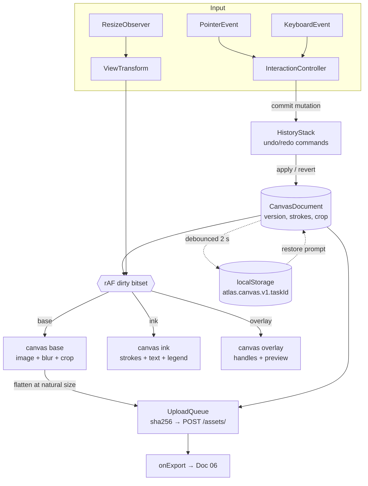

# Doc 07 — In-App Canvas Annotation Engine

> **Series position:** 07 of 10 · **Owner:** Subagent 7 (Canvas Specialist)
> **Parent:** [`master_implementation_plan.md`](./master_implementation_plan.md) §3, §4.1, §6 item 6, §11
> **Frozen contract:** [`01_system_architecture.md`](./01_system_architecture.md) — §4.1 (path ownership), §6.6 (`Asset`), §7.4 (`TaskDetailDTO.assets[]`), §9.3 (`screenshot_paths`), §12 (asset routes), §14 (upload validation), §15 (error taxonomy)
> **Builds against:** `frontend/lib/mocks/task_detail.json` (Doc 01 §16) until Doc 04 lands.
> **Change control:** nothing in this document may alter a Doc 01 field name, enum value, route, or error code. Deviations are `**Decision:**` items scoped to Doc 07 only.

## 1. Purpose & Boundary

### 1.1 Why the annotation engine exists

ATLAS-MCP hands work to CLI agents that have **local filesystem vision** (Master §4.1). The agent never receives base64; it receives an absolute path and reads the file itself. That means the *only* channel carrying spatial intent from human to agent is the pixels of one PNG.

Therefore the annotation engine is not a drawing toy — it is a **specification compiler**. It converts "the bug is here, not there" into a deterministic, high-contrast, low-token raster that a vision model can parse without ambiguity:

| Requirement | Consequence in this doc |
| :--- | :--- |
| Vision models degrade on low-contrast thin lines | §10 mandates minimum stroke widths and font sizes scaled to natural width |
| Vision models hallucinate arrow direction on thin heads | §10 freezes arrowhead geometry (filled, 90°, ≥ 3× stroke width) |
| A 4K screenshot downsampled by the model loses 1 px hairlines | §5 + §10 require annotation to survive a 2× downscale |
| Redundant uploads waste disk and DB rows | §9 computes `sha256` client-side for dedupe before upload |
| Privacy: an agent must not read a secret that was redacted | §4.8 mandates irreversible flattening of blur regions into the exported bitmap |
| The agent must map annotations to the text task description | §10 freezes the `[1] [2] [3]` label convention so the description can reference numbers |

The exported file lands at `storage/projects/{project_uuid}/tasks/{task_uuid}/input/annotated_canvas.png` (Master §3), beside the untouched `input/raw_screenshot_01.png`. Both are `Asset` rows (Doc 01 §6.6) with `kind = INPUT_SCREENSHOT` and `kind = ANNOTATED_CANVAS` respectively, and both surface in `TaskDetailDTO.assets[]` (Doc 01 §7.4) with a derived `absolute_path` that `claim_next_task.attached_images` forwards to the agent (Doc 01 §9.2).

### 1.2 Hard boundary

**Owned paths (this subagent may create/modify only these):**

| Path | Contents |
| :--- | :--- |
| `frontend/components/canvas/` | React client components: `AnnotationCanvas.tsx`, `ToolPalette.tsx`, `ToolOptions.tsx`, `CanvasToolbar.tsx`, `LegendToggle.tsx`, `HistoryControls.tsx`, `CanvasA11yLayer.tsx` |
| `frontend/lib/canvas/` | Framework-free TypeScript: geometry, hit-testing, renderer, history, export, upload queue, persistence, types |

**Explicitly forbidden:**

| Path | Owner | Reason |
| :--- | :--- | :--- |
| `frontend/components/ui/` | Doc 05 | Buttons, sliders, popovers, `SegmentedGauge` are imported, never re-implemented |
| `frontend/styles/`, `tailwind.config.ts` | Doc 05 | Tokens consumed via `var(--…)` / Tailwind classes only |
| `frontend/app/` | Doc 06 | Doc 06 mounts `<AnnotationCanvas />` on the task detail route |
| `frontend/lib/types/` | Doc 06 | `AssetDTO` is imported from there; Doc 07 does not redeclare it |
| `frontend/lib/api/` | Doc 06 | Upload uses `postAsset()` from the Doc 06 typed client; Doc 07 supplies the `FormData` + retry wrapper |
| `backend/`, `mcp_server/`, `tests/e2e/`, `scripts/` | 02/03/04/08/10 | Consumed as frozen HTTP contracts only |

**Decision:** the canvas engine is a *pure client component* (`"use client"`). No server component renders pixels, no Node canvas dependency is added, and no image bytes ever transit an RSC payload. Rationale: keeps the bundle under Doc 06's budget and keeps the storage root path off the browser (Doc 01 §14.2).

### 1.3 Published API — the exact surface Doc 06 consumes

Doc 06 imports exactly one component and one type from Doc 07.

```tsx
// frontend/components/canvas/AnnotationCanvas.tsx
export interface AnnotationCanvasProps {
  taskId: string;                     // UUID; keys autosave + upload
  sourceAsset: AssetDTO;              // kind === "INPUT_SCREENSHOT"; fetched via createImageBitmap
  initialDocument?: CanvasDocument;   // re-open an existing ANNOTATED_CANVAS
  mode?: "create" | "review";         // "review" = read-only, no tools
  onExport?: (result: ExportResult) => void;   // fires after a 2xx asset POST
  onError?: (err: CanvasError) => void;        // §14 taxonomy, never throws
  onDirtyChange?: (dirty: boolean) => void;    // Doc 06 routes unsaved-changes guard
  className?: string;
}

export interface ExportResult {
  asset: AssetDTO;          // returned by POST /api/v1/assets/ — has relative_path + absolute_path
  document: CanvasDocument; // serialised model that produced the PNG
  sha256: string;           // 64 hex chars, computed client-side
  byte_size: number;
  exported_at: string;      // ISO-8601 UTC with Z (Doc 01 §5)
}

export default function AnnotationCanvas(props: AnnotationCanvasProps): JSX.Element;
```

Rules for Doc 06:

1. Mount inside a container with a **definite height** (`min-h-[60vh]` or a flex child). The canvas sizes to its parent via `ResizeObserver`; it never sets viewport height itself.
2. Do **not** wrap it in a `overflow-hidden rounded-*` shell with a different background — the overlay layer draws a selection halo that assumes `--surface-canvas`.
3. `onExport` is called **once per successful upload**; Doc 06 should invalidate the task-detail query and toast.
4. `taskId` change unmounts/remounts: autosave keys are per-task (§13).

**Decision:** no imperative ref/handle is published. Everything flows through callbacks + props. Rationale: prevents Doc 06 from depending on internal state shape, which would freeze `CanvasDocument` into a second contract.

## 2. Architecture

### 2.1 Three stacked canvas layers

One `<canvas>` cannot be partially repainted without re-running every draw call, and re-running a 4K `drawImage` on each pointer move costs ~8 ms/frame. So the engine stacks **three absolutely positioned canvases** of identical CSS size inside one `position: relative` wrapper:

| Layer | z | Contents | Repaint trigger |
| :--- | :--- | :--- | :--- |
| `base` | 0 | Source image at view transform, applied blur/pixelate regions, crop scrim | View change, image load, blur commit, resize |
| `ink` | 1 | Committed strokes, committed callouts, legend block | Any document mutation, resize, view change |
| `overlay` | 2 | Selection handles, marquee, in-progress preview, crosshair, keyboard cursor | Pointer move, selection change, hover |

```
┌─────────────────────────────────────────────────────────────────┐
│ wrapper  position: relative, overflow: hidden                   │
│   canvas#base     z=0  image + blur + crop mask   <- per resize │
│   canvas#ink      z=1  strokes + text chips + legend            │
│   canvas#overlay  z=2  handles + preview + cursor <- per frame  │
│   div#a11y        sr-only live region (DOM, never canvas)       │
└─────────────────────────────────────────────────────────────────┘
```

All three share `width`/`height` attributes derived from the same `dpr` formula (§5.3), so a CSS-pixel coordinate maps identically on every layer. `pointer-events` are enabled **only on the overlay**; `base` and `ink` are `pointer-events: none`. A single `onPointerDown` on the overlay drives all tools. This keeps hit-testing in one place and stops the browser from doing per-layer hit work.

### 2.2 Why `requestAnimationFrame`-batched redraw

`pointermove` fires at up to 240 Hz on high-polling mice; React state updates at that rate would thrash the reconciler. Every input handler therefore does **one** thing: mutate a ref (`docRef.current`, `previewRef.current`) and set a dirty bit. A single rAF loop reads the dirty bits and repaints only the dirty layers, in `base → ink → overlay` order:

```ts
// frontend/lib/canvas/scheduler.ts
export type Layer = "base" | "ink" | "overlay";

export function createScheduler(paint: (l: Layer) => void) {
  const dirty = new Set<Layer>();
  let raf = 0;
  const flush = () => { raf = 0; for (const l of dirty) paint(l); dirty.clear(); };
  return (layer: Layer) => {
    dirty.add(layer);
    if (!raf) raf = requestAnimationFrame(flush);
  };
}
```

Batching collapses the common drag pattern (N `pointermove` events, 1 frame) into exactly one overlay repaint — this is what makes the §11 30 fps floor achievable.

### 2.3 Why strokes render from an immutable model, not pixel buffers

| Requirement | Pixel-buffer failure | Model-driven outcome |
| :--- | :--- | :--- |
| Undo/redo (§8) | Full-bitmap snapshots: 4K RGBA = 33 MB each | ≤ 2 kB of JSON per command |
| Resolution independence (§6) | Strokes baked at screen scale; zoom = blurry | Re-rendered at export scale via `drawStroke(ctx, s, scale)` |
| Restyle after selection (§4.1) | Impossible without inpainting | Mutate `stroke.style`, repaint `ink` |
| Autosave (§13) | Cannot cheaply serialise a bitmap | `JSON.stringify(doc)` into `localStorage` |
| Object hit-testing (§7.5) | Colour-picking tricks | Pure geometric `hitTest(point, doc)` |

The engine holds **one source of truth**: the immutable `CanvasDocument` (§3). Layers are *projections*. The only mutable bitmaps are the decoded source `ImageBitmap` and the blur scratch canvas, both caches keyed to their inputs.

### 2.4 Layer & data flow



## 3. Core Data Model

### 3.1 Types

```ts
// frontend/lib/canvas/types.ts
export const CANVAS_DOC_VERSION = 1;
export interface Point { x: number; y: number }
export interface Rect { x: number; y: number; w: number; h: number }
export type Hex = `#${string}`;

export interface StrokeStyle { color: Hex; width: number; opacity: number; dash?: number[] | null }
interface StrokeBase { id: string; style: StrokeStyle; label?: number; createdAt: number }

export type Stroke =                                   // discriminated union by `tool`
  | (StrokeBase & { tool: "rect";      rect: Rect; radius?: number })
  | (StrokeBase & { tool: "arrow";     from: Point; to: Point })
  | (StrokeBase & { tool: "line";      from: Point; to: Point })
  | (StrokeBase & { tool: "freehand";  points: Point[] })              // RDP-simplified, >= 2
  | (StrokeBase & { tool: "highlight"; rect: Rect })                   // opacity clamped 0.12..0.35
  | (StrokeBase & { tool: "blur";      rect: Rect; mode: "pixelate" | "blur"; strength: number })
  | (StrokeBase & { tool: "text";      anchor: Point; box: Point; text: string;
                                       fontSize: number; wrapWidth: number });
// anchor = leader-line tip; box = chip top-left; both image-natural px.
// A text chip's rendered size is DERIVED from text+fontSize+wrapWidth, never stored.

export interface CanvasDocument {
  version: number;                       // === CANVAS_DOC_VERSION at write time
  sourceAssetId: string;                 // AssetDTO.id of the INPUT_SCREENSHOT
  imageNaturalSize: { w: number; h: number };
  strokes: Stroke[];                     // paint order == array order; z-order is index
  crop?: { rect: Rect } | null;          // applied at export, non-destructive
  legend?: { enabled: boolean; items: Array<{ label: number; text: string }> };
}
```

### 3.2 Serialisability contract

| Rule | Reason |
| :--- | :--- |
| `CanvasDocument` contains **only** JSON primitives, plain objects, and arrays — no `ImageBitmap`, `CanvasRenderingContext2D`, `Path2D`, `DOMRect`, or class instances | `structuredClone`, `JSON.stringify`, `localStorage`, and `postMessage` all work without a custom replacer |
| All geometry in **image-natural** coordinates (§6) | Export is resolution-independent; zoom/pan never leaks into the model |
| `strokes` order is paint order; no explicit `z` field | Removes an invariant that can desync; reorder = array splice |
| `version` is written on every save and checked on every load | §3.3 |
| No `Date` objects: timestamps are epoch-ms `number` | JSON round-trip is lossless |

### 3.3 Migration policy

```ts
// frontend/lib/canvas/migrate.ts
export function migrate(raw: unknown): CanvasDocument | null {
  if (!raw || typeof raw !== "object") return null;
  const d = raw as Partial<CanvasDocument> & { version?: number };
  let v = d.version ?? 0;
  if (v > CANVAS_DOC_VERSION) return null;   // forward-incompatible → refuse, §13.4
  if (v === 0) { /* v0→v1: rename `type`→`tool`, `thickness`→`style.width` */ v = 1; }
  return v === CANVAS_DOC_VERSION ? sanitise(d as CanvasDocument) : null;
}
```

`sanitise()` clamps numbers into valid ranges, drops strokes with unknown `tool`, and truncates `points[]` to 20 000 entries. Unknown fields are preserved (forward tolerance) but never rendered.

**Decision:** `version` starts at `1`, not `0`. `0` is reserved for pre-versioned payloads found in `localStorage` during development so `migrate()` has a distinguishable "legacy" branch.

## 4. Tool Specifications

### 4.0 Tool inventory & palette wireframe

| Key | Tool | Master §6.6 requirement | Doc 07 status |
| :--- | :--- | :--- | :--- |
| `V` | `select` | — (implied by resize/restyle) | in scope |
| `R` | `rect` | "bounding boxes" | **required** |
| `A` | `arrow` | "arrows" | **required** |
| `L` | `line` | — | in scope |
| `F` | `freehand` | — | in scope |
| `T` | `text` | "text callouts" | **required** |
| `H` | `highlight` | — | in scope |
| `B` | `blur` | "privacy blurs" | **required** |
| `C` | `crop` | — | optional (§4.9) |
| `I` | `eyedropper` | — | **out of scope** (§4.10) |

```
┌───────────────────────────────────────────────────────────────────────────────┐
│ ◤ ANNOTATE · TASK 5f2d6c1e · raw_screenshot_01.png · 4320 x 2880              │
│ TOOLS                  │ ┌──────────────────────────────────────────────────┐ │
│  ┌──┬──┬──┬──┐         │ │                                                  │ │
│  │V │R │A │L │         │ │      [1] JWT expiry banner                       │ │
│  ├──┼──┼──┼──┤         │ │      ┌────────────────────────────┐        ↑     │ │
│  │F │T │H │B │         │ │      │ ▓▓▓ redacted ▓▓▓▓▓▓▓▓▓     │   (2)        │ │
│  ├──┼──┼──┼──┤         │ │      └────────────────────────────┘   [3]        │ │
│  │C │  │  │  │         │ │      ─────────────────────↘                      │ │
│  └──┴──┴──┴──┘         │ │                                                  │ │
│  ──────────────        │ └──────────────────────────────────────────────────┘ │
│  STYLE                 │ ┌──────────────────────────────────────────────────┐ │
│  color     ●●●●●●      │ │  [1] secret   [2] banner    undo  redo  zoom     │ │
│  width     ├──●──┤ 6px │ └──────────────────────────────────────────────────┘ │
│  opacity   ├───●┤ 100% │    [ EXPORT PNG ]        [ COPY PATH ]               │
│  ──────────────        │                                                      │
│  [x] VISION MODE       │                                                      │
│  [x] LEGEND BLOCK      │                                                      │
│  [x] HIGH CONTRAST     │                                                      │
└───────────────────────────────────────────────────────────────────────────────┘
```

Palette contract:

- Tool buttons are Doc 05 `HudButton` primitives with `aria-pressed`, wrapped in a `role="toolbar"` `aria-orientation="vertical"`.
- Single-key shortcuts only fire when the canvas subtree has focus and no `input`/`textarea` is focused (§12.2).
- The style panel shows only properties relevant to the active tool (a `blur` has no `color`).
- `EXPORT PNG` is disabled when `strokes.length === 0` and `dirty === false`.

### 4.1 `select`

| Aspect | Specification |
| :--- | :--- |
| Gesture | Click on a stroke → select. Drag on empty → marquee (rubber-band) multi-select. Drag on selected stroke → move. `Shift+click` toggles membership. Click empty → clear. |
| Geometry | Hit-test order is **reverse paint order** (topmost wins). Tolerance = `max(6 / view.scale, style.width / 2)` in image px. `rect`/`blur`/`highlight` test the outline band **and** the interior (interior fill hit only when `altKey` is held, so nested boxes stay selectable). Arrow/line test point-to-segment distance ≤ tolerance. Freehand tests every segment. Text tests the chip `Rect` and the leader segment. |
| Handles | 8 handles: 4 corners + 4 edge midpoints, drawn on `overlay` at a constant **screen** size (`8 CSS px`), not scaled with zoom. Cursor map: `nwse-resize`, `ns-resize`, `nesw-resize`, `ew-resize`. |
| Resize semantics | Corner drag scales both axes; edge drag one axis. `Shift` = preserve aspect (corners only). `Alt` = resize about centre. Minimum size is 4×4 image px; below that, delete the stroke. Text resize adjusts `wrapWidth` only — font size is changed in the style panel, never by drag. |
| Move | `↑ ↓ ← →` = 1 image px; `Shift+arrows` = 10 image px. Arrow keys never scroll the page while the canvas has focus. |
| Edge cases | Multi-select resize uses the union bounding box and scales each member's geometry proportionally. Selection of a stroke with `label` keeps the label; deleting a labelled stroke does **not** renumber remaining labels (numbers are identity, not rank — see §10.5). |

### 4.2 `rect` — bounding box

| Aspect | Specification |
| :--- | :--- |
| Gesture | `pointerdown` → anchor. Drag → live preview on `overlay`. `pointerup` → commit as `RectStroke`. Drag in any direction (all four quadrants normalise). |
| Geometry | Persist normalised `{x: min, y: min, w: abs, h: abs}` with all four values ImageSpace. Render as `strokeRect` + optional 1 px inner glow. |
| Style | `color` (default `#FF2D55`), `width` (default = `max(4, round(naturalW / 720))` image px, §10.1), `opacity`, `radius` (0 default, 4 for HUD-friendly rounded corners), optional `dash`. |
| Modifiers | `Shift` = perfect square (side = `max(|dx|,|dy|)` anchored at `pointerdown`). `Alt` = draw from centre. `Shift+Alt` = centred square. |
| Edge cases | A click with drag distance < 3 CSS px commits nothing (prevents accidental 1-px boxes) and is treated as a click → falls through to `select`. Rect at export crop boundary is **clipped geometrically**, not visually squashed. Committing a rect auto-assigns `label = nextLabel()` unless `Alt` was held. |

### 4.3 `arrow`

| Aspect | Specification |
| :--- | :--- |
| Gesture | `pointerdown` at tail → drag → `pointerup` at head. |
| Geometry | `from` (tail), `to` (head). Head is a filled triangle, `headSize = max(3.2 × width, 14)` image px, half-angle 45° (90° total). The shaft is **shortened** by `headSize * 0.85` so the line never pokes through the tip. |
| Style | Inherits `color`, `width`, `opacity`. `dash` is forbidden on arrows (a dashed shaft with a solid head reads as "broken" to vision models). |
| Modifiers | `Shift` = snap direction to 15° increments (0/15/30/…), so "straight up" is reproducible. `Alt` = double-headed (`bothEnds`). |
| Edge cases | Zero-length arrow (`< 4` image px) is discarded. Head smaller than 8 image px is clamped up — an unreadable head is worse than a slightly fat one. Arrow whose head lands within `width` of the tail is converted to a `line` (degenerate case). |

### 4.4 `line`

Identical to `arrow` minus the head; `Shift` snaps to 15°. Used for underlines, dividers between two regions, and "this element aligns with that element" pairings. Two clicks with no drag also create a line (click-to-start, click-to-end) as an accessibility affordance (§12).

### 4.5 `freehand`

| Aspect | Specification |
| :--- | :--- |
| Gesture | `pointerdown` → sample points on every `pointermove` → `pointerup` commits. |
| Geometry | `points: Point[]` in ImageSpace. During capture, points are stored raw (`getCoalescedEvents()` used when available for pen fidelity). On commit, the array is simplified with **Ramer–Douglas–Peucker**, ε = `0.6 / view.scale` image px, capped at 2 000 points. |
| Style | `lineCap = "round"`, `lineJoin = "round"`, quadratic smoothing through midpoints (`quadraticCurveTo`), single `stroke()` call. |
| Modifiers | `Shift` = constrain the final segment to a straight line from the pen-down point (turns wobble into a clean stroke). |
| Edge cases | > 20 000 raw points → oldest are dropped with a straight-line bridge (protects memory, §11.2). A stroke under 3 raw points is drawn as a dot of radius `width/2`. Freehand is one undo entry regardless of point count (§8.3). |

### 4.6 `text` — callout with leader line

| Aspect | Specification |
| :--- | :--- |
| Gesture | Click → `anchor` placed at the click point. A textarea appears at a default offset (`+28, -72` CSS px, flipped when near the right/bottom edge). `Enter` inserts a newline; `Cmd/Ctrl+Enter` or blur commits; `Esc` cancels. |
| Geometry | `anchor` = leader tip (pointing at the subject). `box` = chip top-left. The chip size is **derived** at render time from `text` + `fontSize` + `wrapWidth` + padding, not stored — so a font-size change cannot desync the box. Leader line runs from the chip edge nearest the anchor to the anchor, ending in a 6 px dot at the anchor. |
| Style | `fontSize` default = `max(14, round(naturalW / 180))` image px (§10.4). Chip background = `--surface-raised` at **100 % opacity** (mandatory solid chip, §10.6). Text colour = `--text-primary`. Border = 2 px `color`. Padding = `0.5em 0.6em`. |
| Modifiers | `Shift+click` places the chip **without** a leader when the anchor and chip would overlap (short labels). `Alt+click` places the anchor at the click and the chip at the pointer-down screen centre (useful for long text at 4K). |
| Edge cases | Empty text on commit → discard. Text > 280 chars → hard stop with a counter turning amber at 240. Chip dragged past the viewport edge is clamped inside the image rect at render time (never persisted clamped, so zooming out restores position). Non-ASCII/CJK is supported; `measureText` wrapping uses `Intl.Segmenter` when available. |

### 4.7 `highlight`

Semi-transparent region emphasis. `rect` geometry, `opacity` forced into `[0.12, 0.35]`, `blendMode = "multiply"` composited inside the export scratch canvas so overlapping highlights do not turn opaque. Default colour `#FFD60A` (amber) with `opacity 0.28`. **No `label`** — highlights are decorative, and numbering them would dilute the `[n]` convention. Rendered *below* strokes (§5.1).

### 4.8 `blur` / `pixelate` — privacy

| Aspect | Specification |
| :--- | :--- |
| Gesture | Drag a rect, exactly like `rect`. Commit immediately applies to the `base` layer. |
| Geometry | `rect` in ImageSpace + `mode` + `strength`. |
| Algorithm A — `pixelate` (**default**) | Downscale the region to `ceil(w / block)` × `ceil(h / block)` on a scratch canvas with `imageSmoothingEnabled = false`, then upscale back to `w × h` with `imageSmoothingEnabled = false`. `block = strength` image px, default `max(8, round(naturalW / 480))`. |
| Algorithm B — `blur` | `scratchCtx.filter = "blur(${strength}px)"` then `drawImage`. `strength` default `max(6, naturalW / 400)`. |
| Mandated default | **`pixelate`.** Rationale: Gaussian blur is *invertible enough* that text at 4K is often recoverable by a deconvolution pass; block averaging at ≥ 8 px blocks destroys glyph structure with no residual gradient information. |
| Irreversibility | The blur is composited into the exported bitmap and **never** into the `ink` layer. There is no "unblur on export" path, no layer retained in the PNG, and the exported PNG has no alpha channel over the region. Additionally, the export step **re-rasterises at natural resolution from the source image** and then paints the pixelated blocks — it never downscales an already-blurred screen-resolution composite, which is the classic accidental-leak path (§5.1 step 2). |
| Style panel | Shows `mode` (segmented: PIXELATE | BLUR) and `strength` in image px. |
| Edge cases | Region smaller than `2 × block` → block clamped to `floor(min(w,h)/2)`. Region fully outside the image is dropped. Blur regions **cannot be exported partially**: if a blur rect is clipped by `crop`, the clipped geometry is re-pixelated at the clip size, never resampled from the unblurred remainder. Overlapping blur regions are applied sequentially on the same scratch canvas (each reading the previous result) so overlap never un-blurs. |
| Verification | An automated test (§15.2) decodes the exported PNG, extracts the region, and asserts that the count of distinct colours inside it is ≤ `(w/block) × (h/block)` thresholds and that no horizontal edge gradient exceeds a threshold. See §15.1 case `T-BLUR-03`. |

**Decision:** blur strokes are stored **in the document model** (so undo/redo works and the region is re-appliable at export scale), but they are rendered on the `base` layer, not the `ink` layer. Rationale: this keeps the visual order correct (a blur must sit under a callout pointing at it) while preserving non-destructive editing.

### 4.9 `crop` (optional — in scope, low priority)

Non-destructive: stores `crop.rect` in the document; `base` renders everything outside it at 35 % opacity with a dark scrim; export uses the crop rect as the destination bounds. Only one crop per document; re-cropping replaces it. `Reset crop` lives in the style panel. If `crop.w < 64` or `crop.h < 64` image px it is rejected. Crop **does not** delete strokes — a stroke fully outside the crop is dropped from the export silently but remains in the document.

**Decision:** crop is implemented *after* all mandated tools (§18 ordering). It is the first thing cut if the schedule slips, because Master §6 item 6 does not name it.

### 4.10 `eyedropper` — out of scope

**Decision:** excluded. Rationale: (a) not named in Master §6 item 6; (b) every realistic use case is already served by the 6-swatch developer palette in the style panel (`#FF2D55`, `#00F2FE`, `#F59E0B`, `#10B981`, `#FFFFFF`, `#000000`) which are exactly the Doc 05 accent tokens; (c) sampling from a tainted/CORS-failed image would require `getImageData` and fail with a `SecurityError` — one more error path for zero requirement coverage.

## 5. Rendering Pipeline

### 5.1 Exact draw order (export, natural resolution)

`base` layer and export share **one** function, `composeTo(ctx2, doc, image, scale)`, so what the user sees is what ships.

| # | Step | Layer / target | Notes |
| :--- | :--- | :--- | :--- |
| 1 | `clearRect` full surface | target | |
| 2 | `drawImage(image, 0,0, cw, ch)` | target | source image at natural (or cropped) size |
| 3 | **Blur regions, sequentially** | scratch canvas, one per region, blitted back | For each `blur` stroke in array order: allocate/reuse a scratch of the *region* size at natural scale, downscale-upscale or filter-blur, then `drawImage(scratch, region)` onto the target. This runs **after** step 2 so it consumes original pixels, and **before** any stroke so callouts stay sharp on top. |
| 4 | `highlight` strokes | target, `globalCompositeOperation = "multiply"` inside save/restore | multiply keeps overlapping highlights from stacking to opaque |
| 5 | `rect` / `line` / `arrow` / `freehand` | target | paint order = array order |
| 6 | `text` callouts: leader line first, then chip, then glyphs | target | chip is opaque (§10.6) so it always occludes what it covers |
| 7 | **Labels** (`[n]` chips) for labelled strokes | target | drawn last of the annotation content so a number is never occluded |
| 8 | **Legend block** (if enabled) | target, bottom-left or bottom-right, whichever has less content | §10.7 |
| 9 | Crop scrim / viewport chrome | **screen only**, never export | `base` layer only |

`globalCompositeOperation` is always reset to `"source-over"` and `globalAlpha` to `1` at the end of every stroke draw, enforced by save/restore.

### 5.2 `ctx.save` / `ctx.restore` discipline

Rules, enforced by a lint rule (§15.1 `T-LINT-01`) and code review:

1. Every function that mutates context state opens with `save()` and closes with `restore()` in a `try/finally`.
2. State that may be mutated: `globalAlpha`, `globalCompositeOperation`, `strokeStyle`, `fillStyle`, `lineWidth`, `lineCap`, `lineJoin`, `filter`, `font`, `textAlign`, `textBaseline`, `setLineDash`, `imageSmoothingEnabled`, and the transform.
3. `save()`/`restore()` counts must balance on every code path; an unbalanced pair silently corrupts the *next* stroke (the classic symptom: one arrow paints in the previous arrow's colour).
4. Never mutate the transform outside `applyView` (§6.4) — no ad-hoc `ctx.scale()` in a tool.
5. `ctx.setLineDash([])` is reset explicitly; it is **not** restored by all engines on `restore()` in older Safari.

### 5.3 `ResizeObserver` + intrinsic-size transform + DPR formula

```ts
// frontend/lib/canvas/device.ts
export const MAX_DPR = 2;   // beyond 2× the memory cost buys no legibility

export function applyDpr(canvas: HTMLCanvasElement, cssW: number, cssH: number) {
  const dpr = Math.min(window.devicePixelRatio || 1, MAX_DPR);
  const w = Math.round(cssW * dpr), h = Math.round(cssH * dpr);
  if (canvas.width !== w || canvas.height !== h) { canvas.width = w; canvas.height = h; }  // clears
  canvas.style.width = `${cssW}px`; canvas.style.height = `${cssH}px`;
  const ctx = canvas.getContext("2d", { alpha: true, desynchronized: true })!;
  ctx.setTransform(dpr, 0, 0, dpr, 0, 0);   // all drawing is now in CSS px
  return ctx;
}
```

**DPR formula (normative):** `dpr = min(devicePixelRatio || 1, 2)`; `canvas.width = round(cssW × dpr)`; `canvas.height = round(cssH × dpr)`; CSS size set explicitly; `setTransform(dpr,0,0,dpr,0,0)`; 1-device-px hairlines use `lineWidth = px / dpr`.

The observer attaches once to the wrapper, debounces through rAF, and drives `fitScale = min((cssW − 48) / naturalW, (cssH − 48) / naturalH)` (24 CSS px margin per side). `zoom` is a **multiplier on `fitScale`**, clamped `[0.25, 8]` (§7.3): `zoom: 1` means "fit the window", which is the correct first-load behaviour and keeps view state out of the persisted model.

### 5.4 `drawStroke(ctx, stroke, scale)` sketch

`scale` = image-natural px → target px (CSS px on screen, `1` at export). Line widths, font sizes, and head sizes are **all** multiplied by `scale` so a 4K export and a 25 %-zoom screen preview are the same drawing.

```ts
// frontend/lib/canvas/drawStroke.ts — S = image-natural px → target px (1 at export)
export function drawStroke(ctx: CanvasRenderingContext2D, s: Stroke, S: number): void {
  ctx.save();
  try {
    ctx.globalAlpha = s.style.opacity ?? 1; ctx.strokeStyle = ctx.fillStyle = s.style.color;
    ctx.lineWidth = Math.max(0.75, s.style.width * S);
    ctx.lineCap = ctx.lineJoin = "round"; ctx.setLineDash(s.style.dash ?? []);
    switch (s.tool) {
      case "rect": case "highlight": {
        const r = mulRect(s.rect, S);
        if (s.tool === "highlight") { ctx.globalCompositeOperation = "multiply";
          ctx.globalAlpha = Math.min(s.style.opacity, 0.35); ctx.fillRect(r.x, r.y, r.w, r.h); break; }
        ctx.beginPath();
        s.radius ? ctx.roundRect(r.x, r.y, r.w, r.h, s.radius * S) : ctx.rect(r.x, r.y, r.w, r.h);
        ctx.stroke(); break;
      }
      case "line": {
        const a = mulPoint(s.from, S), b = mulPoint(s.to, S);
        ctx.beginPath(); ctx.moveTo(a.x, a.y); ctx.lineTo(b.x, b.y); ctx.stroke(); break; }
      case "arrow": {
        const a = mulPoint(s.from, S), b = mulPoint(s.to, S);
        const head = Math.max(3.2 * ctx.lineWidth, 14 * S);         // §10.5 frozen geometry
        const ang = Math.atan2(b.y - a.y, b.x - a.x), kx = Math.cos(ang), ky = Math.sin(ang);
        ctx.beginPath(); ctx.moveTo(a.x, a.y);                       // shaft stops short of tip
        ctx.lineTo(b.x - kx * head * 0.85, b.y - ky * head * 0.85); ctx.stroke();
        ctx.beginPath(); ctx.moveTo(b.x, b.y);                       // filled 90° head
        ctx.lineTo(b.x - head * Math.cos(ang - Math.PI / 4), b.y - head * Math.sin(ang - Math.PI / 4));
        ctx.lineTo(b.x - head * Math.cos(ang + Math.PI / 4), b.y - head * Math.sin(ang + Math.PI / 4));
        ctx.closePath(); ctx.fill(); break;
      }
      case "freehand": { const p = s.points; if (p.length < 2) break;
        ctx.beginPath(); ctx.moveTo(p[0].x * S, p[0].y * S);
        for (let i = 1; i < p.length - 1; i++) { const c = p[i], n = p[i + 1];  // midpoint smoothing
          ctx.quadraticCurveTo(c.x * S, c.y * S, ((c.x + n.x) / 2) * S, ((c.y + n.y) / 2) * S); }
        ctx.stroke(); break; }
      case "blur": break;                      // composited on the base pass, see composeTo()
      case "text": drawCallout(ctx, s, S); break;
    }
  } finally { ctx.restore(); }                 // always: a leak poisons the next stroke
}
```

### 5.5 Callout rendering (`drawCallout`)

Order inside one `save/restore`: leader line (`strokeStyle = color`, `lineWidth = max(2, 2*scale)`, dash `[]`) → anchor dot (`arc`, `r = 3 * scale`) → chip rect (`fillStyle = opaque chip colour`, `radius = 4 * scale`) → chip border → wrapped glyphs with `textBaseline = "top"`. Wrapping is measured once per (text, fontSize, wrapWidth) triple and memoised in a `Map` keyed by `${text.length}|${fontSize}|${wrapWidth}` to avoid `measureText` storms during zoom.

## 6. Coordinate Systems

### 6.1 The three spaces

| Space | Unit | Where it lives | Used by |
| :--- | :--- | :--- | :--- |
| **Screen px** (`clientX/clientY`) | device-independent CSS px relative to the *viewport* | `PointerEvent` | entered once, immediately converted — never stored |
| **CSS px** | CSS px relative to the **canvas wrapper's top-left** (post-DPR, but pre-view-transform) | canvas backing store is `css × dpr` | all `ctx` drawing (transform handles DPR) |
| **Image-natural px** | px in the source bitmap (`imageNaturalSize`) | `CanvasDocument` | **all persisted geometry**, all hit-tests, export |

### 6.2 The single helper pair (normative)

`frontend/lib/canvas/space.ts` is the **only** module allowed to contain these formulas. Any other file that divides by `scale` is a review failure. Conversion chain: `clientX − rect.left → cssX`, then `(cssX − tx) / scale → imageX`.

```ts
export interface ViewTransform { scale: number; tx: number; ty: number }  // css = image*scale + t

export const toImageSpace  = (p: Point, v: ViewTransform): Point => ({ x: (p.x - v.tx) / v.scale, y: (p.y - v.ty) / v.scale });
export const toScreenSpace = (p: Point, v: ViewTransform): Point => ({ x: p.x * v.scale + v.tx, y: p.y * v.scale + v.ty });

export const eventToCss = (e: PointerEvent | React.PointerEvent, el: HTMLElement): Point => {
  const r = el.getBoundingClientRect();
  return { x: e.clientX - r.left, y: e.clientY - r.top };
};

// the one call at the edge of the system: pointer → model
export const eventToImage = (e: PointerEvent | React.PointerEvent, el: HTMLElement, v: ViewTransform) =>
  toImageSpace(eventToCss(e, el), v);
```

### 6.3 Why persistence is in image-natural coordinates

| Consequence | If persisted in screen px | With image-natural px |
| :--- | :--- | :--- |
| Export at 4K from a 900 px preview | stroke widths and fonts are 4.4× too small; annotations vanish | `scale = 1` at export reproduces exactly what was drawn, proportionally |
| Reopen on a different monitor / DPR 2 vs 1 | annotations shift and thicken | identical |
| Re-open in a 40 %-wide side panel | everything is off-canvas | `fitScale` recomputes, document untouched |
| Diff two documents | meaningless | comparable |

**Rule:** view state (`scale`, `tx`, `ty`, `zoom`) is **never** serialised — it is derived on load from `imageNaturalSize` + container size, then clamped.

### 6.4 Applying the transform

```ts
export function applyView(ctx: CanvasRenderingContext2D, v: ViewTransform) {
  ctx.setTransform(1, 0, 0, 1, 0, 0);   // reset to device space
  ctx.scale(dpr, dpr);                   // §5.3 DPR
  ctx.translate(v.tx, v.ty);
  ctx.scale(v.scale, v.scale);           // now in image space
}
```

**Decision:** the engine uses the **explicit `scale`** form (`drawStroke(ctx, s, view.scale)`) rather than this transform form. Rationale: `lineWidth` under a scaled transform scales too, so hairlines and glyphs behave unpredictably across engines, and `getTransform()`-based hit-testing becomes an extra failure mode. The transform version above is retained only for the one place it is unambiguous — drawing a pre-rendered `ink` cache bitmap during a drag (§11.3).

## 7. Interaction & Input Handling

### 7.1 Pointer events only

All input is `pointerdown` / `pointermove` / `pointerup` / `pointercancel` / `pointerleave`, registered with `{ passive: false }` where `preventDefault` is needed. No `mousedown`, no `touchstart`, no `dblclick` handlers. Rationale: one code path covers mouse, pen (including `pressure` and `tiltX` when present), and touch, and `pointerType` gives us the tuning hooks below.

| `pointerType` | Tuning |
| :--- | :--- |
| `mouse` | full hit tolerance; hover cursors enabled; wheel zoom enabled |
| `pen` | `pressure` modulates freehand `lineWidth` within `[0.6, 1.4] × width` when `pressure > 0`; palm rejection via `width < 8 && height < 8` contact geometry check |
| `touch` | hit tolerance × 1.75; hover disabled; single-finger draws, **two-finger pan + pinch-zoom** (§7.3); double-tap does nothing (prevents accidental tool switches) |

### 7.2 Capture

On `pointerdown` the overlay calls `el.setPointerCapture(e.pointerId)`. This guarantees the drag continues to deliver `pointermove`/`pointerup` even when the pointer exits the canvas (very common when drawing near an edge). `pointercancel` (OS gesture takeover, e.g. a browser back-swipe) always **aborts** the in-progress stroke and restores the pre-drag document — it never commits a partial stroke.

### 7.3 Pan & zoom

| Gesture | Behaviour |
| :--- | :--- |
| `Space` + drag (any button) | Pan. Cursor becomes `grab`/`grabbing`; drawing tools are suppressed while `Space` is held. |
| Middle-button drag (`button === 1`) | Pan, no modifier needed. |
| `wheel` with `ctrlKey`/`metaKey` | Zoom toward the cursor. `newScale = clamp(scale × exp(−deltaY × 0.0015), minScale, maxScale)`; `tx/ty` recomputed so the image point under the cursor is invariant. |
| `wheel` without modifier | **Vertical scroll of the page**, not zoom. Rationale: trapping plain wheel is a hostile pattern inside a document page. |
| Pinch (2 touch points) | Zoom + pan, same anchor-invariance formula. |
| `+` / `−` / `0` | Zoom in / out / reset-to-fit (keyboard parity, §12). |

Zoom bounds: `minScale = fitScale × 0.25`, `maxScale = fitScale × 8`, and additionally `maxScale ≤ 8` absolute to prevent 4K-at-800 % memory blowups. Pan is clamped so at least 15 % of the image stays visible on each axis (prevents "lost canvas").

### 7.4 Drag-to-create flow (rect / arrow / line / blur / highlight / crop)

Uniform state machine, one implementation:

```
idle ──pointerdown(tool≠select)──▶ arming
arming ──pointermove ≥ 3 css px──▶ dragging   (preview on overlay)
arming ──pointerup < 3 css px──▶ idle          (discard; treated as click)
dragging ──pointermove──▶ dragging              (preview replaced, not appended)
dragging ──pointerup──▶ COMMIT ──▶ idle         (push history, repaint ink+base, autosave)
dragging ──pointercancel / Esc──▶ ABORT ──▶ idle
dragging ──Space held──▶ panning (preview frozen) ──Space released──▶ dragging
```

Commit always goes through `pushCommand(AddStroke)`, which: assigns `id` + `label` if applicable, appends to `doc.strokes`, marks `ink` (and `base` for blur) dirty, sets `dirty = true`, notifies `onDirtyChange`.

### 7.5 Hit-testing for select

```
hitTest(pImage, doc, tolImage): Stroke | null
  for stroke in reverse(doc.strokes):        // topmost first
    switch stroke.tool:
      rect|highlight|blur : insideOutline(p, r, tol) || (altKey && inside(p, r))
      line|arrow          : distToSegment(p, from, to) ≤ max(tol, width/2)
      freehand            : min over segments of distToSegment ≤ max(tol, width/2)
      text                : inside(p, chipRect) || distToSegment(p, chipEdge, anchor) ≤ tol
```
`tolImage = max(6 / view.scale, style.width / 2)`. Early exit on the first hit keeps a 500-stroke document at ~0.1 ms per pick.

### 7.6 Resize (8 handles)

Handles are computed in **screen space** from `toScreenSpace(bbox)` and drawn at a fixed `8 CSS px` so they stay clickable at any zoom. Dragging a handle sets `resizing = { handle, origin, initial }` and applies an affine update per pointer move:

| Handle | Effect |
| :--- | :--- |
| `nw`,`ne`,`sw`,`se` | move the two adjacent edges; recompute `rect` from min/max |
| `n`,`s` | move `y` / `h` only |
| `w`,`e` | move `x` / `w` only |

For `arrow`/`line`, only the two endpoint handles are shown (plus a midpoint handle that translates the whole stroke). For `text`, the chip's `wrapWidth` follows the east/west handles; the leader `anchor` keeps its own handle. For multi-select, the union bbox scales members proportionally.

### 7.7 Rotation — out of scope

**Decision:** no rotation tool, no rotate handle, no `rotation` field in `Stroke`. Rationale: rotated bounding boxes are not representable in `Rect` without adding an `angle` to every type, break axis-aligned hit-testing simplicity, and add nothing for a vision model — a slightly tilted rectangle is still understood as a rectangle. If tilt is ever needed it will be expressed by freehand.

### 7.8 Multi-select — in scope, restricted

**Decision:** multi-select is supported for **move, delete, duplicate, and restyle**, but **not** for group-resize of mixed tool types (only uniform scaling of the union bbox applies, and it is disabled when the selection mixes `text` with non-`text`). Rationale: group-rescaling a callout's font independently from its chip is visually incoherent; refusing is better than a broken result. Membership lives in `selection: Set<string>` — **ephemeral UI state, never persisted**.

### 7.9 Keyboard operations

| Keys | Action |
| :--- | :--- |
| `Backspace` / `Delete` | Delete selection (single history command for the whole selection) |
| `Cmd/Ctrl+D` | Duplicate selection, offset `+16,+16` image px, new ids, labels **not** copied (a duplicate must not claim an existing number) |
| `↑ ↓ ← →` | Nudge 1 image px (`Shift` = 10) |
| `Cmd/Ctrl+A` | Select all |
| `Esc` | Clear selection → clear tool → exit text edit (in that order, one per press) |
| `Cmd/Ctrl+Z` / `Cmd/Ctrl+Shift+Z` | Undo / redo |
| `V R A L F T H B C` | Tool switch |
| `Space` (hold) | Pan mode |
| `+` `−` `0` | Zoom in / out / fit |

All of these are registered on the canvas container (`tabIndex={0}`), never on `document`, so Doc 06's global hotkeys (Master §6 item 10: `J`/`K`, `C`, `/`, `A`) are not stolen. **Conflict note:** `C` and `A` collide with Doc 06 globals. Doc 07 uses `R` for rect, `A` for arrow — which collides with Doc 06's "approve discovery" `A`. **Resolution:** Doc 07 shortcuts are active **only while the canvas subtree owns focus**; `Esc` returns focus to the panel. Documented in §17 as a contract item for Doc 06.

## 8. Undo/Redo & History

### 8.1 Command-stack design

```ts
// frontend/lib/canvas/history.ts
export interface Command {
  readonly label: string;              // "add rect", "delete 3 strokes"
  apply(doc: CanvasDocument): CanvasDocument;    // pure: returns a new doc
  revert(doc: CanvasDocument): CanvasDocument;   // pure: returns a new doc
}

export interface HistoryState { undo: Command[]; redo: Command[] }

export const HISTORY_CAP = 100;

export function push(h: HistoryState, c: Command): HistoryState {
  const undo = [...h.undo, c];
  if (undo.length > HISTORY_CAP) undo.shift();   // drop oldest; memory ceiling
  return { undo, redo: [] };                     // any new command clears redo
}
```

Commands are **pure functions over the immutable document**, not closures over mutable state. This makes them trivially testable (§15.1) and guarantees `apply` after `revert` is an identity. Concrete command set:

| Command | `apply` | `revert` |
| :--- | :--- | :--- |
| `AddStroke` | `strokes + [s]` | `strokes - [s.id]` |
| `DeleteStrokes` | `strokes - ids` | re-insert at original indices |
| `UpdateStroke` | replace by id with `next` | replace with `prev` |
| `MoveStrokes` | translate by delta | translate by −delta |
| `ReorderStroke` | splice to index | splice back |
| `SetCrop` | `crop = next` | `crop = prev` |
| `SetLegend` | `legend = next` | `legend = prev` |

### 8.2 100-entry cap

Capped at 100 commands. At ~2 kB per stroke command that is ≈ 200 kB worst case, well inside the `localStorage` budget (§13.2). Overflow drops the **oldest** entry (`shift`), which is standard and predictable. The cap is asserted in `T-HIST-02`.

### 8.3 Coalescing rules

| Interaction | History behaviour |
| :--- | :--- |
| Freehand stroke | **One** `AddStroke` per pen-down→pen-up, regardless of point count. Never per point. |
| Rect/arrow/line/blur/highlight/crop drag | **One** command per drag, pushed on `pointerup` only. Intermediate previews are not commands. |
| Handle resize drag | **One** `UpdateStroke` per drag. The `prev` snapshot is captured at `pointerdown`. |
| Move drag | **One** `MoveStrokes` per drag, `prev` at `pointerdown`. |
| Arrow-key nudge | Coalesce consecutive nudges of the same selection while < 600 ms apart **and** no other command intervenes; otherwise each press is its own entry. |
| Text content edit | One command per *commit* (blur / `Cmd+Enter`), not per keystroke. |
| Style slider drag | Coalesce to one command per drag (`input` events collapse until `change`). |

### 8.4 Keyboard & UI

`Cmd/Ctrl+Z` = undo, `Cmd/Ctrl+Shift+Z` (and `Cmd+Y` on Windows) = redo. Both `preventDefault()` inside the canvas subtree. Toolbar buttons mirror the keys and carry `aria-keyshortcuts`. Redo stack is cleared by any new command. Undo across a tool switch is allowed (history is document-scoped, not tool-scoped).

**Decision:** history is **in-memory only**; it is never serialised to `localStorage`. Rationale: a restored session starts with an empty history, which is honest ("we recovered your document, not your keystrokes"), and it halves the storage footprint.

## 9. Export Pipeline

### 9.1 Sequence

```
┌───────────────────────────────────────────────────────────────────────┐
│  1  compose   offscreen canvas w x h = imageNaturalSize (or crop)     │
│               composeTo(ctx, doc, bitmap, scale=1)      <- 5.1 order  │
│  2  vision    white halo 3px + stroke outline          <- 10.3        │
│  3  encode    canvas.toBlob(cb, "image/png")    PNG only, no JPEG     │
│  4  hash      sha256(arrayBuffer(blob)) via WebCrypto -> 64 hex       │
│  5  dedupe    reuse the ANNOTATED_CANVAS asset with the same sha256   │
│  6  upload    POST /api/v1/assets/   multipart/form-data              │
│               task_id, kind=ANNOTATED_CANVAS, source=HUMAN,           │
│               sha256, source_asset_id, file=annotated_canvas.png      │
│  7  response  201 -> AssetDTO (relative_path + derived absolute_path) │
│  8  emit      onExport({asset, document, sha256, byte_size, ...})     │
│  9  persist   localStorage atlas.canvas.v1.{taskId} + last_export     │
└───────────────────────────────────────────────────────────────────────┘
```

Notes:

- The export canvas is **never** the visible `base`+`ink` canvases. It is a fresh `OffscreenCanvas`/`document.createElement("canvas")` at exactly `imageNaturalSize`, so screen DPR cannot contaminate the output and a 4 320 × 2 880 source exports at 4 320 × 2 880 regardless of a 900 px preview.
- `toBlob` is wrapped in a promise; a `null` callback result raises `EXPORT_ENCODE_FAILED` (§14.5).
- Format is **PNG only**. The backend MIME allow-list (Doc 01 §14.5) accepts `image/png`; JPEG would reintroduce ringing artefacts around high-contrast strokes — the exact thing §10 is trying to avoid.
- Filename is always `annotated_canvas.png` (Master §3). Multiple exports create multiple `Asset` rows; the newest wins in the UI, and dedupe prevents byte-identical churn.

### 9.2 Client-side sha256

```ts
// frontend/lib/canvas/hash.ts
export async function sha256Hex(buf: ArrayBuffer): Promise<string> {
  const digest = await crypto.subtle.digest("SHA-256", buf);
  return [...new Uint8Array(digest)].map((b) => b.toString(16).padStart(2, "0")).join("");
}
```

`crypto.subtle` requires a secure context; `http://127.0.0.1` and `http://localhost` qualify, so no fallback is needed (Doc 01 §2 binds loopback only). If `crypto.subtle` is somehow unavailable, the export proceeds **without** dedupe and logs `EXPORT_HASH_UNAVAILABLE` — it must never block the user's ability to post an annotation.

### 9.3 Upload payload (frozen shape)

| Multipart field | Type | Value |
| :--- | :--- | :--- |
| `task_id` | string (UUID) | current task |
| `kind` | string | `"ANNOTATED_CANVAS"` (Doc 01 §6.2 enum value, exact case) |
| `source` | string | `"HUMAN"` |
| `sha256` | string(64) | computed in §9.2 |
| `source_asset_id` | string (UUID) | `doc.sourceAssetId` |
| `file` | binary | `annotated_canvas.png`, `image/png` |

Server derives `relative_path` (`projects/{project_uuid}/tasks/{task_uuid}/input/annotated_canvas.png`), `byte_size`, `mime_type`, and `absolute_path` (via `ATLAS_STORAGE_ROOT` join at response time, Doc 01 §5 dual-path rule). The client **never** sends a path.

### 9.4 Error handling

| Status | Code | UI behaviour | Recovery |
| :--- | :--- | :--- | :--- |
| 413 | `PAYLOAD_TOO_LARGE` | Banner: "Annotation is 31.2 MB, limit 25 MB. Reduce image or crop." | Offer crop; offer "export at 75 % scale" (single click, §9.6) |
| 415 | `UNSUPPORTED_MEDIA_TYPE` | Banner: "Server rejected image/png." | Log full body; **do not** auto-retry with another format — it is a server/config bug |
| 507 | `STORAGE_WRITE_FAILED` | Banner: "Disk write failed — artefact queued." | Enqueue in offline queue; retry on `online` or every 30 s |
| 400 | `PATH_OUT_OF_SCOPE` | Banner: "Storage root misconfigured." | **Never** retry; this is a server bug (source asset path escaped root) |
| 404 | `TASK_NOT_FOUND` | Banner: "Task no longer exists." | Drop the queued item; keep the local document |
| 5xx / network | `BACKEND_UNAVAILABLE` | Banner: "Offline — queued." | Enqueue; retry ×2 with 250 ms/750 ms backoff (Doc 01 §9.7), then queue |
| — | `EXPORT_ENCODE_FAILED` | Banner: "Could not encode PNG." | Suggest lower zoom/`MAX_DPR`, offer raw JSON download |

### 9.5 Offline retry queue

`frontend/lib/canvas/uploadQueue.ts` holds an in-memory `Map<sha256, QueuedUpload>` where `QueuedUpload = { taskId, blob, fields, attempts, lastError, nextAt }`. Behaviour:

1. Blob is stored as a `Blob` reference (not a data URL — a 20 MB base64 string would blow the heap).
2. Queue survives navigation **only** in memory; on reload it is reconstructed from `localStorage.last_export.pending` which stores fields + blob **as a data URL only if byte_size < 4 MB**, else the user is prompted to re-export. **Decision:** this tradeoff is explicit because `localStorage` is 5–10 MB total (§13.2).
3. Retry schedule: 30 s, 60 s, 120 s, then every 300 s, max 10 attempts, with `navigator.onLine` gating.
4. Success → emit `onExport`, clear the queue entry, mark `last_export`.
5. Terminal 4xx (400/404/415) → remove from the queue and surface the error; retrying cannot help.

### 9.6 `onExport` contract

Called exactly once per successful `201`, after the queue entry is cleared, with the `ExportResult`. Doc 06 then invalidates `task:${taskId}` and can display `asset.absolute_path` for copy-to-agent workflows (Master §4.1). Doc 07 never renders the returned path itself except in the "COPY PATH" button.

## 10. Vision-Legibility Rules ("agent-readable annotation")

This section is the actual product requirement. An annotation that a human finds pretty but a vision model misreads is a failure.

### 10.1 Stroke width scales with image size

```
widthPx = clamp(round(naturalW / 720), 3, 24)      // default per new stroke
```

| Natural width | Default width | Rationale |
| :--- | :--- | :--- |
| 1 280 | 3 px | visible, not dominant |
| 1 920 | 3 px | |
| 2 560 | 4 px | |
| 3 840 | 5 px | |
| 4 320 | 6 px | survives 2× downscale to 2 160 |

Rationale: at 4K a 2 px line becomes sub-pixel after a model's internal 2× downsample and disappears entirely. `naturalW/720` keeps the stroke at ≈ 0.14 % of image width — the same *relative* weight at every resolution, so the same annotation reads identically at 1080p and 4K.

**Hard floor:** no stroke may be thinner than `3` image px; the style panel clamps, and `sanitise()` enforces it on load.

### 10.2 Colour contract

| Role | Colour | Why |
| :--- | :--- | :--- |
| Primary annotation | `#FF2D55` | maximum hue distance from both light and dark UI chrome; survives greyscale conversion as a mid-dark tone |
| Secondary / structural | `#00F2FE` | Doc 05 primary accent; high luminance on dark backgrounds |
| Warning / privacy | `#F59E0B` | Doc 05 amber |
| Confirmed / success | `#10B981` | Doc 05 emerald |
| Text chip background | `#0B1528` @ 100 % | dark chip, near-white text = ~14:1 contrast |
| Text colour | `#F8FAFC` | |

Forbidden: pastel/low-saturation fills, colours whose luminance is within 15 % of the *typical* screenshot content behind them, and any stroke with `opacity < 0.55` other than `highlight`. Rationale: models describe low-alpha strokes as "faint" or miss them outright.

### 10.3 High-contrast vision mode

When `visionMode` is on (default **on**), the export composer applies, per stroke:

1. A **3 image px** white halo (`#FFFFFF`, `lineWidth = w + 6`, `globalAlpha 0.9`, drawn first) so the stroke separates from any background — light or dark.
2. The stroke at its own width, `opacity` forced to `1`.
3. An optional 1 px dark outline (`#000000` at `lineWidth = w`, drawn *under* the fill of arrowheads) — disabled by default, because halo alone is sufficient and two outlines thin the stroke's apparent size.

Halo is drawn in the **same** `drawStroke` pass by a wrapper, `drawStrokeWithHalo(ctx, s, scale)`, which calls `drawStroke` twice with a swapped style. Cost: ~2× draw calls, still well inside the §11 budget.

### 10.4 Minimum font size relative to natural width

```
fontSizePx = clamp(round(naturalW / 180), 14, 96)
```

| Natural width | Default font | Minimum allowed |
| :--- | :--- | :--- |
| 1 280 | 14 px | 12 px |
| 1 920 | 14 px | 12 px |
| 2 560 | 14 px | 12 px |
| 3 840 | 21 px | 16 px |
| 4 320 | 24 px | 18 px |

The minimum is enforced at export: if a callout's `fontSize` is below the floor for the current `naturalW`, the exporter **renders it at the floor** (and flags `EXPORT_FONT_CLAMPED` in a non-blocking toast) rather than shipping unreadable text. Stored value is untouched.

Additional text rules: max 4 rendered lines (5th+ is truncated with `…`), max 280 chars, `font-family` `JetBrains Mono` (Doc 05) for digit/letter disambiguation (`0` vs `O`, `1` vs `l`), `letter-spacing: 0.01em`.

### 10.5 Arrowhead geometry (frozen)

| Property | Value |
| :--- | :--- |
| Shape | filled isosceles triangle (never a chevron, never a bare line) |
| Total included angle | 90° ± 0 (45° half-angle) |
| Head length | `max(3.2 × lineWidth, 14 image px)` |
| Fill | same colour as shaft, `opacity 1` |
| Shaft inset | shaft stops `0.85 × headLength` short of the tip |
| Minimum head | 14 image px at any natural size — a 6 px head is invisible after downscale |
| Direction ambiguity guard | if `headLength > 0.6 × shaftLength`, head is clamped to `0.6 × shaftLength` so a very short arrow still reads tip-first |

### 10.6 Labels & numbering convention

- **Convention:** `[1] [2] [3]` — square brackets, Arabic numerals. **Decision:** `[n]` over `① ② ③` because circled numerals are a distinct Unicode block that many tokenizers split into multiple tokens and some vision pipelines mis-OCR as punctuation; `[1]` is unambiguous ASCII, survives greyscale, and can be typed in the Markdown task description by the human without a Unicode picker.
- Labels are rendered as a chip: `height = 1.55 × fontSize`, `padding = 0.35em`, dark opaque background (§10.2), 2 px border in the stroke colour, `border-radius: 4 px`, placed at the stroke's `topLeft − (0, chipH + 4)` by default, flipped inside when it would leave the image.
- **Numbering is identity, not rank.** `nextLabel() = max(existing labels) + 1`. Deleting `[2]` leaves a gap; the gap is intentional, because the human may already have written "[2]" in the task description. A "renumber" action exists in the toolbar and is an explicit, separate history command.
- Labels are only auto-assigned to `rect`, `arrow`, and `text` tools. Highlights and blurs are never numbered.

### 10.7 Legend block (optional toggle, default ON when ≥ 2 labels)

Rendered into the exported PNG at bottom-left (or bottom-right if the bottom-left quadrant contains stroke pixels — measured by sampling the `ink` layer's bounding boxes, not pixels):

```
┌─────────────────────────────────────────┐
│ [1] JWT expiry banner obscured by toast │
│ [2] Token refresh fires at 59 s         │
│ [3] ██ redacted credential ██           │
└─────────────────────────────────────────┘
```

| Property | Value |
| :--- | :--- |
| Background | `#0B1528` at 0.92 alpha, 1 px `#00F2FE` border |
| Font | `JetBrains Mono`, `max(14, naturalW/220)` px |
| Width | `min(0.42 × naturalW, widest line + 2 × padding)` |
| Position | `16 image px` inset from the chosen corner |
| Content | `label → text`. For a rect/arrow with no text, the label's legend row reads the tool name + a short auto descriptor, e.g. `[1] region (412 × 88)`. |

Rationale: the legend is the only bridge between the pixels and the Markdown description. It lets the agent write "issue 2 in the screenshot", and it lets a human verify that the model saw all three.

### 10.8 Legibility self-check (pre-export gate)

Before encoding, the exporter runs `checkLegibility(doc)` and returns a list of warnings:

| Check | Warning code |
| :--- | :--- |
| stroke `width < 3` | `THIN_STROKE` |
| `fontSize < floor(naturalW)` | `SMALL_TEXT` |
| callout text `> 4` rendered lines | `TEXT_OVERFLOW` |
| `stroke.opacity < 0.55` and tool ≠ highlight | `LOW_OPACITY` |
| label count ≠ legend item count | `LEGEND_MISMATCH` |
| any blur region with `block < 8` and `naturalW > 2560` | `WEAK_BLUR` |

Warnings are **non-blocking** but are surfaced in the export popover with a "fix" affordance. **Decision:** warnings are returned from the store's `preflight()` and rendered in the UI; they are *not* added to `ExportResult`, because that type is a cross-document contract (§17) and must stay stable.

## 11. Performance

### 11.1 Budgets

| Metric | Budget | Measured by |
| :--- | :--- | :--- |
| Frame time at 4K, 200 strokes, dragging | ≤ 33 ms (p95) | `T-PERF-01` Playwright trace |
| `ink` full repaint, 200 strokes | ≤ 12 ms | `performance.measure("ink.paint")` |
| `overlay` repaint during drag | ≤ 2 ms | draws selection + one preview only |
| Pointer-down → first preview frame | ≤ 2 frames | `T-PERF-02` |
| Export compose at 4 320 × 2 880, 200 strokes | ≤ 900 ms | `T-PERF-03` |
| Steady-state heap, 4K image + 200 strokes | ≤ 320 MB | `T-PERF-04` |
| Stroke count soft limit | 500 (UI warns at 400) | `sanitise()` |

### 11.2 Stroke-count & scratch-surface budgets

Per document: **500** strokes hard cap in `sanitise()`, **400** triggers a non-blocking "consider splitting" toast; freehand ≤ 2 000 points after RDP; text ≤ 280 chars. Rationale: 500 simple strokes repaint in ~30 ms worst case — beyond that the 30 fps floor cannot hold on integrated GPUs.

Scratch surfaces: **one** `blurScratch` canvas, resized to the largest blur region in the doc and reused across regions and repaints (never one canvas per region — a 20-region doc would allocate 20 surfaces); `exportCanvas` is created per export and released (`width = 0`) as soon as `toBlob` resolves, not pooled, because a retained 50 MB surface is worse than one 200 ms allocation; `measureCache` is a `Map<string, TextMetrics>` capped at 128 LRU-evicted entries.

### 11.3 Avoiding full redraw on pointer move

| Situation | What repaints |
| :--- | :--- |
| Dragging a rect/arrow preview, or drawing freehand | `overlay` only; `ink` receives the finished stroke once, on `pointerup` |
| Moving a selection | `ink` + `overlay`; `base` untouched |
| Dragging a blur region | `base` + `ink` + `overlay` — the one expensive interaction; throttled to one repaint per rAF and re-applied from a **cached** pre-blur patch of that region |
| Panning / zooming | all three, but `base` reuses the decoded `ImageBitmap` (GPU upload once) — no re-decode |
| Hovering | `overlay` only, and only when the hit-test result changes (`hoveredId` comparison) |

### 11.4 `createImageBitmap` decode & memory ceiling

```ts
// frontend/lib/canvas/image.ts
export async function loadBitmap(url: string): Promise<ImageBitmap> {
  const res = await fetch(url, { credentials: "same-origin" });  // same-origin → no taint (§14.1)
  if (!res.ok) throw new CanvasError("IMAGE_FETCH_FAILED", `HTTP ${res.status}`);
  const blob = await res.blob();
  if (!blob.type.startsWith("image/")) throw new CanvasError("IMAGE_UNSUPPORTED_TYPE", blob.type);
  return createImageBitmap(blob, { imageOrientation: "from-image" });
}
```

Decoding off the main thread into a GPU-uploadable surface avoids an `` element, a `decode()` race, and a re-decode on every `drawImage`. The bitmap lives in a ref and is **closed** on unmount or source change — a leaked 4K bitmap is 50 MB.

A 4 320 × 2 880 RGBA bitmap is **49.8 MB**. Worst-case ceiling: source 50 + `base`/`ink`/`overlay` backing stores ~15 each + `blurScratch` ≤ 50 + transient `exportCanvas` 50 + 500-stroke JSON 1.5 ≈ **197 MB peak during export**. Guards: `MAX_DPR = 2`; above `40 MP` the engine refuses with `IMAGE_TOO_LARGE` and offers a downscaled proxy. iOS Safari's ~384 MB per-tab canvas limit is the binding constraint and the peak stays under half of it.

### 11.7 The 4K / 30 fps rule

Non-negotiable: **the tool must remain interactive (≥ 30 fps p95) with a 4 320 × 2 880 source and 200 strokes on the reference machine** (4-core, integrated GPU, Chrome stable). Enforcement: `T-PERF-01` fails the build if p95 frame time > 33 ms. Mitigations available if it regresses, in order of application:

1. Cache the `ink` layer as a bitmap while idle and only redraw the "moved" subset during a drag (`drawImage` of the cached layer + the dragged strokes on top).
2. Drop `base` repaint to `1/2` resolution during an active drag, restore on `pointerup`.
3. Cap preview freehand points to every 3rd sample during capture, re-sample fully on commit.

## 12. Accessibility

### 12.1 Keyboard-only annotation fallback

Drawing must be completable without a pointer. The keyboard flow is not a stub — it produces the **same** `Stroke` geometry as the pointer flow.

| Step | Keys | Announcement |
| :--- | :--- | :--- |
| 1. Enter draw mode | `R` (or any tool key) | "Rectangle tool. Press Enter to place a region at the cursor." |
| 2. Place a virtual cursor | Arrow keys move a 1 image-px cursor drawn on `overlay`; `Shift+arrows` move 10 px | "Cursor at x 420, y 88." (throttled to 500 ms) |
| 3. Anchor | `Enter` | "Anchor set at x 420, y 88. Arrows size the region, Enter to commit, Escape to cancel." |
| 4. Size | Arrows grow the rect from the anchor; `Shift` = 10 px | "Size 200 by 120." (throttled) |
| 5. Commit | `Enter` | "Rectangle added. 3 annotations." |
| Cancel | `Esc` | "Cancelled." |
| Text tool | `T`, cursor to anchor, `Enter`, type into a real `<textarea>`, `Cmd+Enter` | normal text semantics |

For `arrow`/`line` the flow is anchor → cursor → second `Enter`. For `freehand`, keyboard creation is **not** offered; `line` is the documented keyboard substitute (announced once: "Freehand is not available from the keyboard; use line or arrow.").

### 12.2 Focus management & announcements

| Event | Focus moves to |
| :--- | :--- |
| Canvas mount | wrapper (`tabIndex={0}`) — **not** auto-focused on page load; only on click or `Tab` |
| Tool select | stays on the toolbar button (roving `tabIndex`) |
| Text edit start | the textarea; on commit, back to the wrapper |
| `Esc` | clears selection → clears tool → returns focus to the wrapper (never `body`) |

Focus is trapped in the text-edit textarea (a modal micro-state) but **never** trapped in the canvas as a whole — `Tab` must be able to leave.

`components/canvas/CanvasA11yLayer.tsx` renders one visually hidden `role="status" aria-live="polite" aria-atomic="true"` region, coalesced to ≤ 1 announcement per 500 ms, covering: tool changes ("Arrow tool selected"), commits ("Rectangle added at x 120, y 240, 300 by 90. 4 annotations total"), deletions ("2 annotations deleted. 3 remaining"), undo/redo ("Undone: add rectangle"), and export progress. `EXPORT_*` and upload failures use `role="alert"` (assertive) instead.

### 12.3 `aria-label` guidance

| Element | Rule | Example |
| :--- | :--- | :--- |
| Canvas wrapper | `role="application"` + task + source in the label | `aria-label="Annotation canvas for task 'Fix JWT expiry race condition', source raw_screenshot_01.png"` |
| Tool buttons | `aria-pressed` + `aria-keyshortcuts` | `aria-label="Bounding box tool" aria-keyshortcuts="R" aria-pressed={false}` |
| Style sliders | `aria-valuetext` with units | `aria-valuetext="6 pixels"` |
| Export button | state in the label | `aria-label="Export annotation as PNG and upload"`, `aria-busy` while uploading |
| Stroke list (optional) | one `role="listitem"` per stroke | `"Rectangle [1] at 420, 88, 300 by 90"` |

`role="application"` is used **only** on the canvas wrapper, because the arrow-key virtual cursor requires the screen reader to pass keys through. Everything else uses standard roles. All chrome uses Doc 05 tokens, already WCAG AA on `--surface-canvas`. Annotation colours are image content, not chrome, and are exempt — but each style-panel swatch is drawn on a dark plate with a 1 px border so it is perceivable independently of the colour. `prefers-reduced-motion` replaces the export spinner with a static progress bar.

## 13. State Persistence & Recovery

### 13.1 Autosave

```ts
// frontend/lib/canvas/persist.ts
const KEY = (taskId: string) => `atlas.canvas.v1.${taskId}`;
const SAVE_DEBOUNCE_MS = 2_000;

export function scheduleSave(taskId: string, doc: CanvasDocument, lastExport?: LastExport) {
  clearTimeout(timer);
  timer = setTimeout(() => {
    try {
      localStorage.setItem(KEY(taskId), JSON.stringify({
        saved_at: new Date().toISOString(),
        doc, lastExport: lastExport ?? null,
      }));
    } catch (e) {
      // QuotaExceededError → drop history-adjacent fields, retry once, then give up
      notify("CANVAS_AUTOSAVE_FULL");
    }
  }, SAVE_DEBOUNCE_MS);
}
```

Debounced 2 s after the last mutation; also flushed synchronously on `visibilitychange → hidden` and on `beforeunload` (best-effort). One key per task; a task's key is removed on successful export **only** if the exported `sha256` matches the current document's serialisation (otherwise the buffer must survive to catch later edits).

### 13.2 Storage budget

`localStorage` is 5–10 MB per origin. A `CanvasDocument` with 500 strokes is ~1.5 MB, so at most 3–4 tasks fit. Mitigations, in order:

1. Write with a `bytes` estimate check; if `JSON.stringify(doc).length > 2_000_000`, drop `crop` and `legend` first, then refuse and warn.
2. Evict the oldest `atlas.canvas.v1.*` key when a write throws `QuotaExceededError`, retry once.
3. Never store blobs, data URLs, or the `ImageBitmap` in the document key.

### 13.3 Restore prompt

On mount, if `KEY(taskId)` exists **and** its `doc.sourceAssetId` matches the prop `sourceAsset.id`:

```
┌──────────────────────────────────────────────────────────────────┐
│ ⚠ UNSAVED ANNOTATION RECOVERED                                   │
│                                                                  │
│ A session from 2026-10-26 21:14 (14 strokes) was never exported. │
│                                                                  │
│   [ RESTORE ]    [ DISCARD ]    [ VIEW AS JSON ]                 │
└──────────────────────────────────────────────────────────────────┘
```

`RESTORE` runs `migrate()`; a `null` result shows "incompatible version" and offers `DISCARD` only. `DISCARD` removes the key after an explicit confirm (this is destructive and must not be one-click). If `sourceAssetId` does **not** match, the buffer is stale (the screenshot was replaced) — the panel says so and offers `VIEW AS JSON` only.

### 13.4 Durable source of truth

**`localStorage` is a crash buffer, nothing more.** The durable record is the filesystem artefact (`storage/projects/{project_uuid}/tasks/{task_uuid}/input/annotated_canvas.png`) plus its `Asset` row (Doc 01 §6.6, `sha256` + `byte_size` + `relative_path`). Consequences:

- Clearing browser data must never lose an *exported* annotation — and it cannot, because the PNG is on disk.
- Re-opening a task loads `initialDocument` from the latest `ANNOTATED_CANVAS` in `TaskDetailDTO.assets[]` (Doc 01 §7.4) when a JSON sidecar exists; otherwise the canvas starts empty over the raw screenshot and the `localStorage` buffer (if any) offers recovery.

**Decision:** `CanvasDocument` JSON is **not** uploaded as a second asset kind. `AssetKind` (Doc 01 §6.2) is frozen and has no `ANNOTATION_JSON` member, and adding one would require a `CONTRACT-CHANGE`. The JSON therefore lives in `localStorage` + the `source_asset_id`/`sha256` linkage. Consequence, stated plainly: an exported annotation is re-editable only in the browser that produced it. This is accepted for v1 because the PNG is the artefact that matters; a `USER_CONTEXT` sidecar could carry the JSON later without a schema change (it is `text/markdown`, so a fenced ```json block is legal).

## 14. Error Taxonomy & Edge Cases

### 14.1 CORS / tainted canvas

The source image is always fetched from **same-origin** `/api/v1/assets/{id}/content` (Doc 01 §12), proxied by the Next.js rewrite to `127.0.0.1:8471` (Doc 01 §12 transport note). Same-origin means the canvas is never tainted and `toBlob()` always succeeds. Defences:

- `loadBitmap` uses `fetch` + `createImageBitmap`, **not** a bare ``, so a misconfigured `Access-Control-Allow-Origin` surfaces as a `fetch` failure (`IMAGE_FETCH_FAILED`) rather than a silent taint that only explodes at export.
- If a taint is somehow detected (`toBlob` returns `null` with `SecurityError` in the console), raise `EXPORT_TAINTED` with the message "Image served cross-origin; export blocked" — never silently produce a blank PNG.

### 14.2 Decode failure

`createImageBitmap` rejects on corrupt data. Map to `IMAGE_DECODE_FAILED`, show a retry button, and keep the previous document (do not clear the canvas on a failed reload). Common causes: truncated upload, a `.webp` mislabelled `image/png` (the server sniffs MIME per Doc 01 §14.5, so this is a server bug worth logging), zero-byte file.

### 14.3 Oversized image

| Condition | Behaviour |
| :--- | :--- |
| `naturalW × naturalH > 40 MP` | `IMAGE_TOO_LARGE`; offer a downscaled proxy at `maxDim = 4096` via `createImageBitmap(blob, { resizeWidth, resizeQuality: "high" })`; the document then records the **proxy's** natural size and the export ships the proxy — never upscaled |
| Export blob > `ATLAS_MAX_UPLOAD_MB` (25 MB) | pre-empt with `EXPORT_TOO_LARGE` before POSTing; offer crop or 75 % scale |
| Source `byte_size > 25 MB` | server rejects the original upload with 413; the canvas never sees it |

### 14.4 Blob failure

`toBlob(cb, "image/png")` returning `null` → `EXPORT_ENCODE_FAILED`. Causes: canvas dimension 0 (resize raced the export), OOM on a 40 MP surface, tainted canvas. Recovery: re-compose at `min(natural, 4096)` and retry once; then surface the error and offer the raw JSON download so the work is not lost.

### 14.5 Upload failure

Covered in §9.4/§9.5. Two invariants: **(a)** a failed upload never discards the local document or the history; **(b)** a 4xx other than 408/429 is not retried automatically.

### 14.6 Storage root path violation

Doc 07 never constructs, sends, or accepts a filesystem path. The only path-shaped values it handles are `AssetDTO.absolute_path` and `AssetDTO.relative_path` **as opaque display strings**. Specifically:

| Anti-pattern | Why it is banned |
| :--- | :--- |
| Client sends `relative_path` or `absolute_path` in the upload | The server derives both (Doc 01 §5 dual-path rule); a client-supplied path is a path-traversal vector |
| Client builds `storage/projects/{uuid}/…` | The client does not know `ATLAS_STORAGE_ROOT` and must not (Doc 01 §14.2) |
| Client resolves/joins paths | `PATH_OUT_OF_SCOPE` (Doc 01 §15, HTTP 400) is a **server** guarantee; the client can only surface it |

If the server returns `400 PATH_OUT_OF_SCOPE` on an asset upload, Doc 07 shows a non-retryable banner ("Storage root misconfigured — contact operator") and logs the `request_id` from the error envelope (Doc 01 §7.8). This is also the error code that guards `propose_task.screenshot_paths` (Doc 01 §9.3) and agent-supplied `screenshot_paths` — same containment rule, different caller.

### 14.7 Full error code table

| Code | Origin | Retryable | User-visible message |
| :--- | :--- | :--- | :--- |
| `IMAGE_FETCH_FAILED` | client | yes | "Could not load the screenshot." |
| `IMAGE_DECODE_FAILED` | client | yes | "The screenshot file is corrupt." |
| `IMAGE_TOO_LARGE` | client | no (proxy offered) | "Image exceeds 40 MP; a proxy will be used." |
| `IMAGE_UNSUPPORTED_TYPE` | client | no | "Unsupported image format." |
| `CANVAS_AUTOSAVE_FULL` | client | no | "Local recovery storage is full; export to save." |
| `CANVAS_RESTORE_VERSION` | client | no | "Recovered draft is from a newer version." |
| `EXPORT_ENCODE_FAILED` | client | once | "Could not encode the PNG." |
| `EXPORT_TAINTED` | client | no | "Image is cross-origin; export blocked." |
| `EXPORT_TOO_LARGE` | client | no | "Export is 31 MB; limit 25 MB." |
| `EXPORT_HASH_UNAVAILABLE` | client | n/a | silent (dedupe skipped) |
| `EXPORT_FONT_CLAMPED` | client | n/a | toast: "Some labels were enlarged for legibility." |
| `UPLOAD_NETWORK` | client | yes | "Offline — annotation queued." |
| `PAYLOAD_TOO_LARGE` | server 413 | no | "Upload exceeds the 25 MB cap." |
| `UNSUPPORTED_MEDIA_TYPE` | server 415 | no | "Server rejected image/png." |
| `STORAGE_WRITE_FAILED` | server 507 | yes | "Disk write failed — retrying." |
| `PATH_OUT_OF_SCOPE` | server 400 | no | "Storage root misconfigured." |
| `TASK_NOT_FOUND` | server 404 | no | "Task no longer exists." |
| `BACKEND_UNAVAILABLE` | server 5xx | yes | "Backend unavailable — queued." |

`CanvasError` is a single class: `class CanvasError extends Error { constructor(public code: CanvasErrorCode, message?: string, public cause?: unknown) }`. Every `onError` payload is a `CanvasError`. Nothing in the engine throws into React's error boundary.

## 15. Test Plan

### 15.1 Unit tests (Vitest) — `frontend/lib/canvas/__tests__/`

| ID | Target | Assertion |
| :--- | :--- | :--- |
| `T-GEO-01` | `toImageSpace`/`toScreenSpace` | round-trip identity within 1e-9 for 1 000 random points and 20 random transforms |
| `T-GEO-02` | `normaliseRect` | all four drag quadrants produce `w,h ≥ 0` and identical rects for symmetric drags |
| `T-GEO-03` | `hitTest` | point on rect edge within tolerance hits; 3 px outside misses; topmost-of-overlapping wins |
| `T-GEO-04` | RDP simplify | 10 000-point circle → ≤ 2 000 points, max deviation ≤ ε |
| `T-GEO-05` | 8-handle resize | each handle changes exactly the expected edges; `Shift` preserves aspect within 0.5 px |
| `T-HIST-01` | `apply∘revert = identity` | property test over 500 random commands and random documents |
| `T-HIST-02` | cap | 150 pushes → `undo.length === 100`, oldest dropped |
| `T-HIST-03` | redo clear | push after undo → `redo.length === 0` |
| `T-HIST-04` | coalescing | 400-point freehand → exactly 1 command; nudge burst within 600 ms → 1 command |
| `T-DOC-01` | serialise | `JSON.parse(JSON.stringify(doc))` deep-equals `doc` |
| `T-DOC-02` | `migrate` | v0 payload upgrades; unknown tool dropped; `version > current` → `null` |
| `T-DOC-03` | `sanitise` | clamps width to ≥3, fontSize to floor, points to ≤20 000, strokes to ≤500 |
| `T-BLUR-01` | pixelate | a 100 × 100 region with `block = 10` yields exactly 100 distinct block colours max |
| `T-BLUR-02` | overlap | two overlapping blur regions never produce an unblurred seam (sample along the overlap column) |
| `T-BLUR-03` | irreversibility | export → decode → region has no edge gradient > threshold and no glyph-like run-length pattern |
| `T-EXP-01` | compose size | export canvas dimensions === `imageNaturalSize` (or crop) regardless of view zoom |
| `T-EXP-02` | draw order | a `text` stroke over a `blur` region keeps sharp glyph edges (sample contrast at the chip border) |
| `T-EXP-03` | sha256 | matches a known fixture digest |
| `T-EXP-04` | dedupe | same doc exported twice → 1 upload, 2 `onExport` calls with the same `asset.id` |
| `T-UPL-01` | queue | 507 → enqueued → `online` → retried → cleared |
| `T-UPL-02` | terminal 4xx | 415 and 400 are not retried |
| `T-A11Y-01` | announcements | committing a rect fires exactly one `role="status"` text with the rect's coordinates |
| `T-LINT-01` | save/restore balance | AST scan of `lib/canvas/**` — every `draw*` function that calls `save()` also calls `restore()` in `finally` |

### 15.2 Visual regression (Playwright) — `frontend/components/canvas/__tests__/visual/`

| ID | Scenario | Diff policy |
| :--- | :--- | :--- |
| `V-RECT` | fixed 1280 × 720 fixture image + one rect at known coords | exact pixel match (`maxDiffPixels: 0`) after a `fonts.ready` gate |
| `V-ARROW` | arrow at 0°, 45°, 90°, 135°, 180° | exact |
| `V-LINE` | line with dash; `Shift`-snapped to 15° | exact |
| `V-FREE` | deterministic 60-point freehand path | exact |
| `V-TEXT` | callout with 3 lines + leader, at 2 font sizes | exact |
| `V-HIGHLIGHT` | two overlapping highlights (multiply must not saturate) | exact |
| `V-BLUR-PIX` | pixelate region over a text-shaped pattern | exact + `T-BLUR-03` assertion |
| `V-BLUR-GAUSS` | `ctx.filter` blur region | exact (Chromium-only; Firefox/Safari use a tolerance of 2 % pixels) |
| `V-LEGEND` | 3 labels + legend on, top-left empty | exact |
| `V-VISION-MODE` | halo on vs off, side-by-side | exact |
| `V-DPR2` | same doc at `deviceScaleFactor: 2` | exact — proves DPR independence |
| `V-ZOOM` | 25 %, 100 %, 800 % zoom | exact — proves model-driven repaint |

All visual fixtures use a checked-in 1280 × 720 PNG, `deviceScaleFactor: 1` unless stated, and a stubbed `/api/v1/assets/` returning a fixture `AssetDTO`.

### 15.3 Manual QA matrix (tool × device)

`✓` = must pass before merge; `—` = N/A.

| Tool | Chrome / Win (mouse) | Chrome / Win (touch) | Safari / macOS | iPad Safari (pencil) | Firefox / Linux |
| :--- | :--- | :--- | :--- | :--- | :--- |
| select + 8 handles | ✓ | ✓ | ✓ | ✓ | ✓ |
| rect (all quadrants) | ✓ | ✓ | ✓ | ✓ | ✓ |
| arrow (15° snap) | ✓ | ✓ | ✓ | ✓ | ✓ |
| line | ✓ | ✓ | ✓ | ✓ | ✓ |
| freehand (pressure) | ✓ | — | ✓ | ✓ | ✓ |
| text (CJK + emoji) | ✓ | ✓ | ✓ | ✓ | ✓ |
| highlight (multiply) | ✓ | ✓ | ✓ | ✓ | ✓ |
| blur pixelate (irreversible) | ✓ | ✓ | ✓ | ✓ | ✓ |
| crop | ✓ | ✓ | ✓ | ✓ | ✓ |
| pan (space + middle) | ✓ | ✓ | ✓ | ✓ | ✓ |
| zoom (ctrl+wheel, pinch) | ✓ | ✓ | ✓ | ✓ | ✓ |
| undo/redo (100) | ✓ | ✓ | ✓ | ✓ | ✓ |
| export + upload | ✓ | ✓ | ✓ | ✓ | ✓ |
| offline queue replay | ✓ | — | ✓ | — | ✓ |
| keyboard-only rect | ✓ | — | ✓ | — | ✓ |
| autosave + restore | ✓ | ✓ | ✓ | ✓ | ✓ |
| 4K / 200 strokes / 30 fps | ✓ | ✓ | ✓ | — | ✓ |

Additional manual checks: DPR 1 / 1.5 / 2 / 3; browser zoom 50 % / 200 %; image with 1:1 px text (legibility of the halo); export while offline then go online; two tabs on the same task (see the `storage` event below).

**Multi-tab note:** `storage` events are listened to; if another tab writes the same `atlas.canvas.v1.{taskId}` key while this tab is dirty, show a non-blocking banner ("Another tab saved a draft") with `LOAD THEIRS` / `KEEP MINE`. No silent last-writer-wins.

## 16. Definition of Done

Every item is binary and verifiable.

- [ ] `AnnotationCanvas` mounts from `frontend/app/` (Doc 06) with only the §1.3 props.
- [ ] Owned paths contain no file outside `frontend/components/canvas/` and `frontend/lib/canvas/`; no import from `components/ui/*` is re-exported, only consumed.
- [ ] All three layers exist, share the DPR formula, and `pointer-events` is enabled only on `overlay`.
- [ ] `CanvasDocument` round-trips through `JSON.stringify`/`parse` unchanged (`T-DOC-01`).
- [ ] `version` field present; `migrate()` handles v0→v1 and refuses forward versions (`T-DOC-02`).
- [ ] **Every master-mandated tool has a passing test:** `rect` (`V-RECT`), `arrow` (`V-ARROW`), `text` (`V-TEXT`), `blur` (`V-BLUR-PIX`, `T-BLUR-03`).
- [ ] `select` with 8 handles resizes on all four corners and four edges (`T-GEO-05`).
- [ ] `freehand` produces exactly one undo entry per stroke (`T-HIST-04`).
- [ ] Undo depth is 100 and `apply∘revert === identity` (`T-HIST-01/02`).
- [ ] Export canvas dimensions equal `imageNaturalSize` at every zoom level (`T-EXP-01`).
- [ ] Export is **flattened**: no layers, no alpha-only regions, single PNG raster (`T-EXP-02`).
- [ ] **Privacy blur is irreversible**: `T-BLUR-03` passes; no code path re-reads pre-blur pixels after the export compose begins; export always blurs from the *original* bitmap at natural scale.
- [ ] `sha256` computed client-side and identical to the server's stored value (verified against a fixture).
- [ ] Upload is `multipart/form-data` with exactly the §9.3 fields; no path field is sent.
- [ ] 413 / 415 / 507 / 400 / 404 / 5xx all produce the §14.7 message and the documented retry policy.
- [ ] Offline export queues and replays on `online` (`T-UPL-01`).
- [ ] **≥ 30 fps at 4 320 × 2 880 with 200 strokes** (`T-PERF-01`, p95 ≤ 33 ms).
- [ ] Peak memory during a 4K export ≤ 320 MB (`T-PERF-04`).
- [ ] All persisted geometry is in image-natural coordinates; `grep` for `/ scale` outside `space.ts` returns nothing.
- [ ] Keyboard-only rectangle creation works end-to-end with announcements (`T-A11Y-01`, manual).
- [ ] Autosave debounce is 2 s; restore prompt appears with a matching `sourceAssetId`.
- [ ] `localStorage` is documented in-code as a crash buffer, not storage of record (§13.4).
- [ ] No `console.log` in production paths; all failures go through `CanvasError` + `onError`.
- [ ] The mermaid diagram in §2.4 renders on GitHub.

## 17. Cross-Document Contracts

### 17.1 Consumed

| Source | Contract | How Doc 07 uses it |
| :--- | :--- | :--- |
| Doc 01 §6.2 `AssetKind` | `INPUT_SCREENSHOT`, `ANNOTATED_CANVAS` (exact strings) | `sourceAsset.kind` assertion; `kind` field on upload |
| Doc 01 §6.2 `AssetSource` | `HUMAN` | `source` field on upload |
| Doc 01 §6.6 `Asset` | `relative_path` POSIX-relative, `absolute_path` derived, `sha256`, `byte_size` | read from the response; never constructed |
| Doc 01 §7.4 `TaskDetailDTO.assets[]` | `{id, kind, filename, mime_type, byte_size, source, absolute_path, url, created_at}` | `sourceAsset`, dedupe scan, `initialDocument` discovery, "COPY PATH" |
| Doc 01 §12 | `POST /api/v1/assets/` (multipart), `GET /api/v1/assets/{id}/content`, `/download` | upload + image fetch |
| Doc 01 §14.5 | MIME allow-list incl. `image/png`; `ATLAS_MAX_UPLOAD_MB=25`; sha256 dedupe | PNG-only export; 25 MB pre-check |
| Doc 01 §15 | `PATH_OUT_OF_SCOPE` 400, `PAYLOAD_TOO_LARGE` 413, `UNSUPPORTED_MEDIA_TYPE` 415, `STORAGE_WRITE_FAILED` 507 | §9.4 / §14 mapping |
| Doc 01 §7.8 | error envelope `{error:{code,message,retryable,detail,request_id}}` | `CanvasError` construction, `request_id` logging |
| Doc 01 §9.3 | `propose_task.screenshot_paths` are host-absolute, must resolve inside storage root | §14.6 explains the shared containment rule; Doc 07 never emits paths |
| Doc 05 | tokens: `--surface-canvas`, `--surface-raised`, `--text-primary`, `--accent-flow` (#00F2FE), `--accent-review` (#F59E0B), `--accent-success` (#10B981), `--accent-critical` (#EF4444), font `JetBrains Mono` | all chrome; chip colours; legend |
| Doc 06 | `AssetDTO` type in `frontend/lib/types`, `postAsset()` in `frontend/lib/api`, TanStack Query client | imports only |

### 17.2 Published

| Consumer | Contract |
| :--- | :--- |
| Doc 06 | `AnnotationCanvas` + `AnnotationCanvasProps` + `ExportResult` (§1.3); `CanvasError` (§14.7); `onDirtyChange` for route guards |
| Doc 06 | `CanvasDocument`, `Stroke` union (§3.1) — for an optional read-only stroke list / accessibility tree |
| Doc 10 | Test IDs (§15) mapped to Master capability 6 and Doc 01 §17 row 6 |
| Doc 10 | The 4K/30 fps threshold (§11.7) as an E2E performance gate |

### 17.3 Explicit non-contracts

- Doc 07 does **not** publish a store, a hook, or a context provider.
- Doc 07 does **not** add to `frontend/lib/types` (Doc 06 owns it); `CanvasDocument` lives in `frontend/lib/canvas/types.ts`.
- Doc 07 does **not** register global keyboard handlers.

## 18. Implementation Checklist for Subagent 7

Strictly ordered; each step ends green before the next starts.

| # | Step | Deliverable | Gate |
| :--- | :--- | :--- | :--- |
| 1 | **Types + versioning** | `lib/canvas/types.ts`, `migrate.ts`, `sanitise()` | `T-DOC-01/02/03` |
| 2 | **Geometry + space** | `space.ts`, `geometry.ts` (normalise, bbox, distToSegment, RDP) | `T-GEO-01/02/04` |
| 3 | **Layer shell** | `AnnotationCanvas.tsx` with 3 canvases, DPR, `ResizeObserver`, fit scale, `applyView` | mounts; resize is crisp at DPR 1/2/3 |
| 4 | **Image load** | `loadBitmap`, `IMAGE_*` errors, 40 MP guard | manual 4K load |
| 5 | **Select + handles** | `hitTest`, 8-handle resize, move, nudge, delete, duplicate | `T-GEO-03/05` |
| 6 | **Tool: rect** | drag-create, modifiers, label auto-assign | `V-RECT` |
| 7 | **Tool: arrow** | head geometry, `Shift` snap | `V-ARROW` |
| 8 | **Tool: line** | click-click + drag | `V-LINE` |
| 9 | **Tool: freehand** | coalesced events, RDP, quadratic smoothing | `V-FREE` |
| 10 | **Tool: text** | chip, leader, wrapping, opaque background | `V-TEXT` |
| 11 | **Tool: highlight** | multiply compositing | `V-HIGHLIGHT` |
| 12 | **Tool: blur** | pixelate (default) + filter blur, base-layer compositing, irreversibility | `T-BLUR-01/02/03`, `V-BLUR-*` |
| 13 | **Tool: crop** | non-destructive crop, export bounds | manual |
| 14 | **History** | command stack, cap 100, coalescing, `Cmd+Z`/`Cmd+Shift+Z` | `T-HIST-01..04` |
| 15 | **Pan / zoom** | space-drag, middle-drag, ctrl+wheel, pinch, clamps | manual matrix rows |
| 16 | **Vision mode + legend** | halo pass, `[n]` labels, legend block, `checkLegibility` | `V-LEGEND`, `V-VISION-MODE` |
| 17 | **Export** | natural-resolution compose, `toBlob`, sha256, `ExportResult` | `T-EXP-01..04` |
| 18 | **Upload + queue** | multipart, error mapping, offline retry, dedupe | `T-UPL-01/02` |
| 19 | **Persistence** | 2 s autosave, restore prompt, quota handling, multi-tab banner | manual |
| 20 | **Accessibility** | keyboard cursor flow, live region, `aria-*`, focus management | `T-A11Y-01`, manual |
| 21 | **Performance pass** | `ink` caching, drag-time `base` downscale, profile at 4K | `T-PERF-01..04` |
| 22 | **Docs + handoff** | `README.md` inside `components/canvas/` with the §1.3 API and a 10-line Doc 06 integration snippet | review |

**Out of scope for this subagent (do not build):** rotation, eyedropper, group rotation, layer panel, PDF/SVG export, OCR, server-side rendering of annotations, a second state manager, a canvas library dependency (Fabric/Konva/Paper).

**Decision:** zero third-party canvas dependencies. Rationale: `fabric.js` is ~300 kB gzipped and brings its own selection model that would fight §7.6; `konva` adds a React reconciler layer over what is already a 200-line renderer. The measured complexity of the required feature set is lower than the cost of integrating and then fighting either library.
