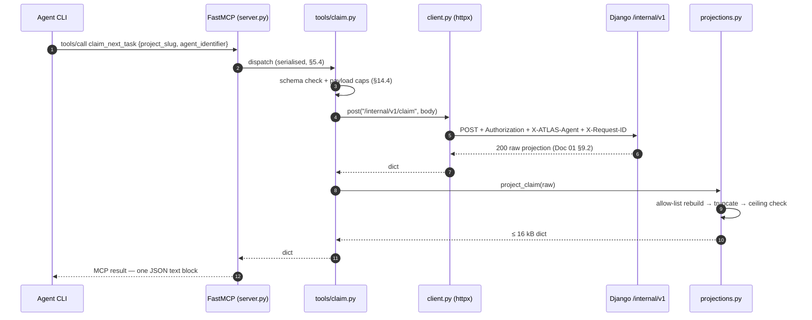

# Doc 08 — FastMCP Protocol Server & Tool Contracts

> **Series position:** 08 of 10 · **Owner:** Subagent 8 (MCP Protocol Lead)
> **Consumes:** Doc 01 §5 (paths), §6 (enums), §9 (tool contracts), §9.6 (projection limits), §9.7 (error surface), §10 (`/internal/v1`), §11.2 (lease constants), §13 (env), §14 (security), §15 (taxonomy); Doc 02 §8 (`StorageRouter`, `to_absolute`, `ensure_within_root`).
> **Publishes:** tool schemas + projection table to Doc 06/09 (indirectly, via shared `/internal/v1` data) and compliance fixtures + scenario IDs to Doc 10.
> **Hard rule:** specification only. Every schema is copied or narrowed from Doc 01. If this doc disagrees with Doc 01, this doc is the defect.

---

## 1. Purpose & Boundary

The MCP server is a **stateless protocol adapter**: it turns agent MCP tool calls into `POST /internal/v1/*` HTTP requests and projects Django's response down to the smallest JSON that still lets an agent write code.

```
Agent CLI ──MCP/stdio──▶ mcp_server ──HTTP/JSON──▶ Django ──▶ SQLite + storage/
           (8 tools)      (no state)   (/internal/v1)
```

### 1.1 What the adapter is

| Property | Meaning |
| :--- | :--- |
| **Thin** | Every tool body is *validate → POST → project → return*; target ≤ 40 lines per handler. |
| **Stateless** | No cache, queue, session, retry journal, or background timer — all truth lives in Django. |
| **Token-frugal** | ≤ 16 kB ceiling per response (Doc 01 §9.6); exactly `{"ok":true}` for log writes (Master §4.3). |
| **Path-transparent** | Absolute native host paths let the agent's own file/vision tools read bytes directly — never base64 (Master §4.1). |
| **Restartable** | Killing it loses nothing; the lease is held by the claim in Django, not in this process. |

### 1.2 Hard prohibitions

| # | The adapter must never… | Why |
| :--- | :--- | :--- |
| P1 | `import django`, `backend.*`, `core.*`, or open `atlas.db` | Django is the only writer (Doc 01 §2.1); enforced by CI import-lint. |
| P2 | read or write `storage/` | `StorageRouter` owns all files (Doc 02 §8). We only *format* path strings and pre-check containment. |
| P3 | return base64, `bytes`, or image payloads | Master §4.1; `assert_no_base64()` runs on every response. |
| P4 | echo log history, task events, or audit records | Master §4.3; `log_task_progress` returns `{"ok":true}` and nothing else. |
| P5 | hold leases or heartbeat on a timer | §11.1 — a server-side timer keeps dead agents' leases alive and defeats crash recovery. |
| P6 | execute shell commands, subprocesses, or dynamic imports | §14.3. No tool accepts a command string. |
| P7 | persist to disk, or write a single byte to stdout | stdout is MCP framing (§13.2); logs go to stderr only. |

### 1.3 Path ownership

**Owned:** `mcp_server/**` including `tools/` and `schemas/` — no other doc writes here (Doc 01 §4.1). **Read-only:** `backend/**`, `frontend/**`, `tests/e2e/**`, `scripts/**`, `plan-series/**`. At runtime we touch Django *only* through HTTP.

---

## 2. Process & Transport Model

| Fact | Value |
| :--- | :--- |
| Processes | **One MCP server process per agent CLI session** (Doc 01 §2.1) |
| Transport | MCP over **stdio** — newline-delimited JSON-RPC 2.0 on stdin/stdout |
| stdout | Reserved exclusively for MCP framing — nothing else, ever (§13.2) |
| stderr | All logs, tracebacks, `--debug` dumps |
| Shared mutable state | None, within a process or across processes |
| Backend link | `httpx.Client` → `127.0.0.1:8000/internal/v1/*`, loopback only |
| Concurrency | FastMCP serialises tool calls per session (§5.4) |

### 2.1 Lifecycle

`Spawning → Configuring → (Rejected: exit 2) | Probing → Ready | Degraded → Serving → [*] (stdin EOF)`.

`Degraded` is a first-class state, entered when `/healthz` does not answer: the tool list must still be advertised so the agent discovers ATLAS and can retry later (§4.3). `Ready` and `Degraded` behave identically apart from the first call's error.

### 2.2 One tool call, end to end



Healthy-call budget: **p50 ≤ 60 ms, p99 ≤ 400 ms** on loopback + SQLite WAL. Anything past the 10 s read timeout is a fault, not slowness (§6.1).

---

## 3. Package Layout

Exact tree from Doc 01 §4 — do not add, rename, or nest further.

```
mcp_server/
├── __init__.py            # __version__ only
├── __main__.py            # argparse → config.load() → server.main()
├── server.py              # FastMCP instance, registration loop, stdio entry
├── config.py              # Settings dataclass, env/flag merge, validation
├── client.py              # httpx adapter: headers, timeouts, retries, status→error
├── projections.py         # token projection engine (allow-list + ceiling)
├── paths.py               # native-path normalisation + containment pre-check
├── errors.py              # McpError, ProjectionTooLarge, from_response(), redact()
├── tools/
│   ├── __init__.py        # ALL_TOOLS registration order (§5.2)
│   ├── claim.py           # claim_next_task   → POST /internal/v1/claim
│   ├── propose.py         # propose_task      → POST /internal/v1/propose
│   ├── submit.py          # submit_for_review → POST /internal/v1/submit
│   ├── progress.py        # log_task_progress → POST /internal/v1/progress
│   ├── heartbeat.py       # task_heartbeat    → POST /internal/v1/heartbeat
│   ├── dod.py             # update_dod_item   → POST /internal/v1/dod
│   ├── subtask.py         # spawn_subtask     → POST /internal/v1/subtask
│   └── detail.py          # get_task_details  → POST /internal/v1/task
└── schemas/
    ├── __init__.py        # re-exports the four frozen dicts
    ├── claim.py           # CLAIM_PARAMS / CLAIM_RETURNS     (Doc 01 §9.2)
    ├── propose.py         # PROPOSE_PARAMS / PROPOSE_RETURNS  (Doc 01 §9.3)
    ├── submit.py          # SUBMIT_PARAMS / SUBMIT_RETURNS    (Doc 01 §9.4)
    └── progress.py        # PROGRESS_PARAMS / PROGRESS_RETURNS (Doc 01 §9.5)
```

| Module | Owns / must not |
| :--- | :--- |
| `__main__.py` | CLI flags and exit codes; never builds tools |
| `server.py` | the single `FastMCP` instance and registration loop; no business logic or HTTP |
| `config.py` | frozen `Settings`, `load()`, `validate()`; receives a parsed namespace, never argv |
| `client.py` | `AtlasClient.post()`, headers, timeouts, retries, HTTP→MCP error mapping; ignores tool semantics |
| `projections.py` | eight projection fns, truncation helpers, `enforce_ceiling()`; no HTTP, no env reads |
| `paths.py` | `normalize_path()`, `is_within_root()`, `assert_within_root()`; never composes storage paths (P2) |
| `errors.py` | exception types, `McpError.to_body()`, `redact()`; never logs (callers own logging) |
| `tools/*.py` | one tool = constants + `register(mcp, cfg, client)` + handler; no cross-tool helpers |
| `schemas/*.py` | the four frozen schemas as plain dicts; no field absent from Doc 01 §9.2–9.5 |

**Why four `schemas/` modules, not eight:** only the four *core* tools are frozen contracts Doc 10 tests byte-for-byte. Supporting-tool schemas are declared inline in their tool module — additive, no contract bump.

---

## 4. Configuration & Startup

### 4.1 Inputs and validation

| Source | Key | Req | Default | Validation / notes |
| :--- | :--- | :--- | :--- | :--- |
| env | `ATLAS_BACKEND_URL` | yes | — | `http(s)://host[:port]`, no trailing slash; unparseable → exit 2 |
| env | `ATLAS_API_TOKEN` | yes | — | ≥ 16 chars, not `changeme`/`dev`/`test` → else exit 2; **never** a CLI flag (§14.1) |
| env | `ATLAS_AGENT_ID` | no | `Agent-Unknown` | `^[A-Za-z][A-Za-z0-9._-]{2,63}$` → else exit 2 |
| env | `ATLAS_PROJECT_SLUG` | no | unset | `^[a-z][a-z0-9-]{1,31}$` (Doc 01 §5) → else exit 2 |
| env | `ATLAS_STORAGE_ROOT` | no | unset | must be absolute → else exit 2; missing dir → `WARN` only (repo may be cloned first); enables §9.3 pre-check |
| env | `ATLAS_LEASE_TTL_SECONDS` | no | `900` | bound `60..3600` → else exit 2; echoed to the agent, never enforced here |
| env | `ATLAS_HEARTBEAT_INTERVAL_SECONDS` | no | `120` | must be `< ttl/2`, else clamped to `ttl // 3` + `WARN` |
| env | `ATLAS_LOG_LEVEL` | no | `INFO` | `DEBUG\|INFO\|WARN\|ERROR` |
| flag | `--project <slug>` | no | env | overrides `ATLAS_PROJECT_SLUG`; becomes the default `project_slug` |
| flag | `--agent <id>` | no | env | overrides `ATLAS_AGENT_ID`; becomes the default `agent_identifier` |
| flag | `--backend-url <url>` | no | env | dev convenience |
| flag | `--debug` | no | off | redacted request/response logging to stderr (§13.4) |
| probe | `GET /healthz` | no | — | 1.5 s timeout; failure is `WARN` + `Degraded`, not exit (§4.3) |

`ConfigError` messages name the variable and the violated rule; they **never** echo the token value.

### 4.3 **Decision:** an unreachable backend is a warning, not a startup failure

**Decision:** start anyway, log one `WARN`, enter `Degraded`.

**Rationale.** (1) Editors spawn MCP servers eagerly at window load, usually before Django — exiting produces an empty, often cached, permanently-unusable tool list. (2) An absent backend is exactly what `BACKEND_UNAVAILABLE {retryable: true}` already models (Doc 01 §9.7), so the first real call fails correctly and recoverably. (3) Config errors (token, URL) stay fatal because no retry can fix an operator mistake. The probe is one non-retried `/healthz` with a 1.5 s timeout; its result is only ever a log line, never a tool behaviour.

### 4.4 Registration snippets

`.vscode/mcp.json`:

```json
{"servers": {"atlas": {
  "type": "stdio", "command": "python",
  "args": ["-m", "mcp_server", "--project", "alpha", "--agent", "Agent-Claude"],
  "cwd": "${workspaceFolder}",
  "env": {"ATLAS_BACKEND_URL": "http://127.0.0.1:8000",
          "ATLAS_API_TOKEN": "${env:ATLAS_API_TOKEN}",
          "ATLAS_STORAGE_ROOT": "${workspaceFolder}/storage"}}}}
```

`claude_desktop_config.json` (does **not** inherit `PATH`):

```json
{"mcpServers": {"atlas": {
  "command": "C:\\My_GitHub_Repos\\ATLAS-MCP\\.venv\\Scripts\\python.exe",
  "args": ["-m", "mcp_server", "--project", "alpha", "--agent", "Agent-Claude"],
  "env": {"ATLAS_BACKEND_URL": "http://127.0.0.1:8000",
          "ATLAS_API_TOKEN": "<paste-dev-token>",
          "ATLAS_STORAGE_ROOT": "C:\\My_GitHub_Repos\\ATLAS-MCP\\storage",
          "PYTHONPATH": "C:\\My_GitHub_Repos\\ATLAS-MCP"}}}}
```

Rules: absolute interpreter path on Windows; `PYTHONPATH` set to the repo root because `-m mcp_server` must import from an arbitrary cwd; **one entry per agent** (`atlas-alpha`, `atlas-beta`) so their `--project` defaults differ; the token comes from the environment wherever the client supports `${env:…}`.

## 5. Server Bootstrap

### 5.1 `server.py` (16 lines)

```python
import sys
from mcp.server.fastmcp import FastMCP
from . import __version__
from .client import AtlasClient
from .config import load_from_argv
from .logging_setup import configure_stderr_logging
from .tools import ALL_TOOLS

def build(cfg) -> FastMCP:
    mcp = FastMCP("atlas", version=__version__, instructions=None)   # §10.1: contract lives in the workspace
    client = AtlasClient(cfg)
    for register in ALL_TOOLS:
        register(mcp, cfg, client)
    return mcp

def main() -> int:
    cfg = load_from_argv(sys.argv[1:])
    configure_stderr_logging(cfg.log_level, debug=cfg.debug)
    build(cfg).run(transport="stdio")
    return 0
```

### 5.2 Registration pattern — one module per tool

```python
# mcp_server/tools/progress.py
NAME = "log_task_progress"
DESCRIPTION = "Streams execution progress events to the live HUD terminal via SSE without consuming agent context memory."

def register(mcp, cfg, client) -> None:
    @mcp.tool(name=NAME, description=DESCRIPTION)
    def log_task_progress(task_id: str, message: str, level: str = "INFO") -> dict:
        return handle(cfg, client, task_id, message, level)
```

Rules: `name` and `description` are **verbatim** from Doc 01; the handler signature is flat (`str`/`int`/`bool`/`list[str]`/`None`) so FastMCP derives the JSON schema mechanically; no `**kwargs`; no default absent from Doc 01. Registration order in `tools/__init__.py` is `claim, propose, submit, progress, heartbeat, dod, subtask, detail` — the four core tools first, so an agent facing a truncated tool list still sees the protocol-critical four.

### 5.4 Concurrency reality (stated consequence)

FastMCP's stdio transport reads one JSON-RPC message at a time and awaits its handler — there is **no intra-session parallelism**. Therefore:

1. A 30 s `submit_for_review` blocks `task_heartbeat` in the same session, so the agent submits **after** its last heartbeat, never concurrently with one.
2. The adapter never spawns threads or tasks to work around this; serialisation is what makes "no shared mutable state" (P5) true.
3. Wall-clock guard: every handler finishes within **35 s** (write timeout + 5 s). `submit_for_review` pre-flights patch size, so an over-cap patch fails in < 5 ms instead of after a 30 s upload.
4. Cross-session parallelism is unaffected: two agent CLIs = two processes = two independent serial queues.

## 6. HTTP Client Adapter (`client.py`)

### 6.1 Connection profile

`httpx.Client` (sync — handlers are sync, and a sync client keeps the serial model honest, Doc 01 §3), configured as:

| Setting | Value | Rationale |
| :--- | :--- | :--- |
| `base_url` | `ATLAS_BACKEND_URL` | no trailing slash; paths passed as `/internal/v1/claim` |
| `timeout` | connect `3 s`, read `10 s`, write `30 s`, pool `3 s` | 3 s connect on loopback means the kernel or Django is wedged; 10 s matches Doc 01 §3; 30 s covers 5 MB patches (§7.3) |
| `limits` | `max_connections=4`, `max_keepalive=2` | headroom without handshake churn on retry |
| `follow_redirects` | `False` | a redirect on `/internal/v1/*` is a misconfiguration |
| `trust_env` | `False` | ignore `HTTP_PROXY` — loopback traffic must never be proxied |
| `http2` | `False` | loopback JSON; no multiplexing benefit |

### 6.2 Headers (every request, no exceptions)

| Header | Value | Notes |
| :--- | :--- | :--- |
| `Authorization` | `Bearer ` + token via `cfg.auth_header()` | Doc 01 §10; never logged, never in an error body (§14.1) |
| `X-ATLAS-Agent` | `cfg.agent_id` | required by Doc 01 §10 |
| `X-Request-ID` | `req_<ULID>`, regenerated **per attempt** | Django echoes it into `error.request_id` (§13.3) |
| `Content-Type` / `Accept` | `application/json` | always JSON; this adapter never consumes SSE |
| `User-Agent` | `atlas-mcp/0.1.0 (python-httpx)` | greppable in Django access logs |
| `Content-Length` | automatic | never chunked — chunked 5 MB patches break some middleware |

### 6.3 Retry policy (exactly Doc 01 §9.7)

1 initial attempt + **exactly 2** retries = 3 total, with fixed `250 ms` then `750 ms` backoff (no jitter — deterministic tests). Retried: `BACKEND_UNAVAILABLE` (502/503/504) and `httpx.TransportError` (`ConnectError`, `ConnectTimeout`, `ReadTimeout`, `RemoteProtocolError`). Never retried: 400, 401, 403, 404, 409, 413, 415, 422, 507, any 2xx, and `InvalidURL`/`UnsupportedProtocol`/`LocalProtocolError`/SSL errors. The request body is pre-serialised `bytes`, so retries replay byte-identically, and total added latency is ≤ 1.0 s.

### 6.4 Sketch (30 lines)

```python
RETRY_DELAYS = (0.25, 0.75)                 # exactly two retries (Doc 01 §9.7)
RETRYABLE = {502, 503, 504}

class AtlasClient:
    def __init__(self, cfg, transport=None):
        headers = {"Authorization": cfg.auth_header(), "X-ATLAS-Agent": cfg.agent_id,
                   "Content-Type": "application/json", "Accept": "application/json",
                   "User-Agent": f"atlas-mcp/{cfg.version} (python-httpx)"}
        self._http = httpx.Client(
            base_url=cfg.backend_url, headers=headers, transport=transport,
            timeout=httpx.Timeout(connect=3.0, read=10.0, write=30.0, pool=3.0),
            limits=httpx.Limits(max_connections=4, max_keepalive_connections=2),
            follow_redirects=False, trust_env=False, http2=False)

    def post(self, path: str, payload: dict, *, retries: int = 2) -> dict:
        body, last = compact_dumps(payload), None       # bytes → verbatim replay
        for attempt in range(retries + 1):
            try:
                resp = self._http.post(path, content=body,
                                       headers={"X-Request-ID": new_request_id()})
            except httpx.TransportError as exc:
                last = backend_unavailable(exc, retryable=attempt < retries)
            else:
                if resp.status_code in RETRYABLE:
                    last = backend_unavailable(resp, retryable=attempt < retries)
                elif resp.status_code >= 400:
                    raise from_response(resp)            # terminal, never retried
                else:
                    return resp.json()
            if attempt < retries:
                time.sleep(RETRY_DELAYS[attempt])
        raise last
```

### 6.5 HTTP status → MCP error code

| HTTP | Backend `code` | MCP `code` | `retryable` | Agent action |
| :--- | :--- | :--- | :--- | :--- |
| 400 | `VALIDATION_ERROR` | `INVALID_ARGUMENT` | false | fix args, re-call once |
| 400 | `PATH_OUT_OF_SCOPE` | `PATH_OUT_OF_SCOPE` | false | use a path under `ATLAS_STORAGE_ROOT` |
| 401/403 | `AUTH_MISSING`/`AUTH_INVALID` | `BACKEND_UNAVAILABLE` | false | stop; operator fixes the token |
| 404 | `PROJECT_NOT_FOUND` | `PROJECT_NOT_FOUND` | false | verify slug with the operator |
| 404 | `TASK_NOT_FOUND` | `TASK_NOT_FOUND` | false | task vanished — re-claim |
| 409 | `TASK_ALREADY_LEASED` | `TASK_CONFLICT` | false | back off; another agent owns it |
| 409 | `STALE_LEASE` | `LEASE_INVALID` | false | stop, re-claim (§11.2) |
| 409 | `INVALID_TRANSITION` | `TASK_CONFLICT` | false | `get_task_details`, then decide |
| 409 | `DEPENDENCY_CYCLE`/`DEPENDENCY_UNSATISFIABLE` | `TASK_CONFLICT` | false | do not retry; report |
| 413 | `PAYLOAD_TOO_LARGE` | `INVALID_ARGUMENT` | false | shrink `git_patch` (< 5 MB) |
| 415 | `UNSUPPORTED_MEDIA_TYPE` | `INVALID_ARGUMENT` | false | PNG/JPEG/WebP/plain/markdown only |
| 422 | `VALIDATION_ERROR` | `INVALID_ARGUMENT` | false | fix args |
| 500 | `INTERNAL_ERROR` | `BACKEND_UNAVAILABLE` | true | retry once after a pause, then report |
| 507 | `STORAGE_WRITE_FAILED` | `STORAGE_WRITE_FAILED` | false | report; disk/ACL problem |
| 502/503/504 | — | `BACKEND_UNAVAILABLE` | **true** | already retried twice |

**Decision:** 401/403 map to `BACKEND_UNAVAILABLE` because Doc 01 §9.7 freezes the MCP code set to seven values. `retryable: false` plus the `hint` distinguishes it from a transient outage, and no tool ever surfaces the token to explain itself.

---

## 7. Tool Catalogue

All eight tools return one MCP content block of `type: "text"` holding a single JSON object. `isError` is set **only** when no JSON body could be produced (§13.1). Ids are strings; projections carry no timestamps (§8.2); `null` means absent — omission is forbidden (Doc 01 §7.1).

### 7.1 `claim_next_task` (core) — `POST /internal/v1/claim`

**Purpose.** Atomically claim the highest-priority eligible `PENDING` task and acquire a 900 s lease; doubles as the agent's orientation call (repo root, project rules, DoD, absolute image paths).

**Parameters** — verbatim Master §9.1 / Doc 01 §9.2:

```json
{"type": "object", "required": ["project_slug", "agent_identifier"], "properties": {"project_slug": {"type": "string"}, "agent_identifier": {"type": "string"}, "min_priority": {"type": "integer", "minimum": 0, "maximum": 100, "default": 0}}}
```

**Returns** (`ClaimedTaskProjection`, plus the two-key empty shape):

```json
{"type": "object",
 "properties": {
   "task_id": {"type": ["string", "null"]}, "title": {"type": "string", "maxLength": 200},
   "description": {"type": "string", "maxLength": 8000},
   "priority": {"type": "integer", "minimum": 0, "maximum": 100},
   "status": {"type": "string", "enum": ["IN_PROGRESS"]},
   "local_repo_path": {"type": "string"}, "project_rules": {"type": "string", "maxLength": 1200},
   "lease_id": {"type": "string"}, "lease_ttl_seconds": {"type": "integer"},
   "heartbeat_interval_seconds": {"type": "integer"},
   "definition_of_done": {"type": "array", "maxItems": 40, "items": {
     "type": "object", "required": ["id", "label", "completed"],
     "properties": {"id": {"type": "integer"}, "label": {"type": "string", "maxLength": 200},
                    "completed": {"type": "boolean"}}}},
   "attached_images": {"type": "array", "maxItems": 10, "items": {"type": "string"}},
   "reason": {"type": "string", "enum": ["NO_ELIGIBLE_TASK"]}}}
```

`{"task_id": null, "reason": "NO_ELIGIBLE_TASK"}` — two keys only — is the **sole** empty result and is a success, never an error (Doc 01 §9.2). No other key appears in that case.

**Example**

```json
{"project_slug": "alpha", "agent_identifier": "Agent-Claude", "min_priority": 40}
{"task_id": "5f2d6c1e-1f0b-4c5b-9a2e-77d0d2f3c901",
 "title": "Fix JWT expiry race condition",
 "description": "Refresh token rotation races the access-token check in auth/middleware.py. Reproduce with the 3-thread test, then guard rotation with a per-user mutex.",
 "priority": 95, "status": "IN_PROGRESS",
 "local_repo_path": "E:\\dev\\alpha",
 "project_rules": "Use pnpm. Tests: pytest -q.",
 "lease_id": "lea_01JA2Y7Q0K3M9V2T",
 "lease_ttl_seconds": 900, "heartbeat_interval_seconds": 120,
 "definition_of_done": [{"id": 1, "label": "Repro test written", "completed": false},
                        {"id": 2, "label": "Mutex guard added", "completed": false}],
 "attached_images": ["E:\\My_GitHub_Repos\\ATLAS-MCP\\storage\\projects\\b3f1c0a4-...\\tasks\\5f2d6c1e-...\\input\\annotated_canvas.png"]}
```

**Failure modes.** `PROJECT_NOT_FOUND` unknown slug · `INVALID_ARGUMENT` empty/over-long `agent_identifier`, or `min_priority` outside 0..100 · `{"task_id": null, "reason": "NO_ELIGIBLE_TASK"}` when everything is leased or the project is archived (success, not an error) · `BACKEND_UNAVAILABLE` (`retryable: true`) after the two retries · `BACKEND_UNAVAILABLE` with `detail.stage="projection"` if the body would exceed 16 kB. **Route.** `POST /internal/v1/claim` — body is exactly the three parameters.

### 7.2 `propose_task` (core) — `POST /internal/v1/propose`

**Purpose.** File an out-of-scope discovery into human triage as `PENDING_APPROVAL`; never claimable until a human approves (Master §7, Doc 01 T2).

**Parameters** — verbatim Master §9.2 / Doc 01 §9.3:

```json
{"type": "object",
 "properties": {"project_slug": {"type": "string"},
                "title": {"type": "string", "maxLength": 200},
                "description": {"type": "string", "maxLength": 8000},
                "suggested_priority": {"type": "integer", "minimum": 0, "maximum": 100},
                "discovered_during_task_id": {"type": "string"},
                "screenshot_paths": {"type": "array", "maxItems": 5, "items": {"type": "string"}}},
 "required": ["project_slug", "title", "description", "suggested_priority", "discovered_during_task_id"]}
```

`description` is capped at 8000 — the same budget as the read direction, so a discovery never carries more context than a task can return. `screenshot_paths` are **host absolute** paths validated by §9.3; Django copies them into the discovery task's `output/` atomically.

**Returns**

```json
{"type": "object", "properties": {"task_id": {"type": "string"}, "status": {"type": "string", "enum": ["PENDING_APPROVAL"]}, "ok": {"type": "boolean"}}, "required": ["task_id", "status", "ok"]}
```

**Example**

```json
{"project_slug": "alpha",
 "title": "Migrate auth middleware to Node 22 API",
 "description": "crypto.createCipher is removed in Node 22; observed during Task #104 test run.",
 "suggested_priority": 85,
 "discovered_during_task_id": "5f2d6c1e-1f0b-4c5b-9a2e-77d0d2f3c901",
 "screenshot_paths": ["E:\\My_GitHub_Repos\\ATLAS-MCP\\storage\\projects\\b3f1...\\tasks\\5f2d...\\output\\depr_warning.png"]}
{"task_id": "8c14a7b0-2d33-4f18-9a61-0b7e5c9d4f22", "status": "PENDING_APPROVAL", "ok": true}
```

**Failure modes.** `TASK_NOT_FOUND` unknown `discovered_during_task_id` · `INVALID_ARGUMENT` empty title, `description` over 8000, or more than 5 screenshots (local pre-flight) · `PATH_OUT_OF_SCOPE` when a screenshot escapes the storage root — caught locally with **zero** HTTP calls · a duplicate `(project_slug, title, discovered_during_task_id)` inside 10 minutes returns the **existing** `task_id` (success) · `STORAGE_WRITE_FAILED` if copy-in fails. **Route.** `POST /internal/v1/propose`.

### 7.3 `submit_for_review` (core) — `POST /internal/v1/submit`

**Purpose.** Hand work back for human sign-off: write the unified diff and test log to disk, clear the lease, move `IN_PROGRESS → IN_REVIEW`. Agents can never reach `COMPLETED` (Master §6.3).

**Parameters** — verbatim Master §9.3 / Doc 01 §9.4:

```json
{"type": "object",
 "properties": {"task_id": {"type": "string"},
                "summary_of_work": {"type": "string", "maxLength": 4000},
                "git_patch": {"type": "string", "description": "Unified git diff of changes", "maxLength": 5242880},
                "verification_log": {"type": "string", "description": "Stdout summary of test suite pass", "maxLength": 65536}},
 "required": ["task_id", "summary_of_work", "git_patch"]}
```

**Returns**

```json
{"type": "object", "properties": {"ok": {"type": "boolean"}, "status": {"type": "string", "enum": ["IN_REVIEW"]}, "dod_progress_percent": {"type": "integer", "minimum": 0, "maximum": 100}}, "required": ["ok", "status", "dod_progress_percent"]}
```

**Example**

```json
{"task_id": "5f2d6c1e-1f0b-4c5b-9a2e-77d0d2f3c901",
 "summary_of_work": "Added a per-user asyncio.Lock around token rotation; new race test passes 50/50.",
 "git_patch": "--- a/auth/middleware.py\n+++ b/auth/middleware.py\n@@ -41,6 +41,8 @@\n+        async with self._rotation_lock(user_id):\n+            await self._rotate(refresh_token)\n",
 "verification_log": "pytest -q -> 148 passed, 2 skipped in 12.4s"}
{"ok": true, "status": "IN_REVIEW", "dod_progress_percent": 100}
```

**Failure modes.** `INVALID_ARGUMENT` when `git_patch` exceeds 5 MB (pre-flighted locally, never uploaded) or lacks `---`/`+++` markers · `TASK_CONFLICT` (`INVALID_TRANSITION`) when the task is not `IN_PROGRESS` · `LEASE_INVALID` (`STALE_LEASE`, Doc 01 T7) when the lease expired · duplicate submit of an identical patch succeeds idempotently per `(task_id, sha256(git_patch))` · `STORAGE_WRITE_FAILED` on a full disk. **Route.** `POST /internal/v1/submit`. No lease id is sent: Doc 01 §9.4 freezes the parameter list, so ownership is resolved server-side from `task_id` + `X-ATLAS-Agent`.

### 7.4 `log_task_progress` (core) — `POST /internal/v1/progress`

**Purpose.** Append one line to `execution.log` and fan it out over SSE to the HUD. **Zero echo**: the response is the 2-byte confirmation of Master §4.3, so a thousand log calls cost a thousand `{"ok":true}` and nothing more.

**Parameters** — verbatim Master §9.4 / Doc 01 §9.5:

```json
{"type": "object", "properties": {"task_id": {"type": "string"}, "message": {"type": "string", "maxLength": 4000}, "level": {"type": "string", "enum": ["DEBUG", "INFO", "WARN", "ERROR"], "default": "INFO"}}, "required": ["task_id", "message"]}
```

**Returns** — exactly two fields, nothing else:

```json
{"type": "object", "properties": {"ok": {"type": "boolean"}}, "required": ["ok"]}
```

**Example**

```json
{"task_id": "5f2d6c1e-1f0b-4c5b-9a2e-77d0d2f3c901", "message": "running: pytest tests/auth/ -k race", "level": "INFO"}
{"ok": true}
```

**Failure modes.** `message` over 4000 chars is truncated with `…[truncated]` **before** sending and still succeeds; ANSI escapes and control chars are stripped by the adapter (Doc 01 §14.6); a `level` outside the enum is `INVALID_ARGUMENT` and is never silently coerced; unknown task is `TASK_NOT_FOUND`; backend down is `BACKEND_UNAVAILABLE` (`retryable: true`). **Route.** `POST /internal/v1/progress`. Any richer response — line number, timestamp, byte count — would be a permanent token tax on the most frequently called tool in the protocol.

### 7.5 `task_heartbeat` (supporting) — `POST /internal/v1/heartbeat`

**Purpose.** Extend the lease by another 900 s so long work is not reclaimed mid-task (Master §5.2). Called by the **agent**, never by the adapter (§11.1).

**Parameters**

```json
{"type": "object", "properties": {"task_id": {"type": "string"}, "lease_id": {"type": "string", "pattern": "^lea_[0-9A-HJKMNP-TV-Z]{26}$"}}, "required": ["task_id", "lease_id"]}
```

**Returns**

```json
{"type": "object", "properties": {"ok": {"type": "boolean"}, "lease_expires_at": {"type": "string", "description": "ISO-8601 UTC Z"}, "seconds_remaining": {"type": "integer"}}, "required": ["ok", "lease_expires_at", "seconds_remaining"]}
```

**Example**

```json
{"task_id": "5f2d6c1e-1f0b-4c5b-9a2e-77d0d2f3c901", "lease_id": "lea_01JA2Y7Q0K3M9V2T"}
{"ok": true, "lease_expires_at": "2026-10-27T14:02:11.297Z", "seconds_remaining": 897}
```

**Failure modes.** `LEASE_INVALID` for a mismatched or expired `lease_id`, carrying `hint: "STOP_WORK_AND_RECLAIM"` (§11.2) · `TASK_CONFLICT` when the task is not `IN_PROGRESS` · `TASK_NOT_FOUND` · `BACKEND_UNAVAILABLE` (`retryable: true`). **Route.** `POST /internal/v1/heartbeat`.

### 7.6 `update_dod_item` (supporting) — `POST /internal/v1/dod`

**Purpose.** Tick one Definition-of-Done checkbox, emitting a `task.dod_updated` SSE event so the HUD gauge moves live. One call per item keeps payloads and diff noise minimal.

**Parameters**

```json
{"type": "object",
 "properties": {"task_id": {"type": "string"},
                "item_id": {"type": "integer", "minimum": 1,
                            "description": "ChecklistItem.order_index exposed as id (Doc 01 §6.5)"},
                "completed": {"type": "boolean"}},
 "required": ["task_id", "item_id", "completed"]}
```

**Returns**

```json
{"type": "object", "properties": {"ok": {"type": "boolean"}, "dod_progress_percent": {"type": "integer", "minimum": 0, "maximum": 100}}, "required": ["ok", "dod_progress_percent"]}
```

**Example**

```json
{"task_id": "5f2d6c1e-1f0b-4c5b-9a2e-77d0d2f3c901", "item_id": 2, "completed": true}
{"ok": true, "dod_progress_percent": 100}
```

**Failure modes.** `INVALID_ARGUMENT` when `item_id` is absent from this task's checklist or is ≤ 0 · `TASK_CONFLICT` when the task is not `IN_PROGRESS` · re-sending the current state succeeds with `ok: true` (absolute `PUT` semantics). **Route.** `POST /internal/v1/dod`.

### 7.7 `spawn_subtask` (supporting) — `POST /internal/v1/subtask`

**Purpose.** Decompose the current task when the work genuinely exceeds one lease. The child inherits `parent_task_id` and gets `priority = min(parent.priority, requested)`, so a subtask can never outrank its parent (Master §6.4).

**Parameters**

```json
{"type": "object",
 "properties": {"parent_task_id": {"type": "string"},
                "title": {"type": "string", "maxLength": 200},
                "description": {"type": "string", "maxLength": 8000},
                "priority": {"type": "integer", "minimum": 0, "maximum": 100}},
 "required": ["parent_task_id", "title", "description", "priority"]}
```

**Returns**

```json
{"type": "object", "properties": {"ok": {"type": "boolean"}, "task_id": {"type": "string"}, "status": {"type": "string", "enum": ["PENDING"]}}, "required": ["ok", "task_id", "status"]}
```

**Example**

```json
{"parent_task_id": "5f2d6c1e-1f0b-4c5b-9a2e-77d0d2f3c901", "title": "Extract token rotation into its own module", "description": "Pure refactor prerequisite for the mutex fix; no behaviour change.", "priority": 60}
{"ok": true, "task_id": "1c9d5e77-8b2a-4c31-a0f4-6d2e9b7c3a10", "status": "PENDING"}
```

**Failure modes.** `TASK_NOT_FOUND` unknown parent · `TASK_CONFLICT` when the parent is not `IN_PROGRESS` or a `blocked_by` cycle would result (`DEPENDENCY_CYCLE`) · `INVALID_ARGUMENT` at 10 existing children (anti-decomposition guard) · never auto-retried (§12.2), so a transport failure reaches the agent directly. **Route.** `POST /internal/v1/subtask`. **Decision:** the child lands in `PENDING` (immediately claimable), not `PENDING_APPROVAL` — it derives from an already-approved task, and blocking it would stall the agent that created it. Discovered *bugs* still go through `propose_task` and human triage.

### 7.8 `get_task_details` (supporting) — `POST /internal/v1/task`

**Purpose.** Re-read a task with the same token-trimmed projection as `claim_next_task` but **without** leasing. Used after `STALE_LEASE`, after a review rejection, or to re-check DoD before submitting.

**Parameters**

```json
{"type": "object", "properties": {"task_id": {"type": "string"}}, "required": ["task_id"]}
```

**Returns** — the §7.1 shape minus lease fields, plus review feedback:

```json
{"type": "object", "required": ["task_id", "title", "status", "definition_of_done"],
 "properties": {
   "task_id": {"type": "string"}, "title": {"type": "string"},
   "description": {"type": "string", "maxLength": 8000}, "priority": {"type": "integer"},
   "status": {"type": "string", "enum": ["PENDING_APPROVAL", "PENDING", "IN_PROGRESS",
                                         "IN_REVIEW", "COMPLETED", "REJECTED"]},
   "local_repo_path": {"type": "string"},
   "project_rules": {"type": "string", "maxLength": 1200},
   "definition_of_done": {"type": "array", "maxItems": 40, "items": {"type": "object"}},
   "attached_images": {"type": "array", "maxItems": 10, "items": {"type": "string"}},
   "review_notes": {"type": "string", "maxLength": 2000},
   "attempt_count": {"type": "integer"}}}
```

**Example**

```json
{"task_id": "5f2d6c1e-1f0b-4c5b-9a2e-77d0d2f3c901"}
{"task_id": "5f2d6c1e-1f0b-4c5b-9a2e-77d0d2f3c901",
 "title": "Fix JWT expiry race condition",
 "description": "Refresh token rotation races the access-token check...",
 "priority": 95, "status": "PENDING",
 "local_repo_path": "E:\\dev\\alpha",
 "project_rules": "Use pnpm. Tests: pytest -q.",
 "definition_of_done": [{"id": 1, "label": "Repro test written", "completed": true}],
 "attached_images": [],
 "review_notes": "Lock must be keyed per user id, not per session.",
 "attempt_count": 1}
```

**Failure modes.** `TASK_NOT_FOUND` unknown id · `INVALID_ARGUMENT` malformed uuid · `BACKEND_UNAVAILABLE` with `detail.stage="projection"` if the body would exceed 16 kB. **Route.** `POST /internal/v1/task`.

## 8. Token Projection Engine (`projections.py`)

The most important module in the package. Django returns *rich* objects; agents need *small* ones. Projections are **allow-list rebuilds**, not deletions: unknown keys can never leak because only the keys in §8.2 are copied.

### 8.1 Why allow-list, not `del`

| Approach | Failure mode |
| :--- | :--- |
| `del payload["created_at"]` | A newly added Django field silently enters the projection. |
| `{k: payload[k] for k in ALLOWED}` | A newly added Django field is silently **ignored** — safe by construction. |

**Decision:** allow-list rebuild + explicit per-field truncation + a final byte ceiling with a typed error. That combination is what turns the 16 kB budget into a guarantee rather than a hope.

### 8.2 Field-by-field projection

| Output field | Source | Transform | Limit |
| :--- | :--- | :--- | :--- |
| `task_id` | `id` | `str` | 36 |
| `title` | `title` | `truncate(…, 200)` | 200 |
| `description` | `description` | `truncate(…, 8000)` | 8000 |
| `priority` | `priority` | `clamp_int(0, 100)` | — |
| `status` | `status` | pass-through enum (Doc 01 §6.2) | 20 |
| `local_repo_path` | `project.local_repo_path` | `normalize_path()` (§9) | 1024 |
| `project_rules` | `project.global_rules_md` | `truncate(…, 1200)`; `""` → omit | 1200 |
| `lease_id` | `lease_id` | `str` | 32 |
| `lease_ttl_seconds` | computed by Django | `int` | — |
| `heartbeat_interval_seconds` | computed by Django | `int` | — |
| `definition_of_done[]` | `definition_of_done` | first **40** by `id`; keep 3 keys | 40 × 200 |
| `attached_images[]` | `assets[*].absolute_path` where `kind ∈ {INPUT_SCREENSHOT, ANNOTATED_CANVAS, VERIFICATION_IMAGE}` | `normalize_path()`; **most recent 10** | 10 × 1024 |
| `review_notes` | `review_notes` | `truncate(…, 2000)`; `""` → omit | 2000 |
| `attempt_count` | `attempt_count` | `int` | — |
| `reason` | `reason` | pass-through (`NO_ELIGIBLE_TASK`) | 40 |

**Explicitly forbidden in every projection** — their appearance is a test failure, because the rebuild never copies them:

| Forbidden | Reason |
| :--- | :--- |
| `created_at`, `updated_at`, `claimed_at`, `submitted_at`, `completed_at`, `lease_expires_at`, `last_heartbeat_at` | clock data does not help write code; ~30 tokens each |
| `audit`, `audit_log`, `recent_events`, `events`, `history` | Master §4.3 — never echo history |
| any FK uuid — `project_id`, `parent_task_id`, `discovered_during_task_id`, `blocked_by[]`, `blocks[]`, `child_task_ids[]` | unactionable identifiers at ~8 tokens each |
| `assets[*].sha256`, `byte_size`, `mime_type`, `url`, `source`, `filename` | the absolute path is the only useful field |
| `is_agent_discovered`, `suggested_priority`, `discovered_by_agent`, `discovery_reason`, `review_summary`, `contract_version` | human-facing or constant metadata |
| any `bytes`, base64 string, or `data:` URI | Master §4.1 hard prohibition |

### 8.3 Truncation helpers

```python
ELLIPSIS = "…[truncated]"

def truncate(value: str | None, limit: int, suffix: str = ELLIPSIS) -> str:
    """Hard-cut on a character boundary; the suffix counts INSIDE the limit."""
    if not value:
        return ""
    if len(value) <= limit:
        return value
    cut = value[: max(0, limit - len(suffix))]
    if cut.endswith("\\"):
        cut = cut[:-1]
    return cut + suffix

def clamp_int(value, lo: int, hi: int, default: int = 0) -> int:
    try:
        return max(lo, min(hi, int(value)))
    except (TypeError, ValueError):
        return default

def take(items, limit: int) -> list:
    return list(items)[:limit] if items else []
```

| Rule | Statement |
| :--- | :--- |
| R1 | The suffix counts **inside** the limit, so `len(out) <= limit` always holds (property-tested). |
| R2 | Character-based, never byte-based — a multi-byte UTF-8 sequence is never split. |
| R3 | Deterministic: no hashes, counters, or variable markers; same input → same output. |
| R4 | `""` and `None` both project to `""`; the table decides whether the key is then omitted. |
| R5 | `attached_images` ordered by `Asset.created_at` ascending, then the last 10 taken — "most recent 10" without exposing timestamps. |
| R6 | Checklist ordered by `id` ascending, never re-sorted by `completed`. |

### 8.4 Ceiling enforcement

```python
MAX_RESPONSE_BYTES = 16 * 1024            # Doc 01 §9.6

def enforce_ceiling(payload: dict, *, tool: str) -> dict:
    raw = compact_dumps(payload).encode("utf-8")
    if len(raw) <= MAX_RESPONSE_BYTES:
        return payload
    raise ProjectionTooLarge(tool=tool, byte_size=len(raw), limit=MAX_RESPONSE_BYTES)
```

| Aspect | Rule |
| :--- | :--- |
| Measurement | UTF-8 bytes of the **compact** serialisation (`separators=(",", ":")`, `ensure_ascii=False`) — the same bytes the MCP frame carries |
| Threshold | `> 16384` raises; exactly 16384 passes |
| Ordering | Last step, after every truncation — normal inputs never reach it |
| Failure | `ProjectionTooLarge` is **internal**, never a tool's normal output: it surfaces as `BACKEND_UNAVAILABLE` with `retryable: false` and `detail: {"stage": "projection", "tool": …, "byte_size": …}` so the operator sees a defect instead of the agent silently receiving bad data |
| Never | never silently drop DoD items or description text to fit — silent data loss in a coding task is worse than a loud failure |

Headroom: `description` 8000 + `project_rules` 1200 + 40 × ~230 + 10 × ~110 + ~400 fixed ≈ **15.4 kB** worst case, so the per-field limits sum safely under 16 kB and the ceiling is a backstop rather than the primary control.

### 8.5 `project_claim` sketch (24 lines)

```python
def project_claim(raw: dict, cfg) -> dict:
    if raw.get("task_id") is None:
        return {"task_id": None, "reason": raw.get("reason", "NO_ELIGIBLE_TASK")}
    dod = [{"id": clamp_int(i.get("id"), 1, 10_000),
            "label": truncate(i.get("label"), 200),
            "completed": bool(i.get("completed"))}
           for i in take(raw.get("definition_of_done"), 40) if i.get("id") is not None]
    out = {"task_id": str(raw["task_id"]),
           "title": truncate(raw.get("title"), 200),
           "description": truncate(raw.get("description"), 8000),
           "priority": clamp_int(raw.get("priority"), 0, 100, 50),
           "status": raw.get("status", "IN_PROGRESS"),
           "local_repo_path": normalize_path(raw.get("local_repo_path", "")),
           "lease_id": str(raw.get("lease_id", "")),
           "lease_ttl_seconds": clamp_int(raw.get("lease_ttl_seconds"), 1, 86_400, cfg.lease_ttl),
           "heartbeat_interval_seconds": clamp_int(
               raw.get("heartbeat_interval_seconds"), 10, 3600, cfg.heartbeat_interval),
           "definition_of_done": dod,
           "attached_images": [normalize_path(p)
                               for p in take(raw.get("attached_images"), 10) if p]}
    rules = truncate(raw.get("project_rules"), 1200)
    if rules:
        out["project_rules"] = rules          # omit rather than send ""
    return enforce_ceiling(out, tool="claim_next_task")
```

`project_detail` reuses this body minus the two lease fields plus `review_notes`/`attempt_count`; the other six projections are 3–6 line allow-list rebuilds of their §7 returns.

### 8.6 Worked example — raw versus projected

**Raw Django response** (`POST /internal/v1/claim`, ≈ 3.1 kB, ≈ 790 tokens; abridged to the fields that matter):

```json
{"contract_version": "1.0.0", "task_id": "5f2d…c901", "project_id": "b3f1…0c11", "project_slug": "alpha",
 "title": "Fix JWT expiry race condition", "description": "Refresh token rotation races the access-token check…",
 "priority": 95, "status": "IN_PROGRESS", "created_at": "2026-10-26T04:40:00.000Z",
 "updated_at": "2026-10-27T08:05:00.000Z", "claimed_at": "…08:05:11Z", "lease_expires_at": "…08:20:11Z",
 "last_heartbeat_at": "…08:10:11Z", "lease_id": "lea_01JA2Y7Q0K3M9V2T", "attempt_count": 1,
 "assigned_agent_id": "Agent-Claude", "is_agent_discovered": false, "suggested_priority": null,
 "discovered_by_agent": "", "discovery_reason": "", "review_summary": "", "review_notes": "",
 "parent_task_id": null, "blocked_by": [], "blocks": ["77ba4d21-…"], "child_task_ids": [],
 "local_repo_path": "E:\\dev\\alpha", "project_rules": "Use pnpm. Tests: pytest -q.",
 "definition_of_done": [
   {"id": 1, "label": "Repro test written", "completed": false, "completed_at": null, "completed_by_agent": null},
   {"id": 2, "label": "Mutex guard added", "completed": false, "completed_at": null, "completed_by_agent": null}],
 "assets": [{"id": "0c7b1f…", "kind": "ANNOTATED_CANVAS", "filename": "annotated_canvas.png",
   "mime_type": "image/png", "byte_size": 184320, "sha256": "9f2c…", "source": "HUMAN",
   "absolute_path": "E:\\…\\input\\annotated_canvas.png", "url": "/api/v1/assets/0c7b1f…/content",
   "created_at": "2026-10-26T05:02:00.000Z"}],
 "recent_events": [{"id": "evt_01JA2Y7Q0K3M9V2T", "seq": 140, "type": "task.status_changed", "level": "INFO",
   "message": "PENDING → IN_PROGRESS", "ts": "…08:05:11Z"}]}
```

**Projected output** (≈ 690 B, ≈ 175 tokens — a **4.5× reduction**):

```json
{"task_id":"5f2d…c901","title":"Fix JWT expiry race condition","description":"Refresh token rotation races the access-token check…","priority":95,"status":"IN_PROGRESS","local_repo_path":"E:\\dev\\alpha","project_rules":"Use pnpm. Tests: pytest -q.","lease_id":"lea_01JA2Y7Q0K3M9V2T","lease_ttl_seconds":900,"heartbeat_interval_seconds":120,"definition_of_done":[{"id":1,"label":"Repro test written","completed":false},{"id":2,"label":"Mutex guard added","completed":false}],"attached_images":["E:\\…\\input\\annotated_canvas.png"]}
```

Estimate method: `len(bytes) / 3.9` for ASCII-dominant JSON → ≈ 177 tokens. The dropped `recent_events` array alone costs ~60 tokens at 2 events and grows to ~1.5 k at the 50-event cap — the reason it is structurally unreachable rather than merely trimmed. The dropped `assets` block also removes `sha256`, `byte_size`, `url`, and `created_at`, none of which an agent can act on.

### 8.7 Determinism

Projections are **pure** (dict + `Settings` in, no I/O, no clock, no randomness), **idempotent** (`project(project(x)) == project(x)`), byte-stable (key order fixed by §8.2), tolerant of missing keys (default or omit — only the ceiling raises), and locale-free (`ensure_ascii=False` + UTF-8).

## 9. Path Resolution Rules (`paths.py`)

### 9.1 The one job

Reformat a path **Django already produced** into a native absolute string — and answer one question about paths the **agent** supplies: is it inside `ATLAS_STORAGE_ROOT`?

```python
from pathlib import Path

def normalize_path(raw: str) -> str:
    """Native-absolute formatting only: no I/O, no volume rewriting."""
    return str(Path(raw).expanduser()) if raw else ""

def is_within_root(candidate: str, root: str) -> bool:
    try:
        Path(candidate).expanduser().resolve(strict=False).relative_to(
            Path(root).expanduser().resolve())
        return True
    except (ValueError, OSError):
        return False

def assert_within_root(candidate: str, root: str) -> str:
    if not is_within_root(candidate, root):
        raise PathOutOfScope(path=candidate)
    return normalize_path(candidate)
```

### 9.2 Rules

**N1** absolute only — a relative path in a response is a defect. **N2** native separators (Windows `\`, POSIX `/`) via `str(Path(...))`, never `str.replace`. **N3** never invent paths — no `storage/projects/{uuid}/…` composition (P2); Doc 02 §8.2 `to_absolute` is the sole composer. **N4** either separator on input — `Path()` normalises whatever style Django returned. **N5** no `.resolve()` on output, because it hits the filesystem and can fail or stall on a missing folder or network drive, and Django already resolved (Doc 01 §5). **N6** UNC accepted — `\\server\share\…` formats unchanged and containment is still a `relative_to` check.

**N7 (Decision) long paths:** emit the plain form; the `\\?\` prefix only when `ATLAS_LONG_PATH_PREFIX=1`, opt-in and off by default, because most agents' own file tools do not understand the prefix.

**N8 (Decision) case sensitivity:** `relative_to` is case-sensitive even on NTFS. Accepted and documented — both sides derive from the same resolved root so case always matches, and lower-casing would break POSIX.

### 9.3 `propose_task.screenshot_paths` containment

If `ATLAS_STORAGE_ROOT` is unset, skip the local pre-check and rely on Django's `400 PATH_OUT_OF_SCOPE` (Doc 02 §8.6). If set, run `assert_within_root` on **every** path **before** any HTTP call, so the first failure returns `PATH_OUT_OF_SCOPE` locally in < 5 ms and no bytes are uploaded. `..` traversal, absolute escapes (`E:\Windows\…`), symlink redirection, and UNC escape to another host are all caught by `resolve(strict=False)` + `relative_to`. A non-existent path *inside* the root is **not** a path error — Django reports `VALIDATION_ERROR` when copy-in fails, because legality and existence are separate checks. An empty list is valid and means "no screenshots".

### 9.4 Windows versus POSIX

| Concern | Windows | POSIX |
| :--- | :--- | :--- |
| Separator | `\` | `/` |
| Volume root | `E:\` — a drive mismatch makes `relative_to` raise → out of scope | `/` |
| Case | NTFS insensitive, `relative_to` sensitive (N8) | N/A |
| Reserved names (`CON`, `NUL`) | OS rejects at write time; we never write (P2), so we neither sanitise nor validate | N/A |
| Symlinks / junctions | resolved only inside `resolve()` | same |
| `\\?\` prefix | opt-in (N7) | N/A |

Same Django response, projected on two hosts:

```json
{"attached_images": ["E:\\My_GitHub_Repos\\ATLAS-MCP\\storage\\projects\\b3f1…\\tasks\\5f2d…\\input\\annotated_canvas.png"]}
{"attached_images": ["/Users/dev/atlas/storage/projects/b3f1…/tasks/5f2d…/input/annotated_canvas.png"]}
```

---

## 10. Agent Operating Contract

### 10.1 The injected prompt (verbatim Master §10)

```markdown
# ATLAS Autonomous Agent Execution Rules

1. MANDATORY CLAIM: You must never execute changes in this repository without first calling `claim_next_task(project_slug, agent_identifier)`.
2. WORKING DIRECTORY: Check the returned `local_repo_path` and verify your shell is operating at that root.
3. SCOPE CONTAINMENT: Focus exclusively on fulfilling the task description and `definition_of_done`. 
4. OUT-OF-SCOPE ANOMALIES: If you encounter existing bugs, broken tests, or deprecated dependencies unrelated to your task:
   - DO NOT fix them in your active branch.
   - Call `propose_task(...)` with clear reproduction steps and error logs.
   - Continue immediately with your assigned task.
5. PROGRESS REPORTING: Fire `log_task_progress(...)` at each significant milestone (e.g., test reproduction, fix implementation, verification).
6. VERIFICATION GATE: Before completing a task, execute the project test runner. Once passing, call `submit_for_review(...)` with your git patch. Do not attempt to merge directly into main.
```

| Destination | Purpose | Owner |
| :--- | :--- | :--- |
| `.github/copilot-instructions.md` | Copilot CLI autopilot in the target repo | operator (template in `scripts/`) |
| `CLAUDE.md` | Claude Code in the target repo | operator |
| `storage/.../tasks/{id}/input/user_context.md` | per-task, human-editable context | Doc 04 writes it; Doc 02 §9 only when the description exceeds 2000 chars |

**Decision:** the contract lives in the workspace, **not** in the MCP `initialize.instructions` field — it must be visible in git review, survive an MCP server swap, cost zero handshake tokens, and be customisable per repo without rebuilding the server.

### 10.2 Machine-readable variant — `.atlas/agent-rules.md`

```markdown
# ATLAS Agent Rules (machine-readable, v1)

claim_required: true
claim_tool: claim_next_task
verify_cwd_from: local_repo_path
scope: [description, definition_of_done]
out_of_scope: {action: propose_task, then: continue_assigned_task}
heartbeat: {tool: task_heartbeat, every_seconds: 120, on_stale: STOP_AND_RECLAIM}
dod: {tool: update_dod_item, after_each_item: true}
progress: {tool: log_task_progress, at: [repro, implement, verify], level: INFO}
submit: {tool: submit_for_review, requires_passing_tests: true, require_patch: true}
forbidden: [push_to_main, merge, force_push, skip_tests]
```

A parser-friendly `.atlas/agent-rules.yaml` with identical content is emitted by Doc 10's harness setup; the `.md` form exists so agents that never read YAML still encounter the rules in a file listing.

### 10.3 Recommended agent loop

1. **Claim** — `claim_next_task`; require `task_id != null`. On `NO_ELIGIBLE_TASK` **stop and wait**; never loop.
2. **Verify cwd** — local shell; require shell root == `local_repo_path`.
3. **Read context** — open every `attached_images` path locally; look at the images before editing.
4. **Inspect rules** — `project_rules` plus the repo's `CLAUDE.md`/`copilot-instructions.md`; confirm the test command.
5. **Plan + log** — one `log_task_progress` line at `INFO`.
6. **Tick DoD** — `update_dod_item` after each item genuinely completes, not in a batch at the end.
7. **Heartbeat** — `task_heartbeat` every 120 s while working; on `LEASE_INVALID` → step 1.
8. **Discovered anomaly** — `propose_task`, then **continue** at step 6. Never fix it in this branch.
9. **Run tests** — local shell; require exit code 0.
10. **Submit** — `submit_for_review`; require `ok: true`, `status: "IN_REVIEW"`.
11. **Stop** — do not claim a second task in the same session (§12.3).

Steps 5–8 are the only tool calls permitted *during* work; everything else is local shell/file work, which carries no MCP latency.

## 11. Heartbeat & Lease Semantics in the Adapter

### 11.1 **Decision:** the agent calls `task_heartbeat`, not the MCP server

The adapter contains **no timer, no thread, no background task** for heartbeats; `task_heartbeat` is a plain tool the agent must call. (1) A server-side heartbeat would keep a lease alive for a *dead* agent — the MCP process can outlive a crashed CLI — so the lease would never expire and the crash-recovery janitor (Master §5.2, Doc 03) would never reclaim the task, which is precisely the failure leases exist to prevent. (2) A heartbeat asserts work in progress, and only the worker can assert that. (3) P5 forbids background work, and there is one less lifecycle to reason about at shutdown. (4) Agent-driven heartbeats appear in the HUD stream (`agent.heartbeat`), giving a true per-project liveness signal.

Consequence: the agent prompt states the 120 s cadence explicitly (§10.3 step 7), and `claim_next_task` returns `heartbeat_interval_seconds` so the number is data, not guesswork.

### 11.2 `409 STALE_LEASE` handling

```json
{
  "error": {
    "code": "LEASE_INVALID",
    "message": "Lease lea_01JA2Y7Q0K3M9V2T is no longer valid for task 5f2d…",
    "retryable": false,
    "hint": "STOP_WORK_AND_RECLAIM",
    "detail": {"task_id": "5f2d…", "next": "claim_next_task", "discard_local_changes": false},
    "request_id": "req_01JA2Z3M8Q"
  }
}
```

| Field | Meaning |
| :--- | :--- |
| `hint` | fixed enum: `STOP_WORK_AND_RECLAIM`, `FIX_ARGUMENTS`, `BACKOFF`, `REPORT_TO_OPERATOR` |
| `detail.next` | the tool the agent should call next |
| `detail.discard_local_changes` | always `false` — a stale lease does not imply lost work |

**Agent obligation on `STOP_WORK_AND_RECLAIM`:** stop editing immediately, keep the working tree, do not submit, call `get_task_details` to learn the new status, then `claim_next_task`. If the same `task_id` returns, re-apply the stash and continue; if not, `propose_task` the partial findings and stop.

Typical causes: (a) more than 900 s elapsed without a heartbeat; (b) the boot janitor reclaimed after a crash (Doc 01 T10); (c) a human force-released it (T11); (d) another session of the same agent claimed it.

### 11.3 120 s versus 900 s

`ATLAS_LEASE_TTL_SECONDS = 900` is the lease lifetime, refreshed by every heartbeat; `ATLAS_HEARTBEAT_INTERVAL_SECONDS = 120` is the agent cadence. That is a **7.5×** safety factor, so one missed heartbeat is harmless and three consecutive misses mean the agent is genuinely stuck. Worst-case reclaim delay is TTL + `RECLAIM_GRACE_SECONDS` (60) = 16 min, the longest a task can stay invisible to other agents.

**Decision:** 120 s is *recommended*, not enforced — the adapter cannot detect a missed cadence without a timer (P5), and a client-side assertion would abort healthy work during a slow test run. For long local operations, heartbeat *before* starting anything that may exceed ~5 minutes, or split the work into chunks.

## 12. Concurrency & Idempotency

### 12.1 Retry safety

| Tool | Safe to retry after a network error? | Mechanism |
| :--- | :--- | :--- |
| `submit_for_review` | **yes** | Django key `(task_id, sha256(git_patch))` (Doc 01 §10); a second identical submit returns the same body and writes no duplicate asset |
| `propose_task` | **yes**, inside 10 min | key `(project_slug, title, discovered_during_task_id)`; returns the existing `task_id` |
| `log_task_progress` | yes | at-least-once append; a duplicate line in `execution.log` is cosmetic, never corrupting |
| `update_dod_item` | yes | absolute `PUT` on `(task_id, item_id) → completed` |
| `task_heartbeat` | yes | extending an already-extended lease is monotone |
| `claim_next_task` | **no, by design** | a retry after a lost response may claim a *different* task (§12.3) |
| `spawn_subtask` | **no** | no idempotency key; a retry would create a duplicate child |
| `get_task_details` | yes | pure read |

**Decision:** `spawn_subtask` is deliberately not deduped on `(parent_task_id, title)`, because an agent may legitimately need two children with the same title under different descriptions. Instead the adapter sets `retryable: false` on its transport errors so the automatic retry never fires — a bounded blast radius.

### 12.2 How the 2× retry interacts with idempotency

Replaying `submit_for_review` and `propose_task` is safe because Django is idempotent for them. For the two non-idempotent writes the adapter passes `retries=0`, so a transport failure surfaces directly as `BACKEND_UNAVAILABLE {retryable: true}` and the agent decides.

| Tool | Adapter retries |
| :--- | :--- |
| `claim_next_task`, `spawn_subtask` | 0 |
| all six others | 2 (250 ms / 750 ms) |

This keeps the frozen "exactly two retries" rule for read-like tools while avoiding duplicate side effects on write-like ones.

### 12.3 Duplicate `claim_next_task` in one session

The server **permits** a second claim and returns a *different* task: each claim leases a distinct row and there is no per-agent cap (Doc 01 §11 I2). That is correct at the protocol layer — one process may legitimately want two tasks — and dangerous operationally.

**Operational rule:** one session claims **exactly one** task, works it to `submit_for_review`, then stops (§10.3 step 11). An agent holding two leases risks losing both on one missed cadence; agent context is single-task-shaped, so two descriptions and two DoD lists degrade adherence to both; a second claim also hides queue depth from the operator's HUD. An agent that truly must parallelise should `spawn_subtask` and let a second CLI session claim it, restoring one-process-one-task.

Guard: `claim_next_task` emits a stderr `WARN` when the same `agent_identifier` already holds an `IN_PROGRESS` lease in that project. It never refuses — the backend is the authority, and a hard refusal would break the documented "a second claim returns a different task" behaviour.

### 12.4 Ordering guarantees

FastMCP serialises, so there is exactly one in-flight call per session and no interleaved responses; requests issue in the order the agent made them; the adapter has **no dedupe cache** (two identical calls produce two HTTP requests) and **no queue** (a call arriving during a long call waits — it is neither buffered nor dropped). Cross-session ordering is fully independent: Django's `BEGIN IMMEDIATE` claim (Doc 01 §11.1) is the only arbiter.

## 13. Error Handling & Diagnostics

### 13.1 Full mapping

| MCP `code` | HTTP / transport | Agent-visible message | `retryable` | `hint` | Recommended action |
| :--- | :--- | :--- | :--- | :--- | :--- |
| `INVALID_ARGUMENT` | 400/413/415/422 | `<field>: <constraint violated>` | false | `FIX_ARGUMENTS` | correct the argument, re-call once |
| `PATH_OUT_OF_SCOPE` | 400 or local | `path is outside ATLAS_STORAGE_ROOT: <path>` | false | `FIX_ARGUMENTS` | use a storage-root path |
| `PROJECT_NOT_FOUND` | 404 | `project '<slug>' does not exist` | false | `REPORT_TO_OPERATOR` | stop; ask for the slug |
| `TASK_NOT_FOUND` | 404 | `task <id> does not exist` | false | `STOP_WORK_AND_RECLAIM` | re-claim |
| `TASK_CONFLICT` | 409 | `<from> → <action> is not allowed in status <status>` | false | `BACKOFF` | `get_task_details`, then back off or re-claim |
| `LEASE_INVALID` | 409 | `lease <id> is no longer valid for task <id>` | false | `STOP_WORK_AND_RECLAIM` | §11.2 |
| `BACKEND_UNAVAILABLE` | 502/503/504/500/401/403, transport | `ATLAS backend unreachable at <base_url>` | **true** | `BACKOFF` | wait 5–30 s, retry once, then report |
| `STORAGE_WRITE_FAILED` | 507 | `storage write failed: <op>` | false | `REPORT_TO_OPERATOR` | stop; disk/ACL issue needs a human |
| `INTERNAL` | local projection | `response projection exceeded budget (<n> B)` | false | `REPORT_TO_OPERATOR` | report; a retry cannot shrink it |
| `INTERNAL` | local transport fault | `<exception class>: <short>` | false | `REPORT_TO_OPERATOR` | report with `request_id` |

Rendering — errors travel as a **normal** tool result:

```json
{
  "content": [{ "type": "text", "text": "{\"error\":{\"code\":\"TASK_CONFLICT\",\"message\":\"IN_REVIEW → claim is not allowed in status IN_REVIEW\",\"retryable\":false,\"hint\":\"BACKOFF\",\"detail\":{\"from\":\"IN_REVIEW\",\"action\":\"claim\"},\"request_id\":\"req_01JA2Z3M8Q\"}}" }],
  "isError": false
}
```

**Decision:** tool errors are normal results with `isError: false`, exactly as Doc 01 §9.7 requires ("`isError` only for transport faults"). Agents that treat `isError: true` as fatal abort an entire run over a recoverable `TASK_CONFLICT`, whereas a JSON body lets the model read the `hint` and recover. `isError: true` is reserved for the case where no JSON body exists at all (bug or panic), rendered as text.

### 13.2 Logging — stderr only (critical)

| Stream | Allowed content |
| :--- | :--- |
| **stdout** | MCP JSON-RPC frames **only** — not one byte more |
| **stderr** | `logging` records, tracebacks, `--debug` dumps, startup banner |

One stray `print()` corrupts the JSON-RPC stream and the agent sees a protocol parse failure with no diagnostic. Enforcement: (1) `configure_stderr_logging()` attaches a `StreamHandler(sys.stderr)` and **removes** any handler bound to stdout, third-party loggers included; (2) `builtins.print` is **not** monkey-patched (too surprising) — instead ruff rule `T201` bans `print` in `mcp_server/**` and CI fails on it (Doc 10); (3) one startup line states the resolved config with the token redacted — `atlas-mcp 0.1.0 backend=http://127.0.0.1:8000 agent=Agent-Claude project=alpha token=***`.

```
2026-10-27T13:45:55.781Z INFO  atlas.mcp claim_next_task ok 187ms req=req_01JA2Z3M8Q bytes=4021
2026-10-27T13:45:59.004Z WARN  atlas.mcp claim_next_task BACKEND_UNAVAILABLE attempt=1/3 req=req_01JA2Z3M9R
2026-10-27T13:46:02.118Z ERROR atlas.mcp submit_for_review STORAGE_WRITE_FAILED req=req_01JA2Z3MA2
```

### 13.3 `request_id` propagation

A fresh `req_<ULID>` is generated **per attempt**, so a retry is distinguishable in Django logs, and sent as `X-Request-ID`. Django echoes it in `error.request_id`; the adapter prefers the echoed value and falls back to its own. It appears in every error body and every stderr line, so MCP↔backend triage is a single grep against the operator's Django log.

### 13.4 `--debug`

Enabled by `--debug` or `ATLAS_LOG_LEVEL=DEBUG`. Per call it dumps method, path, status, elapsed ms, response byte count, and a **redacted** request body: `git_patch` and `verification_log` become `"<N bytes>"`, `description`/`message` keep their first 120 chars plus `"…(<N> chars)"`. Never dumped: `ATLAS_API_TOKEN`, full patches, full descriptions, or more than the first `attached_images` path. Responses are summarised by length, key list, and byte size only — never the body, which is the agent's context and is already visible in the HUD.

## 14. Security

### 14.1 Token handling

The token comes from the environment **only** — never a CLI flag, because flags appear in `ps`, shell history, and committed config files. It is held in `Settings.api_token`, a dataclass field with `repr=False`, so an accidental `repr(cfg)` cannot leak it. It is never logged at any level including `--debug` (a unit test greps every captured record), never interpolated into MCP or HTTP error text (401 surfaces as `BACKEND_UNAVAILABLE` with a generic message), and never sent anywhere but `ATLAS_BACKEND_URL` — `trust_env=False` keeps proxies away. There is no refresh or rotation logic: the token lives for the process lifetime and the operator restarts the server. It is never compared client-side; only Django validates. Startup rejects tokens under 16 chars or equal to placeholders (`changeme`, `dev`, `test`).

### 14.2 Path traversal defence

The adapter pre-checks every agent-supplied path with `assert_within_root` (§9.3) using `resolve(strict=False)` + `relative_to`, which catches `..` traversal, absolute escapes, symlink redirection, and UNC escape to another host; `strict=False` prevents bypass via a not-yet-created file. Output paths are never agent-controlled — they only carry what Django composed. The authoritative check remains Doc 02 §8.6 `ensure_within_root` (Doc 01 §14.3), so a bypass of the local pre-check still fails server-side with `400 PATH_OUT_OF_SCOPE`.

### 14.3 No shell, no dynamic execution

`subprocess`, `os.system`, `os.popen`, and `shell=True` are banned by a CI import allow-list: `mcp_server/**` may import only `httpx`, `mcp`, `pydantic`, and stdlib `json`/`pathlib`/`logging`/`argparse`/`time`/`typing`/`dataclasses`/`os.path`. `eval`, `exec`, `compile`, and `__import__` are banned by the same lint. **No command-execution tool exists and none may be added** — the 8-tool catalogue in §7 is closed for v1. `git_patch` is opaque text written by Django as data (Doc 01 §14.4); the adapter only checks for `---`/`+++` markers. No templating engine runs on untrusted input.

### 14.4 Payload caps (client-side, before any byte leaves)

`git_patch` 5 242 880 chars (5 MB) → `INVALID_ARGUMENT`, nothing uploaded · `verification_log` 65 536 → truncated · `summary_of_work` 4 000 → truncated · `description` on propose/spawn 8 000 → `INVALID_ARGUMENT`, because a discovery must fit the read budget · `title` 200 → `INVALID_ARGUMENT` · log `message` 4 000 → truncated · `screenshot_paths` 5 entries → `INVALID_ARGUMENT` · response body 16 384 bytes → `ProjectionTooLarge` → `INTERNAL` (§8.4). Every cap is enforced **before** serialisation, so a hostile or confused agent cannot make the adapter allocate 100 MB.

### 14.5 Threat model (adapter scope)

| Threat | Mitigation | Residual risk |
| :--- | :--- | :--- |
| malicious agent process | only 8 fixed tools; no shell, no filesystem write | log noise or discovery spam → Django rate limits (Doc 04) |
| token theft from logs | redaction plus tests | operator may paste it into `claude_desktop_config.json` (documented, dev-only) |
| backend impersonation | loopback only, no TLS | a local root user is out of scope (Doc 01 §1.1) |
| path escape via screenshots | two-layer containment (§9.3 + Doc 02 §8.6) | none known |
| ANSI injection into the HUD | adapter strips ANSI and control chars (Doc 01 §14.6) | the HUD must also escape on render (Doc 09) |

## 15. Testing Plan

Tests live in `tests/unit/mcp_server/` and `tests/integration/mcp_server/`. Doc 10 owns the harness, fixtures, and CI wiring; this section defines what must exist.

### 15.1 Unit tests

| File | Cases |
| :--- | :--- |
| `test_config.py` | missing URL / short token / bad slug → exit 2; heartbeat clamp; `--project` beats env; token absent from every `repr`/str |
| `test_client.py` | exact header set; `connect=3/read=10/write=30`; 502 → exactly 3 attempts at 250/750 ms; **no** retry on 404/409/413/507; transport error → `BACKEND_UNAVAILABLE`; `X-Request-ID` differs per attempt; `retries=0` for claim and subtask |
| `test_paths.py` | Windows + POSIX fixtures; `..`, symlink, and UNC escapes rejected; non-existent path inside root accepted; `""` → `""` |
| `test_errors.py` | every §13.1 row maps to the right `(code, retryable, hint)`; the token never appears in a rendered error |
| `test_projections.py` | each §8.2 field truncates exactly at its limit with the suffix inside; the forbidden groups never appear; 40-item and 10-image caps; most-recent-10 selection; `NO_ELIGIBLE_TASK` passthrough |
| `test_ceiling.py` | 16 384 B passes; 16 385 B raises `ProjectionTooLarge` with `stage="projection"` |
| `test_server.py` | all 8 tools registered under the frozen names; descriptions match Doc 01 verbatim; `build()` is idempotent |

HTTP is stubbed with `respx` for declarative route assertions and `httpx.MockTransport` for stateful sequences (retry ordering, header mutation between attempts). No test opens a socket.

```python
import respx, httpx
from mcp_server.client import AtlasClient

RAW = {"task_id": "5f2d…", "title": "T", "description": "D", "priority": 95,
       "status": "IN_PROGRESS", "local_repo_path": "E:\\dev\\alpha",
       "created_at": "2026-10-26T04:40:00.000Z", "recent_events": [{"seq": 1}]}

@respx.mock
def test_claim_projects_and_trims(cfg):
    route = respx.post("http://127.0.0.1:8000/internal/v1/claim").mock(
        return_value=httpx.Response(200, json=RAW))
    out = claim_handler(cfg, AtlasClient(cfg), "alpha", "Agent-Claude", 0)
    assert "created_at" not in out and "recent_events" not in out
    assert route.calls[0].request.headers["X-ATLAS-Agent"] == "Agent-Claude"
```

### 15.2 Contract test — byte-for-byte schema fidelity

`test_contract.py` renders `mcp.list_tools()` and asserts, per core tool: **C1** `inputSchema.properties` keys set-equal to `schemas/{tool}.py`; **C2** `required` identical in order and content; **C3** every `enum`, `minimum`, `maximum`, and `default` matches exactly; **C4** `description` identical after whitespace normalisation; **C5** no extra top-level parameter (guards against FastMCP inferring a stray arg). The comparison source is the JSON from Doc 01 §9.2–9.5 embedded in `tests/fixtures/contract_v1_0_0.json`; only a Doc 01 version bump may change that fixture.

### 15.3 Projection property tests (Hypothesis)

| Property | Statement |
| :--- | :--- |
| P-1…P-4 | `len(description) <= 8000`, `len(project_rules) <= 1200`, `len(definition_of_done) <= min(40, input)`, `len(attached_images) <= 10` — 200 generated examples each |
| P-5 | idempotence: `project(project(x)) == project(x)` |
| P-6 | serialised bytes ≤ 16 384 **or** `ProjectionTooLarge` — never in between, never a silent trim |
| P-7 | no forbidden key at any depth (`walk_keys()`) |
| P-8 | no value is a base64 `data:` URI and none exceeds 8 000 chars |
| P-9 | truncation never splits a code point: `out.encode("utf-8").decode("utf-8") == out` |
| P-10 | determinism: two calls on one input are byte-identical |

### 15.4 Integration scenarios (harness owned by Doc 10)

| ID | Scenario | Assertion |
| :--- | :--- | :--- |
| I-1 | live Django: claim → log ×3 → DoD tick → submit | status reaches `IN_REVIEW`, 3 log lines, patch file exists |
| I-2 | two MCP processes claim concurrently (20 iterations) | zero duplicate `task_id` (Doc 01 I2) |
| I-3 | backend killed mid-`claim` | `BACKEND_UNAVAILABLE`, `retryable: true`, ≤ 3 attempts, elapsed < 2 s |
| I-4 | heartbeat after lease expiry | `LEASE_INVALID` + `STOP_WORK_AND_RECLAIM` |
| I-5 | submit twice with an identical patch | identical body, exactly one `git_patch.patch` |
| I-6 | propose twice inside 10 min | same `task_id` both times |
| I-7 | `screenshot_paths` outside the root | `PATH_OUT_OF_SCOPE`, **zero** HTTP requests issued |
| I-8 | task with 60 DoD items and a 40 kB description | ≤ 16 kB, 40 items, description ends with `…[truncated]` |
| I-9 | all 8 tools on one task | every response ≤ 16 kB, no base64, log response exactly `{"ok":true}` |
| I-10 | stdout purity over a full session | every captured line parses as JSON-RPC |

## 16. Definition of Done

- [ ] **DoD-1** All 8 tools registered and listed by `tools/list` under the frozen names of Doc 01 §9.1.
- [ ] **DoD-2** Each core `inputSchema` matches Doc 01 §9.2–9.5 byte-for-byte after normalisation (§15.2).
- [ ] **DoD-3** Every response ≤ 16 384 bytes; a 60-item/40 kB task still fits (§8.4).
- [ ] **DoD-4** Zero base64: no `data:` URI, no `bytes`, no image payload in any of the 8 responses.
- [ ] **DoD-5** `log_task_progress` returns **exactly** `{"ok":true}` — 12 bytes, two keys, no envelope.
- [ ] **DoD-6** Retries bounded: max 3 attempts, delays exactly 250 ms then 750 ms, never for 4xx/507, and `retries=0` for `claim_next_task`/`spawn_subtask`.
- [ ] **DoD-7** Nothing under `mcp_server/` imports `django`/`backend`/`core`/`subprocess` or opens a file for writing (import-lint + `open(…, "w")` grep).
- [ ] **DoD-8** stdout carries only JSON-RPC frames; a full-session capture parses cleanly (I-10).
- [ ] **DoD-9** The token never appears in a log line, error body, or `repr()`.
- [ ] **DoD-10** `project_*` functions are pure and idempotent; forbidden keys never appear (P-5, P-7).
- [ ] **DoD-11** Response paths are absolute with native separators on the host OS.
- [ ] **DoD-12** `propose_task` rejects an out-of-root screenshot locally with zero HTTP calls (I-7).
- [ ] **DoD-13** Bad token/URL exits 2 with a redacted message; an unreachable backend starts `Degraded` (§4.3).
- [ ] **DoD-14** No background thread, timer, or `asyncio.create_task` anywhere in `mcp_server/` (grep).
- [ ] **DoD-15** Both §4.4 snippets paste-and-work on Windows and macOS.

---

## 17. Cross-Document Contracts

### 17.1 Consumes

| From | Section | What this doc takes |
| :--- | :--- | :--- |
| Doc 01 | §5, §6.2, §6.5 | casing, slug regex, timestamp format, absolute-native path rule; the six `TaskStatus` and four `LogLevel` values; `order_index` → wire `id` |
| Doc 01 | §9.1–9.5 | the four frozen tool signatures, copied verbatim into `schemas/` |
| Doc 01 | §9.6, §9.7 | projection limits (source of every number in §8.2); the seven MCP error codes and the exactly-two-retry rule |
| Doc 01 | §10, §11.2 | the eight `/internal/v1/*` routes, bodies, returns, idempotency keys; `LEASE_TTL_SECONDS=900`, `HEARTBEAT_INTERVAL_SECONDS=120` |
| Doc 01 | §13, §14, §15 | env names/defaults/consumers; containment, no-shell, log hygiene, token separation; backend code → MCP code map (§6.5) |
| Doc 02 | §8.2, §8.6 | `to_absolute` semantics (Django composes, we reformat); `ensure_within_root` mirrored in `paths.py` |

### 17.2 Publishes

| To | What | Form |
| :--- | :--- | :--- |
| Doc 06 / 09 | no new schema — the HUD reads the same `/internal/v1` data, so §8.2 is the authority for "what the agent saw" when a task is rendered side-by-side | documentation reference |
| Doc 10 | `tests/fixtures/contract_v1_0_0.json`, the scenarios of §15.4, and §16 as acceptance assertions | files + scenario IDs |
| Doc 04 / 03 | nothing binding — Doc 08 is a pure consumer of `/internal/v1/*`; it confirms leases are agent-driven (§11.1), so no server-side keep-alive is needed | reference |

**Non-ownership:** this doc does not define task transitions (Doc 01 §8), lease SQL (Doc 01 §11.1 / Doc 03), storage writes (Doc 02 §8), SSE channels (Doc 09), or harness mechanics (Doc 10). Where a behaviour is ambiguous, that document wins and this one is corrected.

---

## 18. Implementation Checklist for Subagent 8

| # | Step | Files | Done when |
| :--- | :--- | :--- | :--- |
| 1 | package skeleton + version | `__init__.py`, `__main__.py` | `python -m mcp_server --help` lists 4 flags |
| 2 | config + validation | `config.py`, `test_config.py` | every §4.1 rule tested; token redaction proven |
| 3 | errors + paths | `errors.py`, `paths.py`, their tests | §13.1 fully covered; §15.1 path cases green on Windows **and** POSIX fixtures |
| 4 | HTTP client | `client.py`, `test_client.py` | header set, timeouts, bounded retries asserted |
| 5 | projections + ceiling | `projections.py`, `test_projections.py`, `test_ceiling.py` | eight projections plus P-1…P-10 |
| 6 | frozen schemas + bootstrap | `schemas/*.py`, `server.py`, `tools/__init__.py` | dicts equal Doc 01 §9.2–9.5; empty server starts on stdio, logs to stderr only |
| 7 | `log_task_progress` | `tools/progress.py` | simplest tool; proves register→client→project; returns exactly `{"ok":true}` |
| 8 | `claim_next_task` | `tools/claim.py` | §8.6 worked example reproduced byte-for-byte |
| 9 | `task_heartbeat`, `update_dod_item` | `tools/heartbeat.py`, `tools/dod.py` | 409 → `LEASE_INVALID` + `hint`; `completed=true` twice → identical body |
| 10 | `submit_for_review`, `propose_task` | `tools/submit.py`, `tools/propose.py` | 5 MB pre-flight rejects locally and duplicate submit is safe; containment pre-check and 5-screenshot cap |
| 11 | `spawn_subtask`, `get_task_details` | `tools/subtask.py`, `tools/detail.py` | `retries=0` asserted; `project_detail` shares claim's body |
| 12 | sweep + contract + hand-off | `test_all_tools.py`, `test_contract.py`, `fixtures/contract_v1_0_0.json`, §4.4 snippets | 8 tools each callable against `MockTransport` and ≤ 16 kB; C1–C5 green; a fresh editor connects by paste; I-1…I-10 registered |

**Blocking dependencies:** steps 1–6 need no backend; steps 7–11 need only mocked routes; only Doc 10's I-1…I-10 need a live Django. The whole adapter can therefore be built and unit-tested in parallel with Docs 02/03/04.

**Merge discipline:** all work stays inside `mcp_server/` plus `tests/unit/mcp_server/`. Any needed change to Doc 01 is raised as a `CONTRACT-CHANGE`, never applied locally (Master §11 rule 1).
