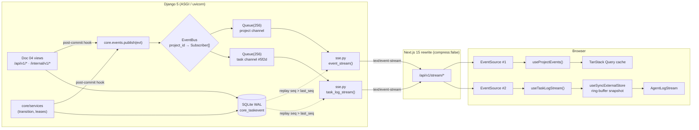
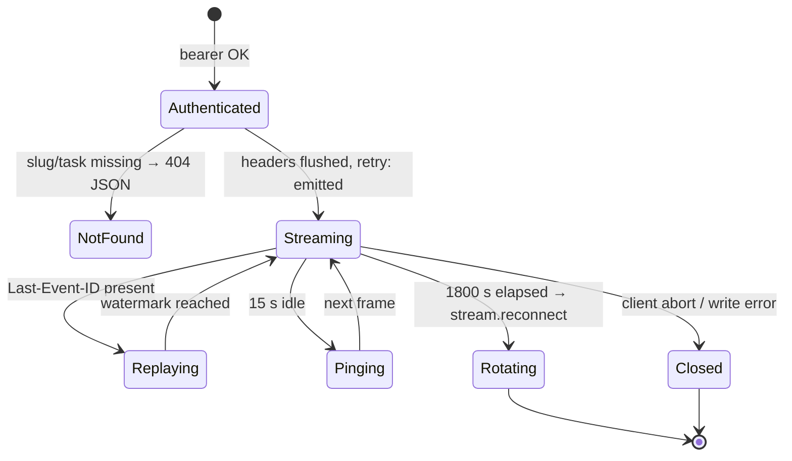
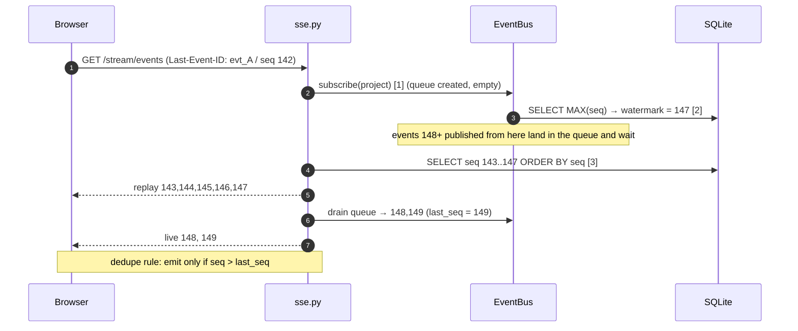
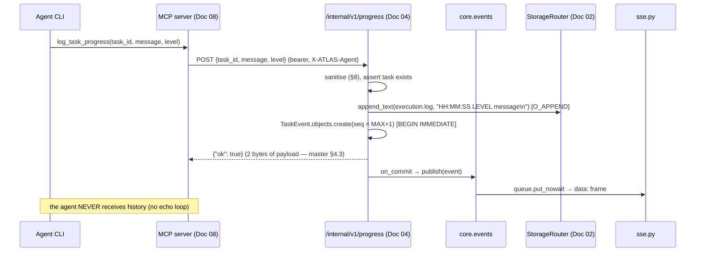

# Doc 09 — Real-Time SSE Event & Terminal Stream

> **Series position:** 09 of 10 · **Owner:** Subagent 9 (Streaming Specialist)
> **Consumes:** Doc 01 §6.2 (enums), §6.7 (`TaskEvent`), §7.9 (SSE envelope), §11.3 (event sequencing), §12 (SSE routes), §13 (env), §15 (error taxonomy + degraded mode); Doc 02 §5.5 (`TaskEvent` model), §8.4 (`execution.log` append contract), §8.2 (`StorageRouter`), §11 (`audit.record`) · Doc 05 §11 (sound tokens) · Doc 06 (query-key factory)
> **Publishes to:** Doc 06 — `AgentLogStream`, `useTaskLogStream`, `useProjectEvents`, `lib/sse/client.ts`; Doc 10 — test IDs `SSE-*`.
> **Hard rule:** the wire envelope in §5.1 is copied **verbatim** from Doc 01 §7.9. Any deviation is a defect in this document, not in Doc 01.

---

## 1. Purpose & Boundary

ATLAS streams two very different traffic shapes into the Command HUD:

1. **Control-plane events** — low frequency (≤ 5/s per project), small, semantically rich
   (`task.status_changed`, `discovery.created`, `telemetry.tick`): drive board
   invalidation, the priority matrix, and the global activity rail.
2. **Data-plane log lines** — high frequency (bursts to 500 lines/s at test start),
   unidirectional, append-only, semantically flat (`task.log`).

Master §6.9 ("Live SSE Terminal Stream") and §4.3 ("log delta truncation") require both to
flow through a **single-connection-per-view, resumable, unidirectional** channel that never
echoes history back into agent context. This document owns that transport end to end.

### 1.1 Why SSE and not WebSockets

| Criterion | SSE (`text/event-stream`) | WebSocket | Verdict |
| :--- | :--- | :--- | :--- |
| Direction | server → client only | bidirectional | ATLAS has **zero** client→server stream messages; every mutation is a REST call (Doc 04). Bidi is unused surface area. |
| Browser API | native `EventSource`, ~0 kB | `WebSocket` + hand-rolled reconnect/backoff | `EventSource` gives us reconnect **for free**, and it is the only browser primitive that does. |
| Resume semantics | `Last-Event-ID` header sent automatically on reconnect; `id:` field is the protocol | must build a resume protocol yourself | Doc 01 §7.9 already freezes `id:` = `evt_<ULID>`; SSE replays it natively. |
| Proxy path | plain HTTP `GET` → survives the Next.js `rewrites()` proxy (Doc 01 §12), nginx, corporate proxies | requires `Upgrade` negotiation; Next.js rewrite **cannot** proxy a WS upgrade | Decisive. The token-injecting rewrite is the only auth path (Doc 01 §14.2). |
| HTTP/1.1 friendliness | chunked transfer, no upgrade dance, `Connection: keep-alive` | full-duplex framing, one socket per tab | SSE costs fewer sockets for our fan-in. |
| Backpressure | natural: TCP + browser buffering | same, but you own the frame queue | equal |
| Compression | must be **disabled** (buffering) | `permessage-deflate` optional | SSE loses here — accepted; payloads are small JSON. |
| Failure visibility | actionable HTTP status on connect (401/404/500) | `close` event with an opaque code | SSE wins for §13 UX. |

**Decision:** SSE for all server→client streaming. WebSockets are **explicitly out of
scope** for v1; a future client→server stream would become a separate `/api/v1/ws/*` doc.

**Consequence:** the backend must run under **ASGI** (`uvicorn atlas.asgi:application`).
`runserver` is WSGI and pins one thread per open stream (≈ 4 streams → deadlock on a
4-thread dev server). Doc 01 §2.2 already permits uvicorn; **Decision:** uvicorn is the
required command and `runserver` is documented as unsupported for the HUD.

### 1.2 Ownership (hard boundary)

| Path | Owner | This doc may… |
| :--- | :--- | :--- |
| `backend/api/sse.py` | **09** | create/own entirely |
| `backend/core/events.py` | **09** (signature shared with Doc 02) | own behaviour; `publish()` signature frozen for Doc 02/03/04 callers |
| `backend/api/v1/**` · `backend/api/internal/**` | 04 | **read only** — we call `events.publish()` from their post-commit hooks, they never import `sse.py` |
| `frontend/components/terminal/**` | **09** | create/own entirely |
| `frontend/lib/sse/**` | **09** | create/own entirely |
| `frontend/app/**` · `frontend/hooks/**` · `frontend/components/{board,hud}/**` | 06 | **read only** — Doc 06 imports our published surface |
| `frontend/styles/tokens.css` · `components/ui/**` | 05 | import only (colour tokens) |
| `backend/core/models/**` · `storage.py` | 02 | import only |
| `mcp_server/**` | 08 | contract only (`log_task_progress` → `/internal/v1/progress`) |

Files created (12): `backend/api/sse.py`, `backend/core/events.py`,
`frontend/lib/sse/{client,frame,ring-buffer}.ts`,
`frontend/lib/sse/hooks/{use-task-log-stream,use-project-events}.ts`,
`frontend/components/terminal/{AgentLogStream,LogLine,TerminalToolbar}.tsx`,
`frontend/components/terminal/use-autoscroll.ts`, and
`frontend/components/terminal/terminal.module.css` (only if Tailwind tokens are
insufficient).

### 1.3 Published API surface (what Doc 06 imports)

| Export | Kind | Signature |
| :--- | :--- | :--- |
| `AgentLogStream` | React client component | `({ taskId, height, title, onLineClick?, className? })` |
| `useTaskLogStream` | hook | `(taskId: string, opts?: TaskLogStreamOptions) => TaskLogStreamState` |
| `useProjectEvents` | hook | `(slug: string) => ProjectEventsState` |
| `TerminalToolbar` | React client component | `({ levels, onLevels, query, onQuery, onCopy, onExport, onClear, newCount })` |
| `LogLine` | React memo component | `({ line, highlight, showTs })` |

```ts
// frontend/lib/sse/types.ts — public shape, frozen for Doc 06
export interface TaskLogLine {
  readonly seq: number;              // monotonic per project; the dedupe + sort key
  readonly id: string | null;        // evt_<ULID>; null only on control frames
  readonly ts: string;               // ISO-8601 Z, ms precision
  readonly level: 'DEBUG' | 'INFO' | 'WARN' | 'ERROR';
  readonly message: string;          // sanitised, ≤ 4000 chars, may contain \n
  readonly type: 'task.log' | 'task.status_changed' | 'stream.reset';
  readonly payload: Record<string, unknown>;
}
export interface TaskLogStreamState {
  lines: readonly TaskLogLine[];
  connected: boolean;                // EventSource open && last frame < 45 s ago
  paused: boolean;                   // user scrolled away from bottom
  newCount: number;                  // lines arrived while paused
  clear(): void;
  export(): void;                    // downloads `${taskId}-execution.log`
}
```

---

## 2. Channel Architecture

Three **logical** channels, two **routes**. Each route is an independent `EventSource`
so a dropped terminal does not disturb the board.



### 2.1 Channel table

| # | Channel | Route | Auth | Carried `EventType`s | Rate | Consumers |
| :-- | :--- | :--- | :--- | :--- | :--- | :--- |
| **A** | Project events | `GET /api/v1/stream/events?project_slug={slug}` | bearer via rewrite (Doc 01 §14.2) | **every** `EventType` **except** `task.log` and `agent.heartbeat`; `telemetry.tick` coalesced | ≤ 5/s steady, 50/s burst | board, matrix, telemetry rail, global activity stream, discovery inbox |
| **B** | Task log | `GET /api/v1/stream/tasks/{id}/log` | bearer via rewrite | `task.log` **and** `task.status_changed` for that task only | up to 500/s burst (§9) | `AgentLogStream` in the split workbench pane |
| **C** | Verification stream | *(none in v1)* | — | — | — | — |

### 2.2 Channel C — verification stream

**Decision (v1):** no separate verification channel. Long test output (10 k+ lines) arrives
on Channel B with `payload.stream = "verification"`, and the toolbar gets a `stream` filter
(`all | agent | verification`). Rationale: one less route, one less replay cursor, one less
thing for Doc 10 to test; Channel B already carries the bounded ring buffer with
drop-oldest, so splitting multiplies connections without raising the ceiling; and the
durable record is `output/test_execution.log` (Doc 02 §8.1), fetched by REST when a
reviewer wants everything. The stream is a *view*, not the archive.

Revisit trigger: a single task exceeding 50 k streamed lines/session promotes Channel C
with its own 2 000-row replay window.

### 2.3 Routing rules (server-side, non-negotiable)

| Rule | Enforcement |
| :--- | :--- |
| R1 | Channel A **never** emits `task.log`. Enforced by the `Subscriber.matches()` predicate evaluated in `EventBus.publish` **before** the queue, so the bytes never exist. |
| R2 | Channel A **never** emits `agent.heartbeat` (2/min/agent × N agents = noise; the rail derives liveness from `last_event_at`). |
| R3 | Channel B emits only frames whose `task_id == path task id`. Enforced at `subscribe(task_id=…)`. |
| R4 | Channel B **also** emits `task.status_changed` for its task, so the pane header badge updates without a REST refetch. |
| R5 | `telemetry.tick` is coalesced: at most one `telemetry.tick` is enqueued per 1 000 ms window per project (last-wins). |
| R6 | A 404/410 on Channel B (task deleted) is **not** a reconnectable error — the client stops (§13). |

---

## 3. Django ASGI Implementation (`backend/api/sse.py`)

### 3.1 Why `StreamingHttpResponse` and not `HttpResponse`

* `HttpResponse` buffers the whole body and sets `Content-Length`; `EventSource` would see a
  complete (empty) document and fire `onerror`. `StreamingHttpResponse` with
  `content_type="text/event-stream"` and **no** `Content-Length` forces chunked transfer —
  exactly what SSE needs.
* Under ASGI an **async iterator** body makes each open stream a coroutine, not an OS
  thread. A sync generator body would occupy a `ThreadPoolExecutor` slot for the whole
  connection lifetime (default 8 threads → 8 tabs kill the server).

### 3.2 `event_stream` sketch (Channel A)

```python
# backend/api/sse.py — Channel A. 404/401 are raised by the caller; this generator is pure bytes.
async def event_stream(request, project_slug: str, last_event_id: str | None):
    project = await _get_project(project_slug)          # sync_to_async; raises ProjectNotFound
    sub = bus.subscribe(project.id)                     # 1. SUBSCRIBE FIRST (no gap window)
    last_seq = await _resolve_last_seq(project.id, last_event_id)   # 2. ULID/unknown → (seq|None)
    watermark = sub.watermark                           # 3. MAX(seq) captured inside subscribe
    try:
        yield b"retry: 3000\n\n"                        # 4. reconnect hint, first bytes out
        if last_seq is None:
            yield _encode_ctrl("stream.reset", {"reason": "UNKNOWN_EVENT_ID", "watermark": watermark})
        elif watermark - last_seq > REPLAY_LIMIT:       # 500
            yield _encode_ctrl("stream.reset", {"reason": "REPLAY_GAP", "skipped": watermark - last_seq})
        else:
            async for evt in _replay(project.id, last_seq, watermark):
                yield _encode_event(evt)                # 5. history, then live
                last_seq = evt.seq
        while True:
            try:
                evt = await asyncio.wait_for(sub.queue.get(), timeout=SSE_KEEPALIVE_SECONDS)
            except asyncio.TimeoutError:
                yield b": ping\n\n"                     # 6. 15 s comment frame
            else:
                if evt.seq <= last_seq or not _route_a(evt):
                    continue                            # 7. dedupe + R1/R2/R5
                yield _encode_event(evt)
                last_seq = evt.seq
            if monotonic() - sub.started_at > MAX_STREAM_SECONDS:
                yield _encode_ctrl("stream.reconnect", {"after_seconds": MAX_STREAM_SECONDS})
                return                                  # 8. server-initiated rotation
    finally:
        bus.unsubscribe(sub)                            # 9. always on disconnect
```

`task_log_stream(request, task_id, last_event_id)` is the same skeleton with
`subscribe(project.id, task_id=task_id)`, `_route_b(...)`, a 2 000-row `REPLAY_LIMIT`,
`retry: 2000`, and `SSE_KEEPALIVE_SECONDS` unchanged.

### 3.3 Response construction

| Setting | Value | Why |
| :--- | :--- | :--- |
| `content_type` | `text/event-stream` | required; charset omitted deliberately — event-stream is always UTF-8 |
| `Content-Encoding` | *never set* | compression buffers; a gzipped SSE stream is a hang |
| `Cache-Control` | `no-cache, no-transform` | `no-transform` stops proxies re-compressing |
| `X-Accel-Buffering` | `no` | nginx: disable `proxy_buffering` for this response |
| `Connection` | `keep-alive` | HTTP/1.1 parity; hop-by-hop, stripped by HTTP/2 — harmless |
| `Access-Control-Allow-Origin` | `ATLAS_WEB_ORIGIN` | Doc 01 §13 |
| `Content-Length` | **absent** | presence ⇒ non-streaming |

### 3.4 Buffering checklist (all five must hold or the HUD is dead)

1. `uvicorn atlas.asgi:application --http h11 --timeout-keep-alive 75` — ASGI, chunked.
2. nginx: `proxy_buffering off; proxy_cache off; gzip off; proxy_read_timeout 3600s; chunked_transfer_encoding on;`
3. `next.config.ts` rewrite for `/api/v1/:path*`: `compress: false` (Doc 01 §12).
4. No middleware may touch the body (`GZipMiddleware` must be conditional on path).
5. `DEBUG=True` Django `runserver` is unsupported (§1.1) — it is WSGI.

### 3.5 Connection lifecycle



A `BrokenPipeError`/`asyncio.CancelledError` inside the generator is **normal**
(tab closed, laptop slept). `sse.py` logs at `DEBUG` and never emits a 500.

---

## 4. In-Process Event Bus (`backend/core/events.py`)

### 4.1 Design

* One `EventBus` singleton per process, created in `apps.py::ready()` as
  `bus = EventBus(maxsize=256)`. Registry is `dict[project_id, list[Subscriber]]`; each
  `Subscriber` holds `queue`, `loop`, `project_id`, `task_id`, `watermark`, `started_at`,
  `dropped`.
* **No database access inside the bus.** It accepts an already-persisted `TaskEvent`-like
  value object and never imports `core.models` at call time — no circular import, and the
  bus is testable with a `SimpleNamespace`.
* Fan-out is O(subscribers) over an atomic tuple snapshot; registry mutation happens only
  under `asyncio.Lock`.

### 4.2 Sketch

```python
# backend/core/events.py — 256-slot queues, drop-oldest, thread-safe publish.
@dataclass(eq=False, slots=True)
class Subscriber:
    queue: asyncio.Queue          # maxsize == EventBus.maxsize
    loop: asyncio.AbstractEventLoop
    project_id: str; task_id: str | None
    watermark: int                # MAX(seq) at subscribe time
    started_at: float
    dropped: int = 0

class EventBus:
    def __init__(self, maxsize: int = 256) -> None:
        self.maxsize, self._subs = maxsize, {}
        self._lock: asyncio.Lock | None = None   # created lazily on the serving loop

    async def subscribe(self, project_id: str, *, task_id: str | None = None) -> Subscriber:
        self._lock = self._lock or asyncio.Lock()
        async with self._lock:
            sub = Subscriber(asyncio.Queue(self.maxsize), asyncio.get_running_loop(),
                             project_id, task_id, watermark=await self._max_seq(project_id),
                             started_at=monotonic())
            self._subs.setdefault(project_id, []).append(sub)
            return sub

    async def unsubscribe(self, sub: Subscriber) -> None:
        async with self._lock:                                  # type: ignore[union-attr]
            bucket = self._subs.get(sub.project_id, [])
            if sub in bucket:
                bucket.remove(sub)
            if not bucket:
                self._subs.pop(sub.project_id, None)

    def publish(self, event) -> int:          # called from SYNC Django views, post-commit
        subs = tuple(self._subs.get(str(event.project_id), ()))
        for sub in subs:
            if not _matches(sub, event):      # R1/R2/R3 filter (see §2.3)
                continue
            sub.loop.call_soon_threadsafe(self._offer, sub, event)   # thread→loop bridge
        return len(subs)

    def _offer(self, sub: Subscriber, event) -> None:            # runs ON the loop
        if sub.queue.full():
            sub.queue.get_nowait()      # drop-oldest: newest data beats oldest
            sub.dropped += 1
        sub.queue.put_nowait(event)
```

### 4.3 The post-commit rule (non-negotiable)

`publish()` is **never** called inside `transaction.atomic()`. Doc 02 §7.3 and Doc 01 §8
already write the pattern; Doc 04/08 satisfy it with `transaction.on_commit`:

```python
# shape only — Doc 04 owns the real hook
with transaction.atomic():
    event = TaskEvent.objects.create(...)      # seq allocated under BEGIN IMMEDIATE (Doc 01 §11.3)
    transaction.on_commit(lambda: events.bus.publish(event))
```

| Failure | Behaviour |
| :--- | :--- |
| Transaction rolls back | no publish (the callback never runs) — no phantom terminal lines |
| `publish` raises | caught by the hook, logged `WARNING`; the DB row is authoritative and replay will deliver it on the next reconnect |
| Process dies after commit, before publish | replay covers it — `seq` gaps are impossible because the row exists |
| Queue full | drop-oldest + `sub.dropped += 1`; the HUD shows a `…N lines dropped` separator |

**Invariant:** *the stream is a projection of `core_taskevent`; it may lag, it may drop
frames, but it may never invent or reorder them.* Ordering comes from `seq`, never from
arrival time.

### 4.4 Thread bridge — why not `async_to_sync`

Doc 04's views are synchronous (`APIView`). `async_to_sync(bus.publish_async)(evt)` would
spin a **new** event loop in the worker thread; `asyncio.Queue.put_nowait` from a foreign
loop is undefined behaviour and silently corrupts the queue's waiter list. The correct
bridge is `loop.call_soon_threadsafe` — the only asyncio primitive documented as
thread-safe — which is why `Subscriber` stores its `loop`. For the reverse direction (an
async consumer needing the sync ORM) use `sync_to_async(..., thread_sensitive=True)`:
SQLite connections are per-thread and Django's `thread_sensitive` pool keeps them
consistent.

### 4.5 Bus invariants

| ID | Invariant | Test |
| :--- | :--- | :--- |
| B1 | `subscribe` then `publish` ⇒ the event is in the queue (no lost-wakeup). | `SSE-BUS-01` |
| B2 | N subscribers receive identical `seq` sequences (prefix-equal, not necessarily complete). | `SSE-BUS-02` |
| B3 | A stalled consumer never blocks `publish()`: 10 000 publishes into a never-drained 256-queue return in < 50 ms and `dropped == 9744`. | `SSE-BUS-03` |
| B4 | `unsubscribe` twice is a no-op; the registry has no empty buckets afterwards. | `SSE-BUS-04` |
| B5 | Publishing from a sync thread while the loop is idle delivers within one loop iteration. | `SSE-BUS-05` |
| B6 | Channel-A subscribers never receive `task.log` (R1). | `SSE-BUS-06` |

---

## 5. The SSE Wire Format

### 5.1 Frozen envelope (copied verbatim from Doc 01 §7.9)

```
id: evt_01JA2Y7Q0K3M9V2T
event: task.log
data: {"id":"evt_01JA2Y7Q0K3M9V2T","seq":142,"type":"task.log","level":"INFO","project_slug":"alpha","task_id":"5f2d…","message":"running: pytest tests/auth/ -k race","payload":{"source":"mcp"},"ts":"2026-10-27T08:10:11.297Z"}
```

Rules: `event:` mirrors `data.type`; `id:` is the ULID (enables `Last-Event-ID` replay); every 15 s a comment frame `: ping` is sent; server sets `Cache-Control: no-cache`, `X-Accel-Buffering: no`, `Connection: keep-alive`.

### 5.2 Byte-level stream (a real connection, shown as escapes)

```text
retry: 3000\n
\n
id: evt_01JA2Y7Q0K3M9V2T\n
event: task.log\n
data: {"id":"evt_01JA2Y7Q0K3M9V2T","seq":142,"type":"task.log","level":"INFO",...}\n
\n
: ping\n
\n
id: evt_01JA2Y7R2P4N0W3X\n
event: task.status_changed\n
data: {"id":"evt_01JA2Y7R2P4N0W3X","seq":143,"type":"task.status_changed","level":"INFO","project_slug":"alpha","task_id":"5f2d…","message":"IN_PROGRESS → IN_REVIEW","payload":{"from":"IN_PROGRESS","to":"IN_REVIEW"},"ts":"2026-10-27T08:10:26.004Z"}\n
\n
```

| Frame | Exact bytes | When |
| :--- | :--- | :--- |
| Retry hint | `retry: 3000\n\n` (Channel B: `retry: 2000\n\n`) | first bytes after headers, once |
| Normal event | `id: <ulid>\n` + `event: <type>\n` + one or more `data: <line>\n` + `\n` | per `TaskEvent` |
| Keep-alive | `: ping\n\n` | after 15 s of write silence (Doc 01 §11.2 `SSE_KEEPALIVE_SECONDS`) |
| Multi-line message | additional `data:` lines, one per `\n` in the message | see §8.3 |
| Control frame (`stream.reset`, `stream.reconnect`, `error`) | `id:` **omitted**, `event: stream.reset`, single-line `data:` | never advances `Last-Event-ID` |

### 5.3 Encoder rules

1. `id:` is emitted **before** `event:` and `data:` so a mid-frame abort cannot leave a
   client believing it consumed an event it did not.
2. Control/error frames carry **no** `id:` — a `stream.reset` must not move the resume
   cursor, or the client would permanently skip the gap it is about to refetch.
3. A raw `\n` inside a `data:` value terminates the field early and silently truncates the
   frame. Our JSON is safe because `json.dumps` escapes `\n` *inside* strings; the encoder
   still implements the general multi-line rule (§8.3) for future raw-text channels.
4. `error` frames use the Doc 01 §7.8 envelope inside `data:`, with `event: error`.

### 5.4 Error frame example

```text
event: error\n
data: {"error":{"code":"BACKEND_UNAVAILABLE","message":"event bus saturated","retryable":true,"detail":{"dropped":37},"request_id":"req_01JA2Y8…"}}\n
\n
```

---

## 6. Replay & Gap Recovery

### 6.1 `Last-Event-ID` sources

| Source | Mechanism | Reliability |
| :--- | :--- | :--- |
| Native reconnect | browser sends `Last-Event-ID: evt_…` automatically | best; preferred |
| Our wrapper reconnect | `new EventSource(url + "?last_event_id=evt_…")` | **required**, because constructing a new `EventSource` loses the header |
| REST fallback | `GET /api/v1/tasks/{id}?include_events=1` (`recent_events`, ≤ 50) | last resort (§6.5) |

**Decision:** the server resolves the cursor in this order — header, then query param,
then `sub.watermark` (i.e. "start live only"). Header wins so native reconnects are exact.

### 6.2 Algorithm

```
resolve(last_event_id):
    if last_event_id is null           -> None (start live)
    row = SELECT seq FROM core_taskevent WHERE id = ?        # ULID → seq
    if row missing                     -> None (caller emits stream.reset / UNKNOWN_EVENT_ID)
    else                               -> row.seq

replay(last_seq, watermark):
    gap = watermark - last_seq
    if gap > REPLAY_LIMIT (500)        -> stream.reset / REPLAY_GAP
    else                               -> stream rows WHERE seq > last_seq AND seq <= watermark
                                          ORDER BY seq ASC (single query, .values(), ≤500 rows)
```

* The lookup is `TaskEvent.id` (PK, no scan). `seq` — not `created_at` — is the ordering
  key, per Doc 01 §11.3, because two events can share a millisecond and `seq` is the only
  total order guaranteed by `uq_event_project_seq` (Doc 02 §5.5).
* Replay rows are **never** re-published to the bus and never mutate `seq`.

### 6.3 The replay/live race — and the subscribe-first sequence

Naïve order (`replay, then subscribe`) loses every event published during the replay
query. Naïve reverse (`subscribe, then replay from MAX(seq)` re-read) duplicates events.
The only gap-free sequence is:



| Step | Guarantee |
| :--- | :--- |
| 1 subscribe first | any publish after this instant is buffered, never lost |
| 2 watermark inside `subscribe` | replay upper bound is fixed, so the replay set is finite and stable |
| 3 replay ≤ watermark | replay cannot overlap unknowable future rows |
| 4 dedupe `seq > last_seq` | overlap (if a publisher raced the `MAX(seq)` read) is dropped idempotently |
| 5 `finally: unsubscribe` | no queue leak on abort |

**Why this is sound:** every event with `seq ≤ watermark` is either in the replay result or
was published before `subscribe` (and is therefore also in the replay result); every event
with `seq > watermark` was published **after** the queue existed. Dedupe covers the single
ambiguous boundary — *no gap, no duplicate, order preserved by `seq`*.

### 6.4 `stream.reset` contract

```json
{
  "id": null,
  "seq": 0,
  "type": "stream.reset",
  "level": "WARN",
  "project_slug": "alpha",
  "task_id": null,
  "message": "replay gap of 1832 events exceeds limit 500",
  "payload": { "reason": "REPLAY_GAP", "watermark": 1974, "limit": 500 },
  "ts": "2026-10-27T08:10:11.297Z"
}
```

* `stream.reset` is **not** a `core_taskevent` row: it has `id: null`, `seq: 0`, and is
  emitted only as a control frame by `sse.py` — its `id:` line is omitted so the resume
  cursor never advances (§5.3 rule 2).
* `payload.reason` ∈ `UNKNOWN_EVENT_ID | REPLAY_GAP | SERVER_ROTATED | PROJECT_ARCHIVED`.
* On receipt the client **clears its ring buffer**, refetches via REST, then resumes live
  from `payload.watermark` (the server keeps streaming; the client drops frames until
  `seq > watermark` only if it cannot refetch).

`type: stream.reset` is not in the Doc 01 §6.2 `EventType` enum, and it must not be:
`EventType` describes **persisted task events**. `stream.*` types are transport-level
pseudo-types, documented here and excluded from every `EventType` consumer. **Decision**
recorded because the master plan is silent on rejected-replay signalling.

### 6.5 REST fallback (degraded mode, Doc 01 §15)

When `stream.reset` arrives, or after 3 consecutive reconnect failures:

1. `queryClient.invalidateQueries()` with `staleTime: 0` on the affected keys (§11.4).
2. For the terminal pane: `GET /api/v1/tasks/{id}` → `recent_events` (≤ 50, oldest →
   newest, `event_type` filterable) seeds the ring buffer and shows a
   `… earlier lines unavailable (stream gap)` separator above line 1.
3. Full history is always available at `execution.log` via
   `GET /api/v1/assets/…/content` after `submit_for_review` (Doc 02 §8.4, rotated at 8 MB).

---

## 7. Log Ingestion Paths

### 7.1 Path A — agent → MCP → Django → bus → SSE



Durability ordering is **disk → DB → bus**, so a crash between steps can only lose the
*UI* frame (recovered by replay if the DB row committed) — never the log file.

If the disk append fails, Doc 01 §15 says the DB transaction rolls back and
`STORAGE_WRITE_FAILED (507)` is returned; the bus still emits the failure so the HUD shows
a red banner. Concretely: `sse.py` publishes a synthetic `task.log` at `ERROR` with
`payload.storage_write_failed = true` **and** `payload.persisted = false`; the terminal
renders it with a red left border and it is never replayed (it has no row).

### 7.2 Path B — system / lease / recovery lines

| Producer | Line | `EventType` | Persisted | Notes |
| :--- | :--- | :--- | :--- | :--- |
| Boot janitor (Doc 03) | `[SYSTEM CRASH DETECTED] lease lea_01JA2… expired; task reset to PENDING` | `task.log` + `task.lease_expired` + `system.recovery` | `TaskEvent` + `execution.log` + audit `SYSTEM_CRASH_DETECTED` | level `ERROR`; the only line that may start with a bracketed tag |
| Lease reclaim | `[SYSTEM] lease reclaimed by human operator` | `task.status_changed` | `TaskEvent` + audit `LEASE_RECLAIMED` | level `WARN` |
| Process boot | `[SYSTEM] atlas boot: wal=ok recovered_tasks=2` | `system.boot` | `TaskEvent` (task null) | Channel A only |
| Heartbeat | *(not streamed)* | `agent.heartbeat` | not persisted | R2 |
| Janitor prune | `[SYSTEM] pruned 41 events older than 30 days` | `system.recovery` | `TaskEvent` | level `INFO` |

System lines are written through the **same** helper as Path A
(`core.events.emit_system_log(project, task, level, message, payload)`) so sanitisation,
truncation, `seq` allocation, and the post-commit rule are shared by construction.

### 7.3 Path C — tailing `execution.log`

**Decision: NOT supported in v1.** Rationale: (1) `execution.log` is written **only** by the
Django append path (Doc 02 §8.4) — tailing would legitimise a contract violation;
(2) a tailer needs a per-file cursor, must handle the 8 MB rotation
(`execution.log` → `execution.log.1`), and would duplicate every line Path A already
streamed (dedupe by line hash costs more than it saves); (3) `inotify` /
`ReadDirectoryChangesW` are not portable to the Windows dev target and add a watcher
daemon to a single-process app; (4) replay already answers the only real question —
"I was away, what did I miss?" — from `TaskEvent` or `execution.log` over REST.

Revisit trigger: a real external producer exists **and** writes through a documented
helper in `core/storage.py`. The tailer then becomes Channel C (§2.2), not a mutation of
Channel B.

### 7.4 Comparison

| Path | Producer | Added latency (p50 / p99) | Durable record | Survives SSE drop | Survives process crash | Ordering key |
| :--- | :--- | :--- | :--- | :--- | :--- | :--- |
| A | agent `log_task_progress` | 12 ms / 60 ms | `execution.log` + `TaskEvent` | yes (replay) | yes (up to 30 d) | `seq` |
| B | janitor / lease / boot | 12 ms / 60 ms | `execution.log` + `TaskEvent` + `project_audit.log` | yes | yes (+ audit JSONL forever) | `seq` |
| C | file tail | 40–250 ms (poll interval) | file only (no `seq`) | **no** | file only | none — unordered vs Channel B |
| — | REST `recent_events` | 30 ms / 120 ms | same rows | n/a | n/a | `seq` |

Latency budget assumes loopback + `synchronous=NORMAL`; Path A's p99 is dominated by the
`fsync` in `append_text`, which is *not* on the response path (the `{"ok":true}` is sent
after the DB commit, and the append is line-buffered).

---

## 8. Sanitisation & Limits

Agent output is hostile input: ANSI colour codes from `pytest --color=yes`, carriage-return
progress bars, NUL bytes from binary spew, and occasionally 200 kB stack traces. Everything
below runs **before** persistence, so `execution.log` and `TaskEvent.message` are already
clean and the SSE encoder stays dumb.

### 8.1 Rules

| # | Rule | Constant | Rationale |
| :-- | :--- | :--- | :--- |
| S1 | Strip ANSI CSI sequences (`ESC [ … final`) | `_ANSI_CSI` | colour codes are meaningless in the HUD and bloat the ring buffer |
| S2 | Strip ANSI OSC sequences (`ESC ] … BEL/ST`) | `_ANSI_OSC` | terminal-title injection |
| S3 | Strip remaining two-byte escapes (`ESC @ … ESC _`) | `_ANSI_ESC` | stray `ESC[K`, `ESC(0` |
| S4 | Drop C0/C1 control chars except `\n` and `\t` | `_CTRL` | `\r` progress bars, NUL, `\x08` overstrike |
| S5 | `\t` → 4 spaces | — | monospace alignment without tab-stop ambiguity |
| S6 | Collapse `\r\n` and lone `\r` → `\n` | — | one canonical line break |
| S7 | Truncate to 4 000 chars + `…[truncated]` | `MAX_MESSAGE = 4000` | Doc 01 §9.5 / §14.6; also keeps `O_APPEND` line < 4 kB (Doc 02 §8.4) |
| S8 | Collapse ≥ 3 blank lines to 1 | — | stack traces with padding |
| S9 | `payload` JSON ≤ 2 048 bytes serialised | `MAX_PAYLOAD = 2048` | Doc 01 §6.7 |
| S10 | Escape nothing else | — | the encoder splits on newlines; HTML escaping belongs to React, not to the wire |

### 8.2 Sketch

```python
# backend/core/events.py — shared by Path A and Path B (Doc 02 §8.4 format parity).
_ANSI_CSI = re.compile(r"\x1b\[[0-9;?]*[ -/]*[@-~]")
_ANSI_OSC = re.compile(r"\x1b\][^\x07\x1b]*(?:\x07|\x1b\\)")
_ANSI_ESC = re.compile(r"\x1b[@-Z\\-_]")
_CTRL     = re.compile(r"[\x00-\x08\x0b\x0c\x0e-\x1f\x7f-\x9f]")
_BLANKS   = re.compile(r"\n{3,}")
MAX_MESSAGE, MAX_PAYLOAD = 4_000, 2_048

def sanitise(message: str, payload: dict | None = None) -> tuple[str, dict]:
    text = _ANSI_OSC.sub("", message or "")
    text = _ANSI_CSI.sub("", text)
    text = _ANSI_ESC.sub("", text)
    text = text.replace("\t", "    ").replace("\r\n", "\n").replace("\r", "\n")
    text = _CTRL.sub("", text)
    text = _BLANKS.sub("\n\n", text).strip("\n")
    if len(text) > MAX_MESSAGE:
        text = text[: MAX_MESSAGE - 12].rstrip() + "…[truncated]"

    body = payload or {}
    encoded = json.dumps(body, separators=(",", ":"), ensure_ascii=False, default=str)
    if len(encoded.encode("utf-8")) > MAX_PAYLOAD:
        # Decision: logging must never fail an agent round-trip (master §4.3 promises {"ok":true}).
        body = {"_truncated": True, "bytes": len(encoded)}
        logger.warning("event payload truncated (%d bytes)", len(encoded))
    return text, body
```

**Decision (payload overflow):** Doc 01 §15 maps oversized payloads to
`413 PAYLOAD_TOO_LARGE`, but `log_task_progress` is contractually incapable of failing
(Master §4.3: it returns exactly `{"ok":true}`). Both are satisfied by truncating the
`payload` and keeping the call successful; the 413 path remains for
`submit_for_review.git_patch` (> 5 MB), which *is* allowed to fail.

### 8.3 Multi-line `data:` rule (conformance detail)

Our JSON is emitted on a single `data:` line because `json.dumps` escapes `\n` *inside*
strings. If a future channel streams raw text, every `\n` in the payload **must** produce
a new `data: ` prefix — a bare newline terminates the field and the browser silently
truncates the frame. The frontend parser implements the general rule: *join all `data:`
lines of a frame with `\n`, then `JSON.parse`*.

---

## 9. Backpressure & Resource Limits

| Limit | Value | Enforced in | Behaviour on breach |
| :--- | :--- | :--- | :--- |
| Subscriber queue depth | **256** frames | `EventBus(maxsize=256)` | drop-oldest; `sub.dropped += 1`; HUD shows `⋯ N lines dropped` |
| Replay window | **500** rows (A) / **2 000** rows (B) | `sse.py` | `stream.reset` / `REPLAY_GAP` |
| Max concurrent SSE per project | **12** | `sse.py` connection registry | 429 `RATE_LIMITED` with `detail.channel` and `detail.limit` |
| Max concurrent per task log channel | **4** | same | 429 |
| Max concurrent SSE per process | **64** | same | 429 |
| Max stream lifetime | **1 800 s** | generator | `stream.reconnect` control frame, then clean close; client reconnects with `Last-Event-ID` |
| Keep-alive interval | **15 s** | generator | — |
| Client stall threshold | **45 s** without any frame (ping counts) | `client.ts` | force reconnect |
| Max frames delivered per second per connection | **25** | `_Flusher` | coalesce (§15.1) |
| Max message size | 4 000 chars | §8 S7 | truncate |
| Max `payload` size | 2 048 bytes | §8 S9 | replace with marker |

**Connection registry.** `sse.py` keeps `_conns: dict[project_id, dict[channel_key, int]]`
behind the same `asyncio.Lock` as the bus. Registration happens **before** the first
`yield`; release in the generator's `finally`. Counts surface on `GET /healthz` as
`{"sse_connections": 7}` for Doc 10 assertions.

**Slow consumer, precisely.** A backgrounded tab keeps reading (the browser buffers), so
the failure is not a blocked `Queue.put` but a growing browser buffer. Two guards: the
server `_Flusher` (§15.1) caps delivery at ~25 frames/s so a 500-lines/s burst arrives as
`… 475 lines coalesced`; and the client ring buffer is bounded by **bytes as well as
lines** (§15), so a backgrounded tab cannot OOM before it is throttled.

**Tab backgrounded:** browsers do not pause `EventSource`, but Chrome's "intensive
throttling" delays timers and the OS may suspend the socket. The client therefore never
relies on a `setInterval` for correctness (only for stall detection), and on
`visibilitychange → visible` performs a gap check: if `Date.now() - lastFrameAt > 60 s` it
closes and reopens the `EventSource`, letting replay fill the hole (§6).

---

## 10. Frontend Terminal Component (`frontend/components/terminal/`)

### 10.1 Files

| File | Responsibility | Client? |
| :--- | :--- | :--- |
| `AgentLogStream.tsx` | pane shell: header, `TerminalToolbar`, virtualised list, empty/`disconnected`/`reset` states, autoscroll wiring, `role="log"` + `aria-live` | `"use client"` |
| `LogLine.tsx` | one row: monospace `HH:MM:SS`, level chip, message with search highlight; `React.memo` keyed by `seq` | `"use client"` |
| `TerminalToolbar.tsx` | level filter toggles, search input, copy, export, clear, `N new` badge, connection dot | `"use client"` |
| `use-autoscroll.ts` | "stick to bottom" detector, `scrollToBottom()`, pause/resume, `newCount` | hook |
| `terminal.module.css` | only the scrollbar + `content-visibility` tweaks not expressible in Tailwind tokens | — |

Doc 06 mounts it as `<AgentLogStream taskId={task.id} />` inside
`components/board/ProjectPane.tsx` (the `LIVE AGENT LOG STREAM` region of the master §2
wireframe).

### 10.2 Wireframe

```
┌─ LIVE AGENT LOG STREAM ────────────────────────── TASK-104 · IN_PROGRESS ─┬─ ● LIVE ─┐
│ [ALL] [DBG] [INF] [WRN] [ERR]   ⌕ race______________   ⧉ copy   ⇩ export   ⌫ clear  │
├────────────────────────────────────────────────────────────────────────────────────┤
│ 11:41:02 INFO   claims lease lea_01JA2Y7Q0K3M9V2T (valid 15m)                      │
│ 11:41:09 INFO   reading E:\dev\alpha\tests\auth\test_jwt.py                        │
│ 11:41:20 WARN   clock skew 240 ms between agent and orchestrator                   │
│ 11:41:31 INFO   running: pytest tests/auth/ -k "race" -q                           │
│ 11:41:44 DEBUG  spawned worker pid 4812                                            │
│ 11:42:01 ERROR  AssertionError: expected exp > iat, got exp < iat                  │
│ 11:42:01 INFO     at tests/auth/test_jwt.py:88                                     │
│ 11:42:07 INFO   mutex guard added in auth/tokens.py:54                             │
│ ⋯ 128 lines coalesced                                                              │
├────────────────────────────────────────────────────────────────────────────────────┤
│                                    ┌──────────────┐                                │
│                                    │ ▼ N new (12) │  ← pause badge, click to jump  │
│                                    └──────────────┘                                │
└────────────────────────────────────────────────────────────────────────────────────┘
```

Colour mapping (Doc 05 tokens; **no hard-coded hex in the component**):

| Level | Token | Fallback hex | Weight |
| :--- | :--- | :--- | :--- |
| `DEBUG` | `--color-text-muted` | `#64748B` | 400 |
| `INFO` | `--color-accent-cyan-dim` | `#00C9FF` @ 70 % | 400 |
| `WARN` | `--color-accent-amber` | `#F59E0B` | 500 |
| `ERROR` | `--color-accent-crimson` | `#EF4444` | 600 + 2 px left border |
| timestamp | `--color-text-faint` | `#475569` | 400, `tabular-nums` |

### 10.3 Props

| Component | Prop | Type | Default | Notes |
| :--- | :--- | :--- | :--- | :--- |
| `AgentLogStream` | `taskId` | `string` | — | required; drives the hook |
| | `title` / `height` / `className` | `string` | `"LIVE AGENT LOG STREAM"` / `"100%"` / `""` | pane header, fill |
| | `showTs` / `initialLevels` | `boolean` / `LogLevel[]` | `true` / all four | toolbar-toggleable |
| | `onLineClick` | `(line: TaskLogLine) => void` | — | Doc 06 jumps to a file path |
| `LogLine` | `line` / `highlight` / `showTs` | `TaskLogLine` / `string` / `boolean` | — / `""` / `true` | `React.memo` on `seq` |
| `TerminalToolbar` | `levels` / `onLevels` · `query` / `onQuery` | controlled pairs | — | query debounced 150 ms by parent |
| | `onCopy` / `onExport` / `onClear` | `() => void` | — | |
| | `nextCount` / `connected` | `number` / `boolean` | `0` / `false` | "N new" badge, status dot |

### 10.4 Behaviour specification

| # | Behaviour | Rule |
| :-- | :--- | :--- |
| T1 | Virtualisation | render only the window of `~60` rows + 10 overscan, positioned with `transform: translateY(startIndex * ROW_H)`; `ROW_H = 18px`. A message containing `\n` wraps and is measured lazily (max 4 wrapped lines, then `…`). |
| T2 | Visible cap | at most **2 000** lines retained (ring buffer drops oldest); the scroll container's `scrollHeight` is computed from `lines.length * ROW_H`, so dropped lines shrink the bar rather than jump the viewport. |
| T3 | Stick to bottom | `isAtBottom = scrollHeight - scrollTop - clientHeight < 24`. On new lines: if `isAtBottom`, `scrollTop = scrollHeight`; else increment `newCount` and show the badge. |
| T4 | Pause resume | clicking the badge (or pressing `End`, or `G`) sets `scrollTop = scrollHeight`, resets `newCount = 0`. |
| T5 | Level filter | filtering is a **view** operation over the ring buffer — it never re-requests the stream. |
| T6 | Search | client-side substring match (case-insensitive), highlights with `<mark>`, shows `1/N` and `↑`/`↓` navigation; never re-fetches. |
| T7 | Copy | copies the filtered, exported text of the **whole buffer** (not just the visible window) to `navigator.clipboard`. |
| T8 | Export | `Blob` → download `${taskId}-execution.log` in the Doc 02 §8.4 line format (`HH:MM:SS LEVEL message`), so a UI export is byte-comparable with the on-disk file. |
| T9 | Timestamps | monospace, `tabular-nums`, `HH:MM:SS` **local** time; hover shows full ISO with `title`. |
| T10 | Long lines | `white-space: pre-wrap; overflow-wrap: anywhere;` — never horizontal scroll (a 4 000-char stack line must not break layout). |
| T11 | Dedupe | append only if `seq > lastSeq`; a replayed overlap is silently dropped. |
| T12 | Browser limits | `content-visibility: auto` per row is **forbidden** (breaks scroll anchoring at 2 000 rows); windowing only. |

---

## 11. SSE Client Hook (`frontend/lib/sse/`)

### 11.1 Layer map

```
lib/sse/
├── client.ts                    # createEventStream(url, handlers) → { close, lastEventId }
├── frame.ts                     # parseFrame(string) + isTaskEvent(unknown) type guard
├── ring-buffer.ts               # append(buf, line) with line + byte ceilings, snapshot()
├── hooks/use-task-log-stream.ts # buffer + store + subscribe → TaskLogStreamState
└── hooks/use-project-events.ts  # query invalidation + telemetry/rail store
```

`client.ts` is React-free (unit-testable with a fake `EventSource`), `ring-buffer.ts` is
React-free, and the two hooks hold all React coupling.

### 11.2 `client.ts` contract

```ts
export interface EventStreamOptions {
  onFrame(frame: SseFrame): void;
  onReset(reason: string): void;
  onStateChange(s: 'connecting' | 'open' | 'retrying' | 'closed'): void;
  retryFloorMs?: number;   // default 3000
  retryCeilMs?: number;    // default 30000
  stallAfterMs?: number;   // default 45000
}
export function createEventStream(url: string, opts: EventStreamOptions): EventStream;
export interface EventStream { close(): void; readonly lastEventId: string | null; }
```

### 11.3 Reconnect + backoff (sketch)

```ts
// frontend/lib/sse/client.ts — native reconnect first, own backoff when it gives up.
export function createEventStream(url: string, opts: EventStreamOptions): EventStream {
  let es: EventSource | null = null, lastEventId: string | null = null, attempt = 0;
  let timer: ReturnType<typeof setTimeout> | null = null, closed = false;
  let stall: ReturnType<typeof setTimeout> | null = null;
  const armStall = () => {                       // 45 s of utter silence ⇒ TCP is wedged
    if (stall) clearTimeout(stall);
    stall = setTimeout(() => { opts.onStateChange('retrying'); reconnect(); },
                       opts.stallAfterMs ?? 45_000);
  };
  const handle = (e: MessageEvent) => {
    armStall();
    if (e.lastEventId) lastEventId = e.lastEventId;   // never move the cursor backwards
    const frame = parseFrame(e);
    if (frame) opts.onFrame(frame);
  };
  const reconnect = () => {
    es?.close(); es = null;
    if (closed) return;
    const base = Math.min((opts.retryFloorMs ?? 3_000) * 2 ** attempt,
                          opts.retryCeilMs ?? 30_000);
    attempt += 1;
    opts.onStateChange('retrying');
    timer = setTimeout(connect, base * (0.8 + Math.random() * 0.4));  // ±20 % jitter
  };
  const connect = () => {
    const withCursor = lastEventId       // our own reconnect has no Last-Event-ID header
      ? `${url}${url.includes('?') ? '&' : '?'}last_event_id=${encodeURIComponent(lastEventId)}`
      : url;
    es = new EventSource(withCursor);            // native retries honour `retry: 3000`
    es.onopen = () => { attempt = 0; opts.onStateChange('open'); armStall(); };
    es.onmessage = handle;
    es.addEventListener('stream.reset', e => opts.onReset(JSON.parse(e.data).payload.reason));
    es.onerror = () => {                         // CONNECTING ⇒ browser is retrying natively
      if (closed) return;
      if (es?.readyState === EventSource.CONNECTING) opts.onStateChange('retrying');
      else reconnect();                          // CLOSED ⇒ fatal for this instance
    };
  };
  connect();
  return { close() { closed = true; if (timer) clearTimeout(timer);
                     if (stall) clearTimeout(stall); es?.close(); },
           get lastEventId() { return lastEventId; } };
}
```

Backoff schedule: `3 s → 6 s → 12 s → 24 s → 30 s (cap) → 30 s …`, each multiplied by
`0.8–1.2` jitter. `attempt` resets to `0` on `onopen`.

### 11.4 Cache invalidation mapping (TanStack Query, coordinates with Doc 06)

Expected keys from Doc 06's factory `frontend/lib/api/keys.ts`
(**coordination item — Doc 06 implements exactly these names**):

```
['projects']            ['project', slug]        ['tasks', slug, filters]
['task', taskId]        ['telemetry']            ['matrix', slug, xAxis]
['discoveries']         ['reviews']              ['health']
```

| `EventType` | Invalidated keys | Store-only | Notes |
| :--- | :--- | :--- | :--- |
| `task.created` | `['tasks', slug]`, `['telemetry']`, `['matrix', slug, *]`, `['project', slug]` | — | |
| `task.updated` | `['tasks', slug]`, `['task', taskId]` | — | |
| `task.status_changed` | `['tasks', slug]`, `['task', taskId]`, `['telemetry']`, `['matrix', slug, *]`, `['project', slug]` | rail | also updates the task pane badge via Channel B |
| `task.priority_changed` | `['tasks', slug]`, `['task', taskId]`, `['matrix', slug, *]` | — | |
| `task.dod_updated` | `['task', taskId]`, `['tasks', slug]` | — | |
| `task.log` | **none** | terminal ring buffer only | §12 rule — must never refetch |
| `task.lease_expired` | `['tasks', slug]`, `['task', taskId]`, `['telemetry']` | rail (red) | |
| `task.submitted` | `['tasks', slug]`, `['reviews']`, `['telemetry']` | sound cue | |
| `review.approved` / `review.rejected` | `['tasks', slug]`, `['reviews']`, `['telemetry']`, `['matrix', slug, *]`, `['project', slug]` | sound cue | |
| `discovery.created` | `['discoveries']`, `['tasks', slug]`, `['telemetry']` | sound cue (amber) | |
| `discovery.approved` / `discovery.rejected` | `['discoveries']`, `['tasks', slug]`, `['telemetry']` | — | |
| `agent.connected` | `['projects']` | rail | |
| `agent.heartbeat` | **none** (not on Channel A) | — | R2 |
| `system.boot` | `queryClient.invalidateQueries()` (all) | reset banner | |
| `system.recovery` | `['tasks', slug]`, `['task', taskId]`, `['telemetry']`, `['projects']` | sound cue (low) | |
| `telemetry.tick` | `['telemetry']` | rail counters | coalesced to 1 per 5 s client-side |
| `stream.reset` | `['tasks', slug]`, `['task', taskId]`, `['discoveries']`, `['reviews']`, `['telemetry']` with `staleTime: 0` | banner | Doc 01 §15 degraded mode |

Invalidation is wrapped in `startTransition` and **coalesced per animation frame**
(a burst of 20 events touching the same key produces one refetch).

---

## 12. React 19 Considerations

| Concern | Rule |
| :--- | :--- |
| Tearing | the line buffer lives **outside** React in a mutable store (`ring-buffer.ts` + `Set<listener>`); the component reads it with `useSyncExternalStore(subscribe, getSnapshot)`. A 500-line burst therefore cannot render a half-applied array. |
| Snapshot identity | `getSnapshot()` returns a **stable frozen array reference** that changes only when the buffer mutates; returning a fresh array each call triggers an infinite render loop (React's `useSyncExternalStore` compares by `Object.is`). |
| Batching | appends are queued and flushed once per 50 ms by the hook (`requestAnimationFrame` in the foreground, `setTimeout` when hidden), then wrapped in `startTransition(() => setVersion(v => v + 1))` so typing in the toolbar is never blocked. |
| Transitions | `useDeferredValue(query)` for search so filtering 2 000 lines does not block a keystroke. |
| No refetch on log frames | `task.log` **must not** invalidate or `setQueryData` on any query. It only appends to the tail buffer. Enforced by an explicit `switch` in `use-project-events.ts` whose `task.log` case is a no-op with a comment, plus a unit test (`SSE-FE-05`) that asserts `queryClient.getQueryState(['tasks','alpha'])` is untouched after 1 000 log frames. |
| Server components | `AgentLogStream` is the **leaf** that is `"use client"`; the pane shell above it stays a server component (Doc 06). |
| Strict mode | the hook's effect returns `close()`; double-invocation in dev opens/closes cleanly because `client.ts` guards `closed` and the buffer is created via `useState(() => createBuffer())`. |
| Key | `key={line.seq}` — never `index` (windowed lists reuse DOM). |
| `useEffectEvent`-style | the `onFrame` callback passed to `client.ts` is held in a `useRef` so a changing callback identity does not tear down the `EventSource`. |

---

## 13. Failure Modes & UX

| # | Failure | Detection | UI | Recovery |
| :-- | :--- | :--- | :--- | :--- |
| F1 | Connection refused (backend down) | `onerror`, `readyState === CLOSED` before any frame | dot → grey `RECONNECTING`, "orchestrator unreachable — retrying in 3 s" | backoff to 30 s, then a `Retry now` button; board keeps its last data (no blank screen) |
| F2 | 401 / 403 | `EventSource` cannot read the status; visible as an immediate close with **zero** frames after `onopen` never firing; the rewrite emits a `401` body that aborts | persisting banner "session expired — reload" + `Retry` | no auto-retry beyond 3 attempts (a bad token will never heal) |
| F3 | Stream 500 | immediate close, no frames | same as F2 but message "stream unavailable" | retries; after 3 → REST fallback (§6.5) |
| F4 | Silent stall (no frame for 45 s) | `armStall` timer (pings count as frames, so 45 s means TCP is wedged) | dot → amber `STALLED` for ≤ 1 s, then `RECONNECTING` | `close()` + reconnect with `last_event_id`; replay fills the gap |
| F5 | Tab sleep / laptop lid | `visibilitychange` + `Date.now() - lastFrameAt > 60 s` on wake | brief `RESUMING…` chip in the toolbar | reconnect + replay; `newCount` badge if the user was scrolled up |
| F6 | Backend restart mid-stream | close + next connect succeeds | 2–3 s `RECONNECTING`, **zero lines lost** (replay), one `… reconnected` separator line in the pane | automatic |
| F7 | Task deleted while streaming | Channel B returns **410 Gone**; also `task.status_changed` → `REJECTED` then 404 on the pane's query | pane replaced by "task archived" empty state; stream closed permanently (R6) | none — user navigates away |
| F8 | Replay gap > 500 | `stream.reset` / `REPLAY_GAP` | amber banner "stream gap — refetching history" then a `⋯ earlier lines unavailable` separator | REST refetch of `recent_events` (§6.5) |
| F9 | Queue overflow (slow consumer) | `payload.dropped` on the next frame, or the server's `stream.stats` control frame | inline `⋯ N lines dropped` separator (not an error) | none needed; DB has the full record |
| F10 | Storage write failed on log append | `ERROR` frame with `payload.persisted === false` | red banner "log not persisted to disk" (Doc 01 §15 degraded mode) | operator action; the DB row still exists |
| F11 | Clock skew > 2 s | compare `frame.ts` against local clock on the ping cadence | WARN chip in the toolbar (`skew 240 ms`) | cosmetic only |

**Degraded-mode banner (Doc 01 §15 requirement).** A single
`<StreamStatusBanner>` in the HUD shell (owned by Doc 05/06, driven by our
`onStateChange`) must appear whenever `connected === false` **and** the last successful
frame is > 5 s old, with text:

> `STREAM DEGRADED — live updates paused; showing last known state. Reconnect in Ns. [Retry]`

The banner is `role="status"`, `aria-live="polite"`, and auto-dismisses 2 s after the
stream reopens with a `✓ STREAM RESTORED` flash.

---

## 14. Accessibility & Sound

| Requirement | Implementation |
| :--- | :--- |
| Live region | the list container has `role="log"` and `aria-live="polite"`; announcements are **throttled to ≤ 1 per 3 s** by an `aria-announcer` that reads `"N new lines, level X, latest: <first 120 chars>"` — never the raw burst. |
| No `aria-live` on every row | only the single container is live; individual `LogLine` nodes are `aria-hidden="true"` for AT purposes (they are inside the live region, so screen readers read the announcement, not 500 rows). |
| Level semantics | the level chip is text (`WARN`), never colour-only — passes 1.4.1. |
| Keyboard | `↑`/`↓` scroll one row, `PageUp`/`PageDown` a viewport, `Home`/`End` jump to oldest/newest (and resume autoscroll on `End`), `Ctrl/Cmd+F` focuses search, `Esc` clears search, `Ctrl/Cmd+Shift+C` copies the buffer. Tab order: filter chips → search → copy → export → clear → list. |
| Focus | the list is `tabIndex={0}` with a visible focus ring (`--color-accent-cyan`); a focused row responds to `Enter` with `onLineClick`. |
| Reduced motion | autoscroll uses `scrollTo({ behavior: prefersReducedMotion ? 'auto' : 'smooth' })`; the reconnect pulse is disabled under `prefers-reduced-motion: reduce`. |
| Contrast | `DEBUG` at `#64748B` on `#060D1F` is 4.6:1 — acceptable for non-essential text; `WARN`/`ERROR` exceed 7:1. |
| Sound (`ATLAS_FEATURE_SOUND`, Doc 01 §13 / Doc 05 §11) | gated by the env flag **and** a one-time user gesture (`AudioContext` unlock on first click) **and** per-event mute toggles stored in `localStorage.atlas.sound`. |

**Beep allow-list — only project-channel events, never `task.log`:**

| Event | Cue | Why |
| :--- | :--- | :--- |
| `discovery.created` | amber two-tone chime | human action required (master §7) |
| `task.status_changed` → `IN_REVIEW` | neutral blip | review queue grew |
| `task.submitted` | neutral blip | same moment as above; debounced 500 ms so they do not double-fire |
| `system.recovery` | low 220 Hz tone | something happened while you were away |
| `stream.reset` | single soft tick | data was refetched |
| `task.log` (any level) | **never** | a 500-line burst of `ERROR` must not machine-gun the speaker |

`ERROR` log lines never beep: the terminal is a firehose, not an alarm.

---

## 15. Performance Budgets

| Budget | Value | Enforcement |
| :--- | :--- | :--- |
| Frames delivered per second per connection | **25** (hard) | server `_Flusher` (§15.1) |
| Frames emitted per second per project into the bus | unbounded | — |
| React commits per second for the terminal | **20** (50 ms coalescing window) | hook flush loop |
| Query refetches triggered by stream events | ≤ 1 per key per 250 ms | `startTransition` + per-frame coalescing |
| DOM nodes in the terminal | ≤ 220 rows (`60` visible + `10` overscan × ≤ 4 wrapped lines) | windowing |
| Ring buffer — task channel | **2 000 lines** or **2 MB**, whichever hits first | `ring-buffer.ts` |
| Ring buffer — project channel | **500 lines** or **512 kB** | `ring-buffer.ts` |
| `task.log` on the project channel | **0** | R1, asserted by `SSE-BUS-06` + `SSE-FE-05` |
| Bundle added by `lib/sse` + `components/terminal` | ≤ 12 kB gzip | Doc 10 §7 bundle check |
| Time from Django commit → pixels | p50 ≤ 120 ms, p99 ≤ 500 ms on loopback | Doc 10 §5.9 |

### 15.1 Server-side coalescer (why 25 fps)

A `pytest -q` run can emit 500 lines in < 400 ms. Forwarding every frame would blow the
client's 50 ms commit window into 10 renders, saturate the chunked write path, and make
`aria-live` a hazard. `_Flusher` is a per-subscriber loop that drains the queue for up to
**40 ms** (`≥ 25 fps`) and writes either one frame per event when `len ≤ 25`, or a single
`task.log` frame whose `message` joins the lines and whose `payload.coalesced = N` (the
terminal renders `⋯ N lines coalesced`). DB rows are untouched — this shapes delivery
only, and replay always reconstructs individual lines.

---

## 16. Testing Plan

| ID | Layer | Test | Asserts | Doc 10 suite |
| :--- | :--- | :--- | :--- | :--- |
| `SSE-API-01` | pytest | `StreamingHttpResponse` headers | `content_type == "text/event-stream"`, no `Content-Length`, `Cache-Control: no-cache`, `X-Accel-Buffering: no` | §5.9.1 |
| `SSE-API-02` | pytest | first chunk | equals `b"retry: 3000\n\n"` exactly | §5.9.1 |
| `SSE-API-03` | pytest | one published event → chunk | `id:` < `event:` < `data:` ordering; `json.loads(data)` round-trips the DTO | §5.9.1 |
| `SSE-API-04` | pytest | keep-alive | with `SSE_KEEPALIVE_SECONDS` patched to 0.05, ≥ 3 `b": ping\n\n"` chunks in 0.2 s | §5.9.1 |
| `SSE-API-05` | pytest | replay from `Last-Event-ID` | 5 events, cursor at #2 → exactly frames 3,4,5, ascending, no dupes | §5.9.2 |
| `SSE-API-06` | pytest | replay gap | 600-row gap → single `stream.reset` with `reason == "REPLAY_GAP"`, no event frames | §5.9.2 |
| `SSE-API-07` | pytest | unknown ULID | `stream.reset` / `UNKNOWN_EVENT_ID` | §5.9.2 |
| `SSE-API-08` | pytest | 429 on 13th connection | `RATE_LIMITED`, `detail.limit == 12` | §5.9.3 |
| `SSE-API-09` | pytest | task deleted mid-stream | `410` on reconnect, no retry loop | §5.9.3 |
| `SSE-BUS-01..06` | pytest-asyncio | §4.5 invariants | fan-out, drop-oldest, thread bridge, R1 filter | §5.9.4 |
| `SSE-BUS-03` | pytest-asyncio | 10 000 publishes into a stalled 256-queue | returns < 50 ms; `dropped == 9744` | §5.9.4 |
| `SSE-SAN-01` | pytest | `sanitise` | ANSI stripped, `\r\n`→`\n`, 4 001 chars → 4 000 + `…[truncated]`, `payload` > 2 kB → marker | §5.9.5 |
| `SSE-FE-01` | vitest | `createEventStream` with a fake `EventSource` | backoff sequence `3,6,12,24,30,30` s with jitter in `±20 %`; `attempt` resets on open | §7.2 |
| `SSE-FE-02` | vitest | replay cursor | reconnect URL contains `last_event_id=`; the newest `lastEventId` wins | §7.2 |
| `SSE-FE-03` | vitest | stall detection | no frames for 45 s → exactly one reconnect | §7.2 |
| `SSE-FE-04` | vitest + RTL | `useTaskLogStream` | 500 frames in 100 ms → ≤ 2 renders per 50 ms window; `lines.length == 500` | §7.3 |
| `SSE-FE-05` | vitest | no refetch on log frames | 1 000 `task.log` frames leave `['tasks','alpha']` `dataUpdatedAt` unchanged | §7.3 |
| `SSE-FE-06` | vitest | ring buffer | 2 500 appends → 2 000 retained, oldest dropped, byte ceiling honoured | §7.3 |
| `SSE-E2E-01` | Playwright | burst | 500 × 200-line burst renders, `document.querySelectorAll('[data-log-row]').length ≤ 220`, no long task > 100 ms | §6.6 |
| `SSE-E2E-02` | Playwright | auto-scroll | scrolled up → badge `N new`; click → back at bottom, badge cleared | §6.6 |
| `SSE-E2E-03` | Playwright | reconnect | `context.setOffline(true)` 5 s → `RECONNECTING` → online → all lines present once | §6.6 |
| `SSE-E2E-04` | Playwright | ping longevity | idle 70 s → connection still `open`, no reconnect | §6.6 |
| `SSE-E2E-05` | Playwright | degraded banner | backend killed → banner visible with `role="status"`; restarted → banner clears | §6.6 |

---

## 17. Definition of Done

- [ ] `GET /api/v1/stream/events?project_slug=alpha` returns `text/event-stream` with `retry: 3000` as the first bytes and no `Content-Length`.
- [ ] `GET /api/v1/stream/tasks/{id}/log` emits only that task's events, plus `task.status_changed`.
- [ ] **No gaps:** for 10 000 sequential events, a client that disconnects at `seq 5 000` and reconnects sees every `seq` exactly once, in order.
- [ ] **Reconnect preserves lines:** the pane's buffer after a forced 5 s disconnect equals the buffer of an uninterrupted session.
- [ ] **Burst:** 500 frames × 200 lines does not freeze the UI — p95 frame time ≤ 16 ms, zero "long task" > 100 ms in the trace.
- [ ] **Ping longevity:** an idle connection survives 120 s with `: ping` every 15 s and no reconnect.
- [ ] Replay gap > 500 → `stream.reset` → REST refetch → banner → recovery, verified end to end.
- [ ] `task.log` never appears on the project channel (asserted in code and test).
- [ ] Sanitisation: ANSI, `\r`, control chars, 4 000-char cap, 2 kB payload cap verified.
- [ ] `ATLAS_FEATURE_SOUND=0` disables all audio; `task.log` never beeps.
- [ ] `role="log"` + `aria-live="polite"` throttled to 3 s; keyboard scroll and `End`-to-resume work.
- [ ] 429 at 13 connections per project; `healthz` reports `sse_connections`.
- [ ] `ruff` / `eslint` / `tsc --noEmit` clean; bundle delta ≤ 12 kB gzip.

---

## 18. Cross-Document Contracts

| Direction | Item |
| :--- | :--- |
| **Consumes ← Doc 01** | §6.2 `TaskEvent`/`LogLevel`/`EventType` enums; §6.7 `TaskEvent` fields + 30-day retention; §7.9 envelope (verbatim); §7.8 error envelope; §11.2 `SSE_KEEPALIVE_SECONDS = 15`; §11.3 `seq` monotonic per project; §12 the two routes; §13 `ATLAS_FEATURE_SOUND`, `ATLAS_WEB_ORIGIN`; §15 degraded-mode rules |
| **Consumes ← Doc 02** | §5.5 `TaskEvent` (PK `id`, `uq_event_project_seq`); §8.4 `execution.log` line format `HH:MM:SS LEVEL message`, `O_APPEND`, 8 MB rotation; §8.2 `StorageRouter.append_text`; §11 `audit.record` (failure-swallowing) |
| **Consumes ← Doc 04** | `transaction.on_commit` hooks calling `events.bus.publish(event)` from `/internal/v1/progress` and every `transition()`; we never import `api/v1/**` |
| **Consumes ← Doc 06** | query-key factory names in §11.4; `<AgentLogStream>` mount point in the split pane |
| **Publishes → Doc 06** | `AgentLogStream`, `useTaskLogStream`, `useProjectEvents`, `TerminalToolbar`, `LogLine`, `TaskLogLine`/`TaskLogStreamState` types (§1.3), cache-invalidation table (§11.4), degraded-banner contract (§13) |
| **Publishes → Doc 03/04** | `core.events.bus.publish(event: TaskEventLike) -> int`, `publish_system_log(...)`, `sanitise(message, payload)` |
| **Publishes → Doc 08** | the guarantee that `log_task_progress` returns `{"ok": true}` even when the payload is truncated (§8.2 decision) |
| **Publishes → Doc 10** | test IDs `SSE-API-*`, `SSE-BUS-*`, `SSE-SAN-*`, `SSE-FE-*`, `SSE-E2E-*`; `healthz.sse_connections` counter |
| **Never touches** | `backend/api/v1/**` (Doc 04), `frontend/app/**` (Doc 06), `backend/core/models/**` (Doc 02), `frontend/styles/**` (Doc 05) |

---

## 19. Implementation Checklist for Subagent 9

Ordered: every step is independently testable and unblocks the next.

1. **`core/events.py` — bus first.** `Subscriber`, `EventBus`, `subscribe/unsubscribe/publish/_offer`, `sanitise`. Unit tests `SSE-BUS-01..06`, `SSE-SAN-01`. No HTTP yet.
2. **`api/sse.py` — encode.** `_encode_event`, `_encode_ctrl`, `_frame_retry`, `_resolve_last_seq`. Byte-level tests `SSE-API-02/03`.
3. **`api/sse.py` — stream.** `event_stream` (§3.2) + `task_log_stream`. Header tests `SSE-API-01`, keep-alive `SSE-API-04`.
4. **Replay.** `_replay`, gap detection, `stream.reset`. `SSE-API-05/06/07`. Verify subscribe-first with a racy-publisher test (publish between watermark and replay).
5. **Limits.** Connection registry, 429s, `MAX_STREAM_SECONDS` rotation, `_Flusher` coalescing. `SSE-API-08/09`.
6. **`lib/sse/frame.ts` + `lib/sse/ring-buffer.ts`.** Pure, React-free, fully unit-tested (`SSE-FE-06`).
7. **`lib/sse/client.ts`.** Backoff + jitter + stall + `last_event_id` query param. `SSE-FE-01/02/03` with a fake `EventSource`.
8. **`lib/sse/hooks/use-task-log-stream.ts`.** `useSyncExternalStore` store, 50 ms flush, `startTransition`, pause/newCount/clear/export. `SSE-FE-04`.
9. **`lib/sse/hooks/use-project-events.ts`.** Invalidation switch per §11.4 + `SSE-FE-05` (the "no refetch on log" regression test).
10. **`components/terminal/LogLine.tsx` → `TerminalToolbar.tsx` → `AgentLogStream.tsx` → `use-autoscroll.ts`.** Windowed list, stick-to-bottom, filters, search, copy/export, a11y (`role="log"`, throttled `aria-live`), colour tokens from Doc 05.
11. **Performance pass.** Profiler trace on the 500 × 200 burst; assert ≤ 220 DOM rows, p95 frame ≤ 16 ms, bundle ≤ 12 kB gzip; tune `ROW_H` and overscan only if the budget is missed.
12. **Playwright E2E** `SSE-E2E-01..05` against the mock agent runner (Doc 10), including offline/online and the 70 s ping-longevity test.
13. **Docs hygiene.** Confirm no file outside §1.2 was created; hand Doc 06 the four exports and the key-factory list; hand Doc 10 the test IDs.
