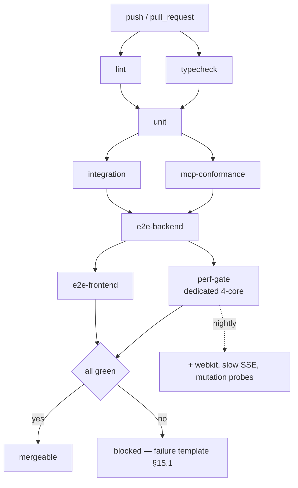

# Doc 10 — End-to-End Verification & Acceptance Harness

> **Series position:** 10 of 10 · **Owner:** Subagent 10 (QA & Validation)
> **Consumes:** Doc 01 §8 (T1–T12), §11 (I1–I6), §15 (error taxonomy), §16 (fixture pack), §17 (traceability); Doc 02 §12 (D1–D8), §14; Doc 03 §7.3, §8, §9, §10; Doc 04 §9, §10; Doc 06 §15, §17; Doc 07 §15; Doc 09 §9, §15, §16.
> **Publishes:** the conformance fixture pack (§9.1), `scripts/{run_mock_agent,simulate_power_cut,verify_integrity,verify_series}.py`, `scripts/check_budgets.mjs`, `.github/workflows/atlas-ci.yml`, the acceptance report schema (§17.3).
> **Owned paths (hard boundary):** `tests/**`, `frontend/e2e/**`, `scripts/**`, `.github/workflows/atlas-ci.yml`.
> **Never owned:** every application path. Tests *observe*; they never patch the system under test. A failure is evidence against an owning doc, never a licence to edit `backend/`, `frontend/app/`, or `mcp_server/`.

---

## 1. Purpose & Verification Philosophy

### 1.1 The claim under test

ATLAS-MCP promises six things a user would pay for: a task is never double-claimed; a power cut never corrupts state; an agent never receives more than 16 kB of context; the HUD never lies about liveness; nothing reaches `main` without human sign-off; an interrupted agent loses at most one lease. **A guarantee no test can falsify is marketing copy.** Doc 10 converts every assertion in Docs 01–09 into an executable counterexample generator.

### 1.2 Governing rules

| Rule | Statement | Enforcement |
| :--- | :--- | :--- |
| **R-1 — No green, no merge** | A branch merges only if every CI stage is green on the merge commit. "Known flake, retry it" is not a status (§15.2). | Branch protection: required checks = all 8 stages (§14.1). |
| **R-2 — One owning test per claim** | Every invariant (`I1–I6`, `D1–D8`), every capability (Master §6) and every cross-cutting concern has **exactly one canonical owning test** with a stable ID. Others may overlap; only the owner decides pass/fail. | Registry §2.5; matrix §6.1; a duplicate or missing owner fails the series gate (§16.1). |

**Why exactly one owner.** Invariants in a concurrent system fail intermittently. If three tests cover I2, two may pass while the third flakes — and the team "fixes" the flake by deleting the strictest test. A single owner makes the falsification duty non-transferable.

### 1.3 Falsification doctrine

1. **Counterfactual reachable** — proven by mutation probing: nine planted application defects must turn their owning test red (§5.8). Kill rate 9/9 is a release gate.
2. **Deterministic** — same input, same verdict, 20/20 local runs; 100/100 overnight for the four concurrency tests.
3. **Diagnosable** — a failure prints the invariant ID, observed state, owning doc and evidence path (§5.0), never a bare `assert`.

### 1.4 Five gates

| Gate | Question | Blocking |
| :--- | :--- | :--- |
| G1 Contract | Does the wire match Doc 01 byte-for-byte? | yes (§9, §10) |
| G2 Invariant | Can any of I1–I6 be violated? | yes — **always**, regardless of other greens (§15.3) |
| G3 Capability | Is every Master §6 feature usable end to end? | yes (§6) |
| G4 Durability | Does the system survive SIGKILL, disk-full, clock jump, corruption? | yes (§7) |
| G5 Budget | Are latency, throughput, bundle and render budgets met? | yes for > 10 % regressions; report-only otherwise (§13.6) |

**Non-goals:** visual taste (Doc 05 §9), the *quality* of an agent-authored patch (that is the T8 human gate), and production deployment topology.

---

## 2. Test Pyramid & Layout

### 2.1 Directory tree (authoritative)

```
ATLAS-MCP/
├── tests/
│   ├── conftest.py            # root fixtures (§3.2)
│   ├── pytest.ini             # markers, --strict-markers, timeout, filterwarnings=error
│   ├── fixtures/              # factories.py clock.py sse.py waiters.py images.py ids.py
│   │   └── expected/          # golden wire payloads (§9.1)
│   ├── unit/                  # core/ api/ mcp/   (no I/O beyond in-memory SQLite)
│   ├── integration/           # db/ api/ sse/     (one real SQLite file per test)
│   └── e2e/                   # conftest + test_{invariants,capabilities,multi_agent,
│                              #   crash_recovery,mcp_conformance,api_conformance,
│                              #   sse_stream,perf_gates}.py
├── frontend/e2e/
│   ├── playwright.config.ts
│   ├── fixtures/{board,matrix,stream,triage}.fixture.ts
│   ├── specs/{board,keyboard,matrix,triage,review,canvas,terminal,a11y}.spec.ts
│   └── visual/{board,canvas}/ # CI-only baselines (§11.6)
├── scripts/                   # run_mock_agent simulate_power_cut verify_integrity
│                              #   verify_series check_budgets.mjs fault_proxy
└── .github/workflows/atlas-ci.yml
```

### 2.2 Tool per layer

| Layer | Runner | Contains | Budget |
| :--- | :--- | :--- | :--- |
| **Unit** (`tests/unit/`) | `pytest` | projections, guards, storage router, serializers, path logic | ≤ 25 s |
| **Integration** (`tests/integration/`) | `pytest` + `pytest-django` | one real DB file per test, DRF client, `httpx` over ASGI, SSE bus | ≤ 180 s |
| **E2E backend** (`tests/e2e/`) | `pytest` + `httpx` | real `runserver` subprocess, real `mcp_server` over stdio, real filesystem | ≤ 300 s |
| **Frontend unit** | `vitest` (+RTL) | hooks, formatters, canvas lib, SSE client | ≤ 40 s |
| **Frontend E2E** (`frontend/e2e/`) | Playwright (Chromium; WebKit nightly) | assembled app against live Django + live Next | ≤ 420 s |
| **Perf** (`test_perf_gates.py`, `check_budgets.mjs`) | pytest + node | latency, throughput, render, bundle, startup | ≤ 240 s |

### 2.3 Layer selection and expected counts

> **Put the test at the lowest layer that can still fail for the right reason.** Two OS processes required ⇒ e2e (real restart, real SIGKILL); one process + one DB file ⇒ integration (real 409 envelope, real constraint violation); no I/O ⇒ unit (`project∘project == project`, `assert_acyclic`, SSE backoff maths).

Expected counts, where a shrinking count is itself a defect: unit 15 files ≈ 340 tests · integration 22 ≈ 180 · e2e 8 ≈ 95 · Vitest 18 ≈ 120 · Playwright 8 specs ≈ 70 · perf 9.

**Zero skips, zero `xfail` in `tests/e2e`.** A session hook fails the run when `skipped > 0` unless the node id is listed in `tests/fixtures/expected/known_skips.txt` with an owning issue.

### 2.4 No-mocking rule for e2e

> **No file under `tests/e2e/` may import `unittest.mock`/`pytest-mock` or patch an application symbol. No `page.route(...)` may intercept `127.0.0.1:8000`.**

The value of the layer is that the wire is real; a mocked Django asserts the mock. Freezing *time* (§4.1) is permitted and mandatory — `freezegun` patches `time`/`datetime`/`zoneinfo` uniformly for the whole process, which is observation-consistent — whereas patching `leases.claim_next_task` is not. Enforced by `verify_series.py --check no-mocks` (greps `mock`, `patch(`, `monkeypatch.setattr("core`); `monkeypatch.setenv` and `tmp_path` stay allowed.

### 2.5 Test ID registry

| Prefix | Meaning | Example | Owner file |
| :--- | :--- | :--- | :--- |
| `INV-I<n>-<k>` | invariant falsification | `INV-I2-01` | `tests/e2e/test_invariants.py` |
| `INV-D<n>-<k>` | Doc 02 data-integrity rule | `INV-D2-01` | `tests/integration/db/test_constraints.py` |
| `CAP-<nn>` | Master §6 capability | `CAP-01` | `tests/e2e/test_capabilities.py` |
| `X-<slug>` | cross-cutting concern | `X-LEASE`, `X-TOKEN`, `X-DISCOVERY` | `tests/e2e/test_multi_agent.py` |
| `FI-<nn>` | fault injection | `FI-01` | `tests/e2e/test_crash_recovery.py` |
| `MCP-<nn>` | MCP conformance | `MCP-04` | `tests/e2e/test_mcp_conformance.py` |
| `API-<nn>` | REST conformance | `API-12` | `tests/e2e/test_api_conformance.py` |
| `SSE-<nn>` | stream behaviour | `SSE-05` | `tests/e2e/test_sse_stream.py` |
| `FE-<nn>` | Playwright scenario | `FE-07` | `frontend/e2e/specs/*.spec.ts` |
| `PERF-<nn>` | budget gate | `PERF-03` | `tests/e2e/test_perf_gates.py` |

IDs appear via `@pytest.mark.test_id("…")` **and** on the docstring's first line, so reports are generated by name without parsing code.

---

## 3. Environment & Fixtures

### 3.1 Database strategy — one disposable file per test

The DB is a **file** under `tmp_path_factory.mktemp("db")`, function-scoped: `:memory:` cannot exercise WAL, cannot be opened by a second process, and hides `-wal`/`-shm` behaviour Doc 03 relies on. Real migrations run **once per session** into a template DB captured with `journal_mode=DELETE` (a copied `-wal` without its `-shm` is a corrupt pair) and switched to `WAL` on first use. Pragmas come from Django's `init_command` (Doc 02 §3) and are never re-applied by tests — if they are wrong, every test should fail. `unit/` and `integration/db/` may use pytest-django's faster transactional `db` fixture.

**Decision:** any test asserting crash or concurrency semantics uses `db_file` (real WAL, real `BEGIN IMMEDIATE`), because lock contention is invisible inside a single rolled-back transaction.

### 3.2 Fixture inventory (root `conftest.py`)

| Fixture | Scope | Yields | Contract |
| :--- | :--- | :--- | :--- |
| `tmp_storage_root` | function | `Path` | Patches `ATLAS_STORAGE_ROOT` env **and** setting **and** the module-level router; asserts no `*.tmp`/`*.part` at teardown. |
| `frozen_clock` | function | `FrozenClock` | `freeze_time("2026-10-27T08:00:00Z", tick=False)`; `.advance(s)`/`.jump(s)`; restores real time. |
| `project_factory` | function | `ProjectFactory` | `.create(slug=…, **over)`; scaffolds the project storage dir. |
| `task_factory` | function | `TaskFactory` | `.create(project, status, priority, blocked_by, dod)`, `.create_batch(n)`. |
| `checklist_factory` | function | `ChecklistFactory` | Rows with `order_index` 1..n (wire `id` == `order_index`). |
| `asset_factory` | function | `AssetFactory` | `.create(task, kind, source, bytes)`, `.create_patch`, `.create_log`. |
| `leased_task` | function | `Task` | Claims **through** `leases.claim_next_task`; never writes lease columns by hand (Doc 03 §2). |
| `api_client` | function | `httpx.Client` | Bearer token, `base_url=http://testserver`. |
| `internal_client` | function | `httpx.Client` | Adds `X-ATLAS-Agent`; self-checks that omitting it yields 400. |
| `sse_client` | function | `SSEClient` | Background reader; `.wait_for(pred, timeout)`, `.wait_for_count(n)`, `assert_no_gaps()`. |
| `mock_agent_proc` | function | `Popen` | `run_mock_agent.py` with a seed; `.expect_exit(code, timeout)`. |
| `live_server` | module (e2e) | `LiveServer` | Real `runserver` on an ephemeral port; `/healthz` polled until ok. |
| `mcp_proc` | module (e2e) | `MCPClient` | Real `python -m mcp_server`, JSON-RPC over stdio. |

### 3.3 Two critical fixtures, in full

**`tmp_storage_root`** — a wrong root silently writes into the developer's real `storage/` and poisons every later assertion:

```python
# tests/conftest.py (excerpt 1, 13 lines)
@pytest.fixture
def tmp_storage_root(tmp_path, monkeypatch):
    root = tmp_path / "storage"
    for sub in ("projects", ".uploads", ".trash"):
        (root / sub).mkdir(parents=True)
    monkeypatch.setenv("ATLAS_STORAGE_ROOT", str(root))
    monkeypatch.setattr(settings, "ATLAS_STORAGE_ROOT", str(root))
    from core import storage as storage_mod
    monkeypatch.setattr(storage_mod, "ROUTER", storage_mod.StorageRouter(root=root), raising=False)
    yield root
    leftovers = [p for p in root.rglob("*") if p.is_file() and p.suffix in {".tmp", ".part"}]
    assert not leftovers, f"un-swept temp files: {leftovers[:3]}"
```

**`task_factory`** — the single place that knows a task needs a folder, DoD rows and stable ids:

```python
# tests/conftest.py (excerpt 2, 20 lines)
@pytest.fixture
def task_factory(db, project_factory, tmp_storage_root):
    class TaskFactory:
        def create(self, project=None, *, dod=("Repro test written",), status="PENDING",
                   blocked_by=(), **over):
            from core.models import ChecklistItem, Task
            project = project or project_factory.create()
            task = Task.objects.create(project=project, status=status,
                                       title=over.pop("title", "Fix JWT expiry race"),
                                       description=over.pop("description", "Repro + fix."), **over)
            if blocked_by:
                task.blocked_by.set(blocked_by)
            ROUTER.scaffold_task(project.id, task.id, description=task.description,
                                 checklist=list(dod), meta={})
            for i, label in enumerate(dod, start=1):
                ChecklistItem.objects.create(task=task, order_index=i, label=label)
            return task
        def create_batch(self, n, **kw):
            return [self.create(**kw) for _ in range(n)]
    return TaskFactory()
```

**`sse_client`** (`fixtures/sse.py`) is the only code in the suite that reads a socket incrementally: a daemon thread parses `id:`/`event:`/`data:` blocks into frames stamped with `perf_counter()`, exposing `wait_for(pred, timeout)`, `wait_for_count(n, timeout)` and `assert_no_gaps()` — condition-variable waits only, never sleeps.

### 3.4 Environment variables

| Variable | Default in tests | Set by | Effect |
| :--- | :--- | :--- | :--- |
| `ATLAS_ENV` | `test` | `pytest.ini` | loopback guard active; no DEBUG. |
| `ATLAS_DB_PATH` / `ATLAS_STORAGE_ROOT` | per-test tmp | fixtures | isolation (§3.1, §3.3). |
| `ATLAS_API_TOKEN` | `test-token-do-not-ship` | session autouse | deterministic auth. |
| `ATLAS_DISABLE_SWEEPER` | **`1`** | session autouse unless the test uses `sweeper_on` | no background thread stealing leases mid-assertion (Doc 03 §6.1). |
| `ATLAS_FORCE_RECOVERY` | **unset** | only `@pytest.mark.recovery` tests | Doc 03 §5.1 skips `ready()` under pytest; this flag is the sole opt-in. |
| `ATLAS_LEASE_TTL_SECONDS` | `900` | never overridden in e2e | the frozen value is asserted (`INV-I3-02`); unit tests may patch the *constant* and must say so in the docstring. |
| `ATLAS_FEATURE_SOUND` / `TZ` | `0` / `UTC` | Playwright env / autouse | silent CI; UTC wire timestamps. |

A test needing a non-default value declares it in a fixture, never with inline `os.environ`, so `verify_series.py --print-env` can publish the matrix.

### 3.5 `live_server` (e2e shape)

```python
@pytest.fixture(scope="module")
def live_server(tmp_path_factory):
    root = tmp_path_factory.mktemp("live"); (root / "storage").mkdir()
    env = {**os.environ, "ATLAS_DB_PATH": str(root / "atlas.db"), "ATLAS_ENV": "test",
           "ATLAS_STORAGE_ROOT": str(root / "storage"), "ATLAS_API_TOKEN": TOKEN,
           "ATLAS_DISABLE_SWEEPER": "1"}
    subprocess.run([sys.executable, "backend/manage.py", "migrate", "--no-input"],
                   env=env, check=True, capture_output=True)
    port = _free_port()
    proc = subprocess.Popen([sys.executable, "backend/manage.py", "runserver",
                             f"127.0.0.1:{port}", "--noreload"], env=env,
                            stdout=subprocess.PIPE, stderr=subprocess.STDOUT)
    _await_health(f"http://127.0.0.1:{port}", timeout=15.0)     # 50 ms poll, event-driven
    yield LiveServer(url=f"http://127.0.0.1:{port}", proc=proc, env=env, db=root / "atlas.db")
    proc.terminate(); proc.wait(timeout=10)
```

### 3.6 Fixture hygiene

Fixtures produce state **through application APIs** where one exists; direct ORM writes only for states no API can create (an already-expired lease, a `REJECTED` blocker). Factories never generate random content — titles cycle a fixed list, images come from a deterministic PNG encoder — so hash and snapshot assertions stay stable.

---

## 4. Determinism Contract

### 4.1 Time

| Rule | Implementation | Why |
| :--- | :--- | :--- |
| One clock source | application code may call `django.utils.timezone.now()` only; `datetime.now()`/`utcnow()` banned in `backend/` (ruff `DTZ` + `--check clocks`) | a second clock source is how a frozen test passes while production expires leases 2 h early |
| Freezing | `freeze_time("2026-10-27T08:00:00Z", tick=False)` for the whole test; `tick=True` forbidden in `tests/` | wall-clock drift makes `lease_expires_at` assertions flaky |
| Advancement | `frozen_clock.advance(900)` for TTL, `+60` for grace, `+3600` for ageing | explicit, auditable time travel; no hidden waits |
| Jumps | `frozen_clock.jump(7200)` for `FI-05`; asserts no lease was silently renewed | NTP correction / laptop sleep |
| Exceptions | `test_perf_gates.py` and `SSE-07` run unfrozen (`@pytest.mark.realtime`) | a frozen clock makes latency measurement meaningless |
| Guard | an autouse fixture asserts the wall clock differs from the frozen base by > 1e6 s, catching a forgotten freeze | prevents accidental real-time tests |

**`freezegun` caveat, recorded:** `auto_now_add` reads `timezone.now()`, so freezing *after* creating a row leaves that row at real time. Rule: `frozen_clock` precedes any factory in the signature order, and `assert_frozen_world()` checks the gap is ≤ 1 s.

### 4.2 Randomness

| Source | Strategy | Assertion style |
| :--- | :--- | :--- |
| UUIDv4 (`Project`, `Task`, `Asset`) | not seeded; assert `version == 4`, in-test uniqueness, stability across re-read | structural |
| ULID (`Event`, `Lease`, `request_id`) | `ATLAS_ULID_SEED` + `ATLAS_ULID_EPOCH` ⇒ deterministic Crockford-Base32 | structural + monotonic |
| Pagination cursors | decode and assert ordering keys; never compare literal strings | structural |
| `request_id` | `^req_[0-9A-HJKMNP-TV-Z]{26}$`, header == body | regex |
| Asset `sha256` | deterministic bytes ⇒ pinned digests in `fixtures/expected/` | exact |

Hard-coded ids are never asserted: they break on fixture changes and would let a real regression (id reuse) hide behind a snapshot update. `fixtures/ids.py` rejects a hard-coded ULID assertion when `ATLAS_ULID_SEED` is unset.

### 4.3 SSE timing and the sleep ban

Frame arrival uses `sse.wait_for(predicate)` with a **2 s** budget (a 2 s local-SSE failure is a defect, not slowness). Burst completeness uses `wait_for_count(500, timeout=60)` — computed, not guessed: 500 lines ÷ the 25 fps coalescer cap ≥ 20 s. Cross-process convergence uses `wait_until(...)` at 5 s with a 10 ms interval. Keep-alive cadence is *time-driven*, so the test advances the frozen clock by 15 s instead of waiting.

`time.sleep` is banned in `tests/**` because a fixed sleep encodes an assumption about machine speed (flaky under load), hides a genuine latency regression (the moment a test sleeps 300 ms "to be safe", the 300 ms budget stops being enforced), and names no predicate when it fails. The single sanctioned primitive is:

```python
# tests/fixtures/waiters.py — the only permitted polling helper
def wait_until(predicate, *, timeout=2.0, interval=0.01, what="condition", debug=None):
    deadline, last = time.monotonic() + timeout, None
    while time.monotonic() < deadline:
        try:
            if predicate(): return
        except Exception as exc:            # row not committed yet
            last = exc
        time.sleep(interval)                # ALLOWED HERE ONLY
    raise AssertionError(f"timed out after {timeout}s waiting for {what}"
                         + ("" if debug is None else f"\n  observed: {debug()}")) from last
```

`--check no-sleep` rejects `time.sleep(` / `asyncio.sleep(` in `tests/**` except that file and one allow-listed throttle probe in `test_perf_gates.py`. Frontend tests use `vi.advanceTimersByTime()` / `waitFor()`, never a `setTimeout` promise; Playwright uses `expect(locator)` with a timeout, never `page.waitForTimeout`. The lint prints every match it found, so the rule is verified rather than trusted.

---

## 5. Invariant Test Suite (I1–I6)

### 5.0 Failure-message template

Every invariant test writes `artifacts/invariants/<ID>.json` (`{id, passed, observed, duration_ms, seed, git_sha}`) and fails through one template, so triage needs no code reading:

```
[INV-I2-01] INVARIANT VIOLATED: two concurrent claims returned the same task_id
  owning_doc : Doc 01 §11.1 / Doc 03 §4.2
  expected   : 20 claimers over 10 PENDING tasks → 10 unique ids, 10 nulls
  actual     : 11 non-null results, 9 unique ids; duplicate 5f2d… (Agent-3, Agent-17)
  evidence   : artifacts/invariants/INV-I2-01.json
  hypothesis : conditional UPDATE lost its status='PENDING' predicate, or BEGIN IMMEDIATE dropped
```

A missing `evidence` line is itself a failure (enforced by the `record_invariant` fixture).

### 5.1 I1 — claims equal distinct leases issued

**Invariant.** Successful claims for a task equal the distinct `lease_id`s ever issued (Doc 01 §11.1 I1).

**Falsifier `INV-I1-01`:** create one `PENDING` task at `T0`; claim as `Agent-A` → `lease_1`; `advance(901)` then `reclaim_expired_tasks(actor="test")`; claim as `Agent-B` → `lease_2`; repeat twice more.

```python
assert task.attempt_count == 4
assert len({lease_1, lease_2, lease_3, lease_4}) == 4, "a lease id was reused across claims"
granted = [r for r in audit_events(task) if r["event"] == "LEASE_GRANTED"]
assert len(granted) == 4
assert {g["detail"]["lease_id"] for g in granted} == {lease_1, lease_2, lease_3, lease_4}
assert Task.objects.get(id=task.id).lease_id == lease_4
```

Failure: `attempt_count (4) != distinct lease_ids issued (3)` — hypothesis: lease id derived from task id, or a claim retried without re-issuing.

### 5.2 I2 — no double claim under concurrency (full test)

**Invariant.** Two concurrent claims never return the same `task_id` (Doc 01 §11.1 I2, Doc 03 §10.2).

```python
@pytest.mark.e2e
@pytest.mark.test_id("INV-I2-01")
def test_parallel_claims_never_duplicate(db_file, project_factory, task_factory, record_invariant):
    """INV-I2-01 — 20 threads over 10 PENDING tasks → 10 distinct claims, 10 nulls."""
    from concurrent.futures import ThreadPoolExecutor
    from django.db import close_old_connections
    from core import leases

    project = project_factory.create(slug="alpha")
    for i in range(10):
        task_factory.create(project=project, title=f"Race task {i}", priority=50 + i)
    barrier, results, errors = threading.Barrier(20), [], []

    def worker(idx):
        close_old_connections()                      # one connection per thread
        try:
            barrier.wait(timeout=10)                 # rendezvous, not a sleep
            t = leases.claim_next_task(project_slug="alpha", agent_identifier=f"Agent-{idx}")
            results.append((idx, t.id if t else None, t.lease_id if t else None))
        except Exception as exc:
            errors.append((idx, repr(exc)))
        finally:
            close_old_connections()

    started = time.perf_counter()
    with ThreadPoolExecutor(max_workers=20) as pool:
        list(pool.map(worker, range(20)))
    elapsed = time.perf_counter() - started

    assert not errors, f"claim raised instead of returning null: {errors[:3]}"
    claimed_ids    = [tid for _, tid, _ in results if tid]
    claimed_leases = [lid for _, _, lid in results if lid]
    assert len(claimed_ids) == 10, f"expected 10 claims, got {len(claimed_ids)}"
    assert len(set(claimed_ids)) == 10, f"duplicate task ids: {duplicates(claimed_ids)}"
    assert len(set(claimed_leases)) == 10, "duplicate lease ids across distinct claims"
    assert sum(1 for _, tid, _ in results if tid is None) == 10
    assert elapsed < 0.5, f"{20 / elapsed:.0f} claims/s < 100/s requirement"     # PERF-04 guard

    rows = Task.objects.filter(id__in=claimed_ids).values("status", "lease_id", "attempt_count")
    assert all(r["status"] == "IN_PROGRESS" and r["lease_id"] and r["attempt_count"] == 1
               for r in rows)
    record_invariant("INV-I2-01", claimed=len(claimed_ids), elapsed_ms=round(elapsed * 1000, 1))
```

| Property | Value |
| :--- | :--- |
| Threads / tasks | 20 / 10 at distinct priorities (a broken `ORDER BY` is also visible); `threading.Barrier(20)`, no sleeps |
| Fixture | `db_file` (real WAL + `BEGIN IMMEDIATE`); the rolled-back `db` fixture would hide contention |
| Repetition | 100 nightly runs, zero failures; ≥ 100 claims/s asserted via `elapsed < 0.5` (`PERF-04` is the stricter 100-claims/1 s gate) |

**Failure message:** `INVARIANT VIOLATED: duplicate task_id returned to two claimers` — hypothesis: `BEGIN IMMEDIATE` not issued, or the `UPDATE` filter lost `status='PENDING'`.

### 5.3 I3 — `IN_PROGRESS` implies exactly one lease

**Invariant.** `status == IN_PROGRESS` ⟺ `lease_id` and `lease_expires_at` non-null; no task ever holds two leases (Doc 01 §11.1 I3, Doc 02 §5.2 `ck_task_lease_invariant`).

| Test | Layer | Action | Assertion |
| :--- | :--- | :--- | :--- |
| `INV-I3-01` | integration | raw `UPDATE core_task SET status='IN_PROGRESS', lease_id=NULL, lease_expires_at=NULL` | `pytest.raises(IntegrityError)` whose text contains `ck_task_lease_invariant` |
| `INV-I3-02` | unit | read the constants | `LEASE_TTL_SECONDS == 900`, `HEARTBEAT_INTERVAL_SECONDS == 120`, `RECLAIM_GRACE_SECONDS == 60` |
| `INV-I3-03` | e2e | 200 seeded claim/submit/reclaim cycles | `IN_PROGRESS` count == `lease_id__isnull=False` count at every sample |

Failure: `UPDATE succeeded; 1 row now IN_PROGRESS with lease_id NULL` — the CHECK constraint is missing from the applied migration (Doc 02 §6 row 0002/0003).

### 5.4 I4 — a stale heartbeat mutates nothing

**Invariant.** A heartbeat with a stale (mismatched or expired) lease mutates nothing and returns `409 STALE_LEASE` (Doc 01 §11.1 I4). `INV-I4-01` covers three cases, snapshotting the whole row before and after each:

| Case | Setup | Expected |
| :--- | :--- | :--- |
| a. mismatch | heartbeat with another task's `lea_…` | `409`, `detail.reason == "mismatch"`, row byte-identical |
| b. expired | `advance(901)`, then heartbeat with the correct id | `409`, `detail.reason == "expired"`, `lease_expires_at` unchanged |
| c. reclaim raced the heartbeat | reclaim (→ `PENDING`), then heartbeat with the old id | `409`, status still `PENDING`, **no** new lease created |

Case (c) proves the heartbeat filter includes `status=IN_PROGRESS`, so a heartbeat can never resurrect a reclaimed task without a new lease (Doc 03 §10.2). The assertion is `assert Task.objects.values().get(id=task.id) == before, "stale heartbeat mutated the row"`.

### 5.5 I5 — nothing stays expired after boot

**Invariant.** After boot recovery, zero tasks remain `IN_PROGRESS` with `lease_expires_at < now − 60 s` (Doc 01 §11.1 I5). `INV-I5-01` (`@pytest.mark.recovery`, `ATLAS_FORCE_RECOVERY=1`) creates 7 tasks, claims 3, forces 2 expired by `−120 s`, leaves 1 expired by `−30 s` (inside grace), then calls `on_startup()` **twice** and asserts: `EXPIRED_Q` count is 0; only `{live, grace}` remain `IN_PROGRESS`; each reclaimed task is `PENDING` with a null lease and an `execution.log` line matching `[SYSTEM CRASH DETECTED]` plus `lease {old}`; and `task.lease_expired` events number exactly **2, not 4** — the idempotency proof for a double boot.

Failure: `1 task still IN_PROGRESS 120 s past expiry after on_startup()` — hypothesis: reclaim compares `lease_expires_at < now` instead of `EXPIRED_Q`, or reclaim is not idempotent.

### 5.6 I6 — storage writes are all-or-nothing

**Invariant.** A write is either absent or complete — no zero-byte PNG, no truncated patch (Doc 01 §11.1 I6, Doc 02 §8.3). `INV-I6-01` is parameterised over four cut points, each asserting the destination and temp-file hygiene:

| Cut point | Mechanism (in-process) | Expected |
| :--- | :--- | :--- |
| `before_write` | `open()` raises after the temp name is chosen | destination unchanged, temp removed |
| `mid_write` | wrapper raises `OSError(ENOSPC)` on the 2nd `write` | destination unchanged, temp removed |
| `before_replace` | `core.storage.os.replace` raises | destination unchanged, temp removed |
| `after_replace` | `_fsync_dir` raises | destination **complete** (the replace already happened) |

The assertion is `dest.read_bytes() == (payload if cut == "after_replace" else b"ORIGINAL")` plus `not list(dest.parent.glob("*.tmp"))`. Failure: `destination is 5 242 880 bytes starting b"xxxx…" (partial new content)` — hypothesis: the writer targets `dest` directly, or reuses a fixed temp name. The out-of-process form (SIGKILL) is `FI-01`/`FI-02` (§7.4).

### 5.7 Doc 02 rules D1–D8 (negative tests)

| ID | Rule | Owner test | Assertion |
| :--- | :--- | :--- | :--- |
| `INV-D1-01` | `priority ∈ [0,100]` | `integration/db/test_constraints.py` | raw `priority=101` → `IntegrityError` `ck_task_priority_range`; API −1/101 → 400 |
| `INV-D2-01` | `IN_PROGRESS ⇔ lease` | shared with `INV-I3-01` | I3 is canonical (single owner, R-2) |
| `INV-D3-01` | checklist `order_index` unique | same file | duplicate insert → `uq_checklist_task_order` |
| `INV-D4-01` | event `seq` unique per project | same file | duplicate `(project, seq)` → `uq_event_project_seq` |
| `INV-D5-01` | asset `relative_path` unique | same file | duplicate path → `IntegrityError` |
| `INV-D6-01` | DAG acyclic | `unit/core/test_guards.py` | A→B→A and self-edges raise `DependencyCycle`; a 500-deep chain does not recurse-error |
| `INV-D7-01` | slug immutable | `integration/api/test_projects.py` | `PATCH {"slug": …}` ignored, DB unchanged |
| `INV-D8-01` | no orphan assets | `integration/db/test_constraints.py` | delete cascades rows; folder moves to `.trash/` (not deleted) |

Plus the unnamed row⇒file invariant (`X-STORAGE-01`, Doc 03 §8): for every `Asset` in a 200-task seed, `(root / relative_path).exists()`, `stat().st_size == byte_size`, `sha256(file) == row.sha256`. This is what makes the review UI trustworthy.

### 5.8 Mutation probes (proof the suite can fail)

Run per release (`verify_series.py --mutate`), never in CI, each against a throwaway worktree.

| # | Mutation | Must kill |
| :--- | :--- | :--- |
| M1 | remove `BEGIN IMMEDIATE` from the claim | `INV-I2-01` |
| M2 | drop `status='PENDING'` from the claim `UPDATE` | `INV-I2-01`, `INV-I1-01` |
| M3 | delete `ck_task_lease_invariant` | `INV-I3-01` |
| M4 | drop `status=IN_PROGRESS` from the heartbeat filter | `INV-I4-01` case c |
| M5 | `EXPIRED_Q` uses `< now` (drop the grace window) | `INV-I5-01` |
| M6 | `write_bytes` writes directly to `dest` | `INV-I6-01` |
| M7 | remove the projection ceiling | `MCP-07` |
| M8 | remove `seq` dedupe in SSE replay | `SSE-02` |
| M9 | make the claim query ignore `blocked_by` | `CAP-05` |

**9/9 or the release is blocked.** A surviving mutation means the owning test is not a falsifier and must be rewritten.

---

## 6. Capability Acceptance Matrix

Fifteen rows: Master §6's twelve capabilities plus the three cross-cutting concerns named in Doc 01 §17. Each "Steps" cell is the test body; each "Artifacts" cell names files a reviewer opens under `artifacts/` without re-running anything.

| # | Capability | Doc owner | Test ID | Type | Preconditions | Steps | Pass criteria | Artifacts |
| :--- | :--- | :--- | :--- | :--- | :--- | :--- | :--- | :--- |
| **1** | Atomic claim protocol | 03 §4.2, 04 §6.2, 08 §7.1 | `CAP-01` | e2e (real `mcp_server` stdio) | project `alpha`; 10 `PENDING` tasks at priorities 51–60; `ATLAS_DISABLE_SWEEPER=1`; frozen at `T0` | 1. Spawn **20 threads** behind `Barrier(20)` — 4 with their own real MCP stdio session, 16 calling `leases.claim_next_task` in-process. 2. Each calls `claim_next_task("alpha", f"Agent-{i}")`. 3. Collect all 20 results. 4. Re-read all 10 rows. | 10 distinct non-null `task_id`s; the other 10 are exactly `{"task_id": null, "reason": "NO_ELIGIBLE_TASK"}` (2 keys, no `ok`); 10 distinct `lease_id`s matching `^lea_[0-9A-HJKMNP-TV-Z]{26}$`; every claimed row `IN_PROGRESS`, `attempt_count == 1`, `lease_expires_at == T0+900 s`; the 4 stdio sessions return the same shape as the 16 in-process calls | `cap/CAP-01/{claims.jsonl,mcp-session-*.log,timing.json}` |
| **2** | DoD checklists | 02 §5.3, 04 §5.4, 08 §7.6 | `CAP-02` | e2e | `leased_task` with 4 items; `internal_client` | 1. Toggle item 1 → true. 2. Item 2 → true. 3. Item 2 → false. 4. Item 4 → true. 5. `GET /tasks/{id}/`. 6. Toggle `item_id: 99`. 7. Toggle item 1 using another task's id. | Percent 25 (1/4) after step 3, 75 (3/4) after step 4; `completed_at` set only for completed items, `completed_by_agent == "Agent-Test-1"` on agent toggles; wire ids are exactly `1,2,3,4` in `order_index` order (Doc 01 §6.5); step 6 → `404 TASK_NOT_FOUND` with `detail.item_id == 99` (**Decision:** Doc 04 lists 404 without a code; Doc 10 pins `TASK_NOT_FOUND`); step 7 → `404 TASK_NOT_FOUND`; exactly 4 `task.dod_updated` events | `cap/CAP-02/{dod.json,events.jsonl}` |
| **3** | Verification gates | 04 §5.7, 06 §10, 08 §7.3 | `CAP-03` | e2e | `leased_task` with 2/3 DoD done; synthetic 1.2 kB diff | 1. `submit_for_review(task_id, summary, git_patch, verification_log)`. 2. Read status. 3. `PATCH /tasks/{id}/ {"status":"COMPLETED"}`. 4. `POST /reviews/{id}/reject/` with blank notes. 5. Reject with 3-char notes. 6. Re-claim and submit again. 7. `POST /reviews/{id}/approve/` with **no body**. | Step 1 → `{"ok":true,"status":"IN_REVIEW","dod_progress_percent":66}` — `IN_REVIEW` **despite** < 100 % DoD (Doc 01 §8); step 3 → status not writable, DB unchanged (unknown field ignored, no transition); step 4 → `400 VALIDATION_ERROR`; step 5 → `PENDING`, lease cleared, `attempt_count` unchanged; step 7 → `COMPLETED`, `completed_at` set, `review.approved` emitted (empty body accepted — Doc 06 §18 risk note); `output/git_patch.patch` byte size equals the submitted diff | `cap/CAP-03/{review.json,git_patch.patch,test_execution.log}` |
| **4** | Subtask spawning | 04 §6.2, 08 §7.7 | `CAP-04` | e2e | `leased_task` `IN_PROGRESS` at priority 80 | 1. `POST /internal/v1/subtask {parent_task_id, title, description, priority:70}`. 2. Read the child. 3. `POST` the same title with a different description. 4. `POST` with `priority` omitted. 5. Read the parent's `child_task_ids`. 6. Claim the child while the parent is `IN_PROGRESS`. | Child has `parent_task_id == parent`, `priority == 70`, `is_agent_discovered == False`; step 3 creates a **second** distinct child (no dedupe, Doc 08 §12.1); step 4 inherits the parent's 80 (**Decision:** Master §6.4 says "inherit priority weighting"; Doc 01 is silent, so Doc 10 pins inheritance-on-omission); step 5 lists both; `SUBTASK_SPAWNED` audit per child; step 6 succeeds because Doc 01 §8 adds no implicit blocker (asserted explicitly, so a future inheritance rule breaks this test loudly) | `cap/CAP-04/{subtasks.json,audit-copy.log}` |
| **5** | Dependency blocking (DAG) | 02 §5.2/§7.2, 04 §5.2 | `CAP-05` | e2e | A `COMPLETED`, B `PENDING`, C `PENDING` blocked by B, D `PENDING` blocked by A, E `REJECTED`, F `PENDING` blocked by E | 1. Claim 3×. 2. Assert the returned set. 3. Create a task with `blocked_by:[C]` (forming B→C→B). 4. Create a task whose `blocked_by` points into project `beta`. 5. Complete B through the review flow, then claim again. 6. Inspect F, then claim. | Steps 1–2 yield exactly `{B, D}` then null — C blocked by pending B, and F blocked by `REJECTED` E is **never** claimable (Doc 01 §8); step 3 → `409 DEPENDENCY_CYCLE`, `detail` names both ids, **no row created**; step 4 → `400 VALIDATION_ERROR` `{"blocked_by": ["must belong to project alpha"]}`; step 5 makes C claimable; step 6 leaves F `PENDING` with telemetry `blocked_unsatisfiable: 1` (**Decision:** Doc 01 says such tasks are skipped silently, so a counter is the only observable; requested from Doc 04) | `cap/CAP-05/{claims.json,dag.mmd,unsatisfiable.json}` |
| **6** | In-app canvas annotation | 07 §15 | `CAP-06` (Playwright `canvas.spec.ts` + Vitest) | frontend 3000, Django 8000, task with a 1280×720 `INPUT_SCREENSHOT` | 1. Open the task; `O` opens the dialog. 2. Drag a rect (100,100)→(400,260). 3. Add arrow + text callout. 4. Blur region over a text-shaped fixture patch. 5. Export (`Cmd+Enter`). 6. Read the new `ANNOTATED_CANVAS` asset. 7. Decode the PNG and sample the blur region. 8. Re-open from the persisted document. | `ExportResult.sha256` present; asset `kind=ANNOTATED_CANVAS`, `source=HUMAN`, `byte_size` matches; export dimensions == `imageNaturalSize` (or crop) at any zoom (`T-EXP-01`); blur region has ≤ `(w/block)*(h/block)` distinct colours and no edge gradient above threshold (`T-BLUR-03`); re-open restores 4 strokes at `version == 1` with identical image-space geometry; a second unchanged export uploads once (`T-EXP-04`) | `cap/CAP-06/{exported.png,document.json,blur-analysis.json}`, trace |
| **7** | Cyber HUD visual theme | 05 §9 | `CAP-07` (Playwright `visual/board`) | frontend with fixture data | 1. Snapshot `/` at 1440×900, DPR 1, fonts ready. 2. Assert computed design tokens. 3. Assert status conveyed by text **and** colour. 4. Run axe on `/`. | Pixel diff ≤ 0.1 % vs the CI-only baseline (§11.6); `--surface-canvas`, `--accent-flow` and all six `--status-*` tokens equal Doc 05's hex values; every `StatusBadge` has a text label; axe zero critical, zero serious | `visual/board/` baselines, `axe.json` |
| **8** | Split multi-agent dashboard | 06 §17 #1–#3 | `CAP-08` (Playwright `board.spec.ts`) | 2 projects, fixture tasks, URL `/?p=alpha,beta&layout=1x2` | 1. Load the URL. 2. Count panes, read labels. 3. Switch to `2x3`. 4. Push a 4 000-char line into pane 1. 5. Compare `scrollHeight` with `clientHeight`. 6. `Shift+Click` a rail card, pick slot 3. 7. Reload. | Exactly 2 panes bound to `alpha`,`beta`; `2x3` renders 6 cells with 4 `EmptyState` slots; no horizontal page scroll at 1280 px; `scrollHeight == clientHeight` (only terminals scroll); the URL gains the third slug and survives reload; `/healthz` `sse_connections == 2` (one `EventSource` per pane) | `panes.json`, `healthz-sse.json`, screenshots |
| **9** | Live SSE terminal stream | 09 §16 | `CAP-09` | e2e + Playwright `terminal.spec.ts` | `leased_task`; `sse_client` on `/stream/tasks/{id}/log` | 1. Open the stream; assert the first bytes are `retry: 3000\n\n`. 2. `log_task_progress` ×5 (DEBUG/INFO/WARN/ERROR/INFO). 3. Collect frames. 4. Compare with `execution.log`. 5. Disconnect after frame 3 and reconnect with that `Last-Event-ID`. 6. Send a 6th message containing `\x1b[31m`. | 5 `task.log` frames in `seq` order, `event:` mirroring `data.type`, `id:` the ULID; `data` round-trips the DTO; `execution.log` holds 5 lines `HH:MM:SS LEVEL message`; reconnect delivers frames 4–5 exactly once; the 6th frame is ANSI-stripped; `task.log` never appears on the project channel | `cap/CAP-09/{frames.jsonl,execution.log,replay.json}` |
| **10** | Keyboard-first navigation | 06 §12.1, §17 #9 | `CAP-10` (Playwright `keyboard.spec.ts`) | 12 fixture tasks, 2 panes | 1. `J`×3 then `K`×1. 2. `C`. 3. `Esc`. 4. `/`, type `jwt` (must not trigger `J`). 5. `Esc`. 6. `Shift+1`, `Shift+2`. 7. `Space` on an asset row, `Esc`. 8. `A` on `/discoveries`. 9. `?`. | Focus lands on row 3 then row 2; `C` opens the dialog with the title input focused; `Esc` restores focus to the row (not `body`); typing in search never moves selection (§12.2 rule 2); `Esc` cascades one layer per press; `Shift+1/2` focuses the pane root with a visible ring; `Space` opens the preview; `A` approves; `?` lists only current-scope bindings and every binding used here appears there (§12.4) | `focus-trace.json`, per-step screenshots |
| **11** | Visual priority matrix | 06 §11, §17 #8 | `CAP-11` (Playwright `matrix.spec.ts` + Vitest `scale.test.ts`) | 21-point fixture **and** a seeded 500-point project | 1. Load `/`, wait for points. 2. Assert the count and that axis labels come from the response `axes` block. 3. `X` toggles to `dependency_weight`. 4. Lasso 3 points. 5. `+`/`-`/`0`. 6. Load the 500-point project and measure. | 21 points with `data-task-id`; `y_max` read from the response (never hard-coded 100); `X` refetches with `?x=dependency_weight`; the lasso selects exactly the 3 enclosed ids; `0` restores the initial `viewBox`; **500 points render in ≤ 16 ms** (`performance.measure("matrix.render")`, §13.3); no chart library in the bundle | `matrix.json`, `render-timing.json`, screenshots |
| **12** | Project root detection | 02 §5.1, 08 §9 | `CAP-12` | e2e | project with `E:\dev\alpha`, project with `/home/dev/beta`, project with a non-existent path | 1. Claim from `alpha`, read `local_repo_path`. 2. Same for `beta`. 3. Claim from the non-existent-path project. 4. `propose_task` with `screenshot_paths: ["..\\..\\etc\\passwd"]`. 5. `propose_task` with a valid in-storage path. | Returned strings are byte-identical to the stored values (native separators, never POSIX-normalised, Doc 01 §5); the non-existent path returns unchanged with no error (Doc 02 §5.1); step 4 → `400 PATH_OUT_OF_SCOPE` and no copy; step 5 copies into the discovery task's `output/` and appears as an absolute native path in `screenshot_absolute_paths` | `cap/CAP-12/{paths.json,discovery.json}` |
| **X1** | Leases & crash recovery | 03 §5–§7 | `X-LEASE` | e2e (process-level cases delegated to `FI-*`) | live server, claimed task, `ATLAS_SWEEPER_INTERVAL_SECONDS=1` for this test only | 1. Claim. 2. `SIGKILL` the mock agent. 3. Wait one sweeper tick. 4. Assert reclaim. 5. Re-claim, heartbeat twice. 6. `POST /tasks/{id}/force-release/`. | Reclaim ≤ 2 s; `execution.log` has `[SYSTEM CRASH DETECTED]` naming the dead lease; `task.lease_expired` emitted; `assigned_agent_id` cleared on reclaim but **retained** after submit (Doc 03 §4.4 — both asserted); each heartbeat adds exactly 900 s; force-release → `PENDING` with audit `LEASE_RECLAIMED`, `actor="human"`; `/healthz` `recovered_tasks` increments. (**Decision:** this one test overrides the sweeper interval via env because a live process ignores `freezegun`; every other e2e test keeps 60 s.) | `cap/X-LEASE/{recovery.jsonl,execution.log,audit.log}` |
| **X2** | Token conservation | 01 §9.6, 08 §8 | `X-TOKEN` | e2e (real MCP stdio) | task with 40 kB description, 60 DoD items, 14 image assets, 3 000 events, 5 kB `global_rules_md` | 1. `claim_next_task`. 2. Measure the JSON byte length. 3. Walk every key. 4. `get_task_details`, repeat. 5. `log_task_progress`, assert the exact body. 6. Repeat 10× and compare lengths. | ≤ **16 384** bytes; keys ⊆ `{task_id,title,description,priority,status,local_repo_path,project_rules,lease_id,lease_ttl_seconds,heartbeat_interval_seconds,definition_of_done,attached_images}`; **absent**: `created_at`, `updated_at`, `project_id`, `parent_task_id`, `attempt_count`, `assets`, `recent_events`; no `data:image/`, no `base64`, no `[A-Za-z0-9+/]{200,}` run; `description` ends `…[truncated]` and is ≤ 8 000 chars; `project_rules` ≤ 1 200; DoD ≤ 40; images ≤ 10, all absolute and existing; `log_task_progress` returns **exactly** `{"ok": true}` (1 key, 13 bytes); 10 lengths identical | `cap/X-TOKEN/{sizes.json,claim.json,projection-audit.txt}` |
| **X3** | Discovery pipeline | 01 §8 T2–T4, 04 §5.6, 06 §9 | `X-DISCOVERY` (+ Playwright `triage.spec.ts`) | `leased_task`, screenshots on disk, frozen clock | 1. `propose_task(…, suggested_priority=85, discovered_during_task_id, screenshot_paths=[valid])`. 2. `claim_next_task` with no other tasks. 3. `GET /api/v1/discoveries/`. 4. `POST /discoveries/{id}/approve/ {"priority": 92}`. 5. Approve again. 6. `propose_task` identically within 10 min. 7. Propose another, `reject`, then `POST /tasks/{id}/requeue/`. | Step 1 → `{"ok":true,"task_id":…,"status":"PENDING_APPROVAL"}`; step 2 → `NO_ELIGIBLE_TASK` (invisible to the queue); step 3 lists it with absolute screenshot paths; step 4 → `PENDING`, `priority == 92`, `suggested_priority` still 85 (audit); step 5 → `409 INVALID_TRANSITION` with `detail.status == "PENDING"`; step 6 returns the **same** `task_id`; step 7 → `REJECTED` then `PENDING` with `review_notes` cleared; the Playwright leg adds optimistic removal plus a 5 s undo window with no request before it closes (§17 #6) | `cap/X-DISCOVERY/{discovery.json,inbox.json}`, trace |

### 6.2 Traceability re-anchor (Doc 01 §17 → here)

Doc 01 §17 cites Doc 10 sections that were placeholders at freeze time. This table is authoritative; the series gate (§16.1) asserts every Doc 01 §17 row resolves.

| Doc 01 §17 row | Doc 01 pointer | Location here | Owning test |
| :--- | :--- | :--- | :--- |
| 1 Atomic claim | "§5.2 race test" | §5.2, §6.1 row 1 | `INV-I2-01`, `CAP-01` |
| 2 DoD checklists | "§5.4" | §6.1 row 2 | `CAP-02` |
| 3 Verification gates | "§5.5" | §6.1 row 3 | `CAP-03` |
| 4 Subtask spawning | "§5.6" | §6.1 row 4 | `CAP-04` |
| 5 Dependency blocking | "§5.7" | §6.1 row 5 | `CAP-05` |
| 6 Canvas annotation | "§6" | §6.1 row 6, §11.5 | `CAP-06`, `FE-08` |
| 7 Cyber HUD theme | "Doc 05 §9" | §6.1 row 7, §11.6 | `CAP-07` |
| 8 Split dashboard | "§6" | §6.1 row 8, §11.2 | `CAP-08`, `FE-01/02` |
| 9 Live SSE stream | "§5.9" | §12 | `CAP-09`, `SSE-01…10` |
| 10 Keyboard navigation | "§6.4" | §6.1 row 10, §11.3 | `CAP-10`, `FE-03/04` |
| 11 Priority matrix | "§6.5" | §6.1 row 11, §13.3 | `CAP-11`, `FE-05` |
| 12 Project root detection | "§5.10" | §6.1 row 12 | `CAP-12` |
| — Leases & crash recovery | "§5.3, §5.8" | §5.1–§5.5, §7 | `INV-I1…I5`, `X-LEASE`, `FI-*` |
| — Token conservation | "§5.11" | §6.1 X2, §9.4 | `X-TOKEN`, `MCP-07` |

**Decision:** the gate checks the *capability → test ID* mapping, not section numbers, because numbers drift as this document is maintained.

### 6.3 Coverage arithmetic and traceability

| Bucket | Count | Owning test |
| :--- | :--- | :--- |
| Master §6 capabilities | 12 | `CAP-01…12` |
| Cross-cutting concerns (leases/recovery, token conservation, discovery pipeline) | 3 | `X-LEASE`, `X-TOKEN`, `X-DISCOVERY` |
| Invariants I1–I6 / data rules D1–D8 | 6 / 8 | `INV-I*`, `INV-D*` (D2 shares I3's owner by design) |
| Doc 01 §15 error codes | 15 (17 with the `AUTH_*` pair) | `API-13` |
| Doc 01 §8 transitions T1–T12 | 12 | `API-14` |
| Doc 04 §2 routes | 24 public + 8 internal | `API-01…12`, `API-15`, `API-18` |
| Doc 09 test IDs / Doc 07 test IDs | 24 / 21 unit + 12 visual | §12.8 / Vitest + Playwright |
| Doc 06 §17 DoD items | 14 | `CAP-07/08/10/11` + `FE-*` |

An unowned row is a Doc 10 defect and fails the gate.

---

## 7. Fault-Injection Suite

Nine scenarios. Each asserts **post-restart state**, never pre-crash intent, and writes `artifacts/fault/<ID>/report.json`.

### 7.1 `scripts/simulate_power_cut.py`

**Contract (Doc 03 §10.3):** claim a task, write a 5 MB patch, `SIGKILL` mid-`os.replace`; after restart assert no zero-byte `git_patch.patch`, no `Asset` row without a file, task reclaimed. Doc 03 owns the semantics; Doc 10 owns this script.

```
python scripts/simulate_power_cut.py --db backend/data/atlas.db --storage storage \
  --project alpha --patch-size 5242880 \
  --kill-at before_commit|after_write|mid_replace|mid_write|post_commit \
  --report artifacts/fault/FI-01/report.json
```

| `--kill-at` | Kill point | Mechanism |
| :--- | :--- | :--- |
| `mid_write` | 50 % of the payload written, before `fsync` | hook raises `SIGKILL` from inside the write loop |
| `mid_replace` | after `fsync`, immediately before `os.replace` | hook in the `os.replace` shim |
| `after_write` | temp file complete and fsynced, transaction not yet committed | hook after the last `write_bytes` returns |
| `before_commit` | inside `transaction.atomic()`, after `bulk_create`, before `COMMIT` | `SIGKILL` while the `BEGIN IMMEDIATE` write lock is held |
| `post_commit` | after `COMMIT`, before the HTTP response | proves committed-but-unacknowledged state is idempotent |

**Why `SIGKILL`, not `SIGTERM`:** `SIGTERM` runs `finally`, `atexit` and Django's request hooks — which delete the temp file and mask the very behaviour under test.

```python
# scripts/simulate_power_cut.py (core, 28 lines)
def _writer_child(args):
    from scripts import _fault_hooks
    _fault_hooks.install(args.kill_at)                  # SIGKILLs this process at the hook
    from core.leases import claim_next_task
    from core import services
    task = claim_next_task(project_slug=args.project, agent_identifier="Agent-PowerCut")
    if task is None:
        return 3                                        # setup bug, not a pass
    patch = "diff --git a/x b/x\n" + ("+" + "x" * 120 + "\n") * (args.patch_size // 122)
    services.reviews.submit(task.id, task.lease_id, "power-cut probe", patch, "ok")
    return 4                                            # only if the hook never fired

def main(argv=None):
    args = parse(argv)
    if args.role == "writer":
        return _writer_child(args)
    proc = subprocess.Popen([sys.executable, __file__, "--role", "writer", *sys.argv[1:]],
                            env={**os.environ, "ATLAS_FAULT_HOOK": args.kill_at})
    code = proc.wait(timeout=60)
    report = {"kill_at": args.kill_at, "exit_code": code, "platform": platform.system(),
              "after_restart": run_recovery_and_audit(args)}   # §7.3 auditor
    Path(args.report).parent.mkdir(parents=True, exist_ok=True)
    Path(args.report).write_text(json.dumps(report, indent=2), encoding="utf-8")
    return 0 if report["after_restart"]["ok"] else 1
```

**Boundary safety.** Application code contains **zero** fault hooks. `scripts/_fault_hooks.py` monkeypatches `core.storage.os.replace` / `StorageRouter.write_bytes` **inside the writer child only**, gated on `ATLAS_FAULT_HOOK`. Exit codes: `0` injected and state correct, `1` audit failed, `3` nothing to claim, `4` hook never fired — and `4` is a failure, never a skip, because a vacuous test is worse than none.

### 7.2 Post-restart assertions (all scenarios)

| # | Assertion | Source |
| :--- | :--- | :--- |
| A1 | `PRAGMA quick_check` returns exactly `["ok"]` | Doc 03 §3.3 |
| A2 | `journal_mode=wal`, `foreign_keys=1`, `synchronous=1` | Doc 02 §3 |
| A3 | No `*.tmp` older than **1 h** under `storage/` (young ones are legitimate in-flight writes) | Doc 03 §7.3 |
| A4 | No zero-byte file under any `input/` or `output/` | Doc 01 §11.1 I6 |
| A5 | Every `Asset.relative_path` resolves; `st_size == byte_size`; `sha256 == row.sha256` | `X-STORAGE-01` |
| A6 | No `IN_PROGRESS` task with `lease_expires_at < now − 60 s` | `INV-I5-01` |
| A7 | After `before_commit`: **zero** `Asset` rows for the abandoned patch; the file is absent or the *previous* complete version | Doc 03 §7.2 |
| A8 | After `mid_write`/`mid_replace`: the file is absent or byte-complete; `git apply --check` fails on a truncated diff and succeeds on a complete one | Doc 03 §7.1 |
| A9 | After `post_commit`: a retried `submit` with the same `(task_id, sha256)` returns the same body and adds no asset | Doc 01 §10 |
| A10 | At most one `[SYSTEM CRASH DETECTED]` line per task after a double boot | Doc 03 §5.2 |
| A11 | `project_audit.log` is valid JSONL — every line parses, no partial trailing line | Doc 02 §11 |

**A11 matters:** a kill during `audit.record` can leave a half-line, and a malformed line breaks every downstream parser. Doc 02 §11 says audit failures are swallowed; Doc 10 additionally requires that one `write()` of a complete `line + "\n"` under 4 kB makes a torn line impossible (POSIX `O_APPEND`), and A11 is the executable proof. A torn line is filed against Doc 02.

### 7.3 `scripts/verify_integrity.py` (the auditor behind A1–A11)

```
python scripts/verify_integrity.py --db backend/data/atlas.db --storage storage \
       --json artifacts/fault/FI-01/integrity.json [--fix-trash]
```

Checks in order, all reported (no fail-fast): DB openability → `quick_check` → pragmas → `core_task` presence → `IN_PROGRESS` rows with null lease → event `seq` gaps (with the missing range) → asset existence/size/sha256 → zero-byte scan → stale `*.tmp` scan → `execution.log` UTF-8 decodability → audit JSONL parse → orphan folder count (moved to `.trash` only with `--fix-trash`). Exit `0` clean, `2` findings, `3` unreadable DB; JSON shape `{"ok": bool, "checks":[{"id","ok","detail"}]}`.

### 7.4 The nine scenarios

| ID | Scenario | How | Pass criteria |
| :--- | :--- | :--- | :--- |
| `FI-01` | Power cut mid-write | `--kill-at=mid_write` + auditor | A1–A5, A8, A10, A11; no partial file |
| `FI-02` | Power cut mid-`os.replace` | `--kill-at=mid_replace` | A1–A5, A8; a young temp file is swept by a forced maintenance run; destination is old-or-new, never mixed |
| `FI-03` | Power cut mid-transaction | `--kill-at=before_commit` | A1, A6, A7; WAL rollback leaves no `Asset`; the pre-transaction file is orphaned and `prune_orphans` removes it |
| `FI-04` | Expired lease | claim, `advance(961)`, `reclaim_expired_tasks()` | `PENDING`, crash line naming the lease, `task.lease_expired`, audit `LEASE_RECLAIMED` |
| `FI-05` | Clock jump **+2 h** | 3 tasks claimed at `T0`; `jump(7200)`; one sweeper tick; then a heartbeat with an original lease id | All 3 reclaimed (jump ≫ grace); each heartbeat → `409 STALE_LEASE` with `reason == "expired"`; re-claims get **new** `lease_id`s; no task left `IN_PROGRESS` without a live lease; exactly one crash line each |
| `FI-06` | Disk full | `monkeypatch.setattr(shutil, "disk_usage", …)` (portable) **and** a 32 MB loopback volume (Linux nightly) | `507 STORAGE_WRITE_FAILED`; status stays `IN_PROGRESS`; no `Asset`; no temp file; a retry after restore succeeds and yields exactly one asset |
| `FI-07` | `SIGTERM` during open SSE | stream open, 2 frames, `proc.terminate()`, restart | Client saw ≥ 2 frames then a clean EOF (no 500); reconnect with `Last-Event-ID` receives later frames exactly once; `/healthz` `sse_connections` returns to 0 |
| `FI-08` | DB corruption | zero the first 4 096 bytes (variant: truncate to 50 %) | `on_startup()` raises `DatabaseCorrupt` with `detail.db_path` and findings; process exits non-zero; no migration attempted; restoring `atlas.db.bak` boots cleanly |
| `FI-09` | Restart with live HUD tabs (gap fill) | Playwright: 2 panes, `setOffline(true)`, publish 3 events, `setOnline(true)` | Exactly those 3 arrive, once each, with no `stream.reset` (gap 3 ≤ 500); `SSE-06` semantics |

**Disk-full realism.** The monkeypatched variant exercises the guard (Doc 03 §6.2) everywhere; the loopback-volume variant produces a real `ENOSPC` from `write()` and runs Linux-nightly only. **Decision:** the portable variant is the CI gate because mounting volumes on hosted runners is unreliable; the real one is recorded as advisory.

### 7.5 Backup/restore leg (`FI-08` continuation)

Seed a `.bak` by calling `maintenance.backup_if_stale(now)` with the clock 25 h in the past (`VACUUM INTO`, Doc 03 §7.4), assert it passes `quick_check`, corrupt the live DB, restore, boot. This turns Doc 03 §9's "Corrupt DB" runbook row into an executable procedure rather than prose.

### 7.6 Hygiene

Every scenario writes a report; every scenario ends with `finally: proc.kill(); proc.wait(timeout=10)`; scenarios run serially (`-p no:randomly`) because they share storage-root names and measure process death. `FI-01…03` need Linux `SIGKILL` semantics for the authoritative verdict — Windows runs use `TerminateProcess` and are marked `platform_variant`, acceptable only if a Linux run of the same commit is green.

---

## 8. Multi-Agent Simulation Harness

### 8.1 `scripts/run_mock_agent.py`

A deterministic fake CLI agent that speaks the **real** MCP stdio protocol to the **real** `mcp_server`, so every simulated action travels the production path (agent → MCP → `/internal/v1` → DB/filesystem). It fakes judgement, never the backend.

```
python scripts/run_mock_agent.py --project alpha --agent-id Agent-Mock-Alpha \
  --mcp-cmd "python -m mcp_server" --seed 1234 \
  --progress-lines 5 --toggle-dod all|first-half|none \
  --propose-discovery 0|1 --propose-screenshots 0|1 \
  --submit patch|patch-and-log|none --crash-after progress|dod|propose|submit|none \
  --hold --hold-seconds 60 --json-report artifacts/agent/alpha.json
```

| Flag | Behaviour |
| :--- | :--- |
| `--mcp-cmd` | split with `shlex.split`, never through a shell (Doc 01 §14.7) |
| `--seed` | seeds *content* only (log text, patch body) — never ids |
| `--progress-lines` | 0–50 `log_task_progress` calls after the claim |
| `--toggle-dod` | `all` / `first-half` / `none` checklist flips via `update_dod_item` |
| `--propose-discovery` | calls `propose_task` with a realistic bug report; `--propose-screenshots` adds 1–3 valid in-storage paths |
| `--submit` | builds a valid unified diff (optionally with a test log) and calls `submit_for_review` |
| `--crash-after` | `os._exit(137)` at that stage — no `finally`, no lease release, socket closed abruptly |
| `--hold` | claim, log once, heartbeat at `HEARTBEAT_INTERVAL_SECONDS` until `--hold-seconds` — keeps two panes alive for isolation/UI tests |

### 8.2 Task-selection policy

The agent never invents a policy: it calls `claim_next_task` (the server decides) and applies one **post-claim** policy.

| Policy | Flag | Behaviour |
| :--- | :--- | :--- |
| `single` (default) | — | claim → work → submit → exit (Doc 08 §12.3 "one task per session") |
| `loop-n` | `--loop 3` | claim → work → submit → claim again, up to `n`; exits on `NO_ELIGIBLE_TASK` |
| `hold` | `--hold` | claim → log once → heartbeat until the hold expires (multi-pane tests) |

**Determinism.** Log lines are `f"[{seed}] step {i}/{n}: {verb} {noun}"` from fixed word lists; the patch targets a fixed fixture file with a seed-derived added line; timings are recorded, never asserted (except by `PERF-*`). Two runs with the same seed against the same starting DB produce byte-identical `execution.log` apart from the `HH:MM:SS` column (`X-MOCK-DETERMINISM` diffs with a masking regex).

### 8.3 Happy path and crash path

```mermaid
sequenceDiagram
    autonumber
    participant AG as run_mock_agent (alpha)
    participant MCP as mcp_server (stdio)
    participant DJ as Django /internal/v1
    participant HUD as HUD (SSE)
    participant HU as Architect
    AG->>MCP: claim_next_task(alpha, Agent-Mock-Alpha)
    MCP->>DJ: POST /claim
    DJ-->>MCP: BEGIN IMMEDIATE → select eligible → UPDATE … status='PENDING' → projection ≤16 kB
    MCP-->>AG: {task_id, lease_id, lease_ttl_seconds:900, definition_of_done, local_repo_path}
    loop every 120 s
        AG->>MCP: task_heartbeat(task_id, lease_id)
        DJ-->>AG: {ok:true, lease_expires_at}
    end
    loop 5 × progress
        AG->>MCP: log_task_progress(task_id, msg, INFO)
        DJ-->>HUD: SSE task.log (seq n)
    end
    AG->>MCP: update_dod_item(1..n, true) then propose_task(…, 85, task_id)
    DJ-->>HUD: SSE discovery.created → triage badge
    AG->>MCP: submit_for_review(task_id, summary, git_patch)
    DJ-->>HUD: SSE task.submitted (patch temp→fsync→replace; IN_REVIEW; lease released)
    HU->>DJ: POST /reviews/{id}/approve/ (Cmd+Enter)
    DJ-->>HUD: SSE review.approved → COMPLETED
```

```mermaid
sequenceDiagram
    autonumber
    participant AG as run_mock_agent (--crash-after progress)
    participant SW as sweeper / boot janitor
    participant HUD as HUD
    AG->>AG: claim → IN_PROGRESS, lease lea_A, expires T0+900; log "step 1"
    Note over AG: os._exit(137) — no finally, no release; stdout EOF kills MCP
    HUD-->>HUD: countdown 900→0, amber below 120 s; no heartbeat arrives
    SW->>SW: at T0+960 EXPIRED_Q matches → status=PENDING, lease cleared, agent cleared
    SW->>HUD: append "[SYSTEM CRASH DETECTED] lease lea_A expired …" + SSE task.lease_expired (WARN)
    AG->>AG: restarted → same task, NEW lease lea_B, attempt_count=2; log "resumed after lease loss"
```

**Crash assertions (`X-LEASE`, `FI-04`, `INV-I4-01`):** exactly one reclaim; `attempt_count == 2`; `lease_B != lea_A` (I1); the crash line names `lea_A`; no duplicate crash lines when sweeper and boot janitor both run; a woken stale agent gets `409 STALE_LEASE` and **cannot** submit.

### 8.4 Two concurrent agents — isolation proof (`X-ISOLATION`)

Create `alpha` and `beta` with 6 tasks each, then launch `--project alpha --agent-id Agent-A --loop 3 --seed 1` and `--project beta --agent-id Agent-B --loop 3 --seed 2` concurrently (`Popen` ×2). Both must exit 0, and: the claimed sets are disjoint and contained in their own project; a 10 ms watcher thread never observes `assigned_agent_id == "Agent-B"` on an alpha task (or the reverse); each project's `TaskEvent.seq` is gap-free `1..n` and no alpha event carries `project_slug == "beta"`; `storage/projects/{alpha_uuid}/**` references no beta task id; and two `sse_client`s (one per `project_slug`) each saw only their own frames. This is the executable form of Master §6.8 plus the safety half of capability 12: two agents on one host cannot see or touch each other's work.

### 8.5 CI usage

The mock agent drives `CAP-01`, `CAP-05`, `X-ISOLATION`, `X-LEASE`, the SSE burst tests and the Playwright terminal specs. It never mutates the DB directly: when a scenario needs a state no API can produce, the *test* sets it up, not the agent.

---

## 9. MCP Contract Conformance Suite

`tests/e2e/test_mcp_conformance.py` drives the real `mcp_server` over stdio; nothing from `mcp_server` is imported except the JSON-RPC framing helper, so a schema change cannot be hidden by updating an import.

### 9.1 Conformance fixture pack (published by this doc)

| File (`tests/fixtures/expected/`) | Contents | Consumers |
| :--- | :--- | :--- |
| `tool_schemas.json` | the 8 tools' `inputSchema` objects, frozen | `MCP-01`, Doc 08 |
| `claim_projection.json` | one full `ClaimedTaskProjection`, ids/timestamps as structural placeholders | `MCP-02`, Doc 08 §8.6 |
| `claim_empty.json` | `{"task_id": null, "reason": "NO_ELIGIBLE_TASK"}` | `MCP-03` |
| `projection_limits.json` | the §9.6 numeric ceilings | `MCP-07` |
| `error_envelopes.json` | one sample per Doc 01 §15 code | `API-13`, Docs 06/09 |
| `sse_frames.jsonl` | 60 envelopes, `seq` 1..60 | Doc 09 replay tests |

### 9.2 `MCP-01` — inventory and schema shape

| Assertion | Detail |
| :--- | :--- |
| Inventory | `tools/list` returns exactly the 8 tools of Doc 01 §9.1; the 4 core names match Master §9 **character for character** |
| `claim_next_task` | `required == ["project_slug","agent_identifier"]`; `min_priority` is `integer`, `minimum 0`, `maximum 100`, `default 0` |
| `propose_task` | `required == ["project_slug","title","description","suggested_priority","discovered_during_task_id"]`; `screenshot_paths` is `array<string>` and **not** required |
| `submit_for_review` | `required == ["task_id","summary_of_work","git_patch"]`; `verification_log` optional |
| `log_task_progress` | `required == ["task_id","message"]`; `level` enum `["DEBUG","INFO","WARN","ERROR"]`, `default "INFO"` |
| Additivity | no supporting tool changes a core tool's semantics; no core tool gained a required parameter |
| Descriptions | non-empty; the lease numbers `900`/`120` appear where relevant |

Any deviation is a **Doc 08 defect** (Doc 01 is frozen); the failure message names the doc.

### 9.3 `MCP-02` — `claim_next_task` response conformance

```python
assert set(result) == {"task_id","title","description","priority","status","local_repo_path",
    "project_rules","lease_id","lease_ttl_seconds","heartbeat_interval_seconds",
    "definition_of_done","attached_images"}
assert result["status"] == "IN_PROGRESS"
assert result["lease_ttl_seconds"] == 900 and result["heartbeat_interval_seconds"] == 120
assert re.fullmatch(r"lea_[0-9A-HJKMNP-TV-Z]{26}", result["lease_id"])
assert all(set(i) == {"id", "label", "completed"} and isinstance(i["id"], int)
           and i["id"] >= 1 for i in result["definition_of_done"])
assert result["definition_of_done"] == sorted(result["definition_of_done"], key=lambda i: i["id"])
assert all(Path(p).is_absolute() and Path(p).exists() for p in result["attached_images"])
```

`status` **is** in the projection (Doc 01 §9.2) although the Master §9.1 sketch omitted it; Doc 01 wins, so Doc 10 asserts it as conformance, not as an extra.

### 9.4 `MCP-07` — the projection ceiling

| Check | Method | Threshold |
| :--- | :--- | :--- |
| Size | `len(json.dumps(result, ensure_ascii=False, separators=(",",":")).encode())` on the worst-case fixture of §6.1 X2 | ≤ **16 384** |
| Banned keys | recursive key walk | none of `created_at`, `updated_at`, `project_id`, `parent_task_id`, `attempt_count`, `assets`, `recent_events`, `sha256`, `payload` |
| No image bytes | `"base64" not in blob`, no `data:` URI, no `[A-Za-z0-9+/]{200,}` run | zero matches |
| Description | endswith `…[truncated]` when the source exceeds 8 000; length ≤ 8 000 | exact |
| Rules / DoD / images | ≤ 1 200 chars / ≤ 40 items / ≤ 10 paths (most recent, all absolute and existing) | exact |
| Stability | 10 identical calls with no state change | identical byte length |
| Progress body | `log_task_progress` result `== {"ok": True}` and `len(json.dumps(...)) == 13` | exact |

The 13-byte assertion is deliberate: it catches `{"ok": true, "message": "logged"}` or any echo — precisely the leak Doc 01 §9.5 forbids.

### 9.5 `MCP-04`…`MCP-06` — retry and idempotency

| ID | Scenario | Expected |
| :--- | :--- | :--- |
| `MCP-04` | fault proxy fails the first two responses with 502 | `submit_for_review` succeeds with **exactly 3** attempts; gaps `250 ms ± 50` then `750 ms ± 100`; one `ok:true` reaches the agent |
| `MCP-05` | all three attempts fail | `BACKEND_UNAVAILABLE`, `retryable: true`, no partial DB state, ≤ 3 HTTP attempts in the stderr log |
| `MCP-06` | identical `submit` sent twice | same body both times; exactly one `OUTPUT_PATCH` asset; `git_patch.patch` mtime unchanged on the second call |
| `MCP-06b` | identical `propose_task` twice within 10 min | same `task_id`; one row; one `discovery.created` |
| `MCP-06c` | `spawn_subtask` retried | creates **two** children (documented, Doc 08 §12.1) and the adapter's retry count for this tool is asserted `== 0` |
| `MCP-06d` | `claim_next_task` transport failure then retry | returns a different task or null; never the same lease twice (Doc 08 §12.3) |

The 502s come from `scripts/fault_proxy.py` (≤ 60 lines: forwards to Django, fails the first N requests) — a *network* fault, so the real retry loop runs.

### 9.6 `MCP-08` — error surface and stdio hygiene

| Case | Expected |
| :--- | :--- |
| Unknown project / task | `PROJECT_NOT_FOUND` / `TASK_NOT_FOUND`, `retryable: false`, `request_id` present, `isError` false (JSON body, not a transport fault) |
| Wrong lease | `LEASE_INVALID` (the adapter's mapping of 409 `STALE_LEASE`, Doc 08 §13.1), `retryable: false` |
| 6 MB patch | `INVALID_ARGUMENT` (413 mapping, Doc 08 §6.5), `retryable: false`, `detail.limit_bytes == 5_242_880` |
| stderr discipline | every stdout line parses as JSON-RPC; diagnostics appear only on stderr (Doc 08 §13.2) |
| `--debug` | adds a `request_id` echo per call and never changes stdout framing |
| No `print()` leakage | 20 calls; every stdout line parses |
| EOF | closing stdin exits 0 within 2 s, no orphan child, no traceback |
| Parallel sessions | two sessions' responses match their own request ids in order |

---

## 10. API Conformance Suite

Conformance tests that care about real headers and streaming use `httpx` against `live_server`; the fast parameterised sweeps use DRF's `APIClient`.

### 10.1 Route coverage

| ID | Routes | Assertions beyond 2xx |
| :--- | :--- | :--- |
| `API-01` | `GET/POST /projects/`, `GET/PATCH /projects/{slug}/` | DTO field set == §7.2; `counters` recomputed after a status change; `slug`/`local_repo_path` immutable; archived hides from claim but not from `GET`; duplicate slug → 400 with `detail.slug` |
| `API-02` | `GET/POST /projects/{slug}/tasks/` | item keys == `TaskSummaryDTO`; each of `status` (repeatable), `q`, `min_priority`, `sort`, `order` verified on a 3-row matrix; 41 DoD items → 400; cross-project `blocked_by` → 400; `Location` header on 201 |
| `API-03` | `GET/PATCH/DELETE /tasks/{id}/` | detail is a superset of summary; `recent_events` ≤ 50 oldest→newest; `DELETE` soft-archives to `REJECTED` |
| `API-04` | `PATCH /tasks/{id}/priority/` | 0 and 100 accepted, −1/101 → 400, repeat idempotent with no extra event; body `{id, priority}` |
| `API-05` | `PATCH /tasks/{id}/dod/{item_id}/` | `{item, dod_progress_percent}`; `item.id == order_index`; unknown item → 404; human toggle leaves `completed_by_agent` null |
| `API-06` | `POST /tasks/{id}/force-release/`, `/requeue/` | force-release on `PENDING` → 409 with `detail.from`; requeue on non-`REJECTED` → 409; both return the refreshed detail DTO |
| `API-07` | `GET /tasks/{id}/events/` | 50 default / 200 max; `seq` ascending; cursor round-trips; `next_cursor` null at the end |
| `API-08` | `GET /discoveries/`, `POST …/approve/`, `…/reject/` | inbox is `PENDING_APPROVAL` ∩ `is_agent_discovered`; approve honours `{priority}`; double approve → 409 with `detail.status`; the reject note lands in `review_notes` |
| `API-09` | `GET /reviews/`, `POST …/approve/`, `…/reject/` | approve with an **empty body** succeeds (Doc 06 §18 risk note); blank or 2-char notes → 400; reject clears the lease |
| `API-10` | `POST /assets/`, `GET …/content`, `…/download` | 5 MB ok, 26 MB → 413, `image/gif` → 415; `ETag == sha256`; immutable `Cache-Control`; `download` sets `Content-Disposition: attachment`; bytes hash equal |
| `API-11` | `GET /telemetry/summary`, `GET /priority-matrix` | §7.7 shape; `?x=dependency_weight` echoed in `axes`; 501 points → exactly 500; values-only query (`API-16`) |
| `API-12` | `GET /healthz` | no auth; payload `{status, db, recovered_tasks, startup_ms, last_boot, recovered_at, sse_connections}`; `db == "wal"` |
| `API-15` | the 8 `/internal/v1/*` routes | each requires `X-ATLAS-Agent` (400 without), `Allow: POST`, JSON-only renderer even on errors, auth required |
| `API-18` | route census | introspect `atlas/urls.py` `urlpatterns`; every path must appear in `COVERED_PATHS`, so a new route without a test fails |

### 10.2 `API-13` — every Doc 01 §15 error code

```python
@pytest.mark.parametrize("case", ERROR_CASES, ids=[c.id for c in ERROR_CASES])
def test_error_taxonomy(live_server, case):
    r = httpx.request(case.method, live_server.url + case.path, headers=case.headers,
                      json=case.body, content=case.content)
    assert r.status_code == case.status, f"{case.code}: expected {case.status}, got {r.status_code}"
    err = r.json()["error"]
    assert set(r.json()) == {"error"}
    assert {"code", "message", "retryable", "detail", "request_id"} <= set(err)
    assert err["code"] == case.code and isinstance(err["retryable"], bool)
    assert re.fullmatch(r"req_[0-9A-HJKMNP-TV-Z]{26}", err["request_id"])
    assert r.headers["X-Request-ID"] == err["request_id"]
    assert "Traceback" not in r.text and '"debug"' not in err
```

| Code | Status | Trigger |
| :--- | :--- | :--- |
| `VALIDATION_ERROR` | 400 | invalid slug on `POST /projects/`; 41 DoD items |
| `PATH_OUT_OF_SCOPE` | 400 | `propose_task` with `..\..\etc\passwd` |
| `AUTH_MISSING` / `AUTH_INVALID` | 401 | no header / `Bearer wrong` |
| `PROJECT_NOT_FOUND` / `TASK_NOT_FOUND` / `ASSET_NOT_FOUND` | 404 | unknown slug / id / asset |
| `INVALID_TRANSITION` | 409 | approve a `PENDING` discovery; force-release a `PENDING` task |
| `TASK_ALREADY_LEASED` | 409 | **contract gap** — Doc 01 §15 lists it but no Doc 04 route emits it (claim returns null, never a conflict): filed `DEF-04-01`; the test asserts the mapping in `errors.py` and marks the HTTP leg `expected_gap` |
| `STALE_LEASE` | 409 | heartbeat/submit with an old lease id |
| `DEPENDENCY_CYCLE` | 409 | B→C→B |
| `DEPENDENCY_UNSATISFIABLE` | 409 | **contract gap** — Doc 01 §8 says such tasks are silently skipped, so no route emits it: filed `DEF-01-03`; asserted via a direct service call (integration), not HTTP |
| `PAYLOAD_TOO_LARGE` | 413 | 6 MB patch; 26 MB upload |
| `UNSUPPORTED_MEDIA_TYPE` | 415 | `image/gif` upload |
| `RATE_LIMITED` | 429 | 121 internal calls in < 60 s, or the 13th SSE connection |
| `BACKEND_UNAVAILABLE` | 502 | fault proxy (§9.5) |
| `STORAGE_WRITE_FAILED` | 507 | `FI-06` disk-full guard |
| `INTERNAL_ERROR` | 500 | unit-level: call `errors.domain_exception_handler` with an unhandled `Exception` and assert the envelope — **no test-only route may be added** |

### 10.3 `API-14` — the transition table (T1–T12)

One parameterised test over the 12 rows: each legal action succeeds, and the three most plausible illegal predecessors return `409 INVALID_TRANSITION` with `detail.from` and `detail.action`. `API-14b` enumerates `TaskStatus` and asserts every member appears in at least one legal transition, so a new status without a guard row fails loudly.

### 10.4 `API-16` — query budgets (Doc 04 §9)

Seeded fixture: 2 projects, 50 tasks (3 DoD items each), 200 events, 6 assets.

| Endpoint | Max queries |
| :--- | :--- |
| `GET /projects/` | 2 |
| `GET /projects/{slug}/tasks/?page_size=50` | 6 |
| `GET /tasks/{id}/` | 10 |
| `PATCH /tasks/{id}/priority/` | 4 |
| `POST /internal/v1/claim` | 6 |
| `GET /priority-matrix` (500 pts) | 1 |
| `POST /assets/` (5 MB) | 3 |

```python
def test_board_query_budget(api_client, seeded_project, django_assert_num_queries):
    with django_assert_num_queries(6) as captured:
        r = api_client.get(f"/api/v1/projects/{seeded_project.slug}/tasks/?page_size=50")
    assert r.status_code == 200 and len(r.json()["items"]) == 50
    if len(captured) > 6:                     # richer than the builtin message
        for q in captured:
            print(q["sql"][:160])
```

A breach prints every query's SQL, so the N+1 is visible without a profiler. Regressions are blocking (Doc 04 §9).

### 10.5 `API-17` — cursor stability under concurrent inserts

| Step | Action |
| :--- | :--- |
| 1 | Seed 120 tasks, `created_at` 1 s apart (`frozen_clock.advance(1)` between creates) |
| 2 | Fetch page 1 (`page_size=50`); capture `next_cursor` and the 50 ids |
| 3 | Insert 30 tasks with `created_at` **between** page-1 rows (backdated by `jump(-30)`) |
| 4 | Fetch page 2 with the cursor |
| 5 | Walk the cursor to exhaustion |

**Assertions:** no id repeats (`len(all_ids) == len(set(all_ids))`); all original 120 appear exactly once; the 30 backdated inserts never land inside the already-walked window; `next_cursor` is `null` only on the last page. The mirror test deletes rows mid-walk and asserts termination within 10 pages.

---

## 11. Frontend E2E (Playwright)

### 11.1 Configuration

```ts
// frontend/e2e/playwright.config.ts
export default defineConfig({
  testDir: './specs', timeout: 30_000, expect: { timeout: 2_000 },
  fullyParallel: true, forbidOnly: !!process.env.CI,
  retries: process.env.CI ? 1 : 0,          // a retry-passer is reported flaky (§15.2)
  workers: process.env.CI ? 2 : 4,
  reporter: [['list'], ['html', { open: 'never' }], ['json', { outputFile: '../../artifacts/fe/results.json' }]],
  use: { baseURL: 'http://127.0.0.1:3000', trace: 'on-first-retry', video: 'retain-on-failure',
         screenshot: 'only-on-failure', locale: 'en-US', timezoneId: 'UTC', reducedMotion: 'reduce' },
  projects: [{ name: 'chromium', use: { ...devices['Desktop Chrome'], viewport: { width: 1440, height: 900 } } },
             { name: 'webkit',   use: { ...devices['Desktop Safari'], viewport: { width: 1440, height: 900 } } }],
  webServer: [
    { command: 'python backend/manage.py runserver 127.0.0.1:8000 --noreload',
      url: 'http://127.0.0.1:8000/healthz', timeout: 30_000, reuseExistingServer: !process.env.CI,
      env: { ATLAS_ENV: 'test', ATLAS_FEATURE_SOUND: '0', ATLAS_DISABLE_SWEEPER: '1' } },
    { command: 'npm --prefix frontend run dev', url: 'http://127.0.0.1:3000',
      timeout: 60_000, reuseExistingServer: !process.env.CI }],
});
```

`timezoneId: 'UTC'` and `reducedMotion: 'reduce'` remove two whole flake classes (clock-dependent copy, animation races) before a single test runs.

### 11.2 Spec inventory

| Spec | Scenarios | IDs |
| :--- | :--- | :--- |
| `board.spec.ts` | dual split render, `1x1→1x2→2x2→2x3`, pane containment, rail assignment, empty-slot padding | `FE-01`, `FE-02` |
| `keyboard.spec.ts` | `J/K`, `C`, `A`, `Space`, `/`, `Esc` cascade, `Shift+1..4`, `?`, input suppression | `FE-03`, `FE-04` |
| `matrix.spec.ts` | fixture render, `X` axis toggle, lasso, zoom, 500-point budget | `FE-05` |
| `triage.spec.ts` | approve with priority, 5 s undo, dismiss-with-confirm, optimistic removal | `FE-06` |
| `review.spec.ts` | literal patch, amber DoD banner, `Cmd+Enter` sign-off, notes-required reject | `FE-07` |
| `canvas.spec.ts` | annotate → export → upload → re-open round-trip, blur analysis | `FE-08` |
| `terminal.spec.ts` | auto-scroll + "N new" badge, reconnect after restart, burst containment | `FE-09`, `FE-10` |
| `a11y.spec.ts` | axe on four routes, focus order, live regions, contrast | `FE-11` |
| `visual/{board,canvas}.spec.ts` | CI-only pixel snapshots | `FE-12` |

### 11.3 Keyboard traversal (`FE-03`)

| Step | Key | Expected observable |
| :--- | :--- | :--- |
| 1 | `J` ×3, then `K` | focused row = 3 then 2; `aria-activedescendant` matches the row id |
| 2 | `C` | dialog opens, title input focused |
| 3 | `Esc` | dialog closed, focus returns to row 2 (not `body`) |
| 4 | `/` then type `jwt` | search focused, list filters, **selection unchanged** (§12.2 rule 2) |
| 5 | `Esc` | search blurred, filter retained (cascade: overlay → selection → blur) |
| 6 | `Shift+1`, `Shift+2` | pane 1 then pane 2 root focused, with a visible focus ring |
| 7 | `Space` on an asset row, then `Esc` | preview dialog opens; closes with focus restored |
| 8 | `A` on `/discoveries` | card removed optimistically; **no request** before the 5 s window closes |
| 9 | `?` | cheat sheet lists only current-scope bindings; `Esc` closes |
| 10 | Focus a pane and press `J` | terminal scrolls one line; task selection unchanged |

```ts
// frontend/e2e/specs/triage.spec.ts (excerpt)
test('FE-06 approve waits out the undo window', async ({ page }) => {
  await page.clock.install({ time: new Date('2026-10-27T08:00:00Z') });
  const approve = page.waitForRequest(r => r.url().includes('/approve/'), { timeout: 8_000 });
  await page.goto('/discoveries');
  await page.keyboard.press('a');
  await expect(page.getByTestId('discovery-card')).toHaveCount(0);       // optimistic
  await page.clock.fastForward(4_000);
  await expect.poll(() => approve.isDone()).toBe(false);                // not yet dispatched
  await page.clock.fastForward(1_200);
  expect((await approve).postDataJSON()).toMatchObject({ priority: expect.any(Number) });
});
```

### 11.4 Containment and matrix budget

```ts
test('FE-02 six streaming panes never scroll the document', async ({ page }) => {
  await page.goto('/?p=alpha,beta,gamma,delta&layout=2x3');
  await page.evaluate(() => window.__atlasTest.pushLog('alpha', 'x'.repeat(4_000)));
  const { sh, ch } = await page.evaluate(() => ({
    sh: document.scrollingElement!.scrollHeight, ch: document.scrollingElement!.clientHeight }));
  expect(sh).toBe(ch);                                        // only terminals scroll
  await expect(page.getByTestId('pane-empty')).toHaveCount(2); // 4 projects in 6 cells
});

test('FE-05 500 matrix points render within 16 ms', async ({ page }) => {
  await page.goto('/?project=alpha&points=500');
  const ms = await page.evaluate(() => performance.getEntriesByName('matrix.render').at(-1)!.duration);
  expect(ms).toBeLessThanOrEqual(16);
  await expect(page.locator('[data-testid="matrix-point"]')).toHaveCount(500);
});
```

`performance.measure("matrix.render")` is emitted by `PriorityMatrix` (Doc 06 §15.2); Doc 10 consumes the mark and invents no instrumentation — **a missing mark fails `PERF-03` and is filed against Doc 06.**

### 11.5 Canvas round-trip (`FE-08`)

| Step | Action | Assertion |
| :--- | :--- | :--- |
| 1 | `O` on a task with a 1280×720 screenshot | canvas `width/height == imageNaturalSize × min(DPR, 2)` |
| 2 | rect (100,100)→(400,260) | `[data-testid="stroke-count"]` becomes 1 |
| 3 | arrow + text + blur over a text fixture | 4 strokes |
| 4 | export | POST `/api/v1/assets/` observed, `201`, `kind=ANNOTATED_CANVAS` |
| 5 | read back | PNG signature ok; dimensions == natural size; blur region distinct colours ≤ `(w/block)*(h/block)`; no glyph run |
| 6 | re-open | 4 strokes, `version == 1`, identical image-space geometry |
| 7 | export unchanged again | one extra call, deduped to the existing `asset.id` (`T-EXP-04`) |

The blur assertion runs **in the browser** over an `OffscreenCanvas` — the same decoder a vision model would use — and the PNG is saved for offline inspection.

### 11.6 Visual-regression policy

**0.1 %** max pixel diff (`maxDiffPixelRatio: 0.001`) for shell/board snapshots; **0** for canvas visual fixtures (Doc 07 §15.2 mandates exact). Baselines live CI-only under `frontend/e2e/visual/**/-snapshots/` and are written **by a `main`-only job** — PRs never create or update them; an update needs a `visual-baseline`-labelled PR with written justification, and the job refuses more than 8 snapshot files per PR. Determinism comes from DPR 1, reduced motion, `page.clock.install`, bundled `JetBrains Mono` (never fetched) and `await page.evaluate(() => document.fonts.ready)` before every snapshot. Actual / expected / diff PNGs attach to the report and upload with CI artifacts.

### 11.7 Accessibility (`FE-11`)

`@axe-core/playwright` on `/`, `/projects/[slug]`, `/discoveries`, `/reviews` must report **0 critical, 0 serious** (Doc 06 §17 #14), with the `color-contrast` rule enabled at WCAG AA. Beyond axe: the `Tab` walk must match Doc 06 §16.1 exactly; exactly one task row carries `tabindex="0"` (others `-1`); triage arrival announces once and never more than once per 3 s; the terminal's `role="log"` carries `aria-live="off"`; every `StatusBadge` shows its status text so colour is never the sole signal; and with `reducedMotion: 'reduce'` the radar sweep is `none`.

---

## 12. Streaming & SSE Tests

### 12.1 `SSE-01` — frame conformance (Doc 09 `SSE-API-01/02/03`)

Headers `text/event-stream`, **no** `Content-Length`, `Cache-Control: no-cache`, `X-Accel-Buffering: no`, `Connection: keep-alive`; first bytes exactly `b"retry: 3000\n\n"`; every frame orders `id:` < `event:` < `data:`; `event` mirrors `data.type`; `data` round-trips the DTO; `task.log` **never** appears on the project channel (10 000 events, 0 matches).

### 12.2 `SSE-02` — replay correctness

| Sub-case | Setup | Expected |
| :--- | :--- | :--- |
| a. normal gap | 5 events, connect at #2 | frames 3,4,5 only, ascending |
| b. no gap | 500-event burst, disconnect after #100 | exactly 400 frames, `seq` 101..500, once each, in order |
| c. gap > limit | watermark − cursor = 600 | one `stream.reset`, `payload.reason == "REPLAY_GAP"`, `payload.limit == 500`, `seq == 0`, zero event frames |
| d. unknown id | `evt_01JUNKNOWN…` | `stream.reset` with `UNKNOWN_EVENT_ID` |
| e. header precedence | header and `?last_event_id=` differ | header wins (Doc 09 §6.1) |
| f. replay/live race | publish 50 events *during* replay | every `seq` exactly once — the §6.3 subscribe-first order |

Sub-case (f) uses no application hook: a background thread waits for the server's structured `replay.start` stderr marker, then publishes while the replay query runs.

### 12.3 `SSE-03` — no gaps over a 500-event burst

```python
sse = sse_client(f"{live.url}/api/v1/stream/events?project_slug=alpha")
for i in range(500):
    internal_client.post("/internal/v1/progress",
                         json={"task_id": str(task.id), "message": f"burst {i}", "level": "INFO"})
frames = sse.wait_for_count(500, timeout=60.0)        # 500 lines ÷ 25 fps coalescer ≥ 20 s
seqs = [f["seq"] for f in frames if f["event"] == "task.log"]
assert sum(int(f.get("payload_coalesced") or 1) for f in frames) == 500
assert seqs == list(range(1, 501)), f"gap or reorder at {first_break(seqs)}"
assert len({f["id"] for f in frames}) == 500
```

Coalescing is permitted **only** on `task.log`; `seq` coverage is preserved through `payload.coalesced`, and the assertion fails if the two counts disagree.

### 12.4 `SSE-04` — keep-alive beyond 60 s

| Variant | Method | Assertion |
| :--- | :--- | :--- |
| Fast (CI) | dedicated server with `ATLAS_SSE_KEEPALIVE_SECONDS=0.05` | ≥ 3 `: ping` comment frames within 0.2 s |
| Real (nightly) | unpatched, idle 65 s, no events | ≥ 4 pings, deltas ≈ 15 s ± 2 s, connection open, zero reconnects |

The fast variant proves the mechanism; the real one proves the number. Both are required.

### 12.5 `SSE-05` — slow-consumer drop

Pause the client pump, publish 10 000 events into `EventBus(maxsize=256)`, then resume. Assertions: publishes finish in **< 50 ms**; `sub.dropped == 9 744`; the resumed client receives a contiguous recent suffix plus a `dropped` indication (`⋯ N lines dropped`); no exception and no blocked producer. This is the test that proves a backgrounded tab cannot wedge the orchestrator.

### 12.6 `SSE-06` — reconnect after backend restart

Consume 3 frames; `proc.terminate()`; the client observes a clean EOF (no unhandled error, exactly one `onerror`); restart on the **same DB file**; reconnect with frame 3's `Last-Event-ID`; publish 2 more events. Assertions: the frames published *before* the kill but after the client's last id arrive once each, the 2 new frames follow, `seq` ordering holds, and `FE-10` shows the `RECONNECTING` badge appearing then clearing with a DOM line count equal to the unique `seq` count.

### 12.7 `SSE-07` / `PERF-05` — latency budget

| Metric | Method | Threshold |
| :--- | :--- | :--- |
| call → client receipt | `t0` before the `log_task_progress` POST; `t1` stamped by `SSEClient` on arrival; 200 samples | **p95 < 300 ms** (asserted); p50 < 120 ms (reported) |
| call → pixels | Playwright `performance.now()` in the `task.log` handler vs the server `ts` | p95 < 500 ms |
| frame rate | frames in any 1 s window during a burst | ≤ 27 (25 fps cap + tolerance) |

```python
@pytest.mark.perf
@pytest.mark.realtime
def test_sse_latency_budget(live_server, leased_task):
    sse = sse_client(f"{live_server.url}/api/v1/stream/tasks/{leased_task.id}/log")
    lat = []
    for i in range(200):
        t0 = time.perf_counter()
        internal_client.post("/internal/v1/progress",
                             json={"task_id": str(leased_task.id), "message": f"lat {i}"})
        frame = sse.wait_for(lambda f: f.get("data") and f"lat {i}" in f["data"], timeout=2.0)
        lat.append((frame["received_at"] - t0) * 1000)
    p95 = statistics.quantiles(lat, n=20)[18]
    report("SSE-07", p50=statistics.median(lat), p95=p95, max=max(lat))
    assert p95 < 300, f"p95 {p95:.0f} ms ≥ 300 ms budget (p50 {statistics.median(lat):.0f} ms)"
```

### 12.8 Doc 09 test-ID reconciliation

| Doc 09 ID | Owner here |
| :--- | :--- |
| `SSE-API-01/02/03` | `SSE-01` |
| `SSE-API-04` | `SSE-04` (fast variant) |
| `SSE-API-05/06/07` | `SSE-02` a–d |
| `SSE-API-08` | `SSE-08` (13th connection → 429, `detail.limit == 12`) |
| `SSE-API-09` | `SSE-09` (task deleted mid-stream → 410 on reconnect, no retry loop) |
| `SSE-BUS-01…06` | `tests/integration/sse/test_bus_invariants.py` |
| `SSE-SAN-01` | `SSE-10` (ANSI, `\r\n`, 4 001→4 000 + suffix, 2 kB payload marker) |
| `SSE-FE-01…06` | Vitest under `frontend/lib/sse/__tests__/` (Doc 09 owns the code, Doc 10 the gate) |
| `SSE-E2E-01…05` | `FE-09`, `FE-10`, `SSE-06` |

---

## 13. Performance & Budget Gates

Each number is a measured value with a stated method. Measurements run unfrozen (`@pytest.mark.realtime`) on the runner class of §14.3; a gate fails at `measured > budget × 1.10` (10 % runner tolerance) while the report shows the nominal comparison.

### 13.1 API latency (`PERF-01`)

| Endpoint | p95 | Method |
| :--- | :--- | :--- |
| `GET /projects/` | < 25 ms | 200 sequential `httpx` calls after a 20-call warm-up; `quantiles(n=20)[18]` |
| `GET /projects/{slug}/tasks/?page_size=50` | < 40 ms | same, 50-task seed |
| `GET /tasks/{id}/` | < 45 ms | same, 6 assets + 200 events |
| `PATCH /tasks/{id}/priority/` | < 15 ms | 200 writes with distinct priorities |
| `POST /internal/v1/claim` | < 20 ms | 100 claims, 100 eligible tasks, single-threaded |
| `GET /priority-matrix` (500 pts) | < 30 ms | 500 tasks, 100 calls |
| `POST /assets/` (5 MB) | < 250 ms | 20 uploads with a nonce byte so dedupe cannot mask I/O |

Measured with `perf_counter` around the `httpx` call — socket and serialisation included, client-side JSON parsing excluded: the number a browser experiences on loopback.

### 13.2 Bundle (`PERF-02`)

| Route | Budget (gzip first load) |
| :--- | :--- |
| `/` | ≤ 180 kB |
| `/projects/[slug]` | ≤ 190 kB |
| `/discoveries` | ≤ 165 kB |
| `/reviews` | ≤ 170 kB |
| shared baseline | ≤ 120 kB |
| matrix chunk | ≤ 20 kB |
| `lib/sse` + `components/terminal` delta | ≤ 12 kB |

**Method:** `npm --prefix frontend run build` → `scripts/check_budgets.mjs` reads `.next/build-manifest.json`, sums the gzip size of each route's chunk closure (excluding `dynamic(..., {ssr:false})` chunks per Doc 06 §15.1), prints a table and exits 2 on breach. No analyzer UI, no network: deterministic and diffable.

### 13.3 Matrix render (`PERF-03`)

| Metric | Budget | Method |
| :--- | :--- | :--- |
| 500-point mount | ≤ 16 ms | `performance.measure("matrix.render")`, 20 loads, max of the last 10 |
| axis toggle (`X`) | ≤ 16 ms | same mark around the re-layout effect |
| hover tooltip (21 points) | ≤ 4 ms | `performance.measure("matrix.hover")` |

16 ms is one frame at 60 Hz: exceeding it drops a frame, which is the actual user-visible requirement.

### 13.4 Claim throughput (`PERF-04`)

| Metric | Budget | Method |
| :--- | :--- | :--- |
| 20 threads / 100 tasks | ≥ 100 claims/s (100 claims in ≤ 1 000 ms) | wall clock across the pool, `db_file`, `Barrier(20)` |
| contended p95 per claim | < 20 ms | per-thread `perf_counter` deltas |
| errors | exactly 0 | collected exception list |

**Why 100/s:** the operative ceiling is 6–10 agents claiming minutes apart; 100/s is ~10× headroom and achievable because the claim is one indexed `UPDATE` under `BEGIN IMMEDIATE`. Falling below it means an N+1 or a missing index — exactly the regression this gate exists to catch.

### 13.5 Startup (`PERF-06`)

| Metric | Budget | Method |
| :--- | :--- | :--- |
| `on_startup()` total | ≤ 2 000 ms | `StartupReport.duration_ms` on 5 000 tasks / 100 000 events / 2 000 files |
| pragma + `quick_check` | ≤ 300 ms | `StartupReport.integrity_ms` (a **Doc 10 requirement** on Doc 03 §5.4) |
| WAL | exact | `PRAGMA journal_mode == 'wal'` after startup |
| sweeper cadence | config only | `SWEEPER_INTERVAL_SECONDS == 60` asserted as a constant, not by waiting |

2 s is a human budget: an operator restarting after a crash should not wait. Measured by starting a subprocess and timing until `/healthz` returns 200 with a non-null `recovered_at`.

### 13.6 Gate policy

| Situation | Behaviour |
| :--- | :--- |
| PR touches code | all `PERF-*` run; > 10 % regression vs the `main` baseline fails |
| PR touches docs/tests only | run and report, never fail |
| Nightly on `main` | full run, `artifacts/perf/YYYY-MM-DD.json`; a 3-day upward trend opens an issue automatically |
| Baseline | median of the last 7 nightly runs per metric in `artifacts/perf/baseline.json`, written only by the nightly job |

---

## 14. CI Pipeline Definition

### 14.1 Stages

| # | Stage | Commands | Blocking |
| :--- | :--- | :--- | :--- |
| 1 | `lint` | `ruff check` + `ruff format --check`; `eslint`; `prettier --check`; `verify_series.py --check no-sleep,no-mocks,clocks,lease-writer` | yes |
| 2 | `typecheck` | `mypy backend mcp_server scripts`; `tsc --noEmit` | yes |
| 3 | `unit` | `pytest tests/unit`; `vitest run` | yes |
| 4 | `integration` | `makemigrations --check --dry-run`; `pytest tests/integration -p no:randomly` | yes |
| 5 | `mcp-conformance` | `pytest tests/e2e/test_mcp_conformance.py` | yes |
| 6 | `e2e-backend` | `pytest tests/e2e -m "not perf" -p no:randomly` | yes |
| 7 | `e2e-frontend` | `playwright test --project=chromium` | yes |
| 8 | `perf-gate` | `pytest -m perf --workers 1`; `node scripts/check_budgets.mjs` | yes on `main`, regression-gated on PRs |

### 14.2 Pipeline diagram and ordering



`unit` waits for `lint`+`typecheck` (a syntax error should not produce 340 failures). `integration` and `mcp-conformance` run in parallel after `unit`. `e2e-backend` composes both. `e2e-frontend` and `perf-gate` run in parallel **only** because perf is pinned to a dedicated runner — Playwright's CPU churn would otherwise make latency numbers fiction. **Decision:** `perf-gate` uses a per-workflow `concurrency` group, `--workers 1`, and `PYTHONDONTWRITEBYTECODE=1`.

### 14.3 Caching, timeouts, artifacts

Cached: pip wheels (`backend/pyproject.toml` + `mcp_server/pyproject.toml`), npm and Playwright browsers (`frontend/package-lock.json`), and the migration template DB (`backend/core/migrations/**`). **Never cached:** the test DB, `storage/`, `artifacts/` — correctness over speed.

Timeouts and failure artifacts (14-day retention): lint/typecheck 10 min (log) · unit 15 min (junit + coverage) · integration 25 min (junit, `artifacts/queries/*` on budget breach) · mcp-conformance 10 min (MCP stdout/stderr, projection audit) · e2e-backend 40 min (`artifacts/**`: invariants, fault reports, SSE frames, logs) · e2e-frontend 40 min (Playwright HTML report, traces, videos, axe JSON) · perf-gate 25 min (`artifacts/perf/*.json`, bundle table).

### 14.4 Workflow skeleton

```yaml
name: atlas-ci
on: { push: { branches: [main] }, pull_request: {}, schedule: [{ cron: '0 3 * * *' }] }
concurrency: { group: atlas-${{ github.ref }}, cancel-in-progress: true }
env: { ATLAS_API_TOKEN: test-token-do-not-ship, ATLAS_DISABLE_SWEEPER: '1', TZ: UTC }
jobs:
  lint:
    runs-on: ubuntu-24.04
    steps:
      - uses: actions/checkout@v4
      - uses: actions/setup-python@v5
        with: { python-version: '3.11', cache: pip }
      - run: pip install -e "backend[dev]" -e "mcp_server[dev]"
      - run: ruff check backend mcp_server scripts tests && ruff format --check backend mcp_server scripts tests
      - run: python scripts/verify_series.py --check no-sleep,no-mocks,clocks,lease-writer
      - run: npm ci --prefix frontend && npm --prefix frontend run lint
  typecheck:
    runs-on: ubuntu-24.04
    steps:
      - uses: actions/checkout@v4
      - uses: actions/setup-python@v5
        with: { python-version: '3.11', cache: pip }
      - run: pip install -e "backend[dev]" -e "mcp_server[dev]" && mypy backend mcp_server scripts
      - run: npm ci --prefix frontend && npm --prefix frontend run typecheck
  unit:
    needs: [lint, typecheck]
    runs-on: ubuntu-24.04
    steps:
      - uses: actions/checkout@v4
      - uses: actions/setup-python@v5
        with: { python-version: '3.11', cache: pip }
      - run: pip install -e "backend[dev]" -e "mcp_server[dev]"
      - run: pytest tests/unit -q --junitxml=artifacts/unit.xml
      - run: npm ci --prefix frontend && npm --prefix frontend run test:unit
  # integration | mcp-conformance | e2e-backend | e2e-frontend | perf-gate share the
  # checkout + setup-python + pip-install prologue (factored to ./.github/actions/py-setup):
  #   integration    : makemigrations --check --dry-run && pytest tests/integration -q -p no:randomly
  #   mcp-conformance: pytest tests/e2e/test_mcp_conformance.py -q
  #   e2e-backend    : pytest tests/e2e -q -m "not perf" -p no:randomly   (+ upload-artifact on failure)
  #   e2e-frontend   : npx --prefix frontend playwright test --project=chromium
  #   perf-gate      : pytest tests/e2e/test_perf_gates.py -q -m perf --workers 1
  #                    && npm --prefix frontend run build && node scripts/check_budgets.mjs
```

### 14.5 Exact commands (copy-paste reference)

```
ruff check backend mcp_server scripts tests && ruff format --check backend mcp_server scripts tests
mypy backend mcp_server scripts
pytest tests/unit -q
python backend/manage.py makemigrations --check --dry-run
pytest tests/integration -q -p no:randomly
pytest tests/e2e/test_mcp_conformance.py -q
pytest tests/e2e -q -m "not perf" -p no:randomly
pytest tests/e2e/test_perf_gates.py -q -m perf --workers 1
python scripts/simulate_power_cut.py --kill-at=mid_write --report artifacts/fault/FI-01/report.json
python scripts/verify_integrity.py --db backend/data/atlas.db --storage storage
npm --prefix frontend run lint && npm --prefix frontend run typecheck && npm --prefix frontend run test:unit
npm --prefix frontend run build && node scripts/check_budgets.mjs
npx --prefix frontend playwright test --project=chromium
python scripts/verify_series.py --all --report artifacts/acceptance.json
```

---

## 15. Defect Triage & Reporting

### 15.1 Failure template

Every CI failure comment and every `artifacts/defects/*.json` uses this shape; a report missing a field is rejected by `verify_series.py --check report`.

```json
{
  "defect_id": "DEF-CAP-05-001",
  "title": "Rejected blocker makes dependent task claimable",
  "what": "claim_next_task returned task F whose only blocker E is REJECTED",
  "where": { "test_id": "CAP-05",
             "node_id": "tests/e2e/test_capabilities.py::test_dependency_rejected_blocker",
             "owning_doc": "Doc 01 §8 dependency guard / Doc 02 §5.6 eligible_for_claim",
             "file_hint": "backend/core/models/managers.py::eligible_for_claim" },
  "expected": "F unclaimed for the whole run; telemetry blocked_unsatisfiable == 1",
  "actual": "F claimed on attempt 3; lease lea_01JA2Y…; status IN_PROGRESS",
  "repro": ["pytest tests/e2e/test_capabilities.py::test_dependency_rejected_blocker -q",
            "python scripts/verify_series.py --only CAP-05 --seed 4242"],
  "evidence": ["artifacts/cap/CAP-05/claims.json", "artifacts/logs/backend-<run>.log"],
  "severity": "S2", "owner": "Subagent 2 (Doc 02)",
  "filed_by": "Subagent 10", "filed_at": "2026-10-27T08:10:11.297Z", "blocks_release": true
}
```

| Field | Rule |
| :--- | :--- |
| `what` | one sentence, observable behaviour, no speculation |
| `where.owning_doc` | **mandatory**; if the tester cannot name it, the defect is a *documentation* gap filed against Doc 01 first |
| `expected` / `actual` | concrete values (ids, statuses, counts), never "should work" |
| `repro` | copy-pasteable, no manual UI steps |

### 15.2 Severity ladder

| Sev | Definition | Response | Release impact |
| :--- | :--- | :--- | :--- |
| **S1** | data loss, corruption, or cross-project leakage (`X-ISOLATION`, `INV-I6`, `FI-01…03`, `FI-08`) | stop-the-line, owner paged, fix in 1 working day | hard block |
| **S2** | a stated guarantee is violated with no data loss (any `INV-I1…I5`, `CAP-01/03/05`, `MCP-07`, `SSE-02`) | fix before the next RC; update the owning doc if the contract was ambiguous | hard block |
| **S3** | a capability is partly unusable, or a budget is exceeded by > 10 % | fix in the milestone; may ship with a written waiver | block unless waived |
| **S4** | cosmetic, a11y non-critical, visual diff ≤ 0.1 %, flake | backlog, 14 days; a **flake gets 7 days** to be deflaked or quarantined | no block |

**Flake policy.** A retry-passed test is *not* green: Playwright reports `flaky`, the pytest rerun plugin reports it, and `verify_series.py` counts any flake as a non-green run. Quarantine moves a test to `tests/quarantine/` with an issue number; quarantined tests are excluded from the gate **but listed** in the acceptance report so they cannot vanish.

### 15.3 The invariant veto

> **A failing invariant test blocks release regardless of how many other tests are green.**

```python
INVARIANT_PREFIXES = ("INV-I", "INV-D", "X-ISOLATION", "X-STORAGE")

def gate(results):
    failed = [r for r in results if r.status in ("failed", "error", "flaky")]
    inv = [r for r in failed if r.test_id.startswith(INVARIANT_PREFIXES)]
    if inv:
        print("RELEASE BLOCKED — invariant violation(s):")
        for r in inv:
            print(f"  {r.test_id} {r.name}\n    {r.first_failure_line}")
        return 1                                  # no override flag exists, by design
    return 0 if not failed else 1
```

There is no `--force`. An invariant clears only by fixing the owning doc's implementation or by a `CONTRACT-CHANGE` (Doc 01 §20) that redefines it — which requires updating this document in the same PR.

### 15.4 Filed contract gaps

| Defect | Gap | Owner | Doc 10 handling |
| :--- | :--- | :--- | :--- |
| `DEF-04-01` | `TASK_ALREADY_LEASED` is in the taxonomy; no Doc 04 route emits it | 04 | `API-13` asserts the mapping in `errors.py`; HTTP leg marked `expected_gap` |
| `DEF-01-03` | `DEPENDENCY_UNSATISFIABLE` is in the taxonomy; Doc 01 §8 skips such tasks silently | 01/04 | asserted by a direct service call (integration), not HTTP |
| `DEF-01-04` | Doc 01 §17 cites Doc 10 sections that did not exist at freeze time | 01 | resolved by the §6.2 re-anchor |
| `DEF-08-02` | `submit` idempotency uses per-process `LocMemCache` (Doc 04 §6.3); multi-worker deployments could double-submit | 04/08 | `MCP-06` passes single-process; the multi-worker risk is recorded as S3 |
| `DEF-09-01` | `stream.reset` is a transport pseudo-type absent from `EventType` (deliberate, Doc 09 §6.4) | 09 | `SSE-02c` asserts it is never a persisted row |
| `DEF-06-01` | Doc 06 §18 flags the review-approve body as unspecified | 04/06 | `API-09` asserts an **empty body** succeeds |
| `DEF-07-01` | Doc 07 mandates exact pixel match while Doc 06 permits 0.1 % | 06/07 | §11.6 splits the policy by surface (canvas exact, shell 0.1 %) |

Each row is `blocks_release: false` only because the *behaviour* is unambiguous; the gaps stay visible rather than being forgotten.

### 15.5 Reporting cadence

| Report | When | Recipient | Content |
| :--- | :--- | :--- | :--- |
| PR check summary | every push | author | stage table + artifact links |
| `artifacts/acceptance.json` | every `e2e-backend` run | series owner | per-capability and per-invariant status with evidence |
| Weekly digest | Monday | all subagents | flake rate, quarantine list, budget trends, open S1–S3 |
| Release report | per release | human architect | §17.3 format |

---

## 16. Definition of Done (Series Gate)

`python scripts/verify_series.py --all --report artifacts/acceptance.json` from a **clean clone** must print `SERIES GATE: PASS`. It is machine-checked, not a checklist a human ticks.

### 16.1 The gate's assertions

| # | Assertion | Machine check |
| :--- | :--- | :--- |
| 1 | All 12 capabilities + 3 cross-cutting concerns verified | the 15 rows of §6.1 resolve to executed node ids with `status == passed` |
| 2 | All invariants I1–I6 and D1–D8 verified | `INV-*` all green |
| 3 | Every §15 error code exercised | `API-13` parameterisation count ≥ 15, all executed |
| 4 | Every T1–T12 transition exercised | `API-14` count == 12 |
| 5 | Every Doc 04 §2 route exercised | `API-18` diffs `urlpatterns` against `COVERED_PATHS` |
| 6 | Zero skipped | session hook: `skipped == 0` |
| 7 | Zero flaky | retry report: `flaky == 0` |
| 8 | Zero `xfail` in `tests/e2e` | collection check |
| 9 | Every fixture documented in §3.2 | `conftest.py` introspection vs the table |
| 10 | No `time.sleep` outside the allow-list | `--check no-sleep` |
| 11 | No mocks in `tests/e2e` | `--check no-mocks` |
| 12 | Only `timezone.now()` in `backend/` | `--check clocks` |
| 13 | Lease columns written only by `core/leases.py` | `--check lease-writer` (Doc 03 §11) |
| 14 | Mutation probes 9/9 | `artifacts/mutation.json` attached |
| 15 | CI green on the same commit | GitHub API: all required checks `success` |
| 16 | Bundle budgets met | `check_budgets.mjs` exit 0 |
| 17 | Perf budgets met within 10 % | `artifacts/perf/*.json` |
| 18 | Acceptance report schema-valid | JSON-schema check of §17.3 |

### 16.2 Clean-clone procedure (the part people skip)

| Step | Command | Expected |
| :--- | :--- | :--- |
| 1 | `git clone <repo> atlas-clean` | fresh tree, no `.env` |
| 2 | `pip install -e "backend[dev]" -e "mcp_server[dev]"` | resolves from the lock, no local paths |
| 3 | `npm ci --prefix frontend` | lockfile-only install |
| 4 | `python scripts/bootstrap_dev.py --non-interactive --token test-token-do-not-ship` | writes `.env`, prints the MCP snippet |
| 5 | `python backend/manage.py migrate` | all 7 migrations apply on an empty DB |
| 6 | `python scripts/verify_series.py --all` | `SERIES GATE: PASS` |

Any step needing a file that is not in git (hand-made fixture, manual DB seed, `.env` value) is a Doc 10 defect: the suite must be self-seeding. Doc 10 only *requires* a non-interactive mode on Doc 01 §13's `bootstrap_dev.py`.

### 16.3 Final acceptance checklist

- [ ] 12 capabilities + 3 cross-cutting concerns each verified by a named owning test (§6.1).
- [ ] I1–I6 and D1–D8 each have a falsification test proven to fail under its mutation (§5.8, 9/9).
- [ ] Fault injection covers mid-write, mid-replace, mid-transaction, expired lease, +2 h jump, disk-full, SIGTERM-mid-SSE, DB corruption, restart gap fill (§7.4).
- [ ] MCP conformance proves the four core tools match Doc 01 §9, the ≤ 16 kB ceiling and the 13-byte `{"ok": true}` (§9).
- [ ] API conformance covers every route, error code, transition, query budget and cursor stability (§10).
- [ ] Playwright covers the 8 required scenarios plus axe on four routes with zero critical/serious (§11).
- [ ] SSE covers replay, 500-event no-gap, keep-alive > 60 s, slow-consumer drop, restart reconnect, p95 < 300 ms (§12).
- [ ] Every budget in §13 is measured by a stated method and gated.
- [ ] CI is green from a clean clone on the release commit (§14, §16.2).
- [ ] Zero skipped, zero flaky, zero `xfail` in e2e (§16.1 rows 6–8).
- [ ] All 7 contract gaps are fixed by their owner or explicitly accepted with a reason (§15.4).

---

## 17. Cross-Document Contracts

### 17.1 Consumes

| From | What | Used in |
| :--- | :--- | :--- |
| Doc 01 §8 | T1–T12 guards, illegal-transition semantics | `API-14`, `INV-I4-01` case c |
| Doc 01 §11.1 | I1–I6 statements | §5 |
| Doc 01 §15 | 15 error codes, status map, degraded-mode rules | `API-13` |
| Doc 01 §16 | mock fixture pack (realistic values, every enum member) | Playwright fixtures mirror the shapes |
| Doc 01 §17 | capability → verification traceability | §6.1, §6.2 |
| Doc 02 §12 / §14 | D1–D8; hosted test list (WAL, constraints, atomic write, containment, dedupe, scaffold idempotency, query count) | §5.7, `tests/integration/db/*` |
| Doc 03 §8 / §9 / §10 | invariants + row⇒file rule; runbook (executed by `FI-08`); crash-simulation contract | §5.7, §7.1, §7.5 |
| Doc 04 §9 / §10 | query budgets, p95 targets, test matrix | §10.1, §10.4, §13.1 |
| Doc 06 §15 / §17 | bundle budgets; 14 DoD items; `matrix.render` mark | §11, §13.2, §13.3 |
| Doc 07 §15 | canvas test IDs; 4K/30 fps gate | §11.5 |
| Doc 09 §9 / §15 / §16 | SSE limits, budgets, test IDs | §12 |

### 17.2 Publishes

| To | What |
| :--- | :--- |
| Doc 06 / 08 / 09 | `tests/fixtures/expected/` conformance pack (§9.1), byte-stable |
| Doc 08 | `MCP-07` as the operative definition of "trimmed" |
| Doc 04 | `API-18` route census as the completeness oracle |
| Doc 03 | the `simulate_power_cut.py` CLI contract and the post-restart assertion set (§7.1–§7.2) |
| All | the failure template and severity ladder (§15) |
| Series owner | the acceptance report (§17.3) |

### 17.3 Acceptance report format

```json
{
  "schema": "atlas.acceptance/1", "generated_at": "2026-10-27T13:47:38.943Z",
  "commit": "9f2c1ab", "contract_version": "1.0.0",
  "environment": { "os": "linux", "python": "3.11.9", "node": "20.11.1",
                   "runner": "ubuntu-24.04-4core", "ci_run": "https://…/runs/123" },
  "gate": { "status": "pass", "blocking_failures": 0, "skipped": 0, "flaky": 0 },
  "capabilities": [{ "id": "CAP-01", "name": "Atomic claim protocol", "owner_doc": "03/04/08",
                     "test_id": "CAP-01", "status": "passed", "duration_ms": 1840,
                     "evidence": ["artifacts/cap/CAP-01/claims.jsonl"] }],
  "invariants": [{ "id": "INV-I2-01", "statement": "no double claim under concurrency",
                   "status": "passed", "seed": 4242,
                   "observed": { "claims": 10, "unique": 10, "elapsed_ms": 62 } }],
  "faults": [{ "id": "FI-01", "kill_at": "mid_write", "platform": "linux",
               "checks_passed": 11, "checks_total": 11 }],
  "budgets": [{ "id": "PERF-01", "metric": "GET /tasks/{id}/ p95", "budget_ms": 45,
                "measured_ms": 31.2, "status": "pass" },
              { "id": "PERF-02", "metric": "/ first load gzip", "budget_bytes": 180000,
                "measured_bytes": 164311, "status": "pass" }],
  "defects": [{ "defect_id": "DEF-04-01", "severity": "S3", "blocks_release": false }],
  "mutation": { "killed": 9, "total": 9 },
  "notes": ["SSE-04 real-timer variant ran nightly only (artifacts/nightly/n-4721.json)"]
}
```

The report is the only artifact a release approver must read: `gate.status == "pass"` with zero `blocks_release` defects is the release condition, and every claim links to evidence on disk. `verify_series.py --report` writes it; nothing hand-edits it.

---

## 18. Implementation Checklist for Subagent 10

Ordered so each step is runnable before the next begins. Steps 1–4 are foundational: a defect there invalidates everything after it.

| # | Step | Deliverable | Exit criterion |
| :--- | :--- | :--- | :--- |
| 1 | **Harness skeleton** | `tests/pytest.ini` (`--strict-markers`, per-test timeout, `filterwarnings=error`), `conftest.py` with `tmp_storage_root`, `frozen_clock`, `db_file`, session env guards | collection succeeds; each fixture's own smoke test passes; the forgotten-freeze guard is proven to fail when removed |
| 2 | **Factories** | `fixtures/{factories,images,ids}.py` | `INV-D1-01`…`INV-D8-01` can be written against them; two runs produce byte-identical images |
| 3 | **Waiter + SSE client** | `fixtures/{waiters,sse}.py` | `wait_until` has unit tests for both paths; `SSEClient` parses a canned 60-frame fixture without a server |
| 4 | **Determinism lints** | `verify_series.py --check no-sleep,no-mocks,clocks,lease-writer` | each check has a self-test proving it detects a planted violation |
| 5 | **Invariant suite** | `test_invariants.py` (I1–I6) + `integration/db/test_constraints.py` (D1–D8) | all green; `INV-I2-01` repeats 100× clean; 9/9 mutations killed |
| 6 | **Capability matrix** | `test_capabilities.py` (`CAP-01…12`), `test_multi_agent.py` (`X-*`) | all 15 rows green, each writing its evidence file |
| 7 | **Fault injection** | `simulate_power_cut.py`, `verify_integrity.py`, `test_crash_recovery.py` (`FI-01…09`) | 9/9 on Linux; Windows variants marked `platform_variant` |
| 8 | **Mock agent** | `run_mock_agent.py`, `X-ISOLATION`, `X-MOCK-DETERMINISM` | two concurrent agents prove isolation; the same seed replays identically |
| 9 | **MCP conformance** | `test_mcp_conformance.py` (`MCP-01…08`), `fault_proxy.py`, `fixtures/expected/*` | ≤ 16 kB projection; 13-byte progress body; retry timings asserted |
| 10 | **API conformance** | `test_api_conformance.py` (`API-01…18`) | route census diff empty; 15 codes and 12 transitions parameterised; budgets hold |
| 11 | **SSE suite** | `test_sse_stream.py` (`SSE-01…10`) + integration bus tests | replay a–f, burst, keep-alive (both variants), drop, restart, p95 |
| 12 | **Playwright** | `frontend/e2e/**` (config, fixtures, 8 specs, baselines) | Chromium green; axe zero critical; containment and matrix budgets asserted |
| 13 | **Perf gates** | `test_perf_gates.py`, `check_budgets.mjs`, `artifacts/perf/baseline.json` | 7 latency gates, bundle budgets, render, claim throughput, startup |
| 14 | **CI** | `.github/workflows/atlas-ci.yml` (8 stages) + branch protection | a deliberately broken PR fails at the right stage; a clean PR is green in ≤ 25 min |
| 15 | **Series gate** | `verify_series.py --all`, the §17.3 emitter, `tests/README.md` | clean-clone run prints `SERIES GATE: PASS` and writes a schema-valid report |

### 18.1 Interfaces this checklist depends on (file a defect; do not work around)

| Dependency | Owner | Needed by | Shape |
| :--- | :--- | :--- | :--- |
| `leases.claim_next_task/heartbeat/force_release`, `EXPIRED_Q`, constants | 03 | 5, 6 | Doc 03 §4, §12 |
| `recovery.on_startup()`, `StartupReport.duration_ms` **and `integrity_ms`** | 03 | 5, 7, 13 | `integrity_ms` is a **Doc 10 requirement** on Doc 03 §5.4 |
| `maintenance.{backup_if_stale,sweep_temp_files,prune_orphans}` | 03 | 7 | Doc 03 §7.3 |
| `StorageRouter.{write_bytes,append_text,scaffold_task,to_absolute}` | 02 | 2, 5, 7 | Doc 02 §8.2 |
| `GET /healthz` incl. `sse_connections` | 03/04/09 | 6, 11 | Doc 01 §12, Doc 09 §9 |
| `/internal/v1/*` (8 routes) + idempotency | 04 | 6, 9 | Doc 04 §6 |
| `performance.measure("matrix.render")` mark | 06 | 12, 13 | **Doc 10 requirement**: no mark, no `PERF-03` |
| `stream.reset` control frame + `last_event_id` param | 09 | 11 | Doc 09 §6 |
| `ExportResult.sha256` + canvas dedupe | 07 | 12 | Doc 07 §4 |

**Closing rule.** This document is satisfied only when step 15 prints `SERIES GATE: PASS` from a clean clone, on a commit whose CI is green, with `artifacts/acceptance.json` attached and zero `blocks_release` defects outstanding. "All tests pass locally" is not done.


